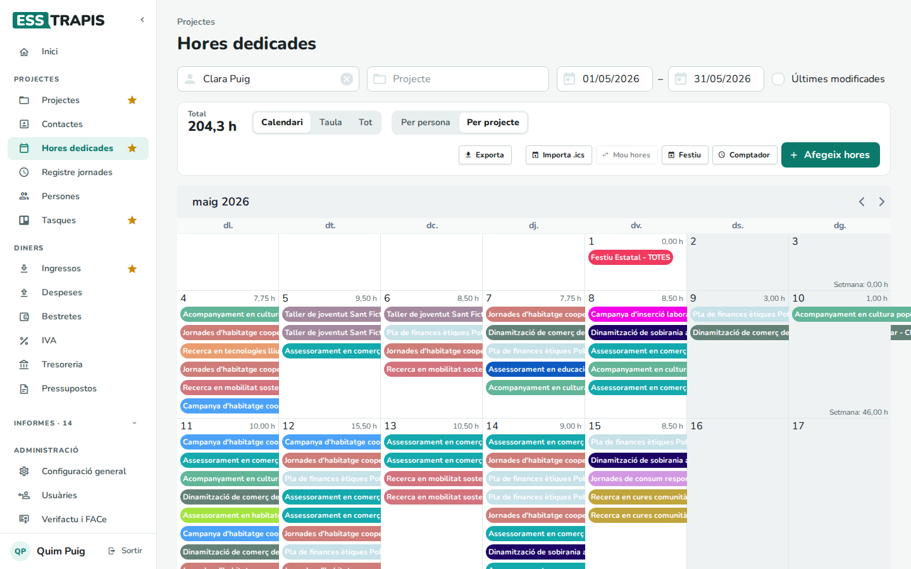
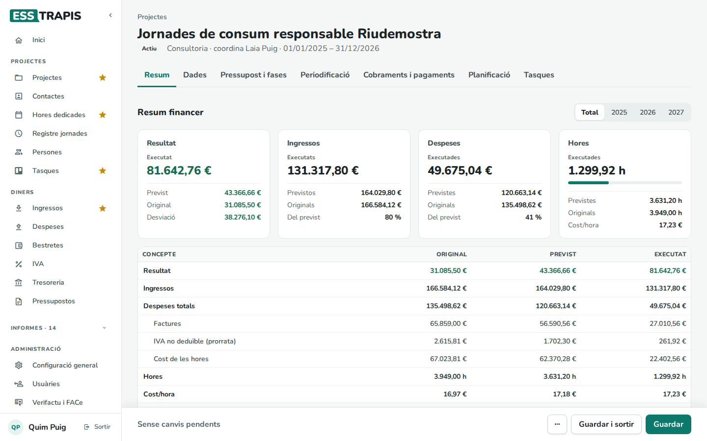
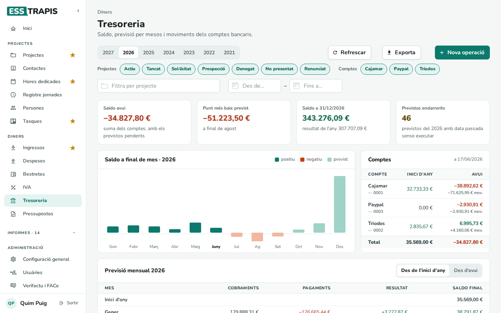
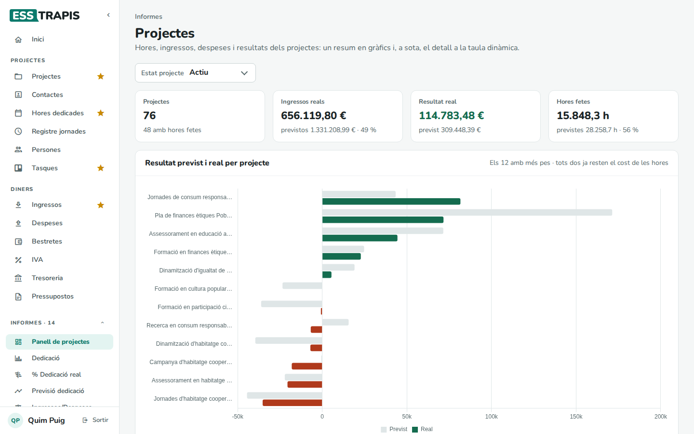

# 00. Què és ESSTRAPIS

> Permís necessari: cap

ESSTRAPIS és una aplicació web de gestió pensada per a cooperatives i entitats de l'economia social i
solidària. Reuneix en un sol lloc la gestió de **projectes**, les **hores** que hi dedica cada persona,
els **diners** que entren i surten (factures, bestretes, IVA, tresoreria) i, per a les entitats que en fan,
la **logística** de comandes i repartiment.

L'objectiu és saber, en tot moment, si cada projecte va com es va pressupostar: quant s'havia previst
ingressar, gastar i dedicar-hi, i quant s'ha ingressat, gastat i dedicat de debò.


## Per a qui és

- **Persones sòcies i treballadores**: imputen les hores que dediquen a cada projecte, fitxen la jornada,
  porten les seves tasques i consulten el seu saldo d'hores.
- **Coordinació de projectes**: crea els projectes, en fa el pressupost per fases, en segueix la
  planificació, les tasques i el resultat.
- **Administració i finances**: emet i registra factures, controla l'IVA, les bestretes i la tresoreria, i
  prepara les justificacions de subvencions.
- **Logística** (només en algunes entitats): proveïdors que entren comandes, l'equip que les reparteix i
  l'equip que les gestiona i factura.

Cada persona veu al menú només les seccions que li permeten els seus permisos (vegeu el capítol
[02. Usuaris, rols i permisos](02-usuaris-rols-permisos.md)).

## La pantalla

- A l'esquerra hi ha el **menú**, agrupat per blocs. La fletxa **‹** de dalt el plega i deixa només les
  icones, per guanyar espai.
- A dalt de cada pantalla hi ha el bloc on és (per exemple, *Projectes* o *Diners*), el **títol** i, a la
  dreta, els botons principals (**Nou projecte**, **Exporta**…). A sota, els **filtres**.
- Al peu del menú hi ha el nom de la persona que ha entrat: clicant-lo s'obre **El meu compte** (dades
  personals, canvi de clau de pas i l'**Aparença**: **Clar**, **Fosc** o **Com el sistema**). Al costat hi
  ha **Sortir**.
- El número al costat de **Tasques** compta les tasques vençudes de la persona i les novetats (tasques
  noves o canviades) des de l'última vegada que va obrir la pantalla. És vermell si n'hi ha de vençudes.

## Les grans àrees

| Bloc del menú | Per a què serveix |
|---|---|
| **Projectes** | Projectes, contactes (clients i proveïdors), hores dedicades, registre de jornades, persones i tasques. |
| **Diners** | Ingressos (factures emeses), despeses (factures rebudes), bestretes, IVA, tresoreria i pressupostos. |
| **Logística**, **Rutes i punts**, **Estadístiques** | Només per a les entitats amb logística: comandes, dipòsits, incidències, punts d'entrega i de consum, rutes i la seva facturació. |
| **Informes** | Panell de projectes, dedicació, ingressos i despeses, preu hora, previsió econòmica i de facturació, estratègies, intercooperació, saldo i hores anuals, justificacions i subvencions. El número indica quants n'hi ha; el bloc es desplega clicant-lo. |
| **Administració** | Configuració general de l'entitat, usuàries, Verifactu i FACe, i les taules auxiliars (estats, tipus, sèries, comptes bancaris…). |
| **Altres** | Registre de canvis de l'aplicació, importar i exportar dades, connexió amb Contasol, Verifactu i tiquets de suport. També es desplega clicant-lo. |




## Com encaixen les peces

Tot gira al voltant del **projecte**:

```
                          ┌───────────── Contactes (clients, proveïdors)
                          │
Pressupostos ─► PROJECTE ─┼── Fases ──┬── Ingressos previstos ──► Factures emeses ──┐
                          │           ├── Despeses previstes ───► Factures rebudes ─┼──► Tresoreria, IVA
                          │           └── Hores previstes                           │
                          │                                                         │
                          ├── Hores dedicades (persones × cost/hora) ──► Bestretes ─┘
                          ├── Tasques i planificació (Gantt)
                          └── Subvencions ──► Justificacions
```

1. Un **projecte** té un client (o més), unes dates, una persona que el coordina, un àmbit i un estat (els
   estats i els àmbits els defineix cada entitat a **Administració › Taules auxiliars**).
2. El projecte es divideix en **fases**. A cada fase s'hi preveuen **ingressos**, **despeses** i
   **hores** de les persones que hi treballaran.
3. Quan es factura, la **factura emesa** es lliga a l'ingrés previst de la fase; quan arriba una factura
   d'un proveïdor, la **factura rebuda** es lliga a la despesa prevista. Així es veu què s'ha complert del
   pressupost.
4. Cada persona **imputa les hores** que dedica al projecte. Com que cada persona té un **cost per hora**
   (definit a la seva jornada laboral), les hores també són un cost del projecte.
5. Amb tot això, ESSTRAPIS calcula el **resultat** de cada projecte (ingressos − despeses − cost de les
   hores) i alimenta la **tresoreria** (quins cobraments i pagaments hi haurà i quan) i l'**IVA**.

Cada projecte s'obre en una pàgina amb pestanyes: **Resum**, **Dades**, **Pressupost i fases**,
**Periodificació**, **Cobraments i pagaments**, **Planificació** i **Tasques**. Els canvis no es desen
sols: la barra de baix diu si n'hi ha de pendents i té els botons **Guardar** i **Guardar i sortir** (vegeu
[04. Crear i editar un projecte](04-crear-editar-projecte.md)).






## Tres maneres de mirar un projecte: original, previst i executat

Aquesta idea apareix a moltes pantalles i informes:

- **Original**: el pressupost tal com es va aprovar al principi. Serveix de referència: no canvia quan
  s'actualitza el previst.
- **Previst**: el pressupost actualitzat. Es pot anar modificant a mesura que el projecte avança (més
  hores, una despesa nova, un ingrés que es retarda…).
- **Executat** (o real): el que ha passat de debò: factures emeses i rebudes i hores imputades.

A la pestanya **Resum** de cada projecte, cada targeta (**Resultat**, **Ingressos**, **Despeses**,
**Hores**) mostra en gran l'executat i, a sota, el previst i l'original. La taula de sota posa les tres
columnes, **Original**, **Previst** i **Executat**, costat per costat. Els botons de dalt a la dreta
(**Total** o un any) limiten les xifres a un any concret.

Comparar-les respon preguntes com: «Hem dedicat més hores de les que vam pressupostar?» o «Aquest any
tancarem el projecte amb benefici?».

## Què més pot fer

- **Pressupostos** i factures proforma per a clients, vinculats al projecte, amb el seu PDF.
- **Facturació electrònica**: registre de factures a **Verifactu** i enviament a l'administració pública
  per **FACe**.
- **Subvencions**: imports per any, cofinançament i preparació de les **justificacions** amb nòmines i
  factures.
- **Informes**: el **Panell de projectes** resumeix en xifres i gràfics tots els projectes d'un estat, i a
  sota té la **taula dinàmica**, que es pot reorganitzar, filtrar, desar com a vista i exportar a Excel.

  
- **Logística**: des de l'entrada d'una comanda fins al repartiment, les incidències i la facturació a les
  sòcies.
- **Mòbil**: totes les pantalles s'adapten al mòbil; és pràctic sobretot per imputar hores, fitxar i
  portar les tasques.

## Vegeu també

- [Glossari](00-glossari.md)
- [01. Primers passos](01-primers-passos.md)
- [Índex del manual](README.md)
