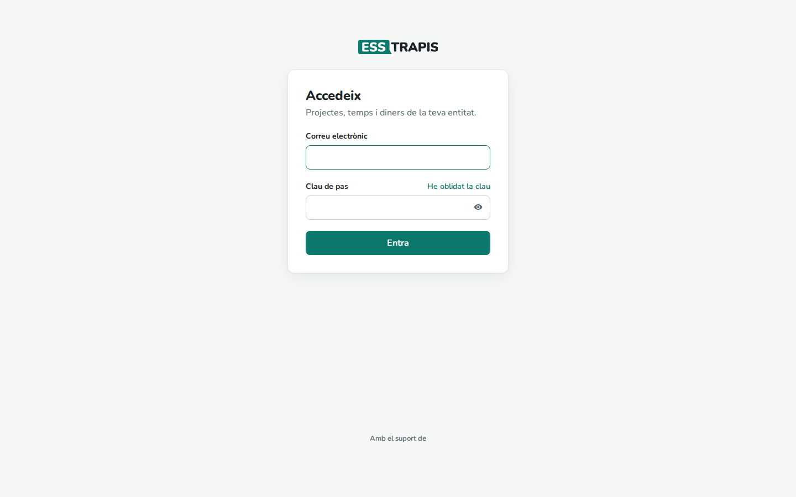
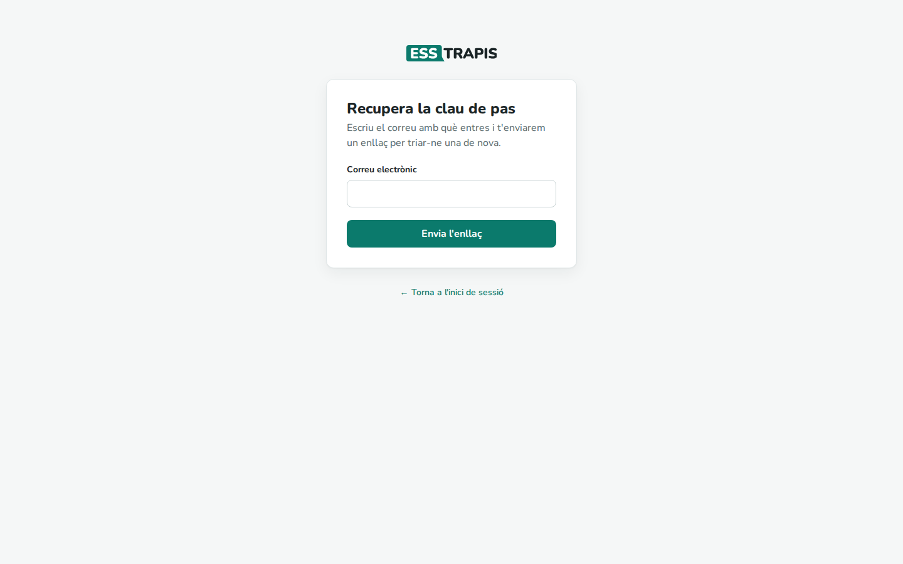
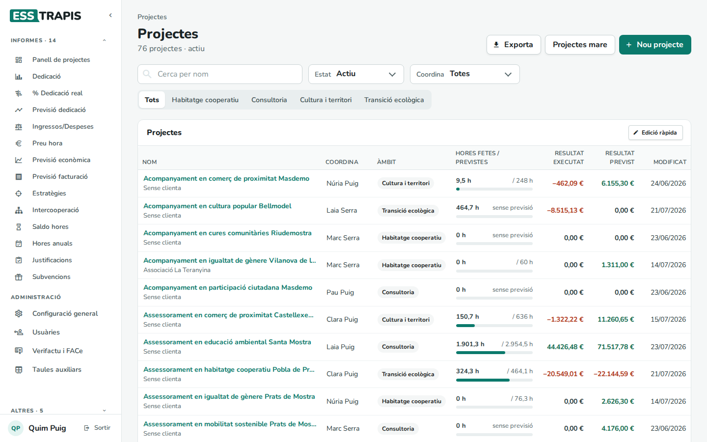
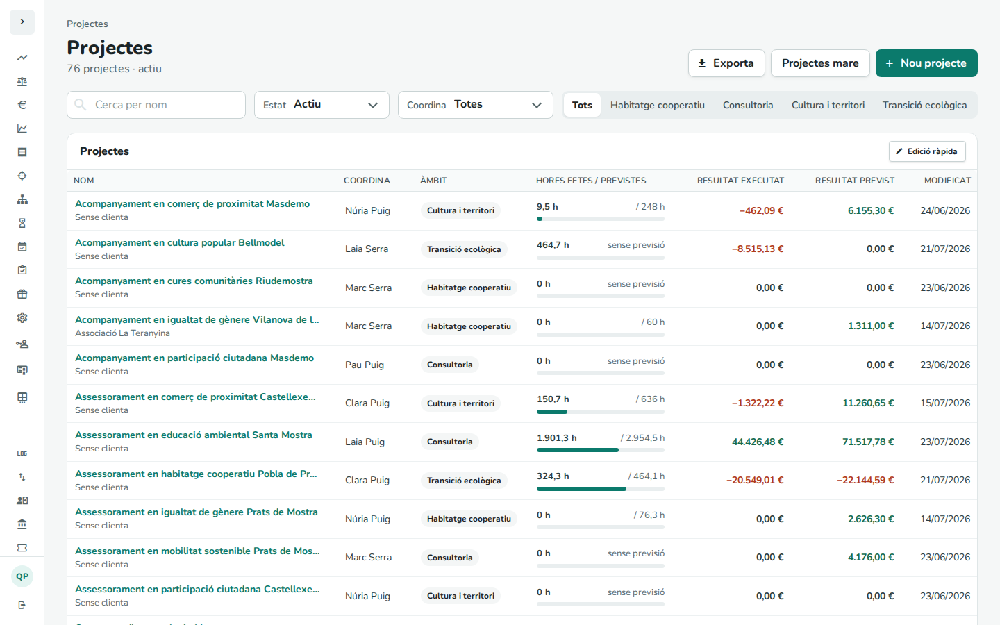
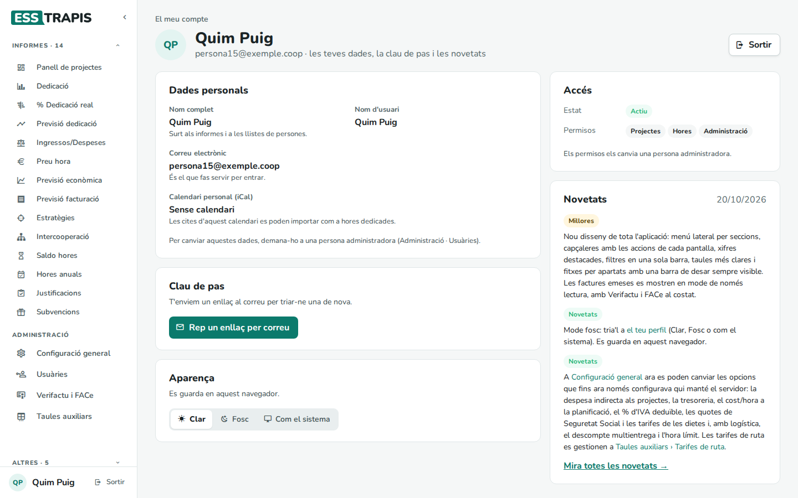
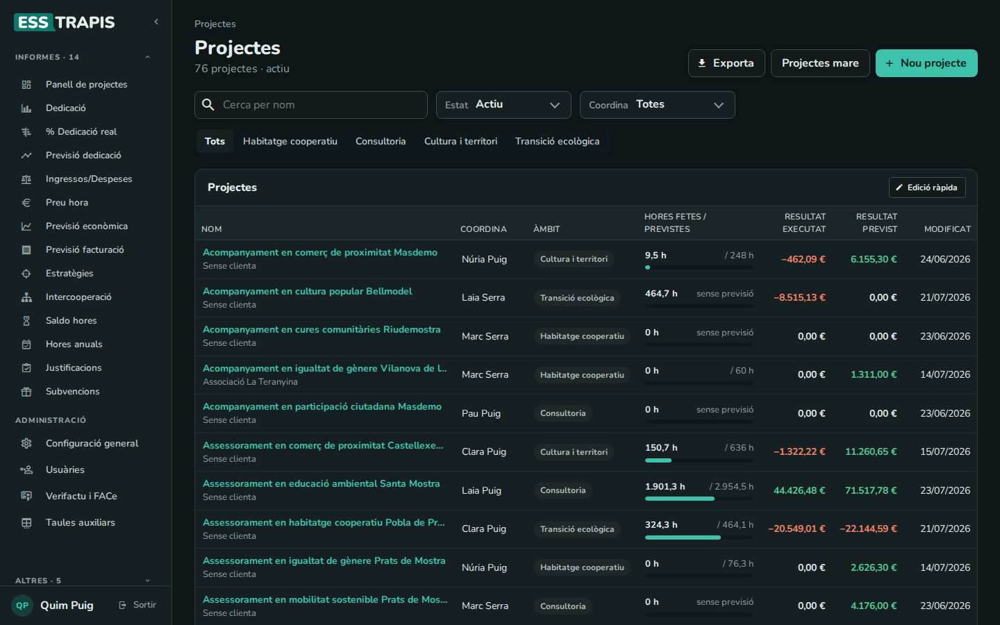
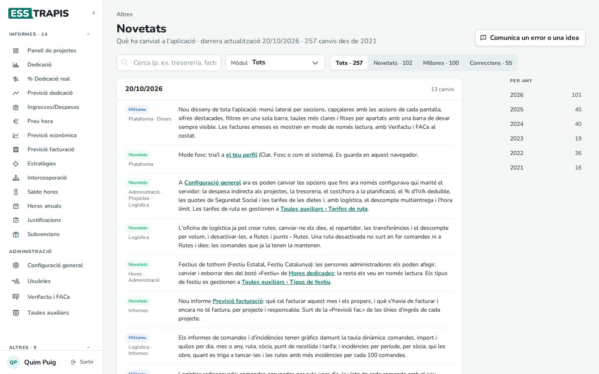

# 01. Primers passos

> Permís necessari: cap

Aquest capítol explica com s'entra a ESSTRAPIS, com es mou per l'aplicació i què hi ha a **El meu compte**.

## Entrar

ESSTRAPIS funciona al navegador: cada entitat té la seva adreça. A la pantalla **Accedeix** s'escriu el
**Correu electrònic** i la **Clau de pas**, i **Entra**. L'ull del costat de la clau la mostra o l'amaga.

En entrar, l'aplicació obre **Inici**, la pàgina amb els accessos que cada persona tria. Allà mateix es pot
triar que, en comptes d'Inici, obri una altra pantalla (vegeu [37. La pàgina d'inici](37-pagina-inici.md)).

### He oblidat la clau

**He oblidat la clau** obre **Recupera la clau de pas**: s'escriu el correu i l'aplicació hi envia un enllaç per
triar-ne una de nova. Si no arriba, **Torna-ho a enviar** (i mireu la carpeta de correu brossa).

## La pantalla

### El menú

A l'esquerra, primer **Inici** i després les pantalles agrupades per blocs (**Projectes**, **Diners**, **Informes**, **Administració**, **Altres**; i a les
entitats amb logística, els seus blocs). Cada persona veu només el que li permeten els seus permisos (vegeu
[02. Usuaris, rols i permisos](02-usuaris-rols-permisos.md)).

- **Informes** i **Altres** surten plegats, amb el nombre de pantalles que tenen (*Informes · 14*). Clicant el
  títol es despleguen; quan s'és en una de les seves pantalles, es despleguen sols.

  
- La fletxa **‹** de dalt plega el menú i deixa només les icones, per guanyar espai; la fletxa **›** el torna a
  obrir. Passant el ratolí per una icona se'n veu el nom.

  
- Una estrella a la dreta marca les pantalles fixades a l'inici. Es fixen i es treuen a Inici, no al menú
  (vegeu [37. La pàgina d'inici](37-pagina-inici.md)).
- Al costat de **Tasques**, un número avisa de les tasques vençudes i les novetats.
- Al peu, el nom de la persona (obre **El meu compte**) i **Sortir**.

### Cada pantalla

A dalt hi ha el bloc on s'és, el **títol**, una línia de resum i, a la dreta, els botons principals (**Nou…**,
**Exporta**…). A sota, la barra de **filtres**. Als formularis llargs (un projecte, una factura), la barra de baix
diu si hi ha canvis sense desar i té els botons **Guardar**.

Al mòbil, el menú s'obre amb el botó de dalt i les taules s'adapten a la pantalla.

## El meu compte

Clicant el nom al peu del menú.

- **Dades personals**: nom complet, nom d'usuari, correu i calendari personal (iCal). Per canviar-les cal
  demanar-ho a una persona administradora.
- **Clau de pas**: **Rep un enllaç per correu** per canviar-la.
- **Aparença**: **Clar**, **Fosc** o **Com el sistema** (segueix la configuració de l'ordinador). Es guarda en
  aquest navegador.

  
- **Accés**: l'estat del compte i els permisos.
- **Novetats**: els últims canvis de l'aplicació, amb l'enllaç a totes.

## Novetats

**Altres › Registre de canvis** mostra què ha canviat a l'aplicació, del més nou al més antic: **Novetats**,
**Millores** i **Correccions**, amb el mòdul de cada canvi. Es pot cercar, filtrar per mòdul i tipus, i saltar a
un any. **Comunica un error o una idea** obre el lloc de tiquets per explicar un problema o fer una proposta.

## Documentació

**Altres › Documentació** és a l'abast de tothom. **Obre el manual** obre aquest manual en una pestanya nova,
ja identificat i amb els capítols que corresponen als permisos de cada persona. S'hi pot cercar i, des de
cada capítol, saltar als relacionats.

## Preguntes freqüents

**No puc entrar.** Comproveu el correu i la clau (les majúscules compten). Si el compte està **bloquejat**, cal
parlar amb una persona administradora.

**No veig una pantalla que veu una companya.** Els permisos són diferents. Vegeu el capítol 02.

## Vegeu també

- [00. Què és ESSTRAPIS](00-que-es-esstrapis.md)
- [02. Usuaris, rols i permisos](02-usuaris-rols-permisos.md)
- [37. La pàgina d'inici](37-pagina-inici.md)
