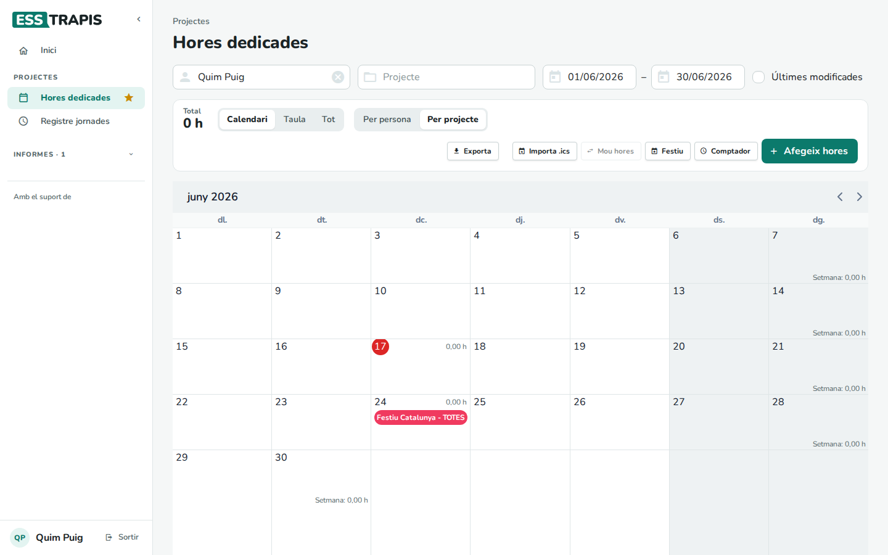
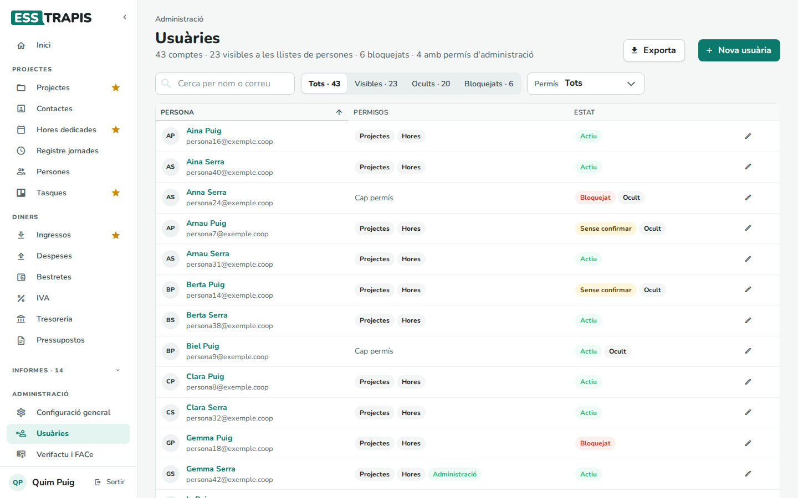
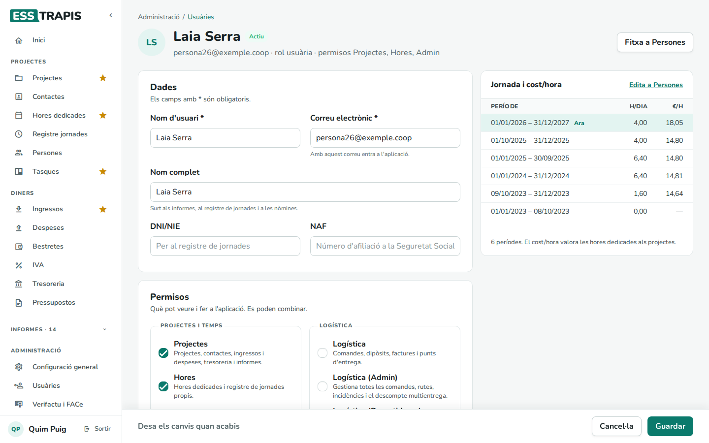
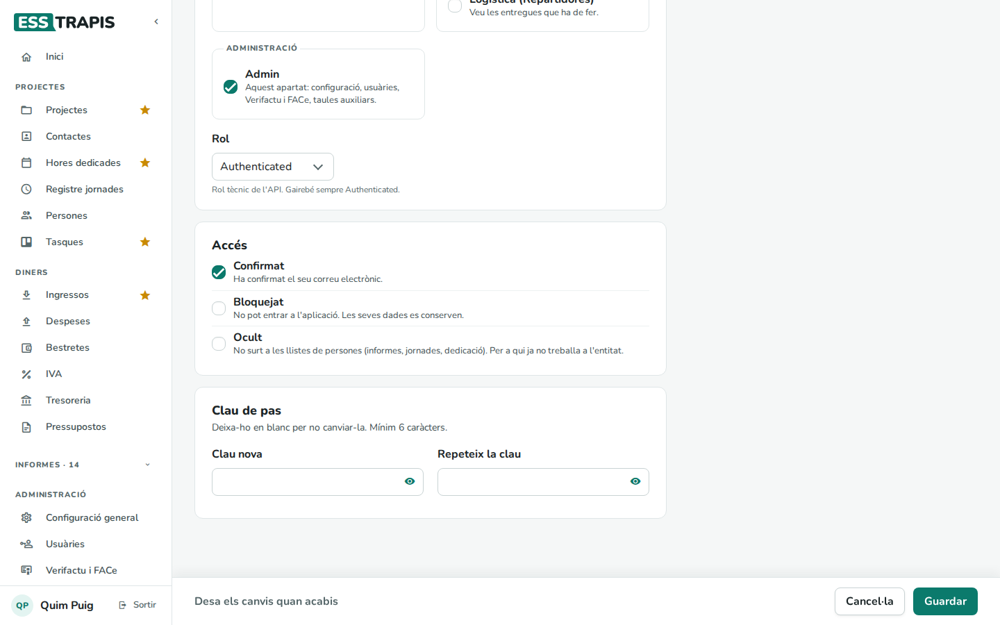

# 02. Usuàries, rols i permisos

> Permís necessari: `admin`

Cada persona que entra a ESSTRAPIS té un compte d'**usuària** amb uns **permisos**, que decideixen què veu al
menú i què pot fer. Les usuàries són també les **persones** de l'equip: les que imputen hores, coordinen
projectes i cobren bestretes. Es gestionen a **Administració › Usuàries**.

## Els permisos

| Permís | Què permet |
|---|---|
| **Projectes** (`projects`) | Projectes, contactes, ingressos i despeses, tresoreria i informes. És el permís de qui gestiona. |
| **Hores** (`hours`) | Hores dedicades i registre de jornades propis. |
| **Logística** (`orders`) | Comandes, dipòsits, factures i punts d'entrega (per a les entitats amb logística). |
| **Logística (Admin)** (`orders_admin`) | Gestiona totes les comandes, rutes, incidències i el descompte multientrega. |
| **Logística (Repartidores)** (`orders_delivery`) | Veu les entregues que ha de fer. |
| **Admin** (`admin`) | El bloc **Administració**: configuració, usuàries, Verifactu i FACe, taules auxiliars. |

Els permisos es combinen: una persona sòcia que gestiona projectes i imputa hores té **Projectes** i **Hores**.
A cada capítol d'aquest manual, a dalt, s'indica el permís que cal.

Per exemple, una persona amb només **Hores** veu un menú molt més curt: les seves hores, el registre de
jornada i l'informe de dedicació.

## La llista d'usuàries

- **Cerca per nom o correu**, els botons **Tots**, **Visibles**, **Ocults** i **Bloquejats**, i el filtre per
  **Permís**.
- Cada fila mostra la persona, els seus permisos i l'**Estat** (**Actiu**, **Sense confirmar**, **Bloquejat**,
  **Ocult**). El llapis obre la fitxa.
- **Exporta** i **Nova usuària**.

## La fitxa d'una usuària

- **Dades**: **Nom d'usuari** *, **Correu electrònic** * (amb el que entra), **Nom complet** (el que surt als
  informes, al registre de jornada i a les nòmines), **DNI/NIE** i **NAF** (número d'afiliació a la Seguretat
  Social, per al registre de jornada).
- **Permisos**: les caselles de la taula d'abans. El **Rol** és tècnic i gairebé sempre és *Authenticated*.
- **Logística**: **Descompte multientrega** (només a les entitats amb logística).
- **Accés**:
  - **Confirmat**: ha confirmat el seu correu.
  - **Bloquejat**: no pot entrar a l'aplicació; les seves dades es conserven.
  - **Ocult**: no surt a les llistes de persones (informes, jornades, dedicació, **Coordina**). Per a qui ja no
    treballa a l'entitat.
- **Clau de pas**: el recomanat és **Envia-li l'enllaç per canviar la clau**: li arriba un correu i la tria ella
  mateixa, sense que ningú més la conegui. També se li pot posar una de nova a mà (no és recomanable: cal fer-l'hi
  arribar per un canal segur). En blanc, no es canvia. Quan se li canvia, se li tanquen les sessions obertes.
- **Jornada i cost/hora**: els seus períodes de jornada, que s'editen a **Persones** (vegeu
  [15](15-persones-jornades.md)).

Després, **Guardar**.

## Pas a pas: donar d'alta una persona nova

1. **Nova usuària**: nom d'usuari, correu, nom complet i permisos. **Guardar**.
2. L'aplicació pregunta com tindrà la clau: **Envia-li l'enllaç** (recomanat: li arriba un correu per triar-la) o
   **La poso jo**.
3. A **Persones**, definir-li la jornada i el salari (vegeu [15](15-persones-jornades.md)).
4. La persona entra amb el seu correu i la clau que ha triat. Si l'enllaç ha caducat, fa **He oblidat la clau**.

## La clau de pas: mínim de seguretat

El mateix per a totes les entitats:

- **10 caràcters** com a mínim. Millor una frase de tres o quatre paraules (*cavall bateria grapa*) que una paraula
  amb números: no cal majúscules ni símbols.
- No pot ser una **clau comuna** (*barcelona2026*, *contrasenya123*, *qwertyuiop*...).
- No pot contenir el **correu**, el **nom** de la persona ni el de l'**entitat**. Un correu compartit
  (*hola@*, *info@*, *comandes@*) no compta, però el nom del domini sí (*areliabio* de hola@areliabio.com).

Les claus d'abans continuen funcionant. Qui entra amb una que no compleix el mínim veu un avís que li recomana
canviar-la i li ofereix l'enllaç per correu.

## Quan una persona marxa

No s'esborra (les seves hores i nòmines han de quedar): es marca **Bloquejat** perquè no pugui entrar i **Ocult**
perquè no surti a les llistes, i es tanca el seu període de jornada a **Persones**.

## Vegeu també

- [01. Primers passos](01-primers-passos.md)
- [15. Persones i jornades laborals](15-persones-jornades.md)
