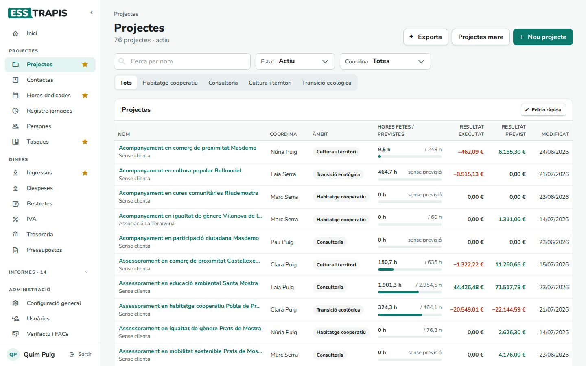
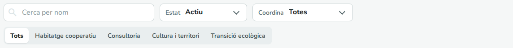
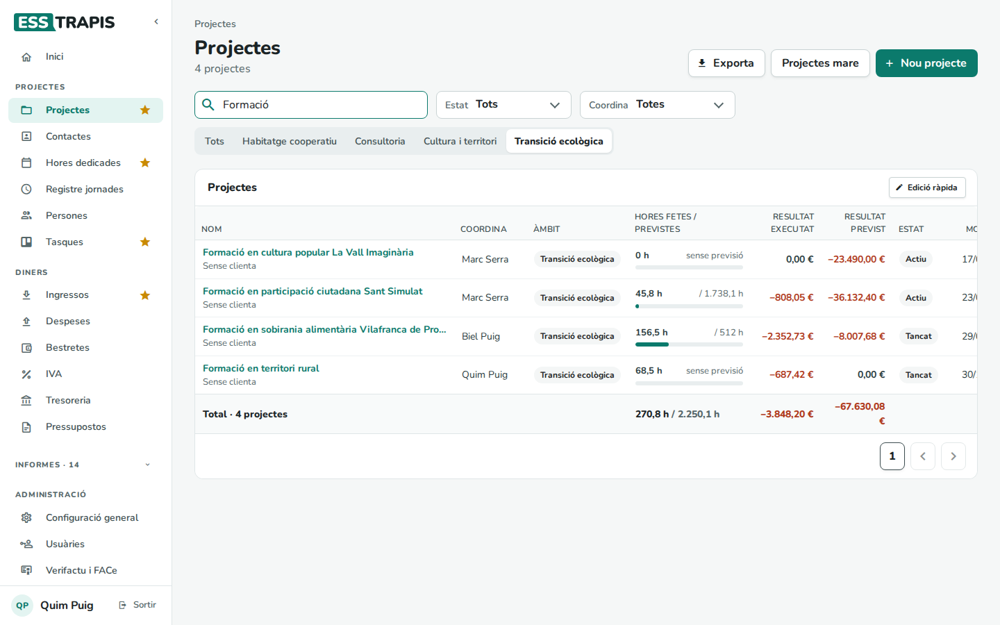
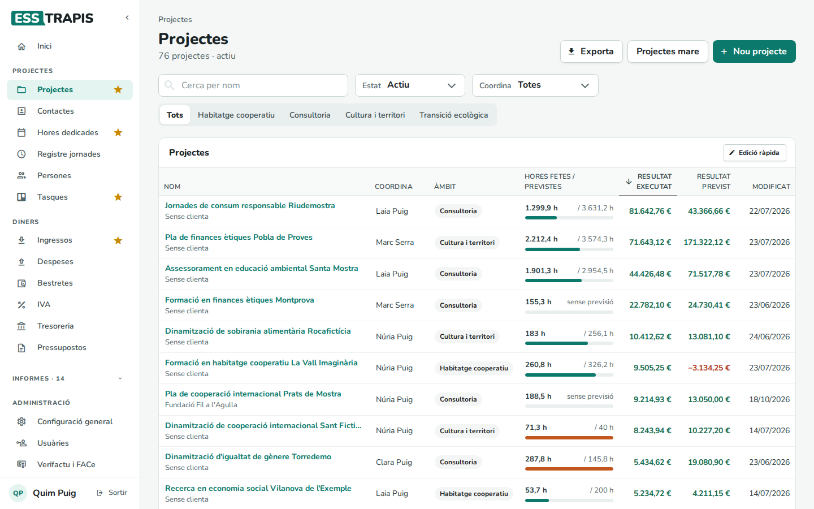
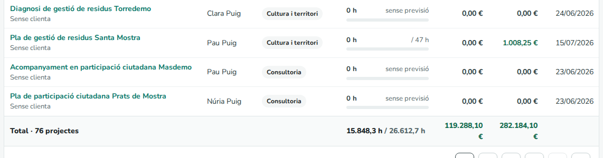
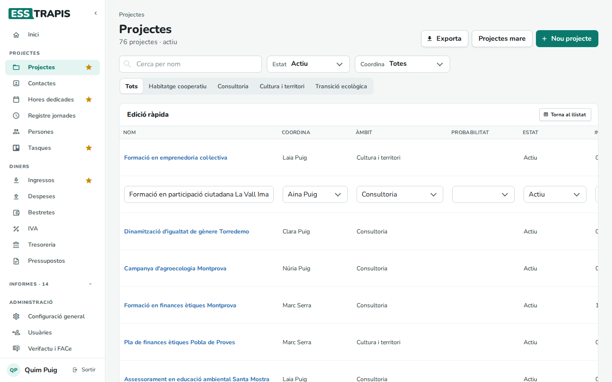

# 03. Llistat de projectes

> Permís necessari: `projects`

La pantalla **Projectes** (al menú, **Projectes › Projectes**) mostra tots els projectes d'un estat (per
defecte, els actius) amb qui els coordina, les hores fetes i previstes i el resultat. Des d'aquí es busca
un projecte, s'obre, se'n crea un de nou o se'n canvien unes quantes dades de cop.

## Abans de començar

- Cal el permís **Projectes** (`projects`). Una persona que només té el permís d'hores entra directament
  a **Hores dedicades**.
- Els **estats** (Actiu, Tancat, Sol·licitat…) i els **àmbits** de projecte són propis de cada entitat i es
  configuren a **Administració › Taules auxiliars** (vegeu [35. Taules auxiliars](35-taules-auxiliars.md)).

## La pantalla

Sota el títol es veu quants projectes hi ha a la llista i de quin estat (per exemple, *76 projectes ·
actiu*). Els botons de dalt a la dreta són:

- **Exporta**: descarrega un full de càlcul amb els projectes de la llista tal com està filtrada.
- **Projectes mare**: canvia a la llista de projectes mare (vegeu
  [06. Projectes mare i fills](06-projectes-mare-fills.md)). L'aplicació ho recorda: mentre no es torni
  enrere amb **Tots els projectes**, el menú **Projectes** obrirà la llista de projectes mare.
- **Nou projecte**: obre l'assistent per crear-ne un (vegeu
  [04. Crear i editar un projecte](04-crear-editar-projecte.md)).

Clicant el nom d'un projecte s'obre la seva fitxa.

### Columnes

| Columna | Què mostra |
|---|---|
| **Nom** | El nom del projecte i, a sota, la primera clienta (o *Sense clienta*). |
| **Coordina** | La persona que el coordina. |
| **Àmbit** | L'àmbit del projecte. |
| **Hores fetes / previstes** | Les hores imputades fins ara i les previstes. La barra mostra el percentatge fet; es torna **taronja** quan se n'han fet més de les previstes. Si el projecte no té hores previstes, hi diu *sense previsió*. |
| **Resultat executat** | Ingressos − despeses − cost de les hores del que ja ha passat (factures i hores imputades). En verd si és positiu, en vermell si és negatiu. |
| **Resultat previst** | El mateix, però amb el pressupost actualitzat (vegeu [Original, previst i executat](00-que-es-esstrapis.md#tres-maneres-de-mirar-un-projecte-original-previst-i-executat)). |
| **Estat** | Només surt quan el filtre d'estat és **Tots**. |
| **Modificat** | L'última data en què es va desar el projecte. Passant-hi el ratolí es veu també l'hora. |

## Pas a pas

### 1. Buscar i filtrar

- **Cerca per nom**: escrivint una part del nom, la llista es filtra al cap d'un moment.
- **Estat**: un estat concret o **Tots**.
- **Coordina**: només els projectes que coordina una persona, o **Totes**.
- Els botons d'àmbit (**Tots** i un per a cada àmbit): només els projectes d'aquell àmbit.

Els filtres se sumen. Per exemple, els projectes de qualsevol estat, de l'àmbit *Transició ecològica*, amb *Formació* al
nom:

### 2. Ordenar

Clicant el títol d'una columna, la llista s'ordena per aquella columna; un segon clic l'ordena a
l'inrevés. Una fletxa al costat del títol indica l'ordre. Per exemple, per **Resultat executat** de més
gran a més petit:

### 3. Els totals

Al final de la llista hi ha la fila **Total**, amb el nombre de projectes, la suma d'hores fetes i
previstes i la suma dels resultats de **tots** els projectes filtrats (no només els de la pàgina que es
veu). La llista es mostra de 25 en 25; els botons de baix canvien de pàgina.

### 4. Edició ràpida

Per canviar unes quantes dades de molts projectes sense obrir-los un per un, el botó **Edició ràpida**
canvia la taula: hi surten **Nom**, **Coordina**, **Àmbit**, **Probabilitat**, **Estat**, **Inici**,
**Final**, **Tipus**, **Estructura** i **Subvencionable**.

1. Clicar el llapis verd de la fila: els seus camps es tornen editables.
2. Fer els canvis.
3. Clicar el mateix botó, que ara és un disquet, per desar-los. Surt l'avís **Guardat**.

Mentre una fila està oberta, les altres no es poden editar. La paperera vermella esborra el projecte,
després de demanar-ne confirmació. **Torna al llistat** torna a la taula normal.

La taula és ampla: per veure les últimes columnes i els botons cal desplaçar-la cap a la dreta.

## Preguntes freqüents

**No trobo un projecte que sé que existeix.** Segurament el filtre **Estat** és *Actiu* i el projecte
està tancat o en un altre estat. Cal posar **Tots**. Mireu també que no hi hagi un àmbit o una persona
triats.

**En clicar Projectes al menú surten els projectes mare.** Es va clicar **Projectes mare** i l'aplicació
ho recorda. Per tornar a la llista normal, cal clicar **Tots els projectes**.

**El resultat d'un projecte no quadra amb el que veig dins seu.** Els totals es recalculen en segon pla
uns minuts després de cada canvi. Si dins del projecte hi ha l'avís *Els totals del projecte s'estan
actualitzant*, cal esperar una estona i tornar a carregar.

## Vegeu també

- [04. Crear i editar un projecte](04-crear-editar-projecte.md)
- [05. Fases i pressupost del projecte](05-fases-pressupost.md)
- [06. Projectes mare i fills](06-projectes-mare-fills.md)
- [25. Informes de projectes i econòmics](25-informes-projectes-economics.md) (el Panell de projectes)
