# 04. Crear i editar un projecte

> Permís necessari: `projects`

Un projecte nou es crea amb un assistent de quatre passos: les dades bàsiques, el pressupost per fases, la
planificació de les hores i la confirmació. Un cop creat, el projecte s'obre en una pàgina amb pestanyes
on es pot consultar i canviar tot. Aquest capítol explica l'assistent, la pestanya **Dades** i com es
desen, es dupliquen i s'esborren els projectes. Les fases i el pressupost tenen el seu capítol:
[05. Fases i pressupost del projecte](05-fases-pressupost.md).

## Abans de començar

- Cal el permís **Projectes** (`projects`).
- Els desplegables (estats, àmbits, tipus de projecte, àmbits territorials, probabilitats, estratègies,
  tipus d'ingrés i de despesa) s'omplen a **Administració › Taules auxiliars** (vegeu
  [35. Taules auxiliars](35-taules-auxiliars.md)).
- Els clients i les entitats d'intercooperació són **contactes** (vegeu [11. Contactes](11-contactes.md)).
  Si encara no hi són, es poden crear des del mateix formulari.
- A **Coordina** hi surten totes les usuàries que no estan marcades com a **Ocult** a **Administració ›
  Usuàries**.

## Crear un projecte pas a pas

A la pantalla **Projectes**, el botó **Nou projecte** obre l'assistent. A dalt es veuen els quatre passos;
el que està fet porta una marca. A baix hi ha la barra amb el pas on s'és i els botons **Enrere** i
**Continuar**.

Cada vegada que es fa **Continuar**, el projecte es desa. Si es tanca la pàgina a mig fer, el projecte ja
surt a la llista i, en obrir-lo, l'assistent continua al mateix pas.

### Pas 1. Dades bàsiques

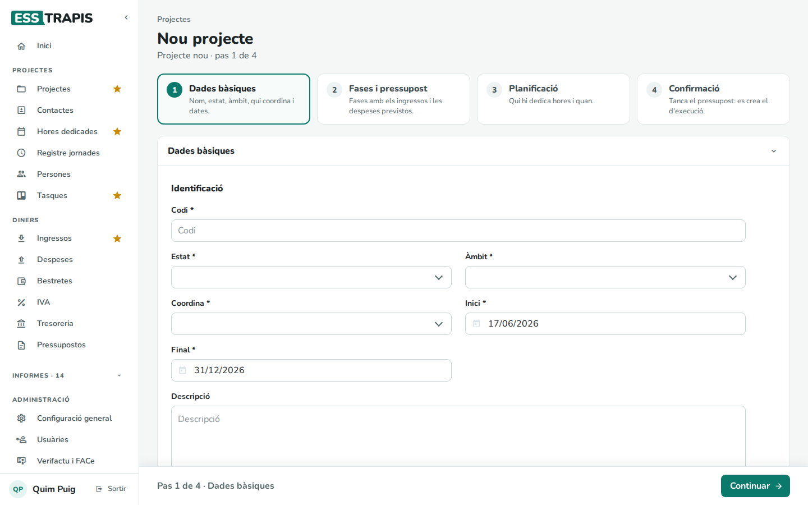

Són obligatoris (*) el **Codi** (el nom del projecte), l'**Estat**, l'**Àmbit**, qui el **Coordina** i les
dates d'**Inici** i **Final**. L'aplicació proposa com a dates avui i el 31 de desembre, i com a
coordinadora la persona que l'està creant (si surt a la llista). La **Descripció** és opcional.

El botó **Més dades (opcionals)** desplega la resta de camps de la pestanya **Dades**: tipus, clients,
propòsit, notes internes, estratègies, subvencions… Es poden omplir ara o més endavant (vegeu
[La pestanya Dades](#la-pestanya-dades)).

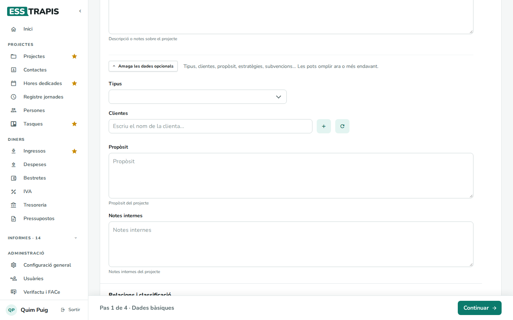

Si falta algun camp obligatori, **Continuar** avisa: *Omple els camps obligatoris (\*): codi, estat, àmbit,
qui coordina i dates.*

### Pas 2. Fases i pressupost

Aquí es fa el **pressupost original**: el projecte es divideix en **fases** i a cada fase s'hi posen les
línies d'**ingressos** i de **despeses** previstes.

1. A **Nova Fase**, escriure el nom de la fase i clicar el **+** de la dreta.
2. Al bloc **Ingressos** de la fase, el botó **+** (*Afegeix una línia*) afegeix una línia. Cal triar el
   **Tipus** (per exemple, *Factura serveis 21%* o *Subvenció pública*), escriure el **Concepte**, la
   **Quantitat** i el **Preu**; el **Total** es calcula sol. **Previsió fac.** i **Previsió pag.** són
   les dates en què es preveu facturar i cobrar. L'**IVA** es proposa segons el tipus.
3. El mateix al bloc **Despeses**.

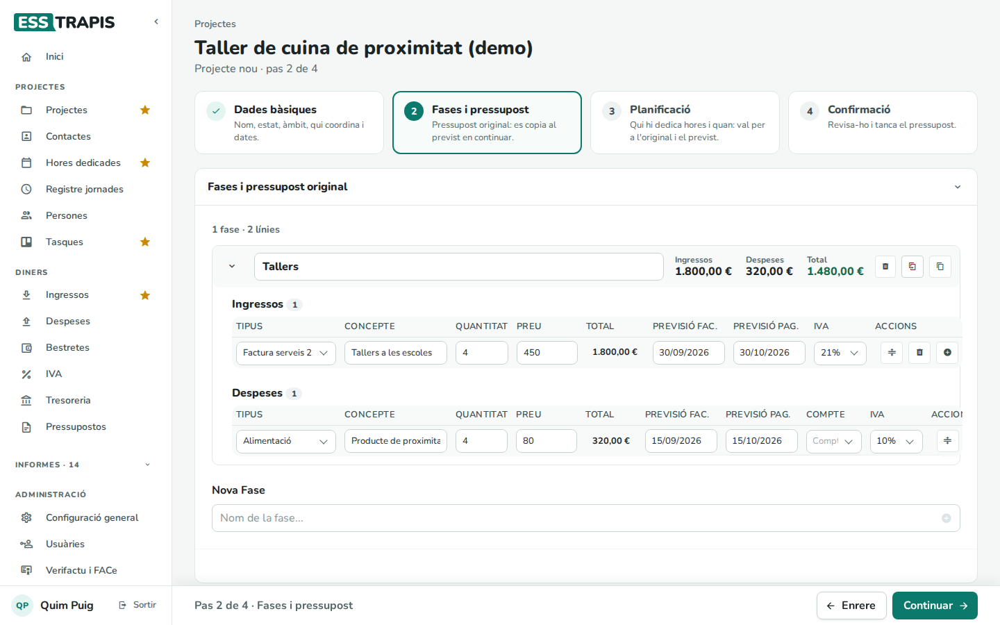

A la capçalera de cada fase es veuen els seus totals (**Ingressos**, **Despeses** i **Total**). Cal com a
mínim una fase per continuar. El detall de les fases i les línies és al capítol
[05. Fases i pressupost del projecte](05-fases-pressupost.md).

### Pas 3. Planificació

La **planificació original** diu qui hi dedicarà hores i quan. És un diagrama de Gantt amb una fila per
a cada fase i línia d'ingrés.

1. Arrossegar el ratolí sobre la fila d'una línia, des del mes en què comença la feina fins al mes en què
   acaba.
2. S'obre la finestra **Planificació**: les **Hores** (en total, per setmana o per mes), la **Persona** que
   les farà (el **Cost/hora** s'omple sol amb el de la seva jornada laboral) i una **Descripció**.
3. **D'acord**.

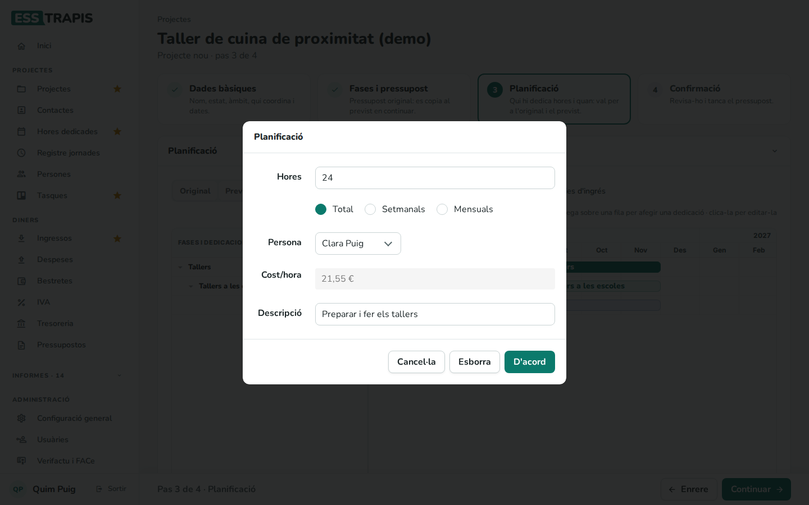

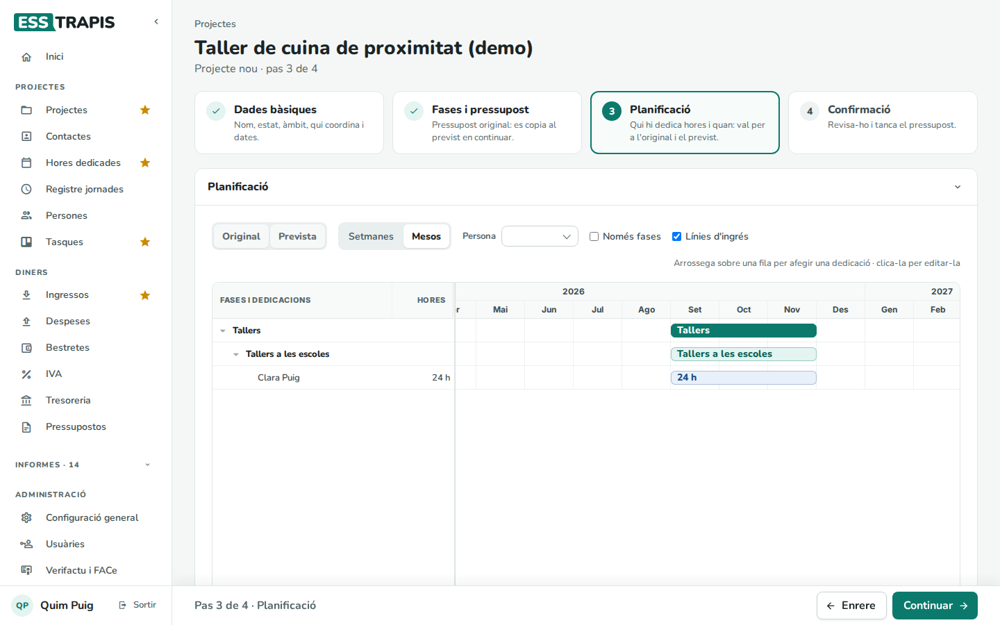

Clicant una barra ja feta es torna a obrir la finestra per canviar-la o esborrar-la (**Esborra**). Si
la planificació queda fora de les dates del projecte, surt l'avís *Atenció, planificació fora del període
del projecte*. Vegeu [09. Planificació (Gantt)](09-planificacio-gantt.md).

Aquest pas és opcional: es pot continuar sense planificar cap hora.

### Pas 4. Confirmació

Es veu el **Resum financer** del pressupost original: resultat, ingressos, despeses (incloent-hi el cost de
les hores planificades) i hores.

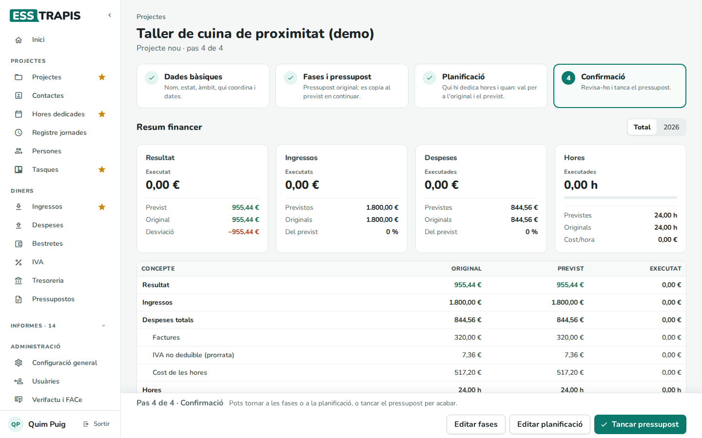

- **Editar fases** i **Editar planificació** tornen als passos 2 i 3.
- **Tancar pressupost** acaba l'assistent. El pressupost original queda com a referència i se'n fa
  una còpia, el **pressupost d'execució** (el *previst*), que és el que s'anirà actualitzant mentre el
  projecte avança.

Després de tancar el pressupost, el projecte s'obre amb les seves pestanyes. Original i previst són iguals
fins que es canviï alguna cosa del previst.

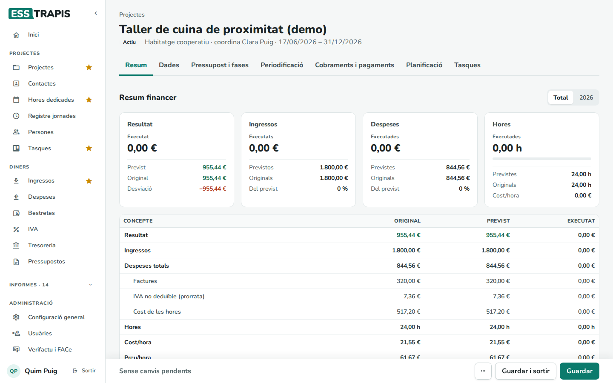

## La pàgina d'un projecte

Clicant un projecte a la llista s'obre la seva pàgina. A dalt hi ha el nom, l'estat, l'àmbit, qui el
coordina i les dates, i a sota les pestanyes:

| Pestanya | Què hi ha |
|---|---|
| **Resum** | El resum financer: resultat, ingressos, despeses i hores, original, previst i executat, en total o per any. |
| **Dades** | Les dades generals del projecte (vegeu més avall). |
| **Pressupost i fases** | Les fases i les línies del pressupost original i del d'execució. Vegeu [05](05-fases-pressupost.md). |
| **Periodificació** | El repartiment dels ingressos i les despeses entre anys. Vegeu [05](05-fases-pressupost.md). |
| **Cobraments i pagaments** | Les factures i els moviments lligats al projecte. |
| **Planificació** | El Gantt original i previst. Vegeu [09](09-planificacio-gantt.md). |
| **Tasques** | Les tasques del projecte. Vegeu [10. Tasques](10-tasques.md). |

L'adreça de la pàgina recorda la pestanya oberta: es pot copiar i enviar a una altra persona.

Si alguna línia del pressupost no té data, a dalt de tot surt un avís groc amb la llista de línies:
aquests imports surten com a *Sense data* a les previsions, la periodificació i la tresoreria. Cal posar-los
data a **Pressupost i fases**.

## La pestanya Dades

La pestanya està dividida en blocs.

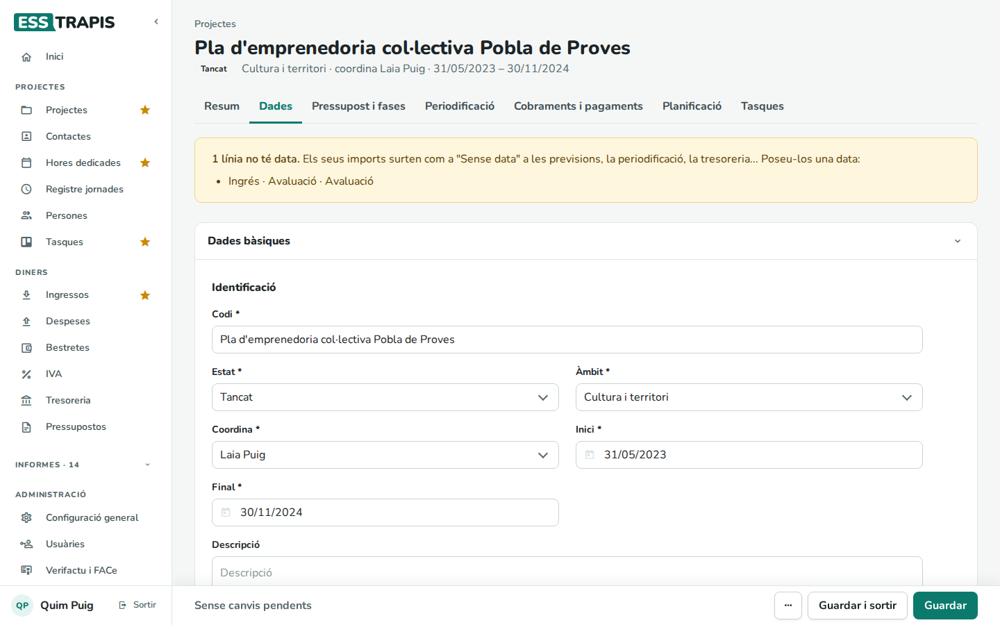

**Identificació**

| Camp | Què vol dir |
|---|---|
| **Codi** * | El nom del projecte. Ha de ser únic. |
| **Estat** * | Actiu, Tancat, Sol·licitat… (els defineix l'entitat). |
| **Àmbit** * | L'àrea de l'entitat a què pertany. |
| **Coordina** * | La persona responsable. |
| **Inici** *, **Final** * | Les dates del projecte. |
| **Descripció** | Descripció o notes sobre el projecte. |
| **Tipus** | El tipus de projecte. |
| **Clientes** | Un o més clients. S'escriu una part del nom i es tria de la llista. El **+** crea un contacte nou i la fletxa rodona torna a carregar la llista (després de crear-ne un en una altra pestanya). Cada client surt com una etiqueta; la creu el treu. |
| **Propòsit** | Per a què és el projecte. |
| **Notes internes** | Notes només per a l'equip. |

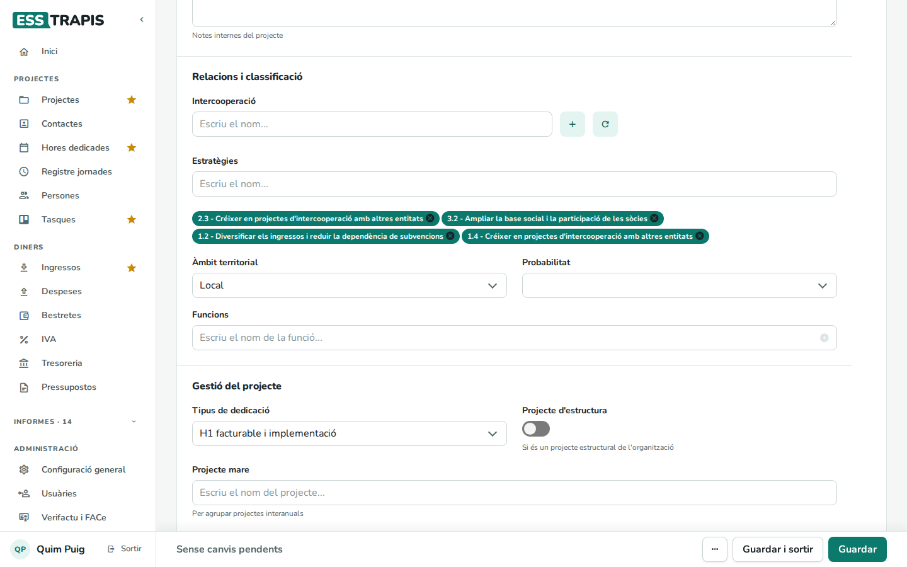

**Relacions i classificació**

| Camp | Què vol dir |
|---|---|
| **Intercooperació** | Les entitats amb què es col·labora en el projecte (contactes). Alimenta l'informe d'intercooperació. |
| **Estratègies** | Les línies estratègiques de l'entitat a què contribueix el projecte. Alimenta l'informe d'estratègies. |
| **Àmbit territorial** | Local, comarcal, nacional… |
| **Probabilitat** | Per als projectes encara no aprovats, la probabilitat que tiri endavant. |
| **Funcions** | Els tipus d'activitat del projecte (per exemple, coordinació o disseny). Les hores i les tasques es poden classificar per funció. |

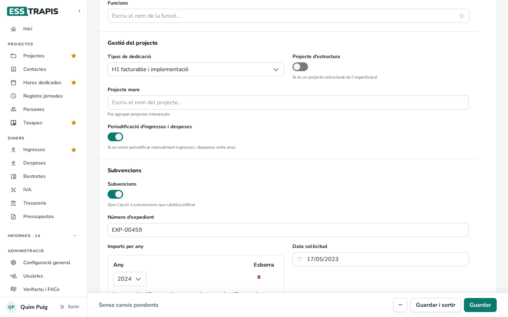

**Gestió del projecte**

| Camp | Què vol dir |
|---|---|
| **Tipus de dedicació** | El tipus de dedicació que es proposa quan algú imputa hores a aquest projecte. |
| **Projecte d'estructura** | Marcat si el projecte recull les despeses i les hores generals de l'entitat (gestió, local, administració) i no és un projecte per a cap client. |
| **Despesa Indirecta (%)** | Percentatge de despeses d'estructura que s'aplica al projecte. Només surt si l'entitat té activada aquesta opció (**Administració › Configuració general › Projectes**). |
| **Projecte mare** | El projecte que agrupa aquest (per exemple, el mateix servei any rere any). Vegeu [06. Projectes mare i fills](06-projectes-mare-fills.md). Si el projecte ja és mare d'altres, aquí es veuen els seus **Projectes fills**. |
| **Periodificació d'ingressos i despeses** | Activa el repartiment manual dels ingressos i les despeses entre anys a la pestanya **Periodificació**. |

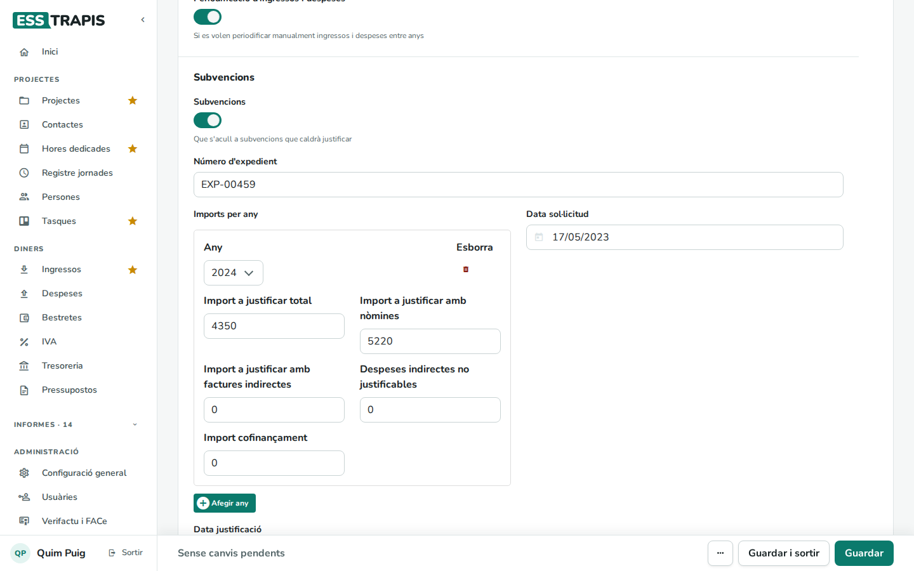

**Subvencions** — en activar **Subvencions** (el projecte s'acull a una subvenció que caldrà
justificar) apareixen:

| Camp | Què vol dir |
|---|---|
| **Número d'expedient** | El número de l'expedient de la subvenció. |
| **Imports per any** | Amb **Afegir any**, un bloc per a cada any amb l'**Import a justificar total**, la part a justificar **amb nòmines**, la part **amb factures indirectes**, les **Despeses indirectes no justificables** (la part de la subvenció per a despeses indirectes que no cal justificar amb documents) i l'**Import cofinançament**. |
| **Data sol·licitud**, **Data justificació** | Quan es va demanar i quan s'ha de justificar. |
| **Necessita agrupada** | Si la subvenció es demana en agrupació amb altres entitats. Llavors cal indicar l'**Entitat líder** i els imports de cada entitat. |

Vegeu [07. Subvencions i justificacions](07-subvencions-justificacions.md).

**Documents** — per adjuntar documents al projecte (per exemple, el pressupost total o la resolució de la
subvenció): arrossegar-los a la zona puntejada o clicar-hi. Vegeu
[08. Documents del projecte](08-documents-projecte.md).

## Desar els canvis

Els canvis no es desen sols. La barra de baix, que és la mateixa a totes les pestanyes, diu **Sense canvis
pendents** o, amb un punt taronja, **Canvis sense desar**.

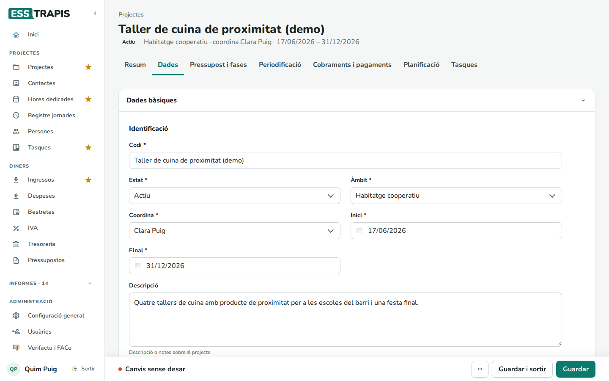

- **Guardar** desa i es queda a la pàgina. Surt l'avís **Guardat**.
- **Guardar i sortir** desa i torna a la llista de projectes.

Si es vol anar a una altra pantalla amb canvis sense desar, l'aplicació ho pregunta: **Surt sense desar** marxa
i perd els canvis; **Continua editant** es queda a la pàgina.

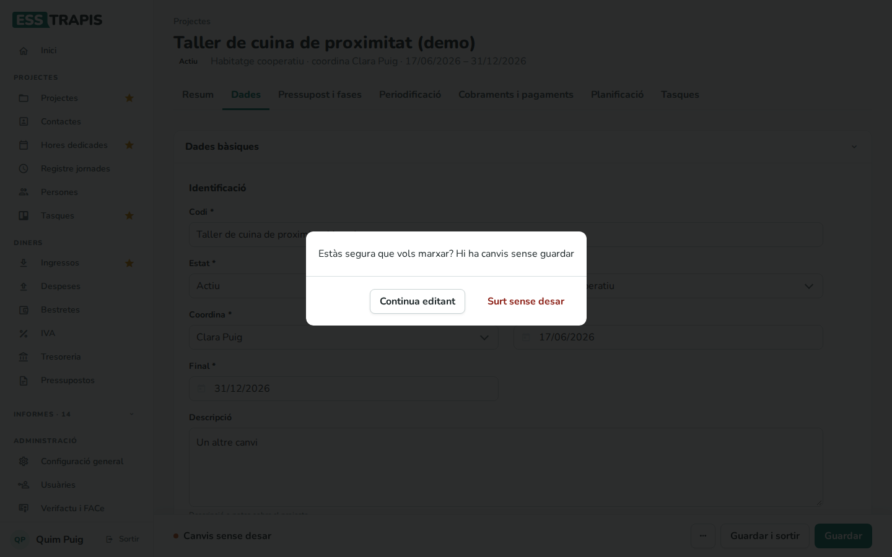

Després de desar, els totals del projecte (resultat, hores, cost) es recalculen en segon pla. Mentre dura,
a la pestanya **Resum** pot sortir l'avís *Els totals del projecte s'estan actualitzant en un procés
extern*; cal tornar a carregar el projecte al cap d'una estona.

## Duplicar i esborrar

El botó **···** de la barra de baix (*Més accions*) té **Duplicar projecte** i **Esborrar projecte**.

**Duplicar projecte** és útil per repetir un projecte (per exemple, el mateix servei l'any següent). La
còpia porta el nom seguit de «(còpia)», totes les fases originals i d'execució, tots els ingressos i
despeses previstos i totes les hores planificades. No es copien els documents adjunts, les factures ni les
justificacions. Cal triar què es fa amb les dates: **Mou totes les dates un any endavant** o **Mantén les
dates originals**.

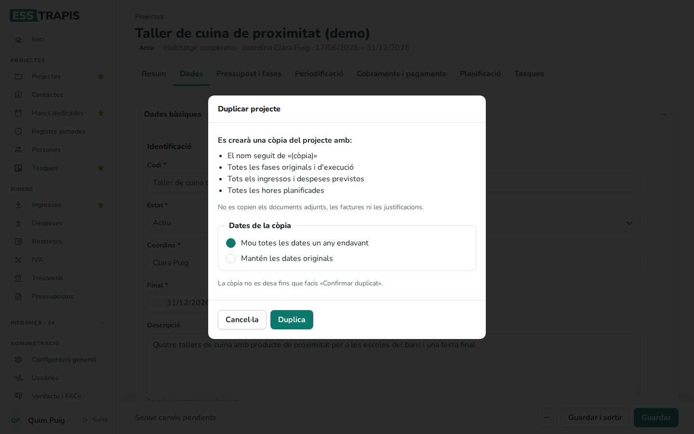

En clicar **Duplica**, la còpia s'obre per revisar-la (canviar-ne el nom, ajustar-ne les fases…), però
encara no està desada: la barra de baix diu *Còpia sense desar*. **Confirmar duplicat** la desa com a
projecte nou; **Cancel·lar** la descarta.

**Esborrar projecte** demana confirmació i el treu de totes les llistes.

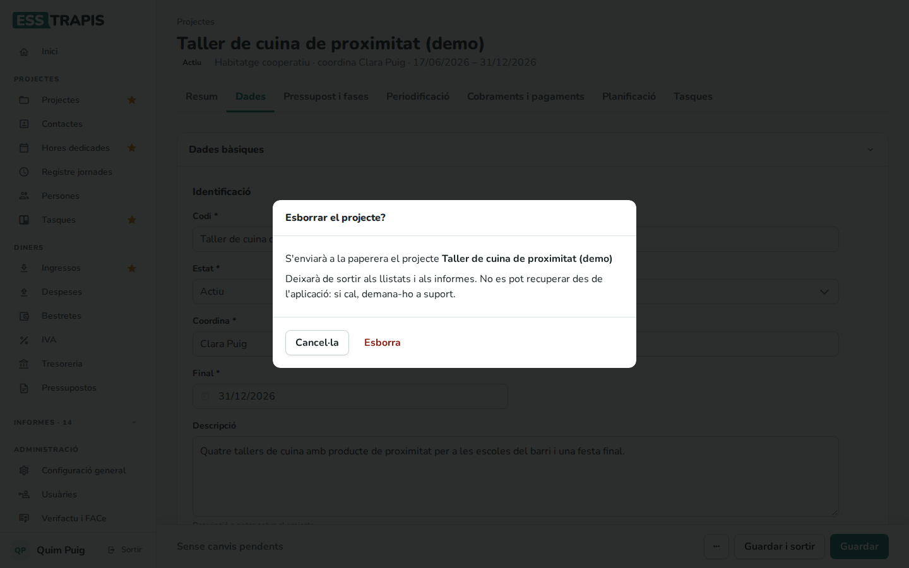

Abans d'esborrar un projecte, valoreu si no és millor posar-lo en estat **Tancat** o **Renunciat**: així se'n
conserva l'històric als informes.

## Preguntes freqüents

**En fer Continuar o Guardar surt «Error: This attribute must be unique».** Ja hi ha un altre projecte amb
el mateix **Codi**. Cal canviar-lo; fixeu-vos també en els projectes tancats (filtre **Estat › Tots** de la
llista).

**No trobo la persona que vull a Coordina.** Les usuàries marcades com a **Ocult** no hi surten. Cal
revisar-ne la fitxa a **Administració › Usuàries**.

**He tancat el navegador a mig assistent.** El projecte es va desar a cada pas. Obriu-lo des de la llista
i l'assistent continuarà al pas on era.

**Vull canviar el pressupost després de crear el projecte.** Es canvia el pressupost d'execució (previst) a
la pestanya **Pressupost i fases**. L'original queda com a referència. Vegeu
[05. Fases i pressupost del projecte](05-fases-pressupost.md).

## Vegeu també

- [03. Llistat de projectes](03-llistat-projectes.md)
- [05. Fases i pressupost del projecte](05-fases-pressupost.md)
- [06. Projectes mare i fills](06-projectes-mare-fills.md)
- [09. Planificació (Gantt)](09-planificacio-gantt.md)
- [11. Contactes](11-contactes.md)
