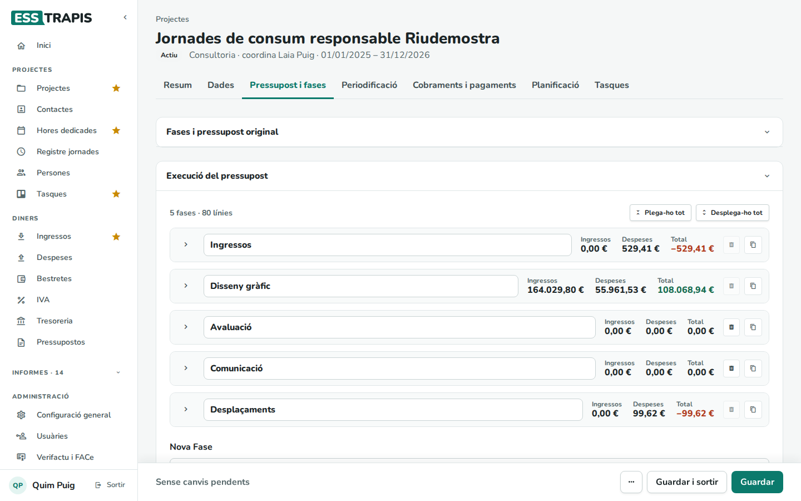
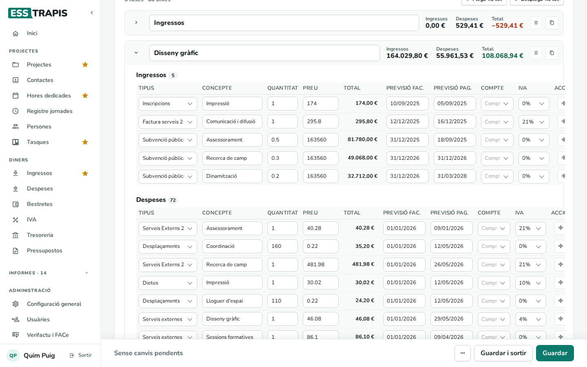
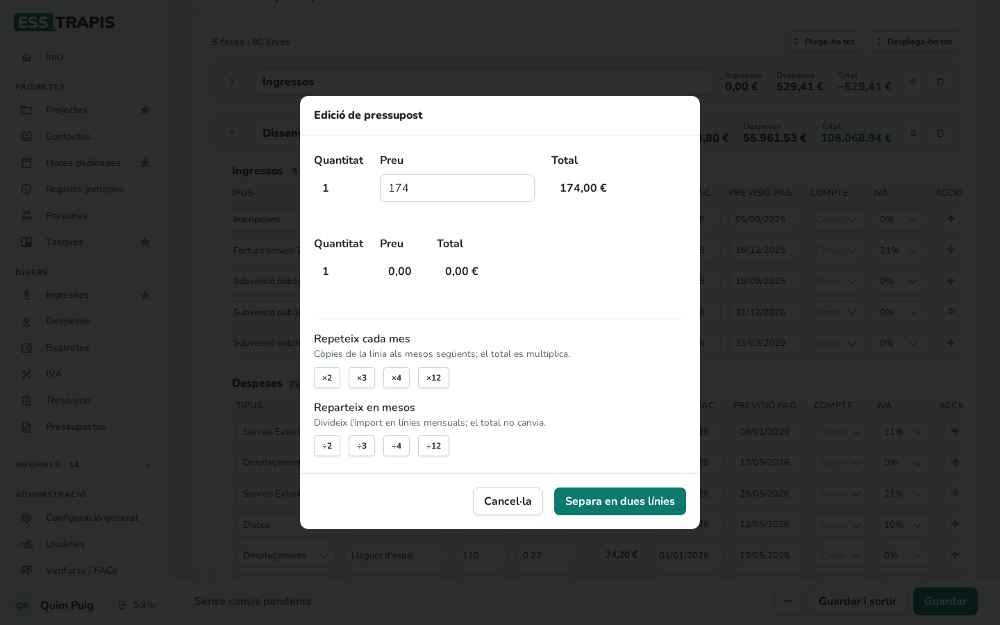
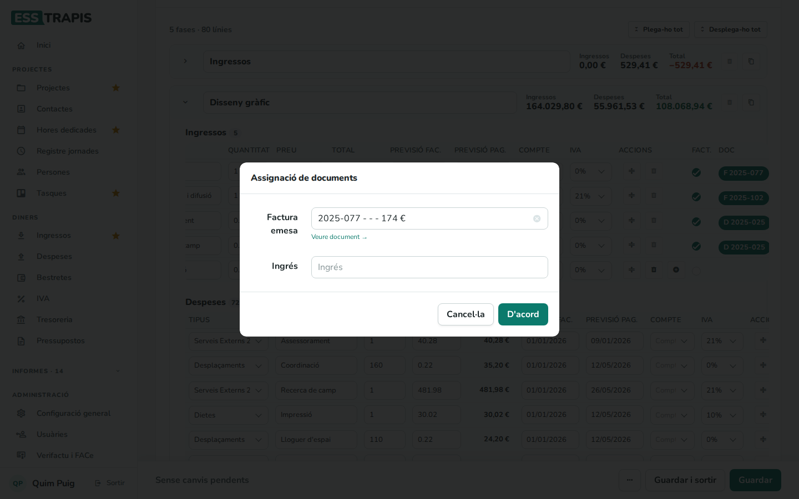
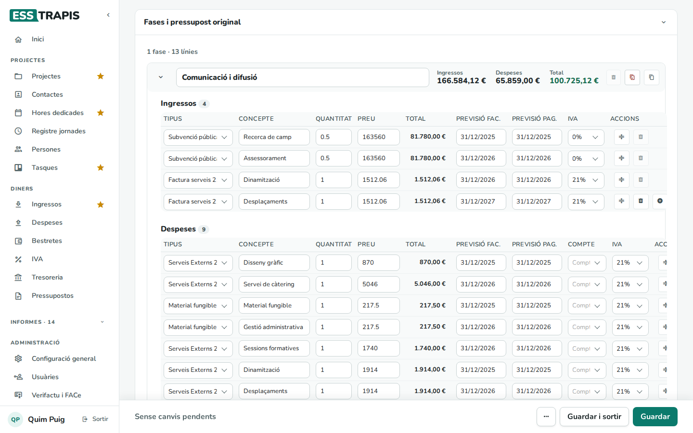
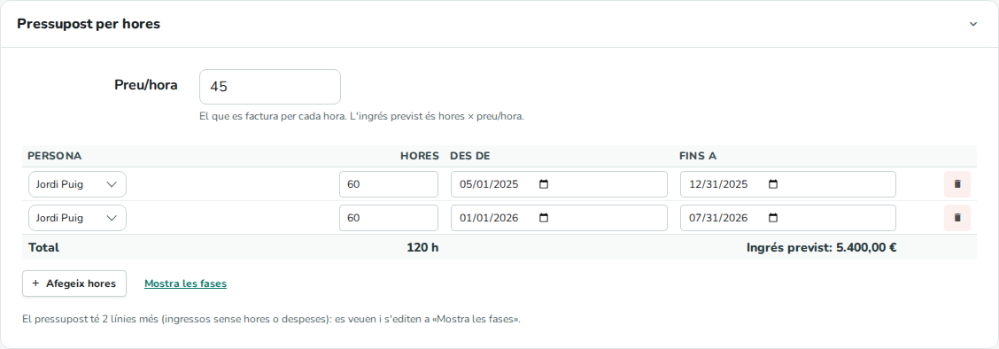
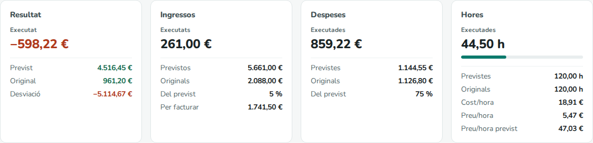
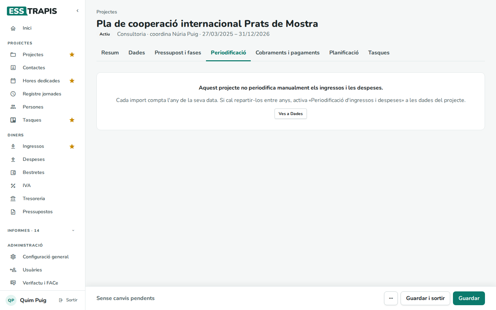
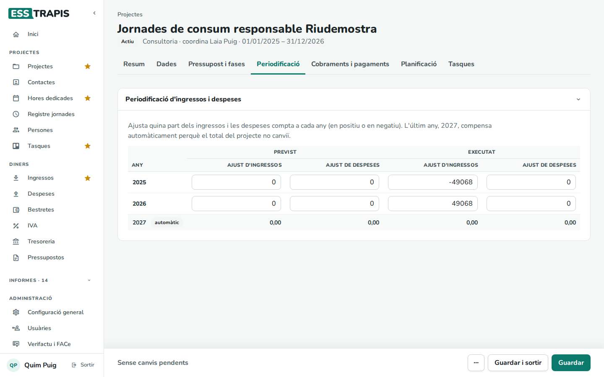

# 05. Fases i pressupost del projecte

> Permís necessari: `projects`

El pressupost d'un projecte es fa per **fases** (parts del projecte), i cada fase té línies d'**ingressos**
i de **despeses** previstes. Cada projecte té dos pressupostos: l'**original**, el que es va aprovar, i el
d'**execució**, que es va actualitzant mentre el projecte avança. Aquest capítol explica la pestanya
**Pressupost i fases**, com és el pressupost d'un projecte facturat per hores i la pestanya
**Periodificació**.

## Abans de començar

- El pressupost original es fa en crear el projecte (vegeu
  [04. Crear i editar un projecte](04-crear-editar-projecte.md#pas-2-fases-i-pressupost)) i el
  d'execució n'és la còpia que es fa en continuar des d'aquell pas, amb les hores planificades.
- Les línies noves porten com a **Previsió fac.** i **Previsió pag.** la data final del projecte; es poden
  canviar.
- Els **tipus d'ingrés** i **de despesa** (amb l'IVA que proposen) i els **comptes bancaris** es configuren
  a **Administració › Taules auxiliars**.
- Les hores previstes no són línies del pressupost: es planifiquen a la pestanya **Planificació** (vegeu
  [09. Planificació (Gantt)](09-planificacio-gantt.md)) i el seu cost s'hi suma.

## La pestanya Pressupost i fases

Hi ha dos blocs:

- **Fases i pressupost original**: plegat per defecte. Es desplega amb la fletxa de la dreta.
- **Execució del pressupost**: el pressupost actualitzat, el que compta com a *previst* a tot arreu.

A dalt de cada bloc es veu quantes fases i línies hi ha. **Plega-ho tot** deixa només la capçalera de cada
fase, amb els seus totals (**Ingressos**, **Despeses** i **Total**); **Desplega-ho tot** les obre totes. La
fletxa de l'esquerra de cada fase la plega o la desplega.

### Les línies

| Columna | Què vol dir |
|---|---|
| **Tipus** | El tipus d'ingrés (factura de serveis, subvenció, inscripcions…) o de despesa (serveis externs, desplaçaments, dietes…). |
| **Concepte** | Descripció de la línia. |
| **Quantitat**, **Preu** | Unitats (hores, quilòmetres, sessions…) i preu de cada unitat, sense IVA. |
| **Total** | Quantitat × preu. |
| **Previsió fac.** | Quan es preveu fer la factura. Decideix a quin any compta la línia (si no en té, compta la previsió de pagament). |
| **Previsió pag.** | Quan es preveu cobrar-la o pagar-la. És la data que fa servir la tresoreria. |
| **Compte** | El compte bancari on es preveu el cobrament o el pagament (només si l'entitat en té més d'un). |
| **IVA** | El percentatge d'IVA; es proposa segons el tipus. |
| **Accions** | Dividir la línia, esborrar-la i, a l'última, afegir-ne una altra. |
| **Fact.** | Marcat quan la línia ja s'ha facturat (o pagat). |
| **Doc** | El document que la justifica: **F** i el número per a una factura, **D** per a un altre ingrés o despesa, **S** per a una subvenció. |

Les columnes **Fact.** i **Doc** només surten al pressupost d'execució, i si l'entitat té activada la
tresoreria. La taula és ampla: cal desplaçar-la cap a la dreta per veure-les.

**Afegir i treure**

- Una fase nova: escriure'n el nom a **Nova Fase**, a baix de tot, i clicar el **+**.
- Una línia: el **+** de l'última línia de la fase (o el de sota el bloc **Ingressos** o **Despeses** si
  encara no en té cap).
- La paperera d'una línia l'esborra. La paperera de la capçalera esborra la fase sencera; està desactivada
  si la fase té línies ja facturades o hores planificades.
- **Duplica la fase i el pressupost** (a la capçalera) en fa una còpia, amb «(còpia)» al nom. Les línies
  copiades no porten factura.

Recordeu que res no es desa fins que es clica **Guardar** a la barra de baix.

### Dividir una línia

Quan una línia s'ha de facturar en parts (per exemple, una subvenció que es cobra en dos pagaments o una
quota mensual), el botó **Divideix la línia** obre la finestra **Edició de pressupost**:

- **Separa**: la divideix en dues. S'escriu el **Preu** de la primera part i la segona es queda la resta.
- **x2**, **x3**, **x4**, **x12**: repeteix la línia 2, 3, 4 o 12 vegades amb el mateix import, cada una
  un mes més tard que l'anterior.
- **/2**, **/3**, **/4**, **/12**: reparteix l'import en 2, 3, 4 o 12 línies iguals, una per mes.

Es tanca sense canviar res amb la tecla **Esc**.

### Lligar una línia amb la seva factura

Quan es fa la factura d'un ingrés previst (o arriba la d'una despesa), es lliga a la línia. Normalment es
fa des de la mateixa factura (vegeu [17. Factures emeses](17-factures-emeses.md) i
[19. Factures rebudes](19-factures-rebudes.md)); des del pressupost, clicant l'etiqueta de la columna
**Doc** s'obre la finestra **Assignació de documents**, on es tria la **Factura emesa** o l'**Ingrés** (per
a les despeses, la **Factura rebuda**, la **Despesa rebuda** o la **Dieta rebuda**). **Veure document**
obre la factura.

Si l'import de la factura no coincideix amb el de la línia, l'etiqueta porta un avís (*Imports
diferents*).

### El pressupost original

S'hi treballa igual que amb l'execució, però sense factures. És la referència: canviar el pressupost
d'execució no el modifica. Cada fase de l'original té un botó més, **Copia la fase a l'execució**, per
passar-hi una fase que s'hi ha afegit després.

Si un projecte antic té pressupost original però no d'execució, surt el botó **Crear Execució de
Pressupost**, que en fa la còpia.

Als **projectes mare** les fases que es veuen són la suma de les dels projectes fills i no es poden
editar (vegeu [06. Projectes mare i fills](06-projectes-mare-fills.md)).

## Projectes facturats per hores

Hi ha feines que no es pressuposten per fases sinó per hores: es factura el que es treballa a un preu per
hora. És habitual, per exemple, en les cooperatives d'autònomes, on cada sòcia pensa en el preu de la seva
hora més que en el cost. Per a aquests projectes, a la pestanya **Dades** › **Gestió del projecte** es tria
**Facturació** › **Per hores** i s'escriu el **Preu/hora** (vegeu
[04. Crear i editar un projecte](04-crear-editar-projecte.md#la-pestanya-dades)).

| Facturació | Com es fa el pressupost |
|---|---|
| **Per projecte** | Com fins ara: fases amb línies d'ingrés i de despesa, cadascuna amb el seu import. És l'opció de tots els projectes que ja existien. |
| **Per hores** | L'ingrés previst són les hores previstes × el preu/hora del projecte. |

Els projectes nous surten amb l'opció que l'entitat hagi triat a **Administració › Configuració general**
(vegeu [34. Configuració general](34-configuracio-general.md)). Cada projecte la pot canviar.

### El pressupost per hores

En un projecte **Per hores**, la pestanya **Pressupost i fases** no mostra les fases sinó el bloc
**Pressupost per hores**:

- **Preu/hora**: el que es factura per cada hora (el mateix camp de la pestanya **Dades**).
- Una fila per a cada bloc d'hores previstes: la **Persona** que les farà, les **Hores** i les dates
  (**Des de**, **Fins a**). Les hores que es planifiquen al Gantt també surten aquí (vegeu
  [09. Planificació (Gantt)](09-planificacio-gantt.md)). Si al Gantt es van posar per setmana o per mes, a
  sota de les hores es veu *a la setmana* o *al mes* i el total que fan en aquelles dates.
- **Afegeix hores** afegeix una fila amb les dates del projecte. La paperera la treu.
- A baix, el **Total** d'hores i l'**Ingrés previst**.
- **Mostra les fases** obre l'editor de fases de sempre, per als ingressos que no són hores (material, una
  quota fixa…) i les despeses. A sota del bloc es diu quantes d'aquestes línies hi ha.

Per sota, aquest pressupost és el mateix de sempre: les hores van en una línia d'ingrés («Hores») dins d'una
fase («Pressupost»), que es creen soles en afegir la primera fila. Per això es pot passar d'un tipus de
facturació a l'altre sense perdre res.

Quan es crea un projecte **Per hores**, el pas 2 de l'assistent és aquest mateix bloc en lloc de les fases.

### El resum d'un projecte per hores

A la pestanya **Resum**:

- **Ingressos › Previstos** inclou les hores × el preu/hora (a l'exemple, 120 h × 45 € = 5.400 €, més una
  línia de desplaçaments de 261 €).
- **Ingressos › Per facturar** (només als projectes per hores): les hores fetes × el preu/hora, menys el que
  ja s'ha facturat i cobrat. A l'exemple, 44,5 h × 45 € − 261 € = 1.741,50 €.
- **Hores › Preu/hora** i **Preu/hora previst** (a tots els projectes): el que surt per cada hora un cop
  restades les despeses. És el que queda per hora; per això és més baix que el preu/hora del projecte quan
  hi ha despeses.

## La pestanya Periodificació

Cada import compta a l'any de la seva data de previsió de factura. De vegades, però, una feina facturada
en un any es fa en part l'any següent (per exemple, una subvenció cobrada el 2025 per a activitats del 2025
i el 2026). **Periodificar** és repartir aquests ingressos o despeses entre els anys en què passen
realment, perquè el resultat de cada any sigui just.

Per fer-ho, cal activar **Periodificació d'ingressos i despeses** a la pestanya **Dades**. Si no està
activada, la pestanya ho explica i té el botó **Ves a Dades**.

Amb la periodificació activada, hi ha una fila per any i quatre columnes d'ajust: **Ajust d'ingressos** i
**Ajust de despeses**, del **Previst** i de l'**Executat**. Cada ajust s'escriu en positiu (aquest any compta
més) o en negatiu (compta menys). L'últim any, marcat com a **automàtic**, compensa la suma perquè el total
del projecte no canviï.

A l'exemple, una part de la subvenció facturada el 2025 es compta el 2026: **−49068** el 2025 i
**49068** el 2026.

Si hi ha línies sense data, surt una fila **Sense data** amb una icona d'avís: aquests imports no compten a
cap any fins que se'ls posa data.

## Com es calcula

- **Total d'una línia** = quantitat × preu (sense IVA).
- **Total d'una fase** = ingressos − despeses de la fase.
- **Resultat** del projecte = ingressos − despeses totals. Les **despeses totals** sumen les factures de
  despesa, l'**IVA no deduïble** (la part de l'IVA de les despeses que l'entitat no pot recuperar, segons la
  seva prorrata) i el **cost de les hores** (hores × cost per hora de cada persona).
- **Original** i **previst** surten dels pressupostos original i d'execució (amb les hores planificades);
  l'**executat**, de les factures i les hores imputades de debò.
- **Preu/hora** = (ingressos − factures de despesa) / hores. N'hi ha un d'executat (amb les hores fetes) i un
  de previst (amb les hores previstes).
- En un projecte **Per hores**, cada línia d'ingrés que té hores previstes val **hores × preu/hora**: la
  quantitat són les hores i el preu, el preu/hora del projecte. Es recalcula en desar, també quan canvia el
  preu/hora. Les línies que ja estan facturades o cobrades no es recalculen: conserven l'import de la
  factura. Les línies sense hores es queden com s'han escrit.
- Les hores per setmana o per mes es compten de dilluns a divendres entre les dues dates (sense descomptar
  festius).
- **Per facturar** = hores fetes × preu/hora − ingressos executats (mai menys de 0). Els ingressos executats
  són tots els del projecte, també els que no són hores.

## Preguntes freqüents

**No puc esborrar una fase.** Té línies facturades o hores planificades. Cal treure'n abans la factura o la
planificació.

**Un import surt a «Sense data».** La línia no té ni **Previsió fac.** ni **Previsió pag.** Poseu-li com a
mínim la previsió de factura; a dalt de la pàgina hi ha la llista de línies sense data.

**He posat el projecte «Per hores» i una línia no ha canviat d'import.** Ja està facturada o cobrada: conserva
l'import de la factura. Si cal, es pot canviar a mà a **Mostra les fases**.

**Vull tornar a «Per projecte».** Es canvia a **Dades** i es desa. Les línies es queden amb l'últim import
(hores × preu) i des d'aquí es poden editar lliurement a les fases.

**He canviat el pressupost i el resum no s'actualitza.** Cal **Guardar**. Després, els totals es recalculen en
segon pla en uns minuts.

## Vegeu també

- [04. Crear i editar un projecte](04-crear-editar-projecte.md)
- [09. Planificació (Gantt)](09-planificacio-gantt.md)
- [17. Factures emeses](17-factures-emeses.md) · [19. Factures rebudes](19-factures-rebudes.md)
- [22. Tresoreria](22-tresoreria.md)
