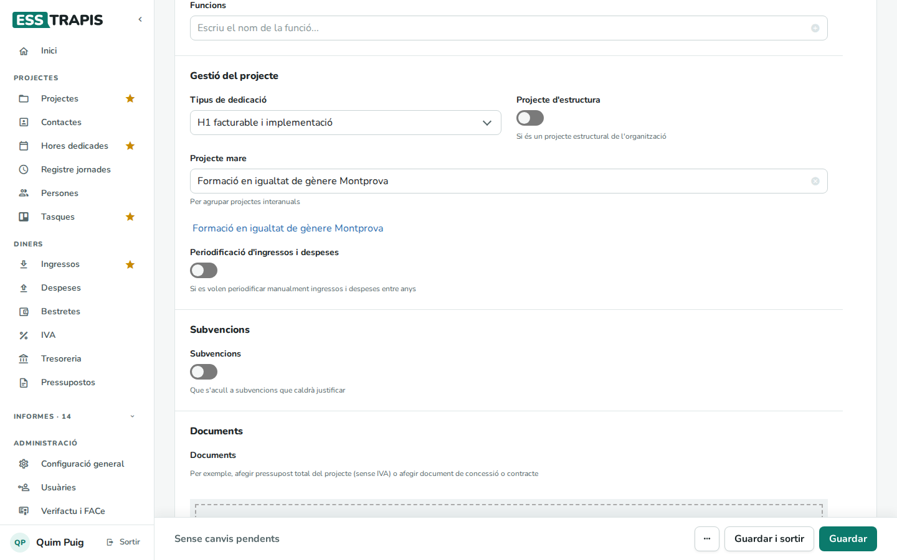
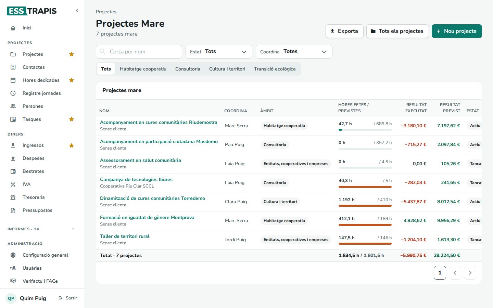
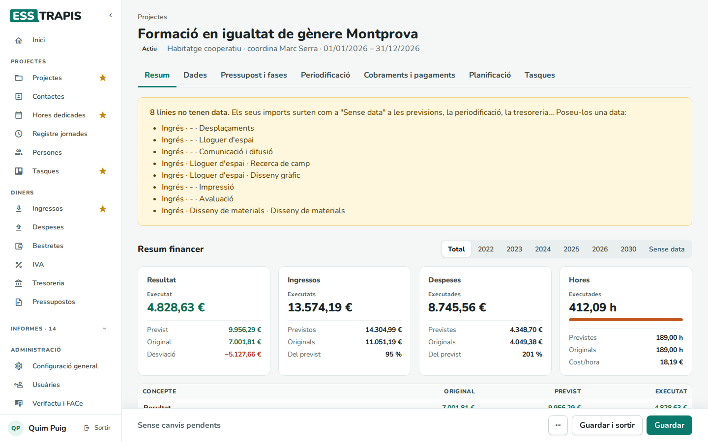
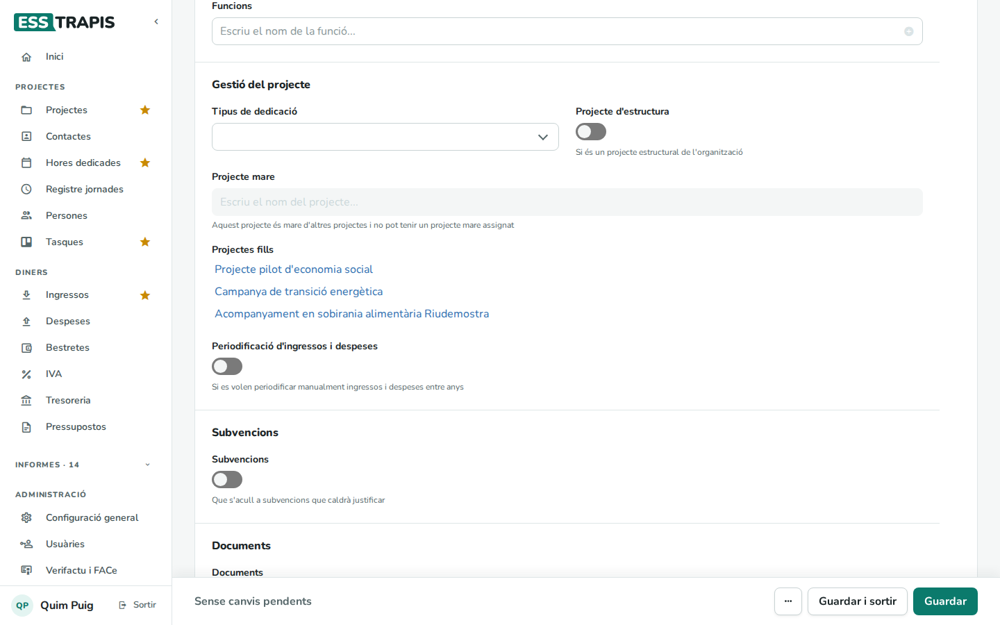
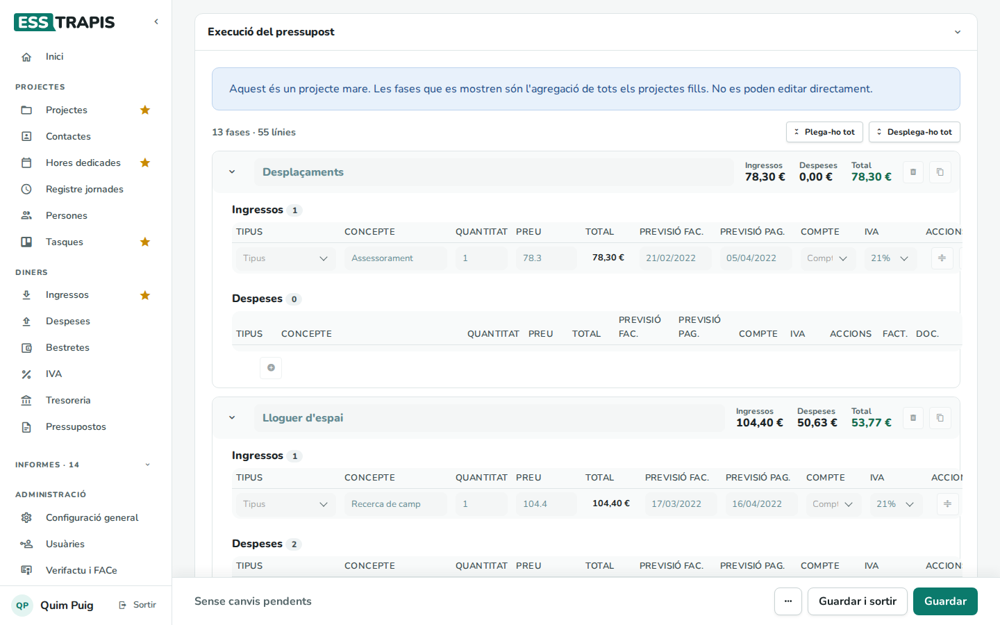
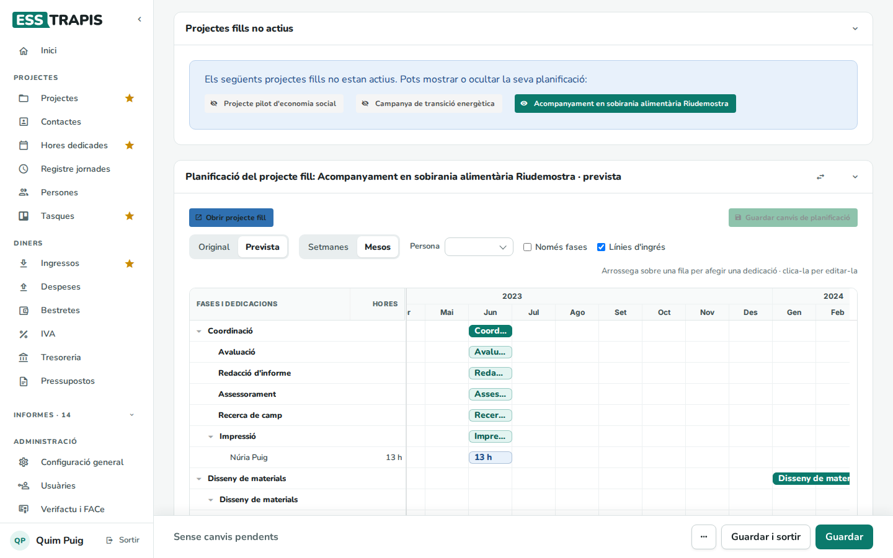

# 06. Projectes mare i fills

> Permís necessari: `projects`

Un **projecte mare** agrupa altres projectes, els seus **fills**. Serveix sobretot per als projectes que es
repeteixen any rere any (el mateix servei, la mateixa subvenció renovada…): cada any és un projecte fill, i
el projecte mare en mostra la suma. Així es pot veure el resultat de tota la història sense perdre el detall
de cada any.

## Abans de començar

- Un projecte es converteix en mare automàticament quan un altre projecte l'indica com a **Projecte mare**.
  No hi ha cap casella per marcar-lo.
- Un projecte mare no pot tenir, al seu torn, un projecte mare.

## Pas a pas

### 1. Lligar un projecte fill amb la seva mare

1. Obrir el projecte que ha de ser fill i anar a la pestanya **Dades**, bloc **Gestió del projecte**.
2. A **Projecte mare**, escriure una part del nom de la mare i triar-la de la llista.
3. **Guardar**.

A sota del camp surt l'enllaç al projecte mare. Per deslligar-lo, cal buidar el camp amb la creu i desar.

Per crear una sèrie de projectes anuals, una manera còmoda és fer el primer, **duplicar-lo** amb les dates
un any endavant (vegeu [04](04-crear-editar-projecte.md#duplicar-i-esborrar)) i posar a tots dos el mateix
projecte mare.

### 2. La llista de projectes mare

A la pantalla **Projectes**, el botó **Projectes mare** canvia a la llista de projectes mare. A dalt diu quants
n'hi ha (*7 projectes mare*). Té els mateixos filtres que la llista normal (**Cerca per nom**, **Estat**,
**Coordina** i els botons d'àmbit) i les columnes **Coordina**, **Àmbit**, **Hores fetes / previstes**,
**Resultat executat**, **Resultat previst** i **Estat**. Les hores i els resultats són la suma dels fills. La
fila **Total** de sota suma els projectes mare que es veuen amb els filtres triats.

L'aplicació recorda aquesta tria: mentre no es torni a la llista normal amb **Tots els projectes**, el menú
**Projectes** obre els projectes mare.

### 3. Consultar un projecte mare

El projecte mare s'obre com qualsevol altre projecte, amb les mateixes pestanyes.

- **Resum**: les xifres (original, previst i executat) sumen les de tots els fills.

  
- **Dades**: el camp **Projecte mare** està desactivat i a sota hi ha la llista de **Projectes fills**, amb
  un enllaç a cadascun.

  
- **Pressupost i fases**: les fases són les de tots els fills juntes. No es poden editar des d'aquí: cal
  obrir el fill.

  
- **Planificació**: un Gantt per a cada projecte fill actiu. Els fills que no estan actius surten en un bloc
  a part (**Projectes fills no actius**), amb un botó per mostrar o amagar la planificació de cadascun. Des
  d'aquí es pot canviar la planificació d'un fill i desar-la amb **Guardar canvis de planificació**;
  **Obrir projecte fill** porta al projecte.

  

## Preguntes freqüents

**Al projecte mare surt un avís groc: «Dades heretades detectades».** El projecte mare té fases pròpies,
d'abans del sistema actual. Un projecte mare només ha de mostrar les fases dels fills: cal esborrar les fases
pròpies a mà.

**Les línies sense data del projecte mare.** L'avís de línies sense data d'un projecte mare llista les dels
fills. Cal posar-los la data dins de cada fill.

**No puc posar un projecte mare a un projecte.** Si el projecte ja és mare d'altres, no pot tenir mare.

## Vegeu també

- [03. Llistat de projectes](03-llistat-projectes.md)
- [04. Crear i editar un projecte](04-crear-editar-projecte.md)
- [09. Planificació (Gantt)](09-planificacio-gantt.md)
