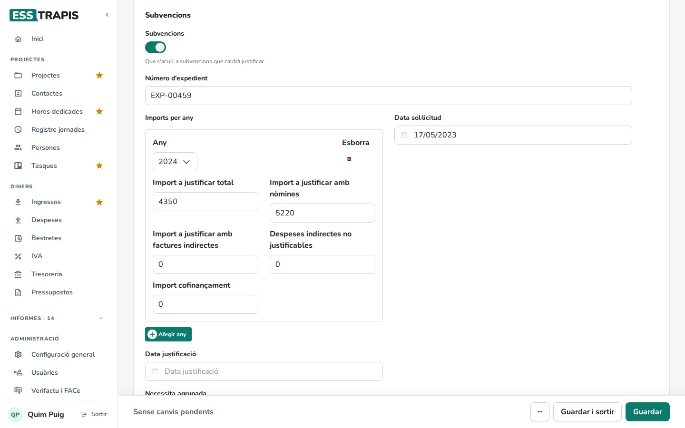
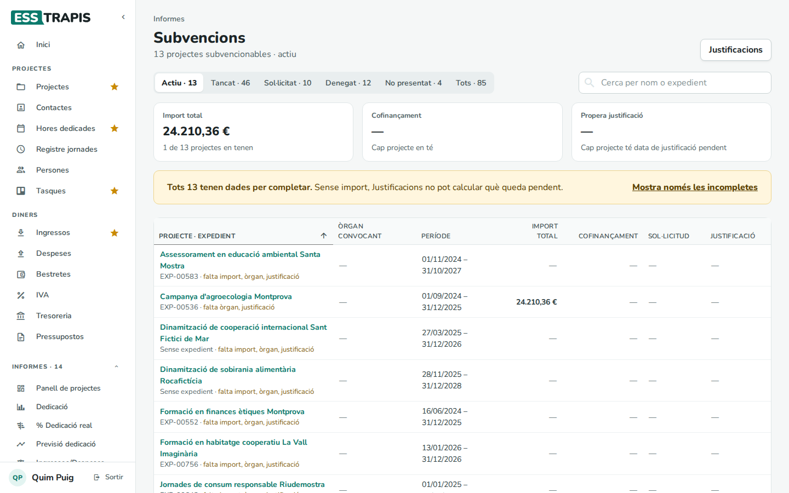
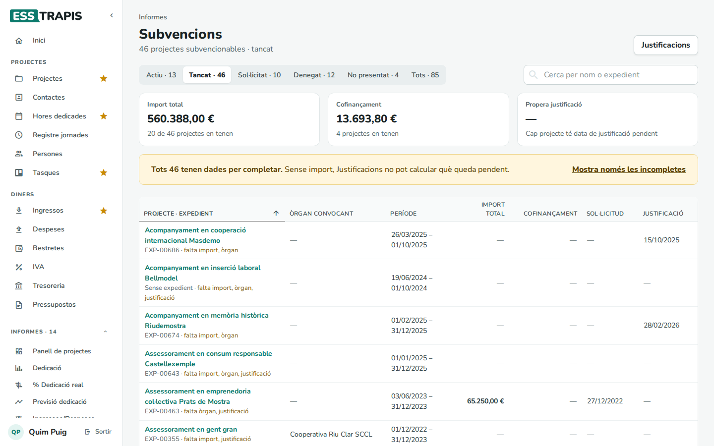
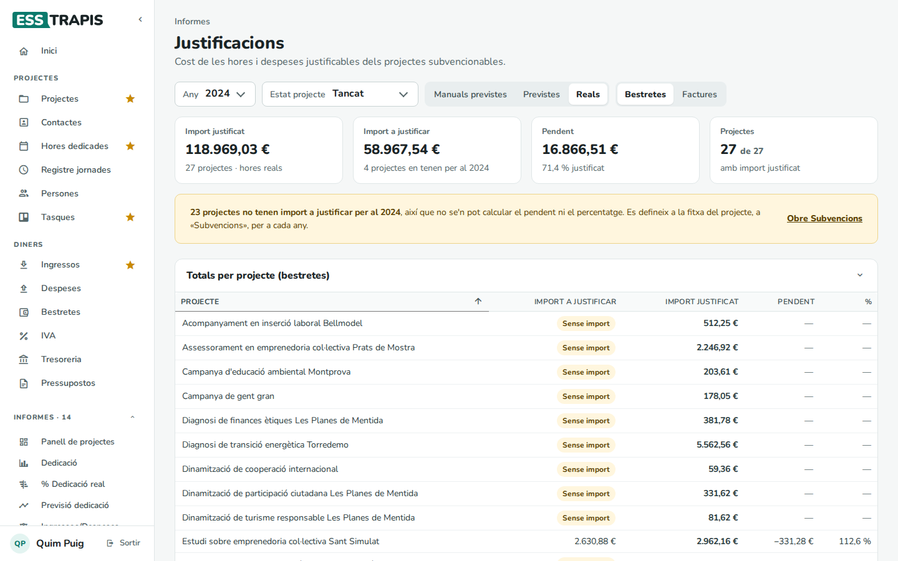
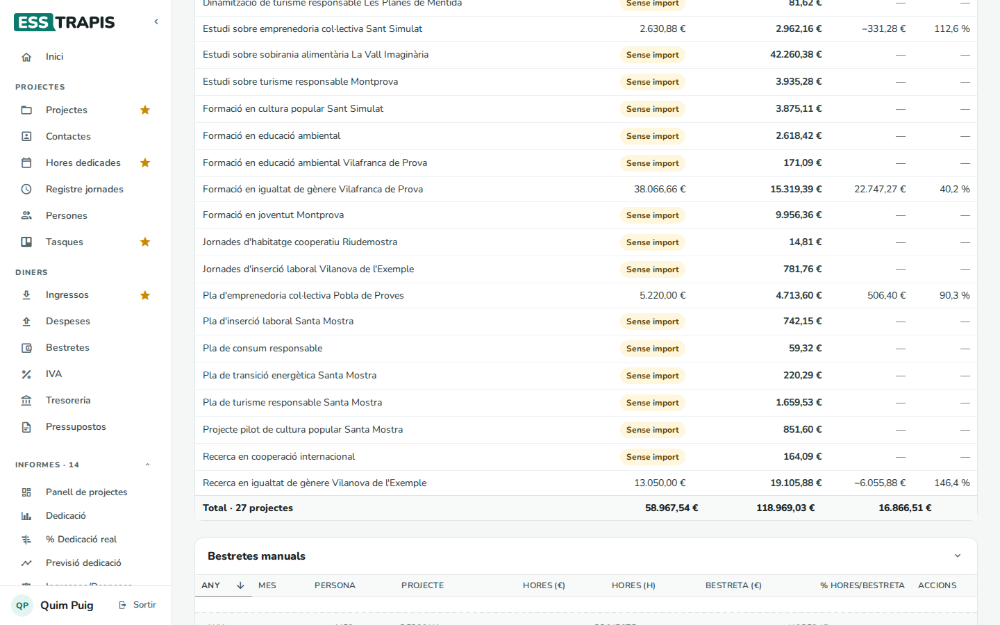
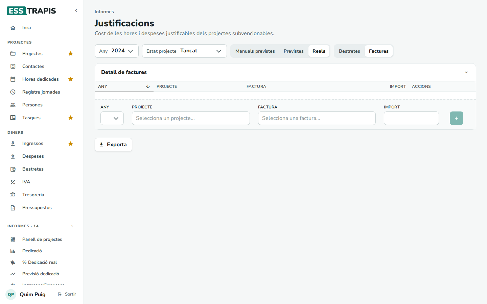

# 07. Subvencions i justificacions

> Permís necessari: `projects`

Molts projectes es financen amb **subvencions**, i en acabar cal **justificar-les**: demostrar a qui les
ha donat que els diners s'han fet servir per al projecte, normalment amb el cost de les hores de l'equip
(les **bestretes** o nòmines) i amb factures. ESSTRAPIS guarda les dades de cada subvenció a la fitxa del
projecte, en fa una llista a **Informes › Subvencions** i calcula a **Informes › Justificacions** quant es
pot justificar i quant en falta.

## Abans de començar

- Les hores que es justifiquen són les **hores dedicades** de cada persona (vegeu
  [13. Imputar hores dedicades](13-imputar-hores.md)), valorades al seu **cost per hora**.
- Les **bestretes** de cada mes es registren a **Diners › Bestretes** (vegeu [20. Bestretes](20-bestretes.md)).
- L'**òrgan convocant** d'una subvenció és el primer client del projecte.

## Pas a pas

### 1. Marcar un projecte com a subvencionat

A la fitxa del projecte, pestanya **Dades**, bloc **Subvencions**, activar **Subvencions** i omplir:

- **Número d'expedient**.
- **Imports per any**: amb **Afegir any**, un bloc per a cada any que cobreix la subvenció, amb l'**Import a
  justificar total** i com es reparteix (**amb nòmines**, **amb factures indirectes**, **Despeses indirectes
  no justificables**, **Import cofinançament**). L'import a justificar de cada any és el que fa servir
  l'informe de justificacions.
- **Data sol·licitud** i **Data justificació** (la data límit per justificar).
- **Necessita agrupada**, si la subvenció es demana amb altres entitats: llavors cal indicar l'**Entitat
  líder** i els imports de cada entitat.

Després, **Guardar**. El detall de cada camp és al capítol
[04](04-crear-editar-projecte.md#la-pestanya-dades).

### 2. La llista de subvencions

**Informes › Subvencions** mostra tots els projectes subvencionables.

- Els botons de dalt filtren per estat del projecte (amb el nombre de projectes de cada un); **Tots** els
  mostra tots. **Cerca per nom o expedient** busca al nom del projecte i al número d'expedient.
- **Import total**: la suma de l'import a justificar total dels projectes de la llista.
  **Cofinançament**: la suma del cofinançament. **Propera justificació**: la data de justificació més
  propera que encara no ha passat.
- Columnes: **Projecte · expedient**, **Òrgan convocant**, **Període** (dates del projecte), **Import
  total**, **Cofinançament**, **Sol·licitud** i **Justificació**.
- Sota el nom de cada projecte s'avisa de què **falta** (import, òrgan, data de justificació). L'avís groc diu
  quants projectes tenen dades per completar; **Mostra només les incompletes** els filtra.
- El botó **Justificacions** porta a l'informe següent.

### 3. L'informe de justificacions

**Informes › Justificacions** calcula, per a cada projecte subvencionat, l'**import justificat** (el cost de
les hores o les factures que s'hi poden imputar) i el compara amb l'**import a justificar**.

**Filtres**

| Filtre | Què fa |
|---|---|
| **Any** | L'any de la subvenció (o **Tots**). |
| **Estat projecte** | L'estat dels projectes que hi entren. |
| **Manuals previstes** / **Previstes** / **Reals** | Quines hores es fan servir: només les entrades manuals (vegeu més avall), les hores **planificades** més les manuals, o les hores **realment imputades** més les manuals. |
| **Bestretes** / **Factures** | Justificar amb el cost de les hores (bestretes) o amb factures. |

**Xifres de dalt**: **Import justificat**, **Import a justificar** (dels projectes que en tenen per a aquell
any), **Pendent** (a justificar − justificat, i el percentatge justificat) i **Projectes** (quants tenen
import justificat). Si hi ha projectes sense import a justificar per a l'any triat, un avís ho diu, amb
l'enllaç **Obre Subvencions**.

**Totals per projecte (bestretes)**: una fila per projecte amb **Import a justificar** (o *Sense import*),
**Import justificat**, **Pendent** i **%**. Un percentatge per sobre de 100 vol dir que les hores fetes ja
cobreixen més del que cal justificar. A sota hi ha la fila **Total**.

### 4. Bestretes manuals

Quan cal justificar amb una part concreta de la bestreta d'una persona (i no amb les hores imputades), es
pot afegir a mà al bloc **Bestretes manuals**: **Any**, **Mes**, **Persona**, **Projecte** i la quantitat,
en euros (**€**), en hores (**h**) o en percentatge de la bestreta (**%**), i el botó **+**.

La taula mostra, per a cada entrada, les hores en euros i en hores, la **Bestreta (€)** de la persona aquell
mes i el **% Hores/Bestreta**. Si la suma dels percentatges d'una persona en un mes passa del 100 %, s'agafa
l'import de la bestreta en lloc de les hores, i la cel·la ho avisa.

**Detall de bestretes** és una taula dinàmica (any, mes, persona, projecte) amb l'**Import justificat**, les
**Hores**, la **Bestreta**, la **Diferència bestreta-hores** i el **% Bestreta**. Es pot reorganitzar,
desar com a vista i exportar (vegeu [24. Taules dinàmiques](24-taules-dinamiques.md)).

### 5. Justificar amb factures

Amb **Factures**, l'informe mostra el **Detall de factures**: per afegir-ne una, triar l'**Any**, el
**Projecte**, la **Factura** i l'**Import** que s'hi imputa, i clicar **+**. Quan n'hi ha, a dalt surten els
**Totals per projecte (factures)**.

## Com es calcula

- **Import justificat (bestretes)** = hores × cost per hora de cada persona, més les bestretes manuals. Amb
  **Reals** compten les hores imputades; amb **Previstes**, les planificades.
- **Pendent** = import a justificar de l'any − import justificat.
- **% Hores/Bestreta** = cost de les hores ÷ bestreta de la persona aquell mes.

## Preguntes freqüents

**L'informe surt buit.** Comproveu l'any i l'estat: per defecte només surten els projectes actius. Si cap
projecte té dades per a aquests filtres, ho diu (*No hi ha cap projecte subvencionat amb dades per a aquests
filtres*).

**Un projecte surt amb «Sense import».** No té import a justificar per a aquell any. Cal afegir-lo a la fitxa
del projecte, **Subvencions › Imports per any**.

## Vegeu també

- [04. Crear i editar un projecte](04-crear-editar-projecte.md)
- [13. Imputar hores dedicades](13-imputar-hores.md)
- [20. Bestretes](20-bestretes.md)
- [24. Taules dinàmiques](24-taules-dinamiques.md)
