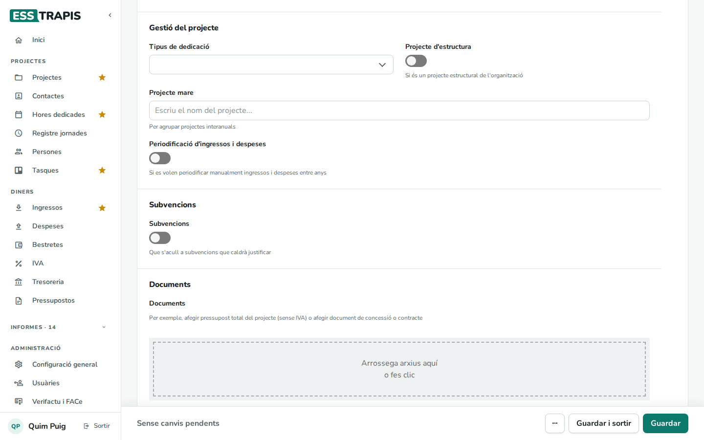
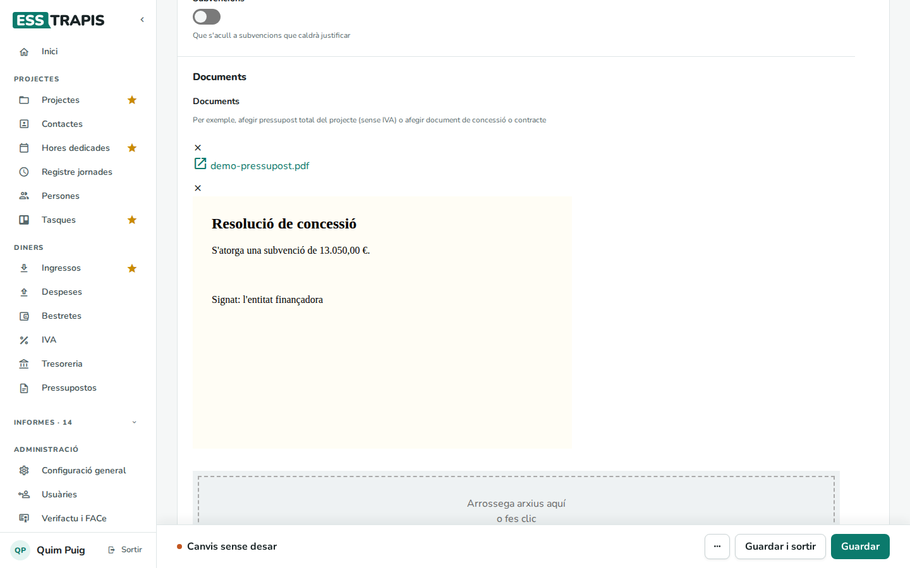
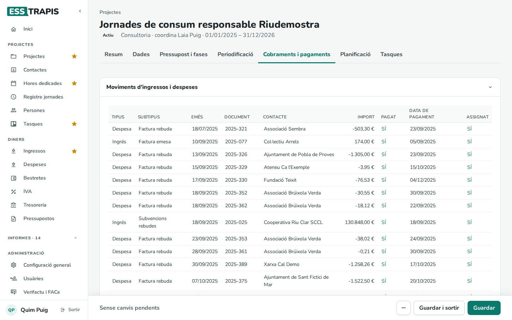
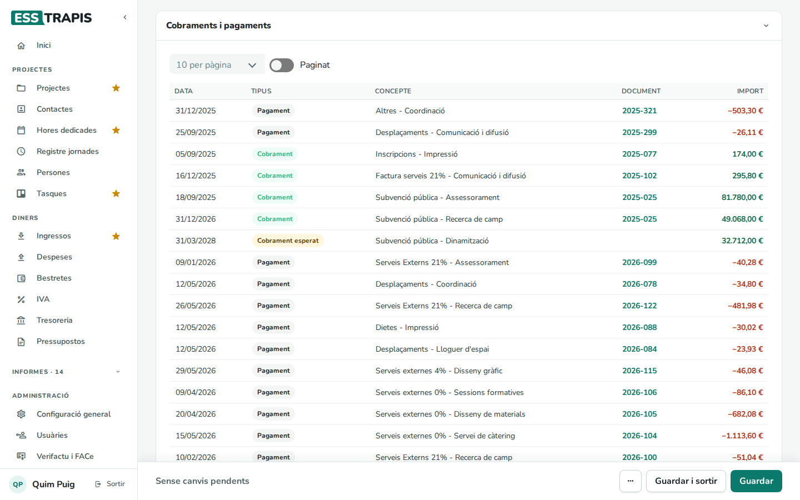

# 08. Documents del projecte

> Permís necessari: `projects`

Cada projecte pot guardar els seus **documents adjunts**: el pressupost presentat, la resolució d'una
subvenció, el contracte… A més, la pestanya **Cobraments i pagaments** reuneix els documents econòmics del
projecte (factures emeses i rebudes, subvencions, altres ingressos i despeses) i els cobraments i pagaments
previstos i fets.

## Abans de començar

- Els documents s'adjunten a un projecte ja desat (en un projecte nou, després del primer pas de
  l'assistent).
- Les factures no s'adjunten aquí: es fan a **Ingressos** i **Despeses** i s'assignen al projecte (vegeu
  [17. Factures emeses](17-factures-emeses.md) i [19. Factures rebudes](19-factures-rebudes.md)).

## Adjuntar documents

Els documents són a la pestanya **Dades**, a l'últim bloc, **Documents**.

1. Arrossegar un o més arxius a la zona puntejada (*Arrossega arxius aquí o fes clic*), o clicar-hi per
   triar-los. S'hi pot posar qualsevol tipus d'arxiu.
2. Els arxius es pugen i queden adjuntats al moment, sense haver de clicar **Guardar**.

Els PDF i altres arxius surten com un enllaç amb el nom: clicant-lo s'obre en una pestanya nova. Les
imatges es mostren directament.

**Treure un document**: la creu (**×**) de sobre el document el treu de la llista. Aquest canvi sí que
s'ha de desar amb **Guardar**.

## La pestanya Cobraments i pagaments

Té dos blocs.

### Moviments d'ingressos i despeses

Tots els documents econòmics lligats al projecte, cadascun en una fila:

| Columna | Què mostra |
|---|---|
| **Tipus** | **Ingrés** o **Despesa**. |
| **Subtipus** | Factura emesa, factura rebuda, subvenció rebuda, tiquet, dieta, o el tipus de l'ingrés o la despesa. |
| **Emès** | La data del document. |
| **Document** | El número del document. |
| **Contacte** | La clienta o la proveïdora. |
| **Import** | Positiu per als ingressos, negatiu per a les despeses. |
| **Pagat** | **SÍ** si ja s'ha cobrat o pagat. |
| **Data de pagament** | Quan es va cobrar o pagar. |
| **Assignat** | **SÍ** si el document està lligat a una línia del pressupost d'execució; **NO** si encara no. |

Un document amb **Assignat: NO** és del projecte però no està lligat a cap línia del pressupost, i per
tant no surt a cap fase. Cal lligar-lo a una línia (vegeu [05. Fases i pressupost](05-fases-pressupost.md#lligar-una-línia-amb-la-seva-factura)).

### Cobraments i pagaments

Les línies del pressupost d'execució vistes com a moviments de diners, amb la seva data de cobrament o
pagament. És el que el projecte aporta a la [tresoreria](22-tresoreria.md).

- **Tipus**: **Cobrament** o **Pagament** quan la línia ja té el seu document; **Cobrament esperat** o
  **Pagament esperat** (en groc) quan encara no; **Operació de tresoreria** per a les anotacions fetes a
  mà a la tresoreria.
- **Concepte**: el tipus i el concepte de la línia. **Document**: el número de la factura, amb un enllaç.
- Clicant el títol d'una columna s'ordena per aquella columna (per exemple, per **Data**).
- **Paginat** divideix la taula en pàgines; el desplegable tria quantes files per pàgina.

## Preguntes freqüents

**He tret un document i torna a sortir.** Després de treure'l amb la creu cal clicar **Guardar**.

**Un cobrament surt com a «esperat» però ja l'hem cobrat.** La línia del pressupost encara no està lligada
a la factura o la factura no està marcada com a cobrada. Vegeu [05](05-fases-pressupost.md) i
[17. Factures emeses](17-factures-emeses.md).

## Vegeu també

- [04. Crear i editar un projecte](04-crear-editar-projecte.md)
- [05. Fases i pressupost del projecte](05-fases-pressupost.md)
- [22. Tresoreria](22-tresoreria.md)
