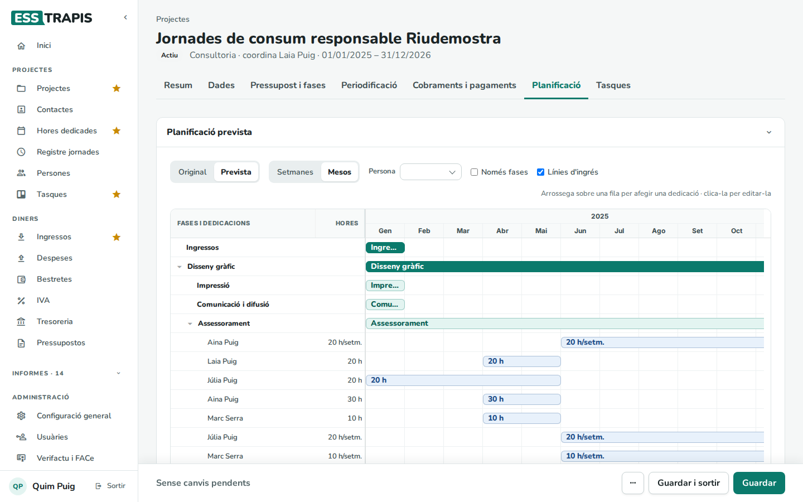
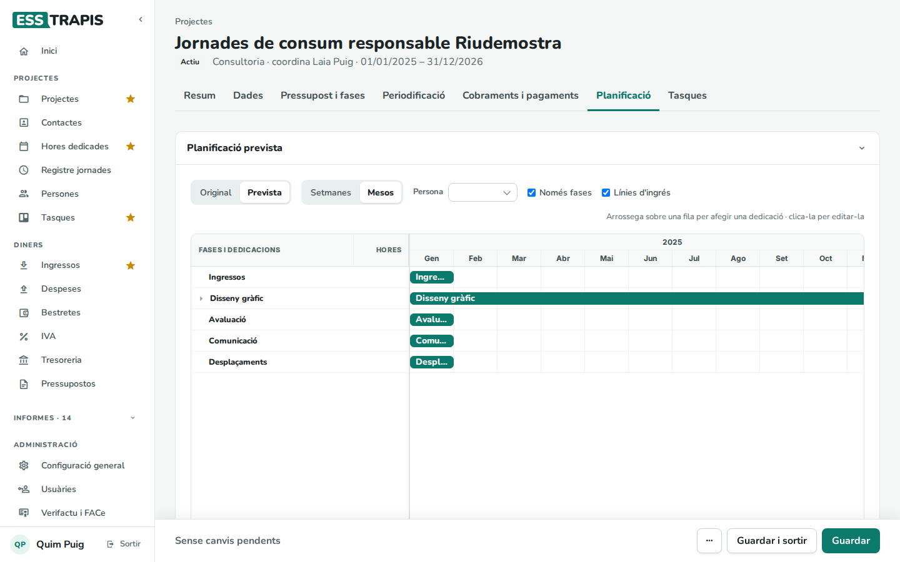
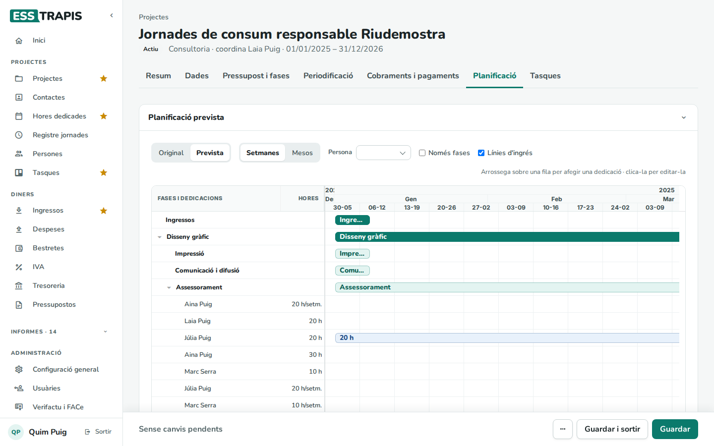
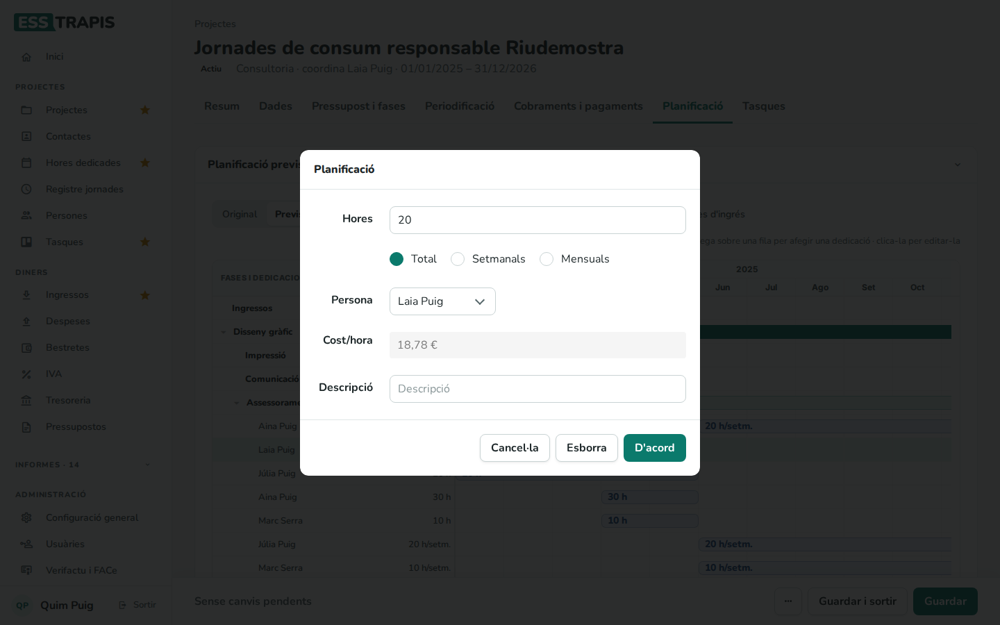
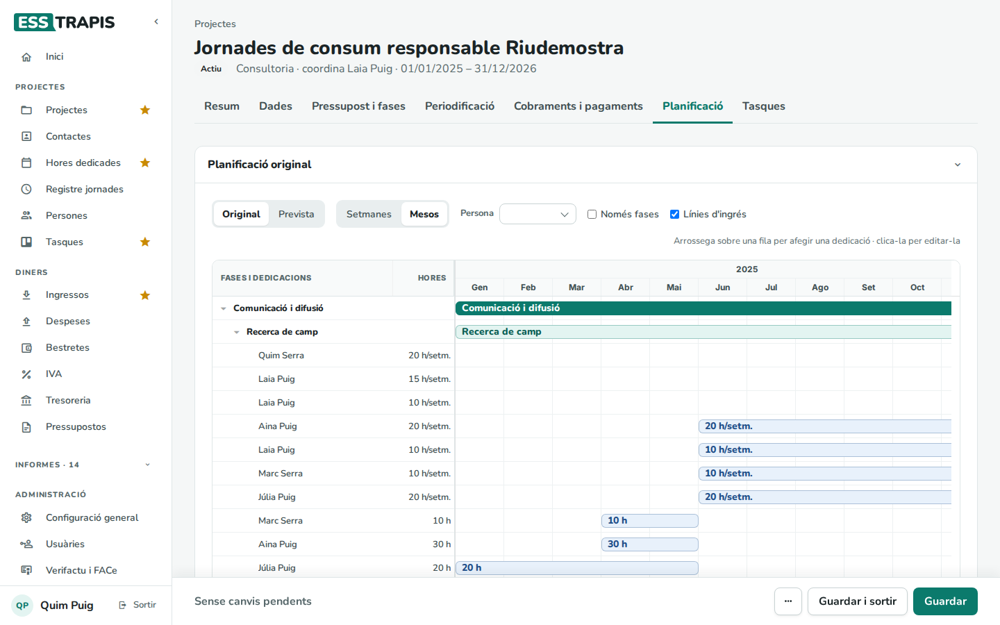
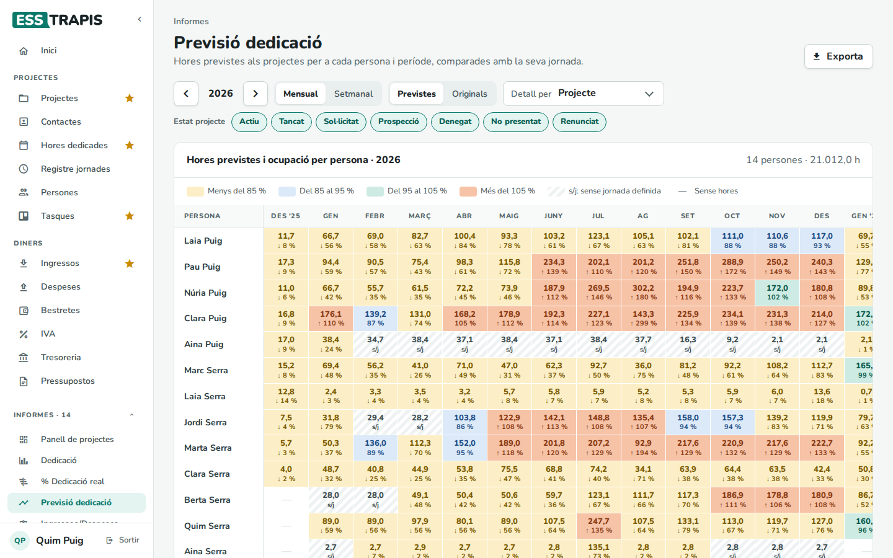
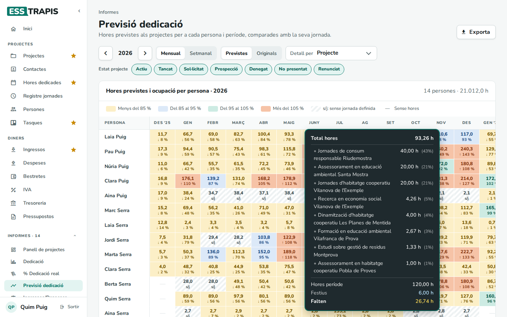

# 09. Planificació (Gantt)

> Permís necessari: `projects`

La **planificació** diu qui dedicarà hores a cada part d'un projecte i quan. Es dibuixa en un diagrama de
**Gantt**: una fila per fase, per línia d'ingrés i per persona, i una barra per al període de feina. El cost
d'aquestes hores entra al pressupost (hores × cost per hora de cada persona). L'informe **Previsió
dedicació** suma les hores planificades de tots els projectes per veure si cada persona en té massa o massa
poques.

## Abans de començar

- El projecte ha de tenir fases i el pressupost tancat (vegeu
  [04. Crear i editar un projecte](04-crear-editar-projecte.md)). Si no, la pestanya diu *Es necessari tenir
  fases i guardar el projecte amb un pressupost tancat per accedir a la planificació*.
- El **cost per hora** de cada persona i la seva jornada surten de **Persones** (vegeu
  [15. Persones i jornades laborals](15-persones-jornades.md)).

## La pestanya Planificació

A l'esquerra hi ha les files (**Fases i dedicacions**) i les **Hores** de cada dedicació; a la dreta, les
barres sobre el calendari. Les barres verd fosc són les fases, les verd clar les línies d'ingrés i les blaves
les dedicacions de cada persona, amb les hores (*20 h* en total o *20 h/setm.* per setmana).

Controls de dalt:

| Control | Què fa |
|---|---|
| **Original** / **Prevista** | Canvia entre la planificació del pressupost original i la de l'execució. El títol del bloc ho indica. |
| **Setmanes** / **Mesos** | L'escala del calendari. |
| **Persona** | La persona que es proposarà a les dedicacions noves que es dibuixin. |
| **Només fases** | Amaga les línies i les dedicacions i deixa només les fases. |
| **Línies d'ingrés** | Mostra o amaga les files de les línies d'ingrés. |

Passant el ratolí per sobre d'una fase o d'una línia es veu la **Durada**: la suma de les hores que té
planificades.

## Pas a pas

### Afegir una dedicació

1. (Opcional) Triar la **Persona** a dalt.
2. Arrossegar el ratolí sobre la fila d'una línia, des del dia o el mes d'inici fins al final.
3. A la finestra **Planificació**, posar les **Hores** i triar si són el **Total** del període,
   **Setmanals** o **Mensuals**; la **Persona** (el **Cost/hora** s'omple sol) i, si cal, una **Descripció**.
4. **D'acord**.
5. **Guardar** a la barra de baix.

El pas a pas amb imatges de la primera planificació és al capítol
[04](04-crear-editar-projecte.md#pas-3-planificació).

### Canviar o esborrar una dedicació

- Clicant una barra s'obre la mateixa finestra: es canvien les hores o la persona, o es clica **Esborra**.
- Arrossegant una barra es mou en el temps; estirant-ne un extrem, s'allarga o s'escurça.

Si una barra queda fora de les dates del projecte, surt l'avís *Atenció, planificació fora del període del
projecte*. Els canvis no es desen fins que es clica **Guardar**.

Si s'han canviat les fases i encara no s'han desat, el Gantt no es mostra i surt el botó **Guardar i
Actualitzar**, que desa el projecte i el torna a dibuixar.

### Original i prevista

La **planificació original** és la que es va fer en crear el projecte; la **prevista** n'és la còpia que es
va actualitzant. Quan les hores reals es desvien del que es va pressupostar, s'actualitza la prevista i
l'original queda com a referència.

Als projectes mare, la pestanya mostra la planificació de cada fill (vegeu
[06. Projectes mare i fills](06-projectes-mare-fills.md)).

## L'informe Previsió dedicació

**Informes › Previsió dedicació** compara, per a cada persona i cada mes (o setmana), les hores planificades
a tots els projectes amb les hores de la seva jornada.

- Les fletxes canvien d'any. **Mensual** / **Setmanal** canvia el període de les columnes.
- **Previstes** / **Originals**: quina planificació se suma.
- **Detall per**: com s'agrupa el detall de cada cel·la (**Projecte**, **Tipus de projecte** o
  **Probabilitat**).
- **Estat projecte**: els estats dels projectes que compten (per exemple, afegir els *Sol·licitat* per veure
  la càrrega si s'aproven).
- **Exporta** descarrega la taula en un full de càlcul.

Cada cel·la mostra les hores i l'**ocupació** (hores previstes ÷ hores de jornada del període), amb un color:

| Color | Ocupació |
|---|---|
| Groc | Menys del 85 % |
| Blau | Del 85 al 95 % |
| Verd | Del 95 al 105 % |
| Taronja | Més del 105 % |
| Ratllat (**s/j**) | La persona no té jornada definida en aquest període |
| **—** | Sense hores |

Passant per sobre d'una cel·la es veu el detall per projecte; clicant-la, el detall queda fix. A baix hi ha
les **Hores període** de la jornada, els **Festius** i quantes hores **Falten** per omplir-la.

Les hores de jornada no compten caps de setmana, festius ni vacances. Al peu de la taula es llisten les
persones sense hores, amb **Mostra-les** per afegir-les a la taula.

## Preguntes freqüents

**No veig la barra d'una dedicació.** Pot ser fora del període que es veu: cal desplaçar el calendari cap a
la dreta o canviar a **Mesos**.

**Una persona surt amb «s/j».** No té jornada laboral definida per a aquell període. Cal definir-la a
**Persones**.

**L'ocupació no té en compte les hores ja fetes.** És una previsió: compara la planificació amb la
jornada. Les hores reals són a l'informe **% Dedicació real** (vegeu
[26. Informes de dedicació](26-informes-dedicacio.md)).

## Vegeu també

- [04. Crear i editar un projecte](04-crear-editar-projecte.md)
- [05. Fases i pressupost del projecte](05-fases-pressupost.md)
- [13. Imputar hores dedicades](13-imputar-hores.md)
- [15. Persones i jornades laborals](15-persones-jornades.md)
