# 10. Tasques

> Permís necessari: `projects`

Les tasques són la feina pendent de l'equip: qui ha de fer què, de quin projecte i per a quan. Es poden
veure en tres formes (tauler, llista i calendari). Cada tasca pot tenir una descripció, una llista de
passos (checklist), documents, comentaris, hores estimades i fetes, i pot repetir-se cada cert temps. Les
tasques que es repeteixen en molts projectes es poden desar com a **plantilla** i crear de cop en un
projecte nou.

## Abans de començar

- Cal el permís **Projectes** (`projects`). La pantalla és a **Projectes › Tasques**, i cada projecte té
  també la pestanya **Tasques**.
- Els **estats** de les tasques (per defecte **Pendents**, **En procés** i **Acabades**) es configuren a
  **Administració › Taules auxiliars › Estats de tasca** (vegeu [35. Taules auxiliars](35-taules-auxiliars.md)).
  L'últim estat de la llista és el que compta com a **acabat**: les tasques que hi són no surten com a
  vençudes, i és el que fa repetir una tasca recurrent.
- La **Funció** d'una tasca és una de les funcions (tipus d'activitat) del projecte. Només es pot triar si
  el projecte en té.

## La pantalla Tasques

A dalt hi ha el resum (**tasques obertes**, **vençudes** i **acabades**) i els filtres comuns:

- **Cerca una tasca**: busca al nom, la descripció i el nom del projecte.
- **Persona**: en entrar, hi surt la persona que ha entrat a l'aplicació. Per veure les tasques de tothom,
  cal buidar-lo amb la creu.
- **Projecte**: limita la pantalla a un projecte (no hi surten els projectes tancats). Quan n'hi ha un de
  triat, apareix el botó **Plantilles** (vegeu [Plantilles](#plantilles)).

Els botons **Tauler**, **Llista** i **Calendari** canvien la forma de veure les tasques. L'aplicació
recorda l'última que s'ha fet servir en cada navegador.

### Tauler

Una columna per a cada estat. Cada targeta mostra el nom, el projecte, la data límit (en vermell, amb
la paraula **Vençuda**, si ha passat), el progrés de la checklist, els comentaris, les hores fetes i
estimades, la funció i les inicials de les persones. Les de prioritat alta porten la marca **Alta** i les
que es repeteixen, una icona de fletxes.

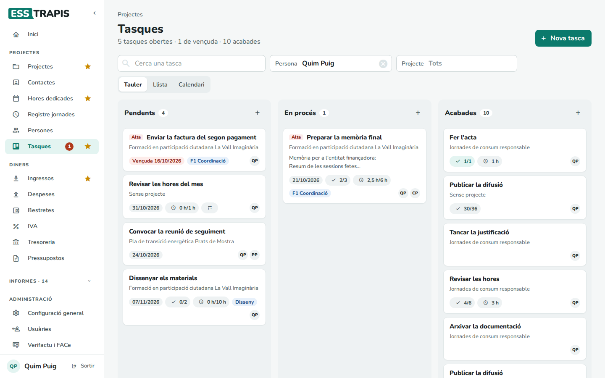

- Per canviar l'estat d'una tasca, s'arrossega la targeta a una altra columna; també es pot canviar
  l'ordre dins d'una columna. Al mòbil o a la tauleta cal **mantenir el dit premut un moment** sobre la
  targeta i després moure'l (un lliscament curt només fa desplaçar la pàgina).
- El **+** de cada columna crea una tasca en aquell estat.
- Cada columna mostra les 12 primeres targetes; **Mostra'n N més** ensenya la resta.

### Llista

Les tasques en una taula agrupada, per veure moltes tasques alhora i canviar-ne unes quantes de cop.

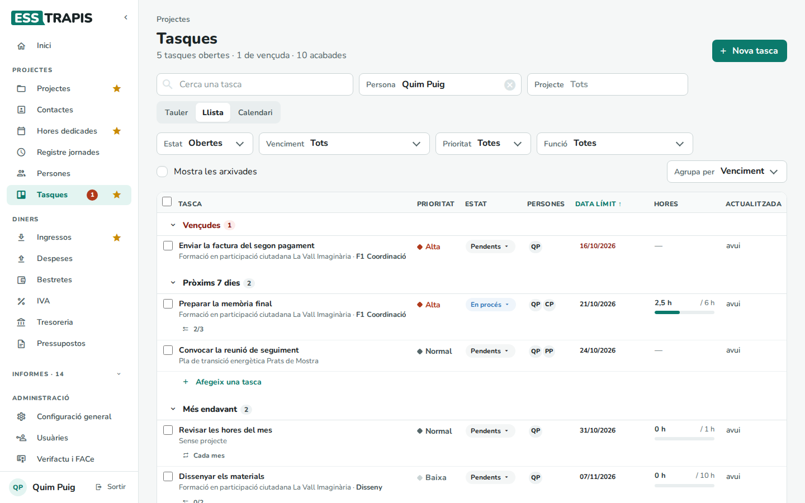

- **Estat**: per defecte **Obertes** (totes menys les acabades). També **Totes** o un estat concret.
- **Venciment**: **Vençudes**, **Vençudes i pròxims 7 dies** o **Sense data**.
- **Prioritat** i **Funció**: només les d'aquella prioritat o funció (**Sense funció** per a les que no en
  tenen).
- **Mostra les arxivades**: hi afegeix les tasques arxivades, amb l'enllaç **Recupera** per tornar-les a
  la llista.
- **Agrupa per**: **Venciment** (Vençudes, Pròxims 7 dies, Més endavant, Sense data), **Estat**,
  **Projecte** o **Persona**. Si es tria Persona, una tasca de dues persones surt a tots dos grups.

Clicant els títols **Tasca**, **Prioritat**, **Estat**, **Data límit** o **Actualitzada** s'ordena la
taula per aquella columna (un altre clic, a l'inrevés). A cada fila es pot canviar directament la
**prioritat**, l'**estat** i la **data límit**. **Afegeix una tasca** al final d'un grup crea una tasca
amb el que té el grup (el seu estat, projecte o persona).

La columna **Actualitzada** surt en taronja quan fa més de 15 dies que ningú no ha tocat una tasca
oberta.

**Canviar moltes tasques alhora**: es marquen les caselles de l'esquerra i apareix una barra amb
**Estat**, **Assigna** (afegeix una persona), **Prioritat**, **Data límit** i **Arxiva**.

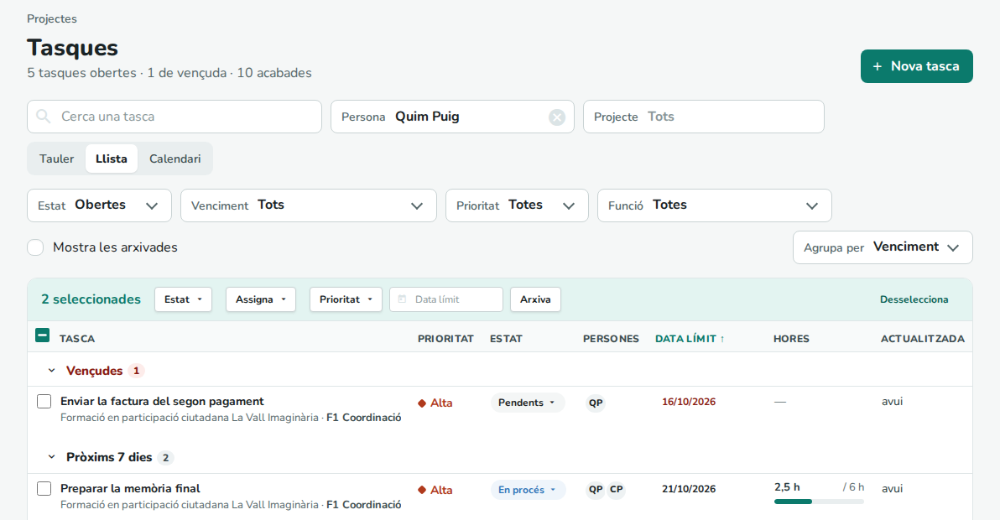

### Calendari

El mes amb les tasques que tenen data. Una tasca amb **data d'inici** i **data límit** surt tots els dies
entre totes dues; si només en té una, surt aquell dia. En vermell, les vençudes; ratllades, les acabades;
amb una vora vermella, les de prioritat alta. El **+** que apareix en passar per sobre d'un dia crea una
tasca amb aquella data límit. Les tasques sense cap data no hi surten (el calendari diu quantes n'hi ha).

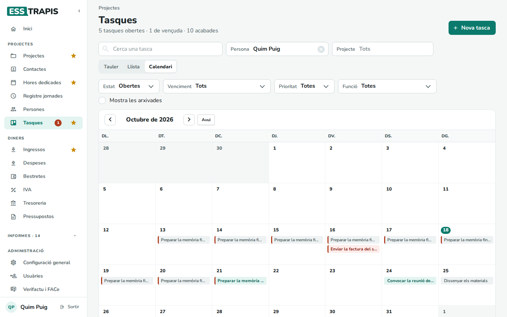

Fa servir els mateixos filtres que la llista. Al mòbil es veu com una agenda amb només els dies que tenen
tasques.

## La fitxa d'una tasca

Clicant una tasca (o **Nova tasca**) s'obre la fitxa. A l'esquerra hi ha el contingut; a la dreta, les
dades.

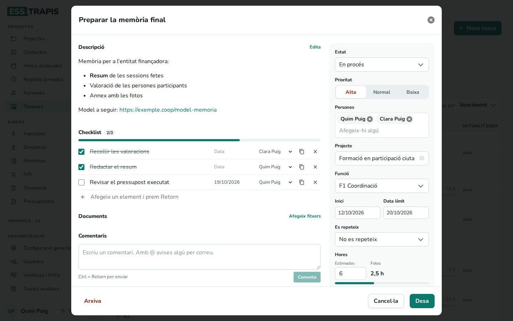

### Descripció

**Edita** obre el text. Es pot donar format amb els botons o escrivint:

| Escrivint | Surt com a |
|---|---|
| `**text**` | **negreta** |
| `*text*` | *cursiva* |
| `- ` a l'inici de línia | llista de punts |
| `1. ` a l'inici de línia | llista numerada |
| `[text](https://…)` o una adreça web | enllaç |

### Checklist

Passos de la tasca. Cada pas té una casella de fet, el nom, una data i una persona; es pot duplicar o
eliminar. **Afegeix un element i prem Retorn** n'afegeix un. La barra i el comptador (per exemple 2/3)
mostren quants n'hi ha de fets.

### Documents

**Afegeix fitxers** adjunta documents. En una tasca nova també es pot fer: es pugen en desar-la.

### Comentaris

Un fil de conversa de la tasca. Es pot escriure quan la tasca ja està desada. Escrivint **@** i el
principi d'un nom apareixen les persones; amb les fletxes i **Retorn** (o clicant) s'hi afegeix el nom.
Les persones esmentades reben un correu al cap d'uns minuts (vegeu [Avisos per correu](#avisos-per-correu)).
**Comenta** (o **Ctrl + Retorn**) envia el comentari.

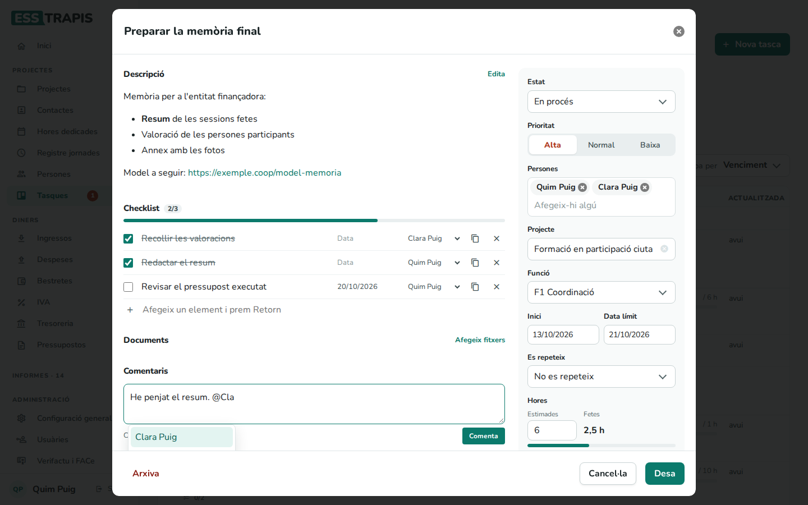

Només qui ha escrit un comentari el pot **Edita**r o **Esborra**r.

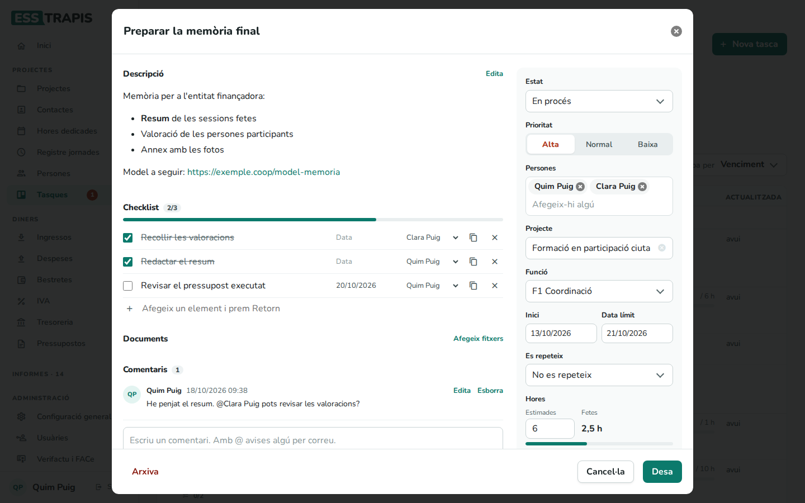

### Les dades de la tasca

| Camp | Què és |
|---|---|
| Nom | Obligatori. Es pot canviar clicant-hi, a dalt de tot. |
| Estat | Un dels estats de la llista. |
| Prioritat | **Alta**, **Normal** (la de les tasques noves) o **Baixa**. |
| Persones | Qui la fa. Rep un correu quan l'hi afegeixen (vegeu [Avisos per correu](#avisos-per-correu)). |
| Projecte | Opcional. A la pestanya Tasques d'un projecte ja ve triat. |
| Funció | Una de les funcions del projecte, si en té. |
| Inici · Data límit | Opcionals. Amb totes dues, la tasca ocupa aquells dies al calendari i al Gantt. |
| Es repeteix | **No es repeteix**, **Cada setmana**, **Cada 2 setmanes**, **Cada mes**, **Cada 3 mesos** o **Cada any** (vegeu [Tasques que es repeteixen](#tasques-que-es-repeteixen)). |
| Hores · Estimades | Les hores que es preveu que costarà. |
| Hores · Fetes | Les hores imputades a la tasca (no s'escriuen aquí: vegeu més avall). |

**Desa** guarda els canvis; **Cancel·la** els descarta. **Arxiva** treu la tasca de les llistes sense
esborrar-la: es pot recuperar amb **Mostra les arxivades** a la llista.

### Hores fetes i «Imputa hores»

Les **hores fetes** són la suma de les [hores dedicades](13-imputar-hores.md) en què s'ha triat aquesta
tasca. A la fitxa, a la llista i al tauler surten com a «fetes / estimades», amb una barra que es torna
taronja quan les fetes passen de les estimades.

**Imputa hores** obre la finestra d'entrada d'hores amb la data d'avui, el projecte, la persona que ha
entrat, la funció i la tasca ja triats: només cal posar-hi les hores.

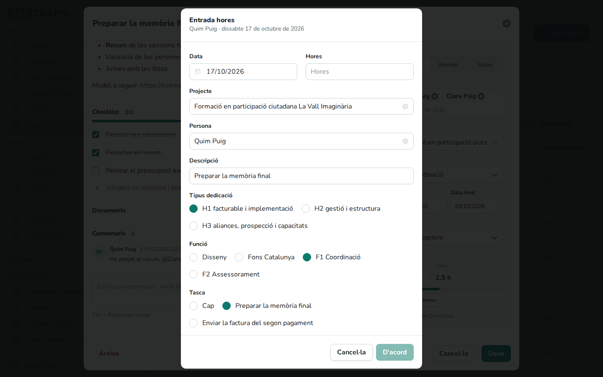

També es pot fer a l'inrevés: en entrar hores a **Hores dedicades**, l'apartat **Tasca** mostra les
tasques del projecte (i de la funció triada).

## Tasques que es repeteixen

Per a les feines periòdiques (revisar les hores cada mes, una reunió cada dues setmanes…), a **Es
repeteix** es tria cada quant.

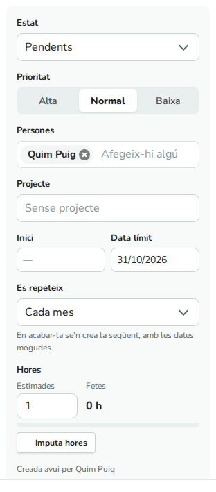

Quan la tasca passa a l'estat acabat (des del tauler, la llista o la fitxa), l'aplicació en crea la
següent:

- Amb el mateix nom, descripció, projecte, funció, persones, prioritat, hores estimades i repetició.
- A l'estat inicial (Pendents), amb la checklist desmarcada.
- Amb les dates mogudes un període: si la tasca anava de l'1 al 5 d'octubre i es repeteix cada mes, la
  nova va de l'1 al 5 de novembre. Si no tenia data límit, es compta des del dia que es va acabar.
- Només una vegada: si la tasca acabada es torna a obrir i a acabar, no se'n crea cap més.

Per deixar de repetir-la, a la tasca nova es tria **No es repeteix**.

## Plantilles

Una plantilla és una llista de tasques desada per crear-les de cop en un altre projecte, per exemple les
tasques que sempre hi ha en començar un projecte. Les plantilles són de tota l'entitat: les veu i les fa
servir qualsevol persona amb el permís Projectes.

El botó **Plantilles** surt quan hi ha un projecte triat: al filtre **Projecte** de la pantalla Tasques o
a la pestanya **Tasques** d'un projecte.

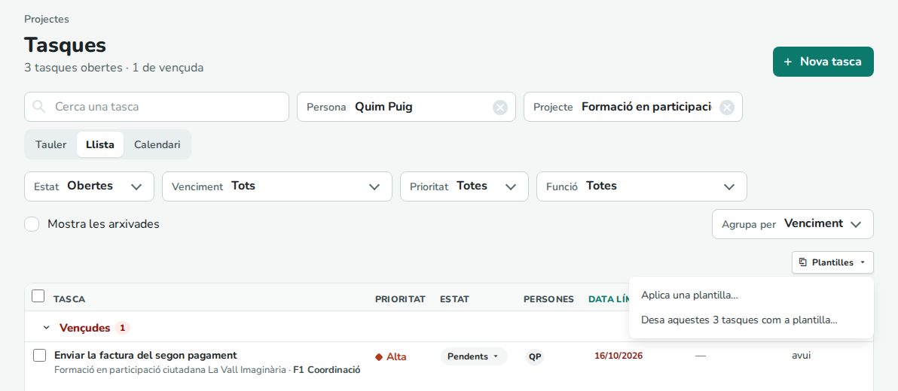

### Desar una plantilla

**Desa aquestes N tasques com a plantilla…** desa les tasques **obertes** (no acabades ni arxivades) que
es veuen del projecte. Si el filtre **Persona** està triat, només són les d'aquella persona: per desar
totes les del projecte, cal buidar-lo abans. S'hi posa un nom i **Desa**.

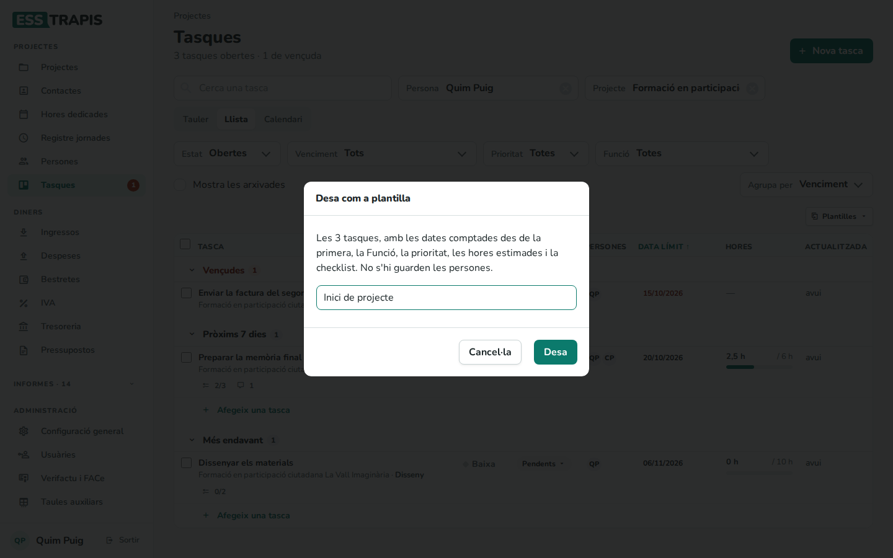

De cada tasca es guarda:

| Es guarda | No es guarda |
|---|---|
| Nom i descripció | Les persones |
| Funció | El projecte i l'estat |
| Prioritat | Els comentaris i els documents |
| Hores estimades | Les hores fetes |
| Repetició | De la checklist: qui la fa, les dates i si està feta |
| Els noms dels passos de la checklist | |
| Les dates, comptades en dies (vegeu més avall) | |

**Com es guarden les dates.** La data més antiga de totes les tasques (d'inici o límit) passa a ser el
**dia 0**, i la resta es guarden com a «tants dies després». A l'exemple de les imatges:

| Tasca | Dates al projecte original | A la plantilla |
|---|---|---|
| Preparar la memòria final | del 12/10 al 20/10 | del dia 0 al dia 8 |
| Enviar la factura del segon pagament | límit el 15/10 | límit el dia 3 |
| Dissenyar els materials | del 24/10 al 06/11 | del dia 12 al dia 25 |

Les tasques sense data queden sense data.

### Aplicar una plantilla

Amb el projecte de destí triat, **Plantilles › Aplica una plantilla…**:

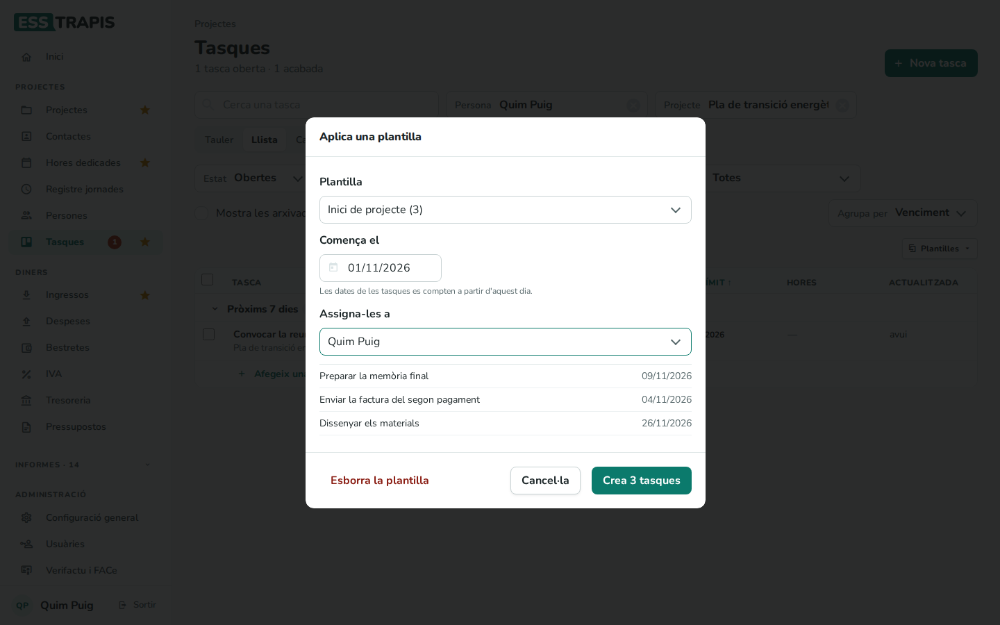

- **Plantilla**: quina (entre parèntesis, quantes tasques té).
- **Comença el**: el dia que fa de **dia 0**. A l'exemple, començant el 31/10, la memòria acaba el 08/11
  (dia 8), la factura és el 03/11 (dia 3) i els materials van del 12/11 al 25/11.
- **Assigna-les a**: la persona que les farà totes (per defecte, qui ha entrat). Amb **Ningú** queden sense
  persona; llavors no surten mentre el filtre Persona estigui triat.
- A sota es veuen les tasques que es crearan, amb la data límit.

**Crea N tasques** les crea al projecte, a l'estat inicial (Pendents). Després es poden repartir entre
diverses persones des de la llista (selecció i **Assigna**) o a cada fitxa.

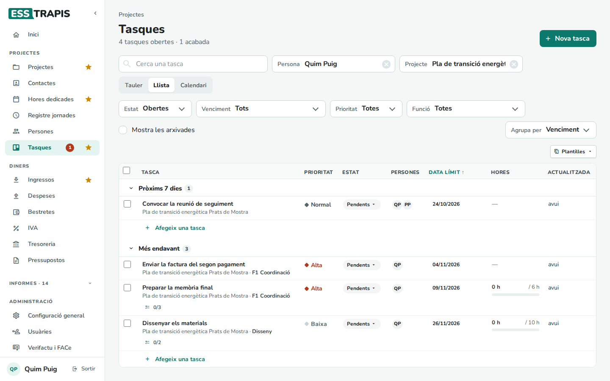

Una plantilla no es modifica: per canviar-la, s'aplica a un projecte, s'hi fan els canvis, es desa amb un
altre nom i s'esborra l'antiga. **Esborra la plantilla** (a la finestra d'aplicar) l'elimina; les tasques
que ja s'havien creat amb ella no canvien.

Si el projecte de destí no té la funció d'una tasca, la tasca la conserva, però a la fitxa no es pot triar
i, en desar-la, queda sense funció.

## Avisos per correu

L'aplicació envia tres tipus de correu sobre tasques:

- **Resum diari** (cada matinada): a cada persona, les seves tasques i passos de checklist amb la data
  límit superada, i les tasques que algú altre li ha assignat o canviat l'últim dia. Si una tasca porta
  més de 15 dies vençuda sense canvis, surt com a **ÚLTIM AVÍS** i deixa d'avisar-se'n.
- **Tasca assignada**: quan algú afegeix una persona a una tasca. No s'envia a qui ha fet el canvi.
- **Menció en un comentari**: quan algú esmenta una persona amb @.

Aquests dos no surten a l'instant: esperen uns 5 minuts. Si mentrestant la persona es treu de la tasca,
la tasca s'arxiva o el comentari s'esborra, no s'envia res. I si en aquell temps una persona té diversos
avisos, els rep tots en un sol correu.

Els correus porten un enllaç que obre directament la tasca.

Una entitat pot desactivar tots aquests correus a **Administració › Configuració general › Opcions ›
Avisos de tasques per correu** (cal el permís d'administració). Al mateix lloc hi ha l'opció de mostrar
les tasques al Gantt (vegeu més avall):

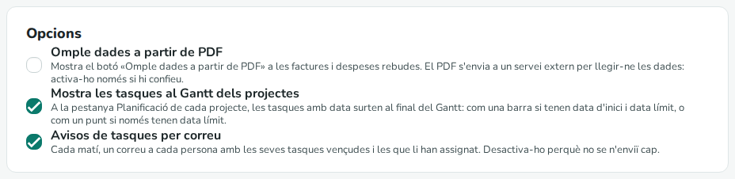

A més, el llistat de projectes avisa **«Atenció, tens tasques amb la data límit superada!»** quan la
persona que entra en té.

### El número al menú

Al menú, al costat de **Tasques**, surt un número quan hi ha alguna cosa per mirar:

- **En vermell**, si la persona té tasques o passos de checklist amb la data límit superada (el número
  les compta, juntament amb les novetats).
- **Del color de l'aplicació**, si només hi ha novetats des de l'última vegada que va obrir Tasques:
  tasques que algú altre li ha creat i comentaris que l'esmenten.

En obrir Tasques, les novetats es donen per vistes. Passant el ratolí per sobre del número es veu el
detall (per exemple, «Tasques: 1 vençuda · 2 novetats»). Amb el menú plegat, és un punt sobre la
icona. Es recalcula en entrar, cada 5 minuts i en canviar tasques.

## Tasques d'un projecte i el Gantt

La pestanya **Tasques** d'un projecte mostra el tauler només amb les tasques d'aquell projecte i el botó
**Plantilles**. La icona de columnes de la capçalera canvia les columnes: per estat o per funció. Allà, les
persones que es poden triar són les que coordinen el projecte.

Si a **Administració › Configuració general › Opcions** està marcat **Mostra les tasques al Gantt dels
projectes** (ho està per defecte), la pestanya **Planificació** mostra les tasques del projecte al final
del Gantt: com una barra, si tenen data d'inici i data límit, o com un punt, si només tenen data límit.

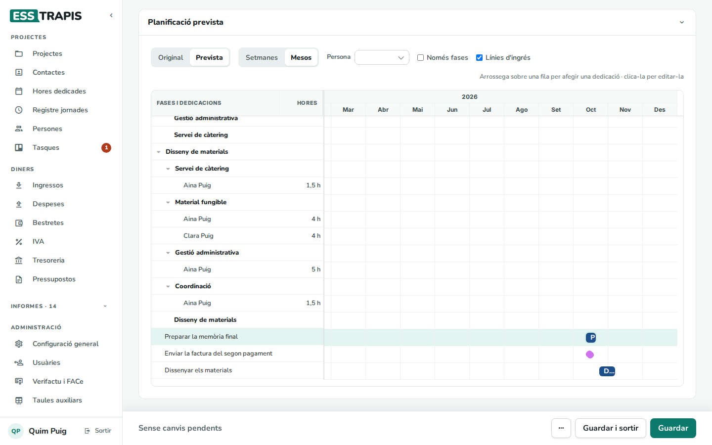

## Preguntes freqüents / Errors habituals

**He creat una tasca i no la veig.** Comproveu els filtres: **Persona** (la tasca ha de tenir aquella
persona), **Projecte** i, a la llista i al calendari, **Estat** (per defecte no hi surten les acabades)
i **Venciment**. Al calendari no surten les tasques sense data.

**He esborrat una tasca per error.** **Arxiva** no l'esborra: a la llista, marqueu **Mostra les
arxivades** i cliqueu **Recupera**.

**No puc comentar.** Cal desar la tasca primer.

**No puc triar la funció.** El projecte no té funcions, o la tasca no té projecte.

**He acabat una tasca que es repeteix i no en veig la següent.** Surt a l'estat inicial amb la data del
període següent; a la llista, comproveu el filtre **Venciment**.

## Vegeu també

- [09. Planificació (Gantt)](09-planificacio-gantt.md)
- [13. Imputar hores dedicades](13-imputar-hores.md)
- [34. Configuració general de l'entitat](34-configuracio-general.md)
- [35. Taules auxiliars](35-taules-auxiliars.md) (estats de tasca)
