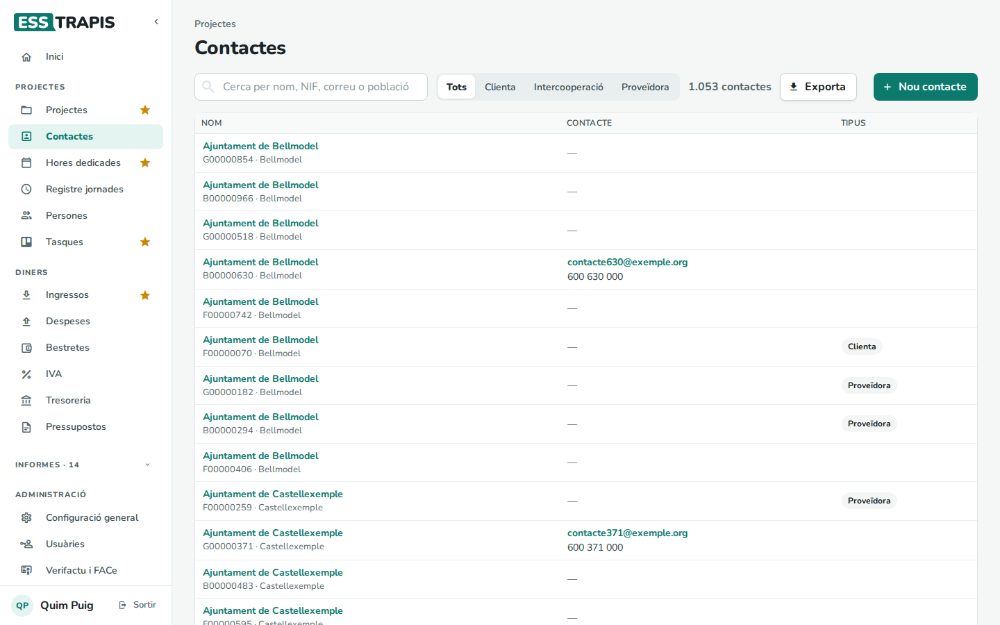
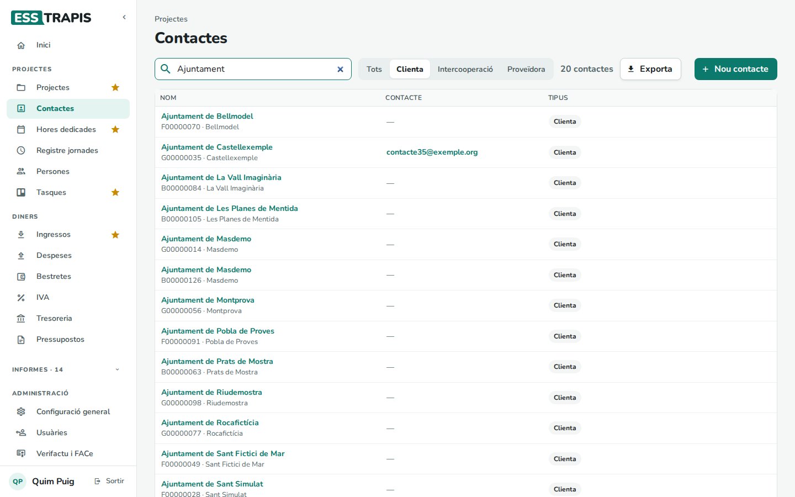
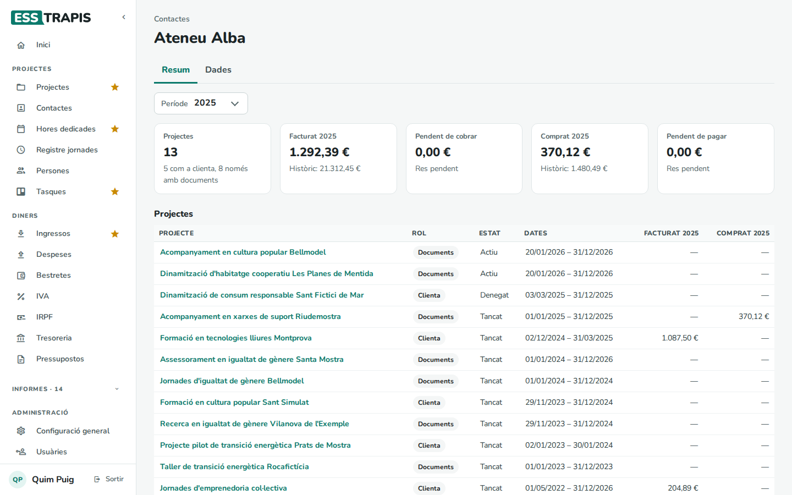
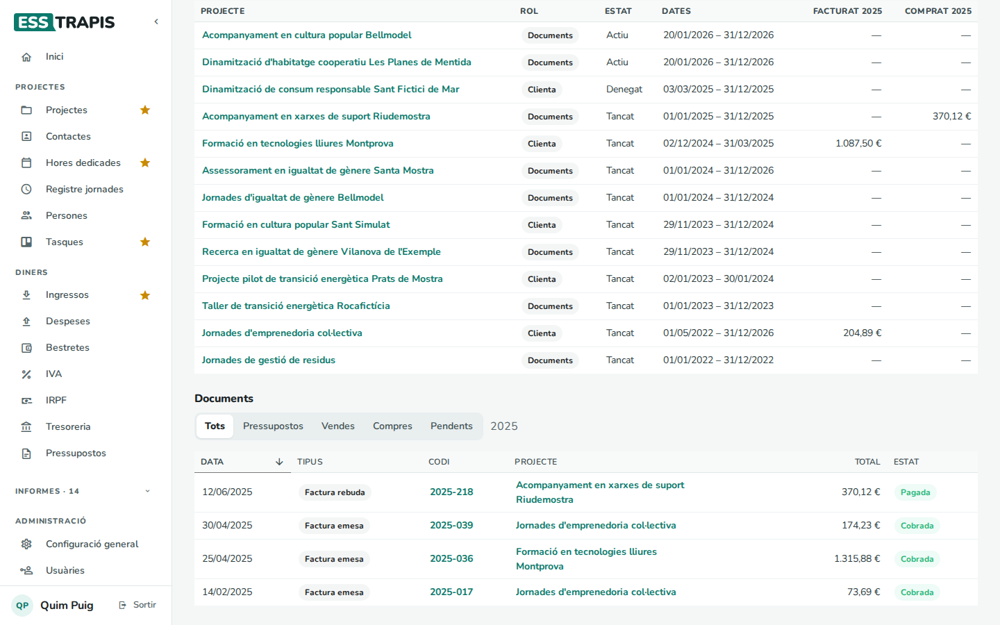
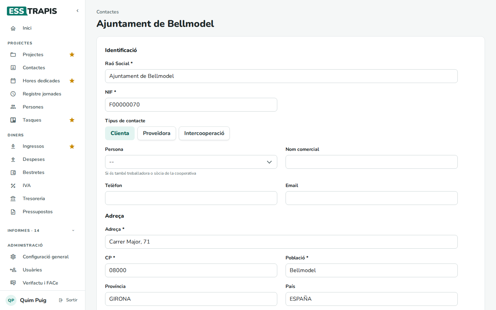
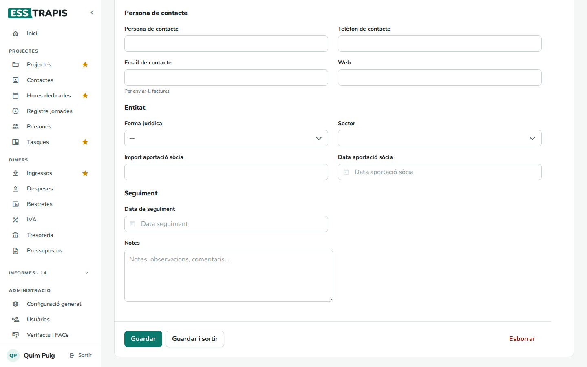
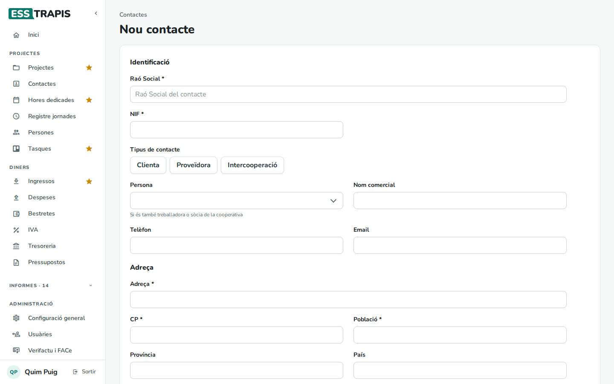
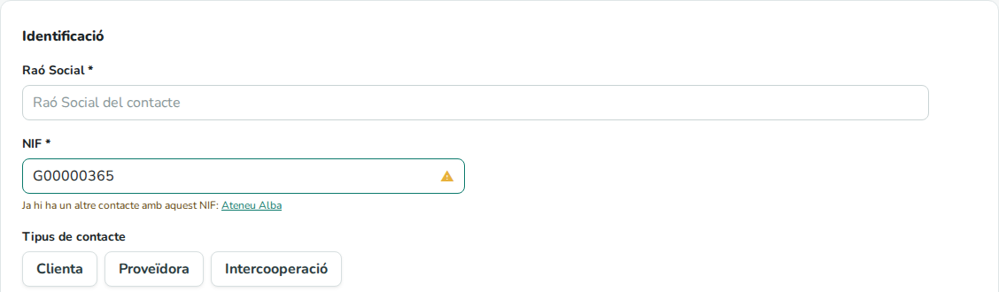

# 11. Contactes

> Permís necessari: `projects`

Els **contactes** són les entitats i persones amb qui treballa la cooperativa: **clientes** (a qui es
factura), **proveïdores** (que ens facturen) i entitats d'**intercooperació**. Un mateix contacte pot ser
de més d'un tipus. Els contactes es fan servir als projectes (clientes, intercooperació, entitat líder d'una
subvenció), a les factures i als pressupostos.

## Abans de començar

- Els **tipus de contacte**, les **formes jurídiques** i els **sectors** es configuren a **Administració ›
  Taules auxiliars**.
- També es pot crear un contacte des d'un projecte, amb el botó **+** al costat de **Clientes** o
  **Intercooperació** (s'obre en una pestanya nova; després cal clicar la fletxa rodona per tornar a
  carregar la llista).

## La llista de contactes

**Projectes › Contactes**.

- **Cerca per nom, NIF, correu o població**.
- Els botons **Tots**, **Clienta**, **Intercooperació**, **Proveïdora** filtren per tipus. Al costat es veu
  quants contactes hi ha a la llista.
- **Exporta** descarrega la llista en un full de càlcul. **Nou contacte** obre la fitxa buida.
- Columnes: **Nom** (amb el NIF i la població a sota), **Contacte** (el correu) i **Tipus**.

## La fitxa d'un contacte

Clicant un nom s'obre el contacte amb dues pestanyes: **Resum** (la que s'obre primer) i **Dades** (la fitxa).
L'adreça recorda la pestanya oberta.

### Resum: projectes i documents

El **Resum** aplega tot el que la cooperativa ha fet amb aquest contacte. Només el veuen les persones amb
permís de projectes o d'administració.

- **Període**: un any (l'any fiscal, si l'entitat en té) o **Històric** (tots els anys).
- **Projectes**: quants en té, i en quants és clienta, entitat d'intercooperació o només hi té documents.
- **Facturat** i **Comprat** al període: el que se li ha facturat (factures emeses i altres ingressos) i el
  que ens ha facturat (factures rebudes i despeses), sense IVA. A sota, el total de tots els anys.
- **Pendent de cobrar** i **Pendent de pagar**: els documents encara no cobrats o no pagats, de tots els
  anys, amb IVA. Si n'hi ha de vençuts, la targeta de cobrar es marca.
- La taula **Projectes**: cada projecte amb el seu **Rol** (**Clienta**, **Intercooperació** o
  **Documents**, si el contacte no hi és com a clienta però hi té factures), l'**Estat**, les **Dates** i
  el que s'hi ha facturat i comprat al període. Un asterisc vol dir que hi ha documents repartits entre
  diversos projectes, comptats sencers a cadascun.

- La taula **Documents**: pressupostos, factures, ingressos i despeses del contacte al període, amb el seu
  estat (**Cobrada**, **No cobrada**, **Vençuda**, **Pagada**, **Esborrany**…). Els botons **Tots**,
  **Pressupostos**, **Vendes**, **Compres** i **Pendents** la filtren; **Pendents** mostra els de tots els
  anys. Clicant el codi s'obre el document; clicant el projecte, el projecte.

Els punts d'entrega de la logística no tenen aquesta pestanya: tenen la seva de comandes.

### Dades: la fitxa

| Bloc | Camps |
|---|---|
| **Identificació** | **Raó Social** * (el nom fiscal), **NIF** *, **Tipus de contacte** (es marquen clicant-los; poden ser més d'un), **Persona** (si el contacte és també una persona de l'equip), **Nom comercial**, **Telèfon**, **Email**. |
| **Adreça** | **Adreça** *, **CP** *, **Població** *, **Província**, **País**. Són les dades que surten a les factures. |
| **Persona de contacte** | **Persona de contacte**, **Telèfon de contacte**, **Email de contacte** (on s'envien les factures), **Web**. |
| **Entitat** | **Forma jurídica**, **Sector**, i per a les sòcies, **Import aportació sòcia** i **Data aportació sòcia**. |
| **Seguiment** | **Data de seguiment** (quan cal tornar-hi a parlar) i **Notes**. |

A baix: **Guardar**, **Guardar i sortir** i **Esborrar**. Un contacte que ja té dades lligades (projectes,
factures…) no es pot esborrar: surt l'avís *Error. El contacte no s'ha pogut esborrar perquè té dades
associades*.

### Administracions públiques i FACe

Si l'entitat té activada la facturació electrònica per **FACe** (vegeu
[18. Verifactu i FACe](18-verifactu-face.md)), la fitxa té un bloc més, **Facturació electrònica**:

1. Activar **FACe** (*Activar FACe*) per als contactes que són administracions públiques.
2. **Cercar DIR3** obre la cerca de codis **DIR3** (els codis que identifiquen l'oficina comptable, l'òrgan
   gestor i la unitat tramitadora de l'administració). Es pot cercar per **NIF** o per **Nom**; en triar un
   resultat s'omplen **DIR3 OC**, **DIR3 OG** i **DIR3 UT** (*Dades DIR3 carregades*).
3. **Guardar**.

Les factures a aquest contacte es podran enviar per FACe.

## Crear un contacte

**Nou contacte** obre la fitxa buida. Cal omplir com a mínim la **Raó Social**, el **NIF** i l'adreça
(**Adreça**, **CP**, **Població**), marcar el **Tipus de contacte** i **Guardar**.

Si el NIF ja és d'un altre contacte, a sota del camp surt l'avís *Ja hi ha un altre contacte amb aquest
NIF:* amb el nom de l'altre contacte (o *Ja hi ha N contactes més amb aquest NIF:* si n'hi ha diversos).
Clicant el nom s'obre en una pestanya nova. És un avís, no impedeix desar: de vegades és el mateix NIF a
propòsit. Surt també en canviar el NIF d'un contacte que ja existeix. Els punts d'entrega no avisen, perquè
una mateixa entitat en pot tenir diversos amb el mateix NIF.

Abans de crear-ne un, convé buscar-lo a la llista pel NIF: si ja hi és amb un altre tipus, n'hi ha prou
d'afegir-li el tipus que falta.

## Preguntes freqüents

**Una clienta no surt a la llista de Clientes d'un projecte.** Comproveu que existeix i, si l'acabeu de crear
en una altra pestanya, cliqueu la fletxa rodona del costat per tornar a carregar els contactes.

**El mateix contacte surt dues vegades.** Pot ser que s'hagi creat dos cops (en crear-lo, l'avís de NIF
repetit ho hauria dit). Feu servir sempre el mateix (el
que tingui més dades) i esborreu l'altre si no té res lligat.

## Vegeu també

- [04. Crear i editar un projecte](04-crear-editar-projecte.md)
- [12. Pressupostos](12-pressupostos.md)
- [17. Factures emeses](17-factures-emeses.md) · [19. Factures rebudes](19-factures-rebudes.md)
- [18. Verifactu i FACe](18-verifactu-face.md)
