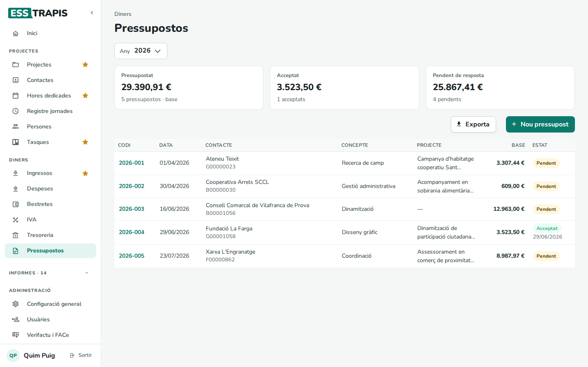
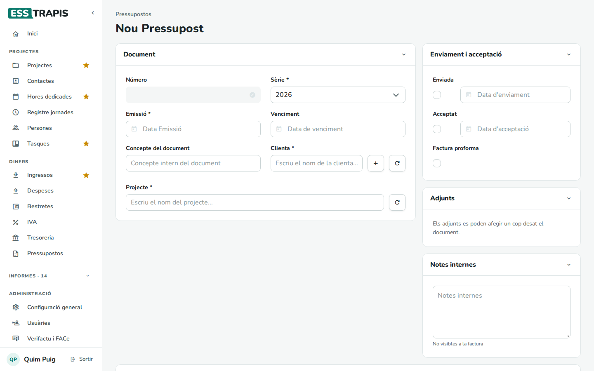
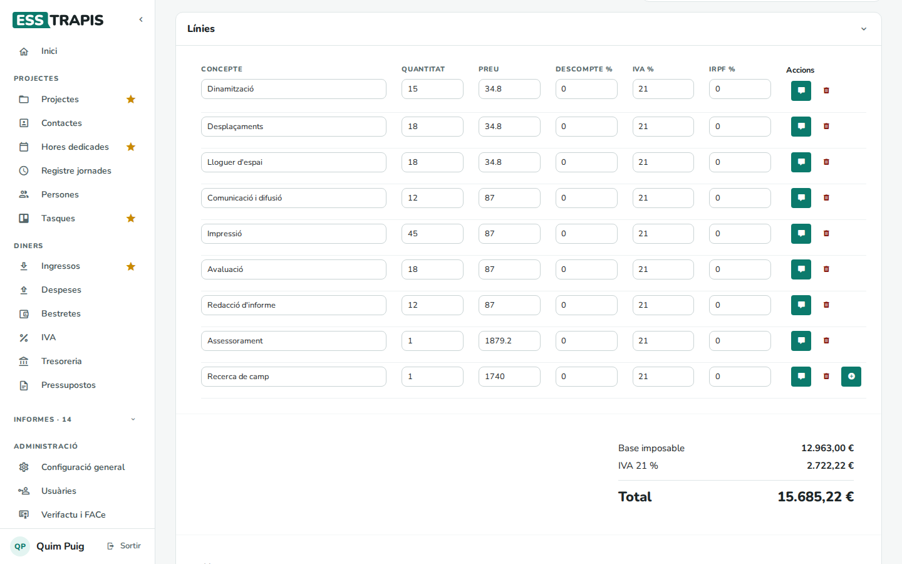
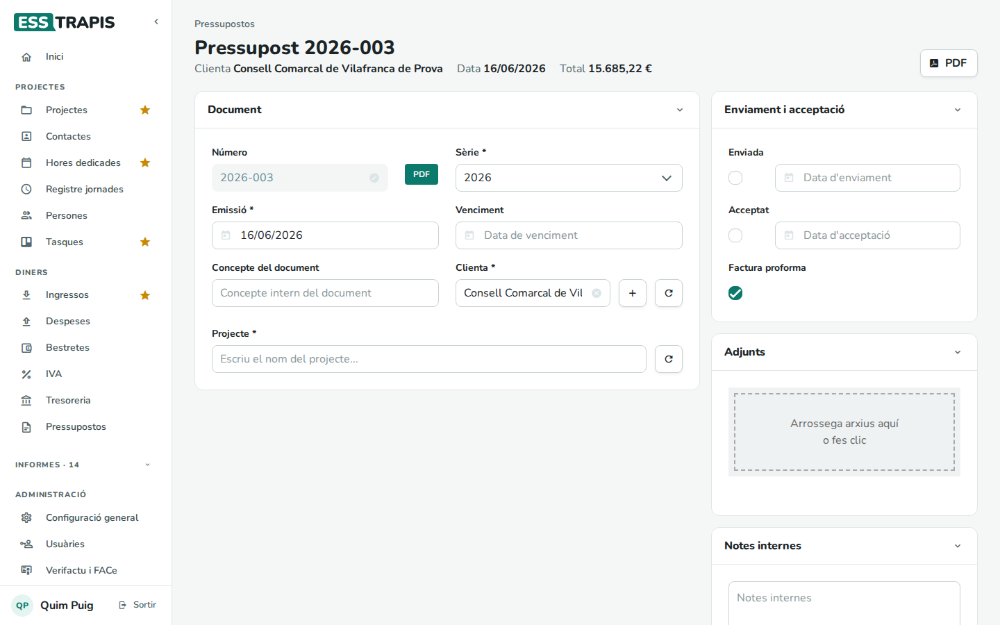
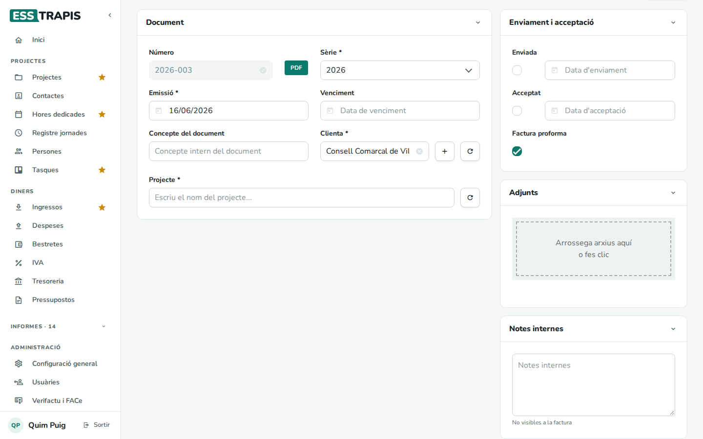
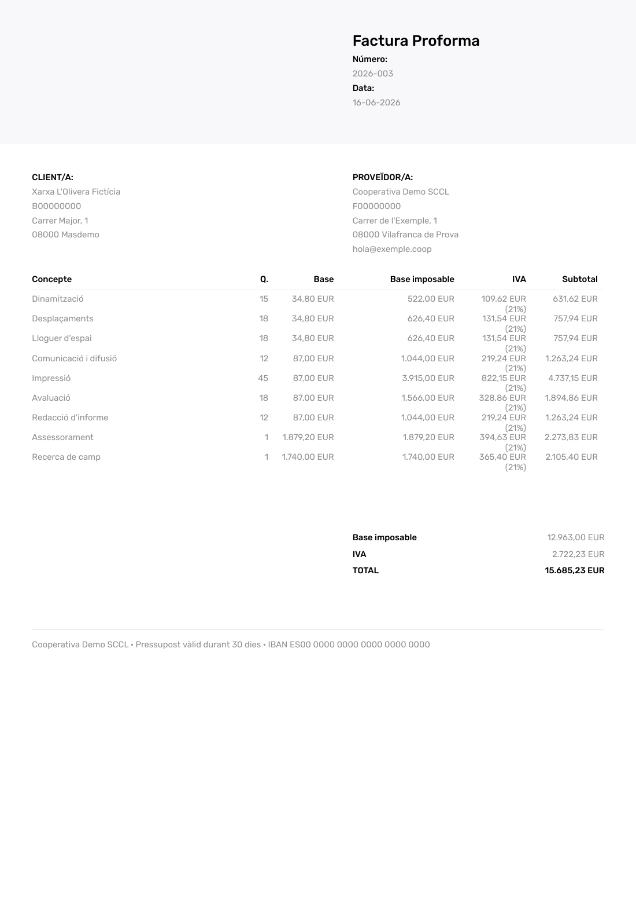

# 12. Pressupostos

> Permís necessari: `projects`

Un **pressupost** és l'oferta que s'envia a una clienta abans de fer la feina: les línies de concepte,
quantitat i preu, amb l'IVA, en un PDF amb les dades de l'entitat. També es pot fer servir com a **factura
proforma**. Cada pressupost està lligat a un projecte i se'n pot marcar quan s'ha enviat i quan s'ha
acceptat.

## Abans de començar

- La clienta ha de ser un **contacte** (vegeu [11. Contactes](11-contactes.md)) i el projecte ha d'existir
  (vegeu [04. Crear i editar un projecte](04-crear-editar-projecte.md)).
- La numeració surt de les **sèries** de pressupostos, a **Administració › Taules auxiliars**.
- Les dades de l'entitat que surten al PDF (nom, NIF, adreça, logo) són a **Administració › Configuració
  general**.

## La llista de pressupostos

**Diners › Pressupostos**.

- **Any**: l'any dels pressupostos que es mostren.
- **Pressupostat**: la base (sense IVA) de tots els pressupostos de l'any. **Acceptat**: la dels acceptats.
  **Pendent de resposta**: la resta.
- Columnes: **Codi**, **Data**, **Contacte** (amb el NIF), **Concepte** (la primera línia), **Projecte**,
  **Base** i **Estat** (**Pendent** o **Acceptat**, amb la data d'acceptació).
- **Exporta** descarrega la llista; **Nou pressupost** obre un pressupost en blanc.

## Pas a pas

### 1. Crear un pressupost

**Nou pressupost** obre el formulari.

Bloc **Document**:

| Camp | Què vol dir |
|---|---|
| **Número** | S'assigna sol en desar, segons la sèrie. |
| **Sèrie** * | La numeració (normalment, una per any). |
| **Emissió** * | La data del pressupost. |
| **Venciment** | Fins quan és vàlid. |
| **Concepte del document** | Un concepte intern, per trobar-lo a la llista. |
| **Clienta** * | S'escriu una part del nom i es tria. El **+** crea un contacte nou (en una pestanya nova) i la fletxa rodona torna a carregar la llista. |
| **Projecte** * | El projecte a què correspon. |

Bloc **Línies**, a sota: una línia per concepte, amb **Concepte**, **Quantitat**, **Preu**, **Descompte %**,
**IVA %** i **IRPF %**. El botó verd de cada línia obre una **Descripció del concepte** més llarga, que surt
al PDF sota la línia; la paperera l'esborra i el **+** de l'última n'afegeix una altra. A baix es calculen la
**Base imposable**, l'**IVA** i el **Total**. També hi ha unes **Notes** visibles al document.

Els **Adjunts** (per exemple, la memòria tècnica) es poden afegir un cop desat el pressupost. Les **Notes
internes** no surten al PDF.

### 2. Consultar i editar un pressupost

Clicant el codi a la llista s'obre el pressupost. A dalt es veuen la clienta, la data i el total, i a la
dreta el botó **PDF**.

### 3. Enviament i acceptació

Al bloc **Enviament i acceptació**:

- **Enviada**: marcar-la i posar-hi la data quan s'envia a la clienta.
- **Acceptat**: marcar-lo i posar-hi la data quan la clienta l'accepta. A la llista passa a **Acceptat**.
- **Factura proforma**: el PDF surt amb el títol *Factura proforma* en lloc de *Pressupost*.

### 4. El PDF

El botó **PDF** obre la vista prèvia del document *tal com surt al PDF*: les dades de l'entitat
(**PROVEÏDOR**), les de la clienta (**CLIENT**), les línies amb l'IVA i els totals. **Descarrega PDF** el
desa; **Torna al document** torna al formulari.

Les dades de la clienta que surten al PDF són les que es van desar amb el pressupost. Si després es
canvia la fitxa del contacte, cal tornar a desar el pressupost perquè el PDF les agafi.

### 5. Després de l'acceptació

Quan la clienta accepta el pressupost, el pressupost del projecte (fases i línies d'ingrés) es prepara a la
pestanya **Pressupost i fases** del projecte (vegeu [05](05-fases-pressupost.md)), i a l'hora de cobrar es
fa la factura a **Diners › Ingressos** (vegeu [17. Factures emeses](17-factures-emeses.md)).

## Preguntes freqüents

**No puc desar el pressupost.** Comproveu els camps obligatoris: **Sèrie**, **Emissió**, **Clienta** i
**Projecte**.

**El PDF mostra una adreça antiga de la clienta.** El pressupost guarda les dades de la clienta del moment en
què es va desar. Torneu-lo a desar.

## Vegeu també

- [11. Contactes](11-contactes.md)
- [04. Crear i editar un projecte](04-crear-editar-projecte.md)
- [17. Factures emeses](17-factures-emeses.md)
