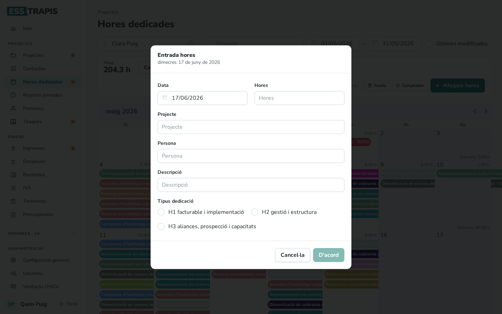
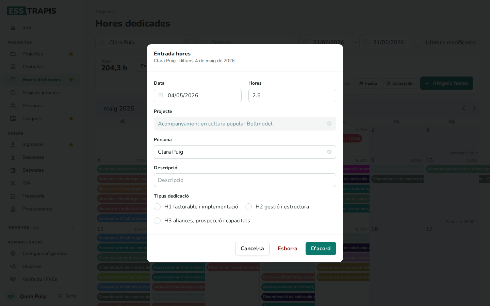
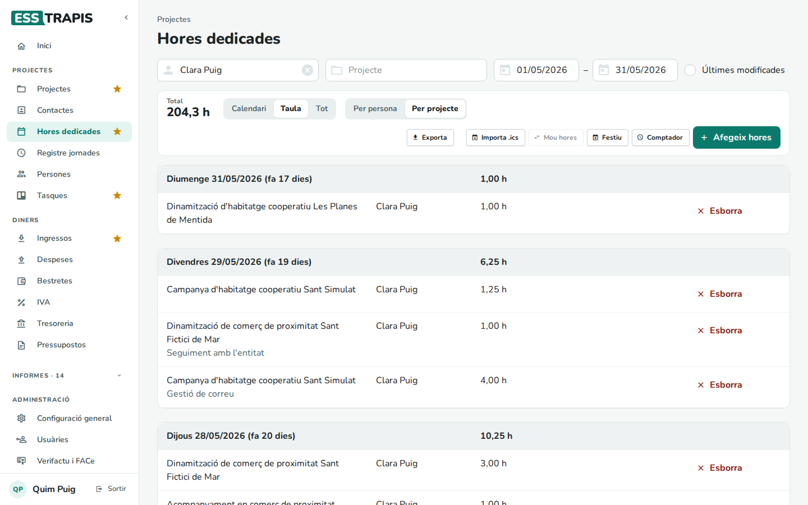
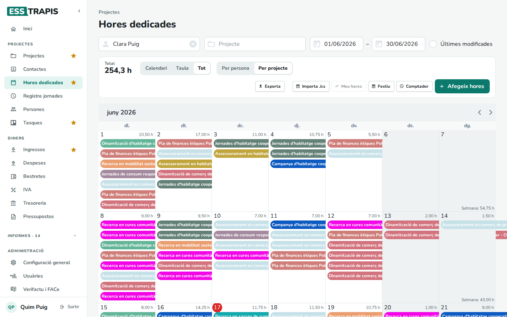
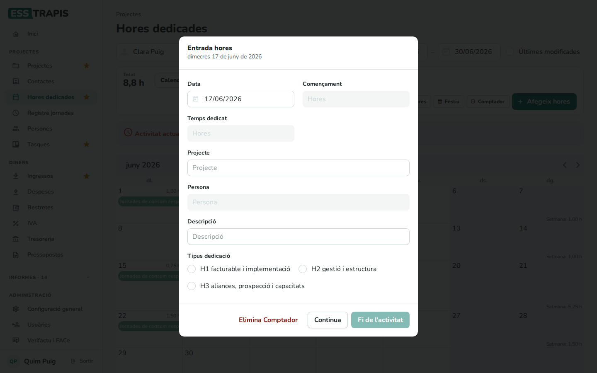
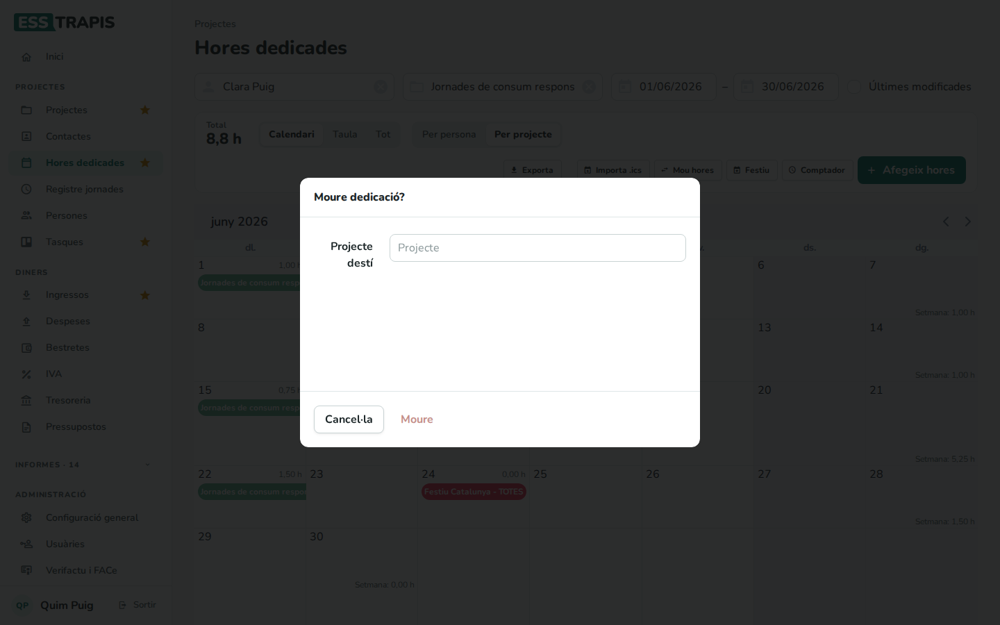
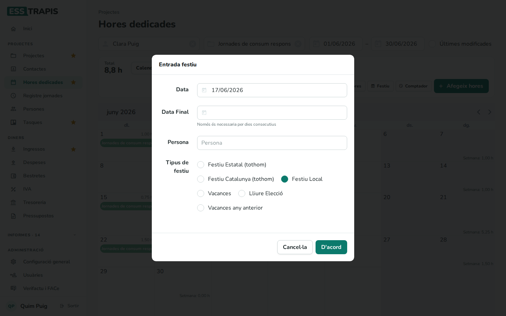

# 13. Imputar hores dedicades

> Permís necessari: `hours`

Cada persona apunta les **hores** que dedica a cada projecte, dia a dia: és el que s'anomena **imputar
hores**. Amb aquestes hores ESSTRAPIS calcula el cost real dels projectes (hores × cost per hora), el saldo
d'hores de cada persona i els informes de dedicació. La pantalla és **Projectes › Hores dedicades**.

## Abans de començar

- Cal el permís **Hores** (`hours`). Qui només té aquest permís entra directament en aquesta pantalla i
  veu les seves hores.
- Els projectes han d'existir i estar en un estat que admeti hores (normalment, actius). Els **tipus de dedicació** (per exemple, *H1 facturable*, *H2
  gestió i estructura*) es configuren a **Administració › Taules auxiliars**.
- Per importar hores d'un calendari, la persona ha de tenir l'adreça del seu calendari **iCal** a la fitxa
  (**El meu compte**).

## La pantalla

**Filtres de dalt**: **Persona** (en entrar, la persona que ha entrat; amb la creu es buida per veure les de
tothom), **Projecte**, les dates d'inici i final i **Últimes modificades** (les entrades canviades els últims
7 dies, sense tenir en compte les dates).

**Barra d'eines**:

- **Total**: les hores del període filtrat.
- **Calendari** / **Taula** / **Tot**: la forma de veure les hores (vegeu més avall).
- **Per persona** / **Per projecte**: de quin color surt cada entrada al calendari.
- **Exporta**: les hores en un full de càlcul. **Importa .ics**, **Mou hores**, **Festiu** i
  **Comptador**: vegeu més avall. **Afegeix hores**: una entrada nova.

Al calendari, cada dia mostra les seves entrades (*projecte - persona - hores*) i, a dalt a la dreta, la
suma del dia. A diumenge hi ha la suma de la setmana. Els festius surten en vermell. Les fletxes canvien de
mes.

Al **mòbil**, el calendari no té espai per als noms: cada dia mostra la suma i una ratlla del color de cada
entrada. A sota hi ha la llista del mes, per setmanes i dies, amb el nom sencer del projecte i les hores de
cada entrada. Tocant un dia del calendari, la llista hi salta (si el dia no té hores, s'obre **Entrada hores**).
Tocant una entrada s'obre per canviar-la, i el **+** de cada dia hi afegeix hores.

## Pas a pas

### 1. Afegir hores

1. Clicar un dia del calendari (o **Afegeix hores**). S'obre la finestra **Entrada hores**.
2. Omplir:

   | Camp | Què vol dir |
   |---|---|
   | **Data** | El dia. |
   | **Hores** | Les hores dedicades (amb decimals: 1,5 és una hora i mitja). |
   | **Projecte** | S'escriu una part del nom i es tria. Només hi surten els projectes en un estat que admet hores (normalment, els actius). |
   | **Persona** | Qui ha fet les hores (per defecte, la persona del filtre). |
   | **Descripció** | Què s'ha fet (opcional, però ajuda a l'hora de justificar). |
   | **Tipus dedicació** | El tipus de feina. Si el projecte en té un per defecte, ja surt marcat. |
   | **Funció**, **Tasca** | Només surten si el projecte té funcions o tasques: per classificar les hores. |

3. **D'acord**. Surt l'avís **Guardat** i l'entrada apareix al calendari.

### 2. Canviar o esborrar unes hores

Clicant una entrada del calendari s'obre la mateixa finestra amb les seves dades: es canvien i es fa **D'acord**,
o **Esborra** per treure-la.

### 3. Les altres vistes

- **Taula**: les entrades agrupades per dia (del més recent al més antic), amb el total del dia, el projecte,
  la persona, les hores i la descripció. Cada fila té **Esborra**, i clicant-la s'edita.

  
- **Tot**: el calendari amb totes les entrades del dia desplegades.

  

### 4. Comptador de temps

Per cronometrar una feina mentre es fa:

1. **Comptador** comença a comptar des d'aquest moment i obre la finestra amb el **Començament**. A dalt
   de la pantalla surt la barra **Activitat actual** mentre el comptador corre.
2. Es pot triar ja el **Projecte**, la **Descripció** i el **Tipus dedicació**, i clicar **Continua** per
   tancar la finestra sense aturar-lo.
3. Quan s'acaba, tornar-la a obrir i clicar **Fi de l'activitat**: es crea l'entrada amb el **Temps
   dedicat**. **Elimina Comptador** l'atura sense crear-ne cap.

### 5. Moure hores d'un projecte a un altre

Quan s'han imputat hores al projecte equivocat:

1. Filtrar per la **Persona**, el **Projecte** d'origen i les dates.
2. **Mou hores** (només s'activa amb un projecte al filtre) i triar el **Projecte destí**.
3. **Moure**. Totes les hores filtrades passen al projecte destí (*Actualitzat!*).

### 6. Festius i vacances

**Festiu** obre **Entrada festiu**: la **Data** (i la **Data Final** si són dies seguits), la **Persona** i el
**Tipus de festiu**: **Festiu Local**, **Vacances**, **Lliure Elecció** o **Vacances any anterior**. Aquests
dies no compten com a jornada a treballar al saldo d'hores (vegeu
[16. Saldo d'hores](16-saldo-hores.md)). Els festius de tothom (com els oficials) surten amb *TOTES*.

Els festius de tothom (**Festiu Estatal**, **Festiu Catalunya**) només els afegeix, canvia o esborra una persona
administradora: al mateix diàleg li surten marcats «(tothom)», i en triar-ne un la **Persona** passa a ser
**Tothom**. La resta de persones, en fer clic a un festiu de tothom del calendari, el veuen en només lectura.

### 7. Importar d'un calendari

**Importa .ics** llegeix el calendari personal (iCal) de la persona filtrada i mostra les seves cites del
període com a entrades pendents, perquè se'ls assigni un projecte i es desin una a una. Si la persona no té
calendari, ho avisa: *La usuària no te un calendari de tipus iCal definit*.

## Preguntes freqüents

**No veig cap hora.** Comproveu la **Persona**: si està buida i no hi ha cap projecte triat, la pantalla
demana *Tria una persona, o «Totes», per veure'n les hores*. Comproveu també les dates i el mes del
calendari.

**No trobo el projecte a la finestra.** Només hi surten els projectes en un estat que admet hores
(normalment, els actius). Si el projecte està tancat, cal parlar amb qui el coordina.

**He imputat hores al projecte que no tocava.** Obriu l'entrada i canvieu-ne el projecte, o feu servir **Mou
hores** si n'hi ha moltes.

## Vegeu també

- [14. Registre de jornada](14-registre-jornada.md)
- [15. Persones i jornades laborals](15-persones-jornades.md)
- [16. Saldo d'hores i hores anuals](16-saldo-hores.md)
- [26. Informes de dedicació](26-informes-dedicacio.md)
