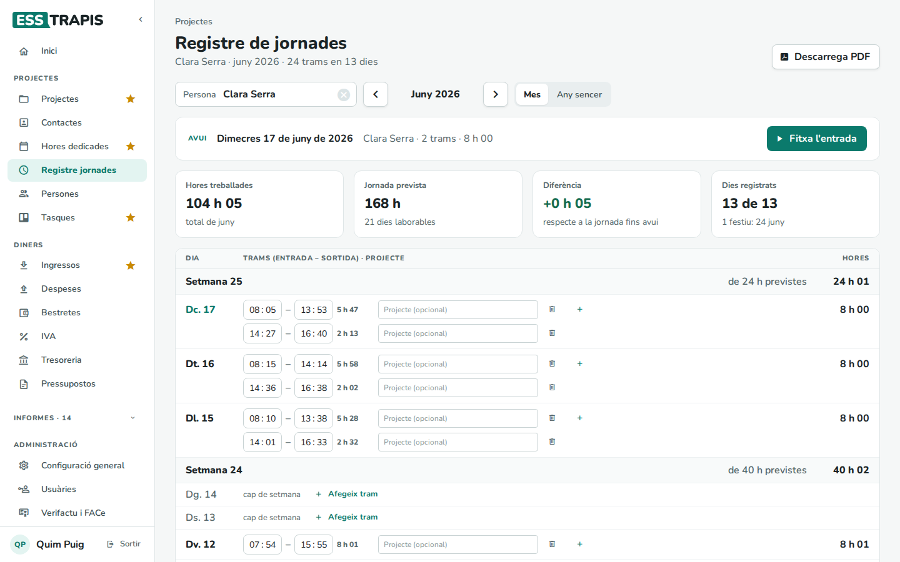
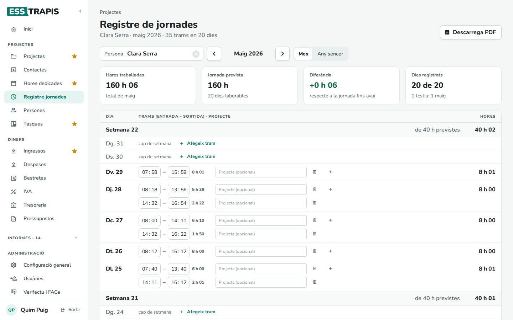
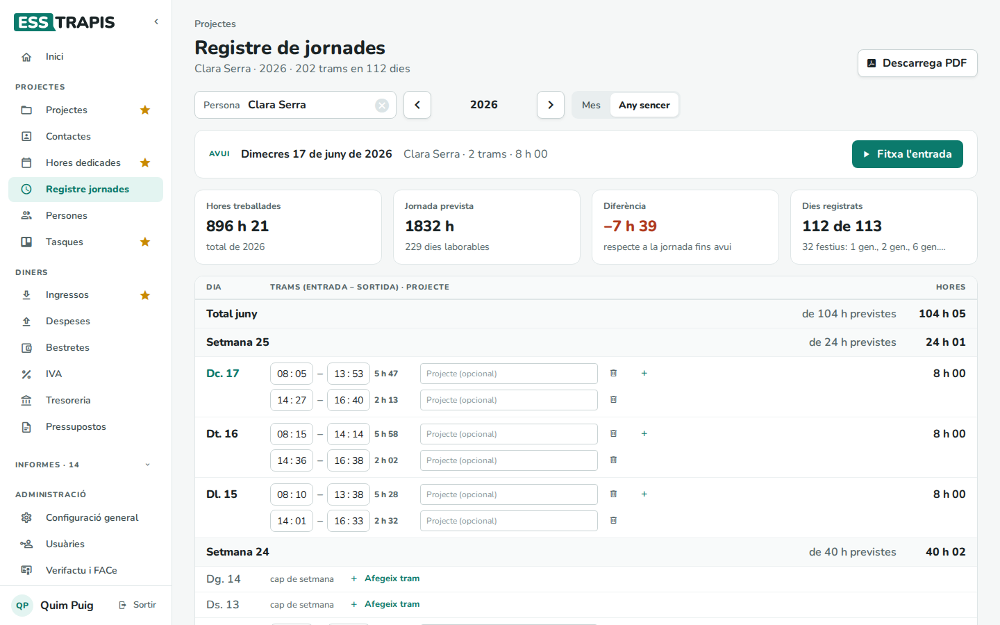

# 14. Registre de jornada

> Permís necessari: `hours`

El **registre de jornada** és l'horari d'entrada i sortida de cada dia de feina, que la llei obliga a
guardar. A ESSTRAPIS cada persona **fitxa** l'entrada i la sortida (o les escriu a mà), i la pantalla compara
les hores fetes amb la jornada prevista. És a **Projectes › Registre jornades**.

No és el mateix que les **hores dedicades** (vegeu [13. Imputar hores dedicades](13-imputar-hores.md)): el
registre diu quan s'ha treballat; les hores dedicades, a quins projectes. Es poden lligar (vegeu el pas 3).

## Abans de començar

- La **jornada prevista** surt de la jornada laboral de cada persona (vegeu
  [15. Persones i jornades laborals](15-persones-jornades.md)) i dels seus festius i vacances.

## La pantalla

- **Persona**: de qui es veu el registre. Si no n'hi ha cap de triada, la pantalla diu *Tria una persona per
  veure el seu registre*.
- Les fletxes canvien de mes (o d'any); **Mes** / **Any sencer** canvia el període.
- **Descarrega PDF**: el registre del període en PDF, per arxivar-lo o donar-lo a qui el demani.
- **Avui**: quan es mira el mes en curs, la franja de dalt mostra el dia d'avui, els trams i les hores fetes, i
  el botó **Fitxa l'entrada** (o **Fitxa la sortida** si hi ha un tram obert).
- Xifres: **Hores treballades**, **Jornada prevista** (i els dies laborables), **Diferència** respecte a la
  jornada fins avui (en verd si se'n fan més, en vermell si menys) i **Dies registrats** (amb els festius del
  període).

A sota hi ha els dies, del més recent al més antic, agrupats per setmana (amb les hores previstes i fetes de
cada setmana). Cada dia té els seus **trams** (entrada – sortida), la durada de cada tram i el total del dia.
Els caps de setmana i els festius surten més clars.

## Pas a pas

### 1. Fitxar

En començar a treballar, **Fitxa l'entrada**: es crea un tram amb l'hora d'ara. En plegar, **Fitxa la
sortida**. Si es fa pausa per dinar, es torna a fitxar l'entrada en tornar: es crea un segon tram.

### 2. Escriure o corregir un tram a mà

- Les hores i els minuts de cada tram es poden escriure directament (**hh** : **mm**). Els canvis es desen
  sols.
- El **+** d'un dia (o **Afegeix tram** en un dia buit) afegeix un tram nou.
- La paperera esborra el tram, després de demanar-ne confirmació.
- Si la sortida és abans de l'entrada, el tram ho avisa: *La sortida és abans de l'entrada*.

### 3. Lligar un tram a un projecte

Al costat de cada tram hi ha **Projecte (opcional)**. Si s'hi tria un projecte, es crea automàticament una
entrada d'**hores dedicades** a aquell projecte amb la durada del tram; si es canvia el tram, l'entrada
s'actualitza, i si es treu el projecte, s'esborra. Així no cal apuntar les mateixes hores dues vegades.

### 4. L'any sencer

**Any sencer** mostra tot l'any: les xifres de dalt són de l'any (amb tots els festius), i la llista té un total
per a cada mes.

## Preguntes freqüents

**La jornada prevista no és la que toca.** Surt de la jornada laboral de la persona i dels seus festius.
Reviseu-los a **Persones** i a **Hores dedicades › Festiu**.

**He fitxat l'entrada i he marxat sense fitxar la sortida.** Escriviu l'hora de sortida a mà al tram obert.

## Vegeu també

- [13. Imputar hores dedicades](13-imputar-hores.md)
- [15. Persones i jornades laborals](15-persones-jornades.md)
- [16. Saldo d'hores i hores anuals](16-saldo-hores.md)
