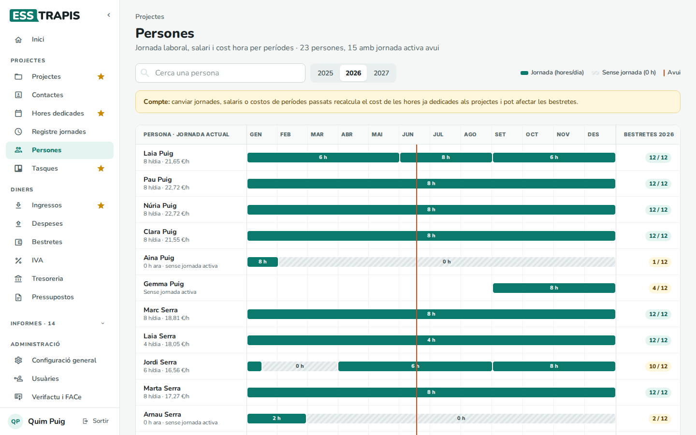
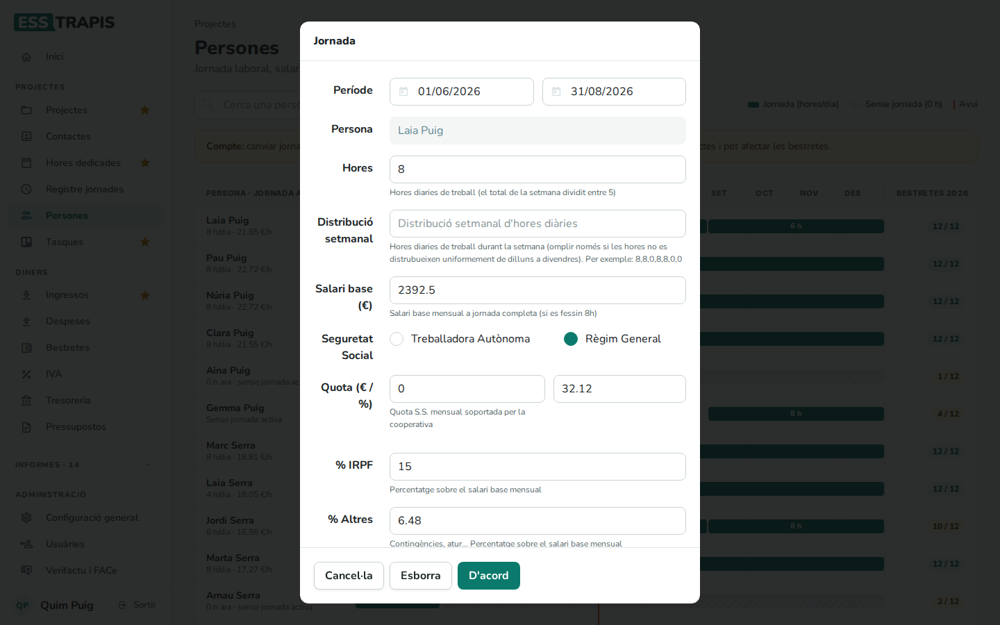
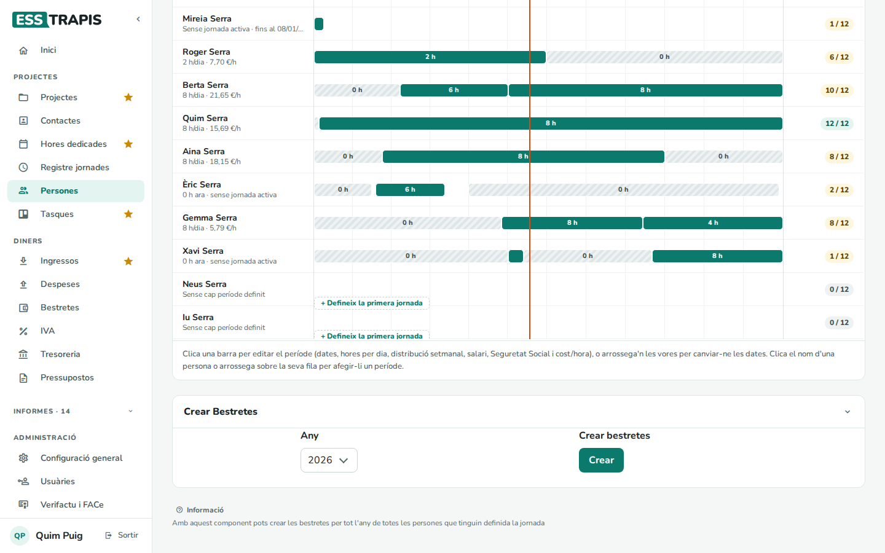

# 15. Persones i jornades laborals

> Permís necessari: `projects`

La pantalla **Persones** guarda, per a cada persona de l'equip, els seus **períodes de jornada**: quantes
hores treballa cada dia, el salari, la Seguretat Social i el **cost per hora** que en resulta. D'aquí surten:

- el cost de les hores que la persona imputa als projectes (hores × cost per hora);
- la jornada prevista del registre de jornada i del saldo d'hores;
- les **bestretes** (nòmines) de cada mes.

És a **Projectes › Persones**.

## Abans de començar

- Les persones són les **usuàries** de l'aplicació (vegeu [02. Usuàries, rols i permisos](02-usuaris-rols-permisos.md)).
- Les **hores anuals** de jornada completa de cada any (per calcular el cost per hora) es configuren a
  **Administració › Taules auxiliars › Anys**. Si un any no en té, es fan servir 1.764 hores.

## La pantalla

- **Cerca una persona** i els botons d'any (**2025**, **2026**, **2027**…).
- A l'esquerra, cada persona amb la seva jornada actual (*8 h/dia · 21,65 €/h*), o *Sense jornada activa*.
- Al centre, l'any: cada barra verda és un període de jornada amb les hores per dia; les ratllades (**0 h**) són
  períodes sense jornada (una excedència, per exemple). La línia vermella és avui.
- A la dreta, **Bestretes** de l'any: quantes bestretes mensuals té creades la persona (*12 / 12*).
- L'avís groc recorda que canviar jornades, salaris o costos de períodes passats **recalcula el cost de les
  hores ja dedicades** als projectes i pot afectar les bestretes.

## Pas a pas

### 1. Afegir un període de jornada

Clicar el nom de la persona, o arrossegar sobre la seva fila les dates del període (per a una persona sense
cap període, **Defineix la primera jornada**). S'obre la finestra **Jornada**.

### 2. Les dades d'un període

Clicant una barra s'obre el període per canviar-lo; arrossegant-ne les vores se'n canvien les dates.

| Camp | Què vol dir |
|---|---|
| **Període** | Dates d'inici i final. |
| **Hores** | Hores de treball diàries (el total de la setmana dividit entre 5). |
| **Distribució setmanal** | Només si les hores no són iguals de dilluns a divendres: les hores de cada dia de la setmana separades per comes, de dilluns a diumenge (per exemple, *8,8,0,8,8,0,0*). |
| **Salari base (€)** | Salari base mensual a jornada completa (com si es fessin 8 h). |
| **Seguretat Social** | **Treballadora Autònoma** o **Règim General**. En triar-ho, la quota, l'IRPF i els altres s'omplen amb els valors de **Configuració general › Persones i dietes** (vegeu [34](34-configuracio-general.md)). |
| **Quota (€ / %)** | La quota mensual de la Seguretat Social que paga la cooperativa: un import fix o un percentatge del salari base. |
| **% IRPF** | Retenció, en percentatge del salari base. |
| **% Altres** | Contingències, atur…, en percentatge del salari base. |
| **Cost/hora (€)** | El cost d'una hora d'aquesta persona per a la cooperativa. Es calcula sol (vegeu més avall). |

**D'acord** desa el període; **Esborra** l'elimina.

### 3. Crear les bestretes de l'any

Al bloc **Crear Bestretes**, triar l'**Any** i clicar **Crear**: es creen les bestretes de tots els mesos
de l'any per a totes les persones que tenen jornada definida. Després es poden revisar a **Diners ›
Bestretes** (vegeu [20. Bestretes](20-bestretes.md)).

## Com es calcula

**Cost per hora** = (salari base + quota fixa + quota % × salari base) × 12 ÷ hores anuals de l'any.

Per exemple, amb un salari base de 2.392,50 €, una quota del 32,12 % i 1.764 hores l'any: (2.392,50 + 768,47)
× 12 ÷ 1.764 = 21,50 €/h.

## Preguntes freqüents

**Una persona surt amb «s/j» a la previsió de dedicació.** No té cap període de jornada definit en aquelles
dates. Cal afegir-n'hi un.

**He canviat el salari i ha canviat el resultat d'un projecte antic.** Si el període canviat inclou dates
passades, el cost de les hores ja imputades es recalcula. Per a un canvi de salari a partir d'una data, cal
tancar el període a la vigília i crear-ne un de nou.

## Vegeu també

- [13. Imputar hores dedicades](13-imputar-hores.md)
- [14. Registre de jornada](14-registre-jornada.md)
- [16. Saldo d'hores i hores anuals](16-saldo-hores.md)
- [20. Bestretes](20-bestretes.md)
