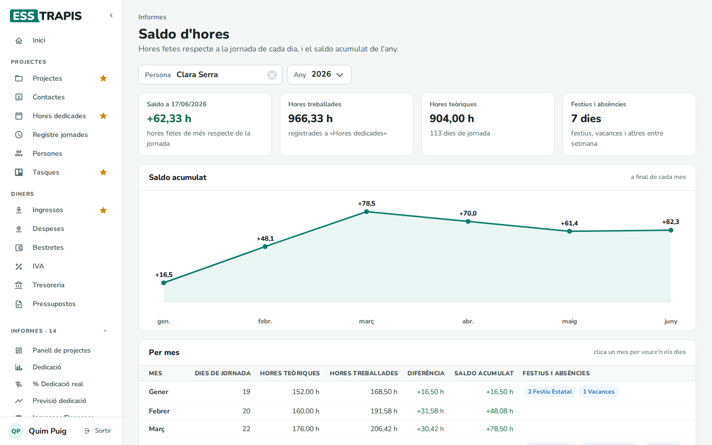
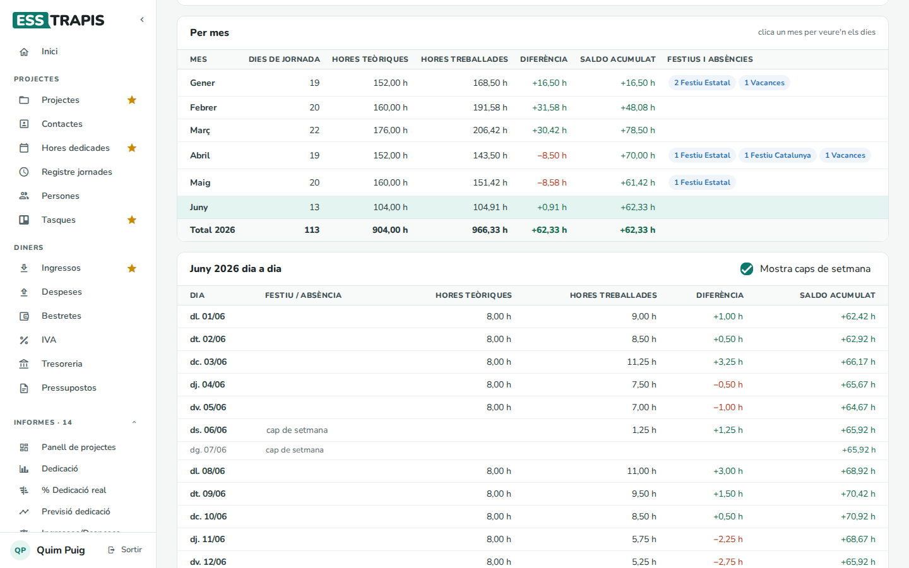
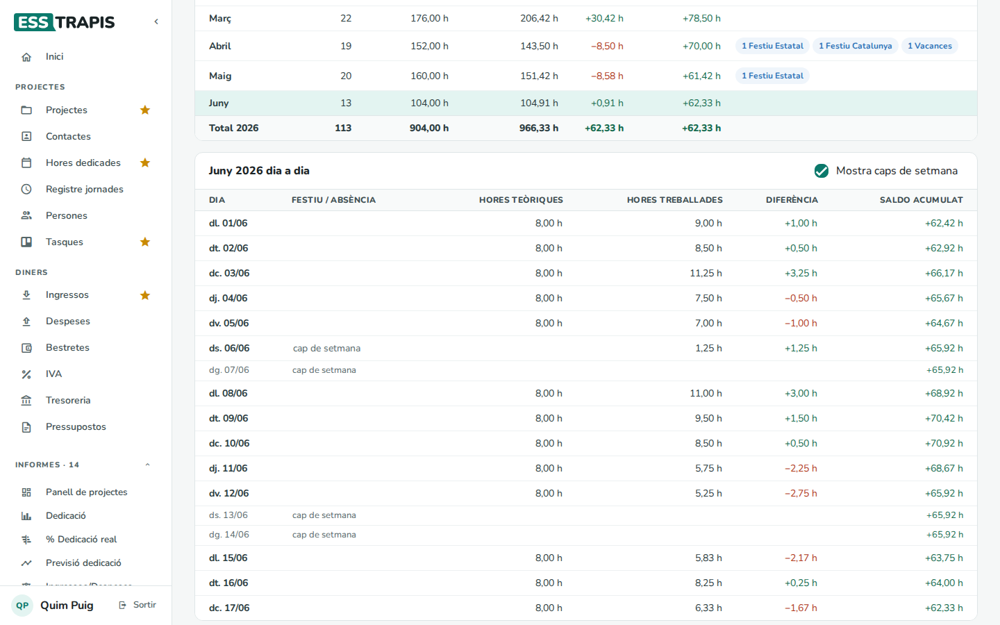
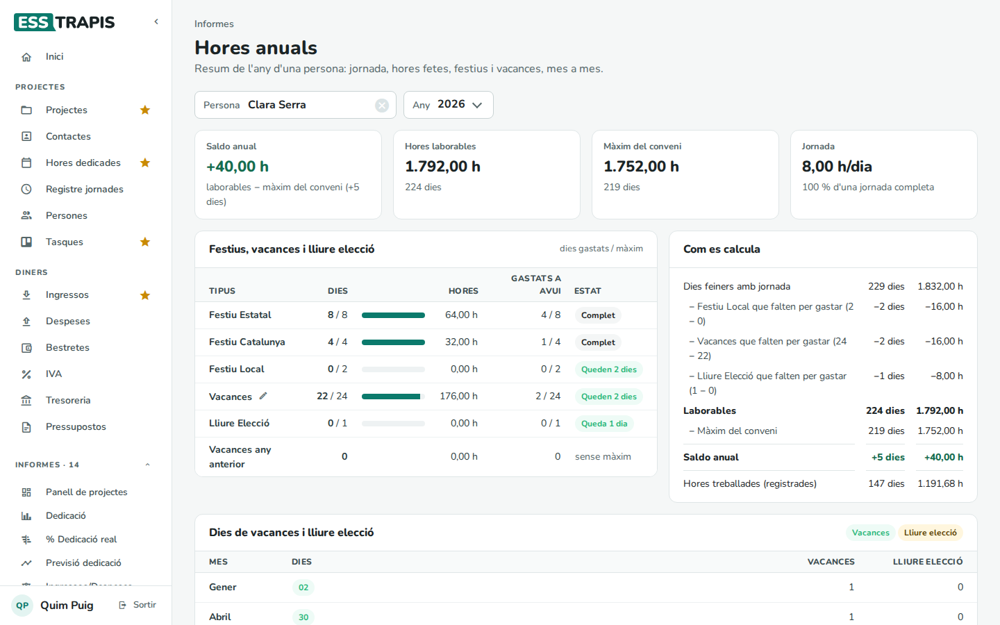
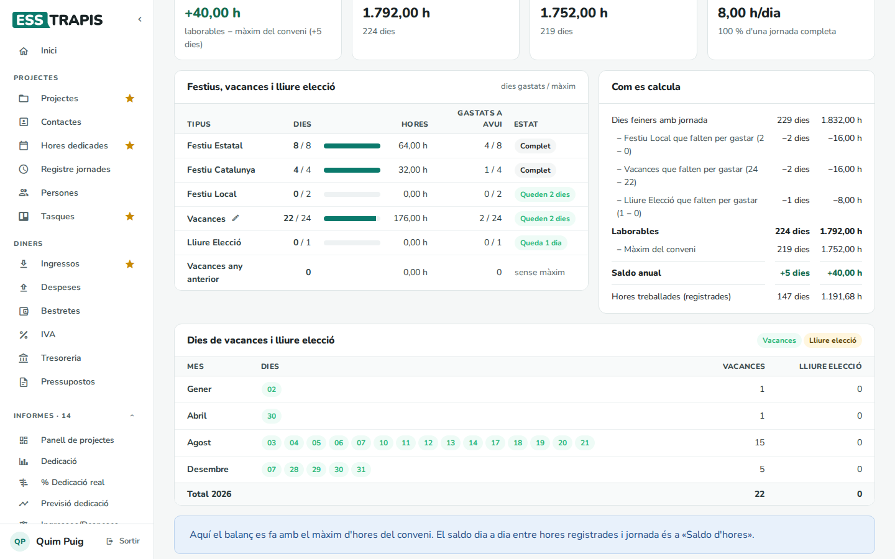

# 16. Saldo d'hores i hores anuals

> Permís necessari: `projects`

Dos informes comparen les hores que fa cada persona amb les que li toquen:

- **Saldo d'hores**: dia a dia, les hores imputades respecte a la jornada, i el **saldo acumulat** de l'any
  (quantes hores de més o de menys porta).
- **Hores anuals**: el balanç de l'any amb el **màxim d'hores del conveni**, tenint en compte els festius, les
  vacances i els dies de lliure elecció.

Tots dos són a **Informes**.

## Abans de començar

- La persona ha de tenir la **jornada laboral** definida per a tot l'any (vegeu
  [15. Persones i jornades laborals](15-persones-jornades.md)). Si no, **Hores anuals** ho avisa.
- Els festius, les vacances i els dies de lliure elecció s'apunten a **Hores dedicades › Festiu** (vegeu
  [13](13-imputar-hores.md#6-festius-i-vacances)).
- Les **hores de conveni** de cada any són a **Administració › Taules auxiliars › Anys** (**Hores de treball**).
  El màxim de dies de cada tipus de festiu és general (**Taules auxiliars › Tipus de festiu**), i es pot
  personalitzar per a una persona i un any a **Taules auxiliars › Festius d'usuari**.

## Saldo d'hores

Triar la **Persona** i l'**Any**.

- **Saldo a** (avui): les hores fetes de més (en verd) o de menys (en vermell) respecte a la jornada.
- **Hores treballades**: les registrades a **Hores dedicades**.
- **Hores teòriques**: les de la jornada, i quants dies de jornada hi ha.
- **Festius i absències**: els festius, vacances i altres absències entre setmana.
- **Saldo acumulat**: el gràfic del saldo a final de cada mes.

**Per mes**: una fila per mes amb els dies de jornada, les hores teòriques i treballades, la diferència del
mes, el saldo acumulat i els festius i absències. Clicant un mes es veu **dia a dia** a sota (**Mostra caps
de setmana** hi afegeix els dissabtes i diumenges).

## Hores anuals

Triar la **Persona** i l'**Any**.

- **Saldo anual**: hores laborables − màxim del conveni (també en dies).
- **Hores laborables**: les hores de jornada de l'any un cop descomptats els festius i les vacances que
  pertoquen (vegeu el càlcul).
- **Màxim del conveni**: les hores anuals del conveni, proporcionals a la jornada de la persona.
- **Jornada**: les hores per dia i el percentatge d'una jornada completa.

**Festius, vacances i lliure elecció**: per a cada tipus, els dies gastats sobre el màxim (amb una barra), les
hores, els **gastats a avui** (només l'any en curs) i l'**Estat**: **Complet**, **Queden N dies** o un avís en
vermell si se n'han gastat més dels disponibles. El llapis vol dir que el màxim d'aquesta persona és
personalitzat.

**Dies de vacances i lliure elecció**: els dies concrets de cada mes.

## Com es calcula

**Saldo d'hores** (de cada dia): hores treballades − hores teòriques (les de la jornada, zero els caps de
setmana, festius i absències). El saldo acumulat en suma tots els dies de l'any fins al dia.

**Hores anuals** (el bloc **Com es calcula** ho mostra amb les xifres de la persona):

1. **Dies feiners amb jornada** de l'any, en dies i hores.
2. Se'n resten els festius, vacances i dies de lliure elecció **que falten per gastar** (màxim − gastats):
   s'entén que es faran abans d'acabar l'any.
3. El resultat són les **Laborables**.
4. **Saldo anual** = laborables − **màxim del conveni**. Si és positiu, la persona té més hores de jornada
   que les del conveni.
5. A sota, les **Hores treballades (registrades)**, com a referència.

Hores anuals no mira les hores fetes dia a dia: per a això és el **Saldo d'hores**.

## Preguntes freqüents

**Hores anuals diu que cal definir la jornada.** La persona no té jornada per a tot l'any a **Persones**.

**El saldo d'hores surt molt negatiu a principi d'any.** Pot ser que falti apuntar festius o vacances: els
dies sense hores ni festiu compten com a jornada no feta.

## Vegeu també

- [13. Imputar hores dedicades](13-imputar-hores.md)
- [14. Registre de jornada](14-registre-jornada.md)
- [15. Persones i jornades laborals](15-persones-jornades.md)
