# 17. Ingressos: factures emeses

> Permís necessari: `projects`

A **Diners › Ingressos** es fan les **factures** que la cooperativa emet a les clientes i s'hi registren
els **altres ingressos** que no són factures (subvencions cobrades, inscripcions…). Cada ingrés es lliga a un
o més projectes i, dins del projecte, a la línia d'ingrés prevista que paga: així el projecte sap què s'ha
facturat i cobrat (l'*executat*).

Una factura passa per dos estats: **Esborrany** (es pot canviar tot) i **Emesa** (té número i ja no es pot
canviar; per corregir-la cal una factura **rectificativa**).

## Abans de començar

- La clienta ha de ser un contacte amb NIF i adreça (vegeu [11. Contactes](11-contactes.md)). Per enviar
  la factura per correu, ha de tenir l'**Email de contacte**.
- Les **sèries** (numeracions) i els **mètodes de cobrament** es configuren a **Administració › Taules
  auxiliars**. Per fer rectificatives cal una sèrie marcada com a rectificativa.
- Les dades de l'entitat que surten a la factura (nom, NIF, adreça, IBAN, logo) són a **Administració ›
  Configuració general**.
- Si l'entitat té activats **Verifactu** o **FACe**, en emetre la factura es registra o s'envia (vegeu
  [18. Verifactu i FACe](18-verifactu-face.md)).

## La llista d'ingressos

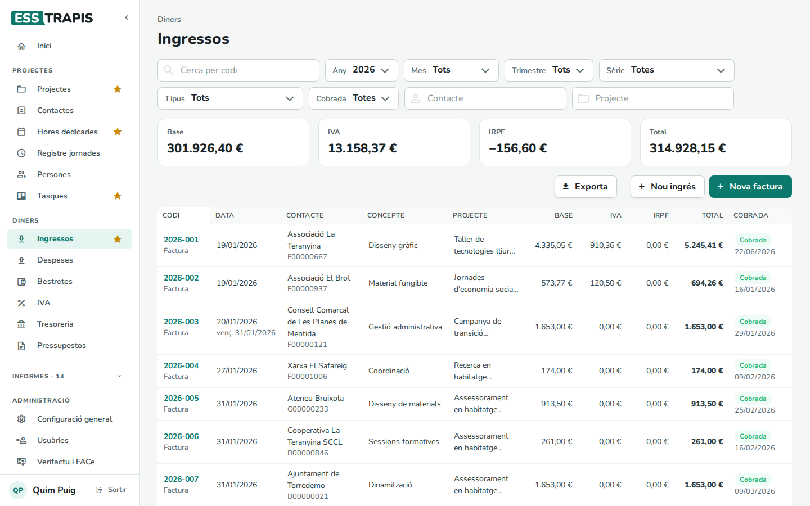

- Filtres: **Cerca per codi**, **Any**, **Mes**, **Trimestre**, **Sèrie**, **Tipus** (factura o altres
  ingressos), **Cobrada**, **Contacte** i **Projecte**.
- Totals de la llista: **Base**, **IVA**, **IRPF** i **Total**.
- Columnes: **Codi** (i el tipus), **Data** (i el venciment), **Contacte**, **Concepte**, **Projecte**,
  **Base**, **IVA**, **IRPF**, **Total** i **Cobrada** (amb la data).
- **Exporta** descarrega la llista; **Nou ingrés** i **Nova factura** creen un ingrés o una factura.

## Pas a pas

### 1. Fer una factura

1. **Nova factura**. La factura neix com a **ESBORRANY**.

   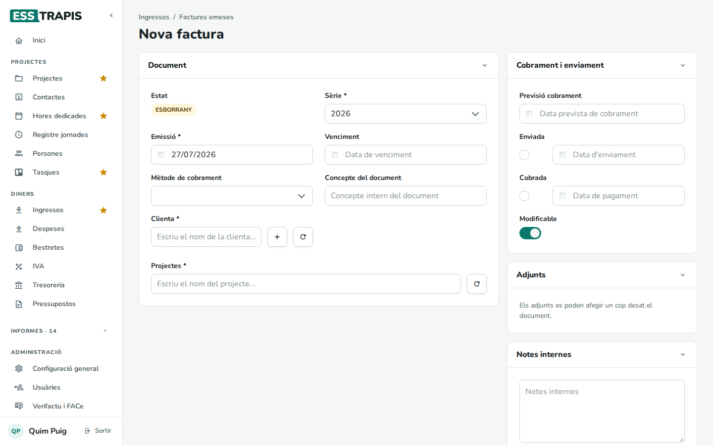

2. Bloc **Document**: la **Sèrie**, la data d'**Emissió** (vegeu la nota), el **Venciment**, el **Mètode de
   cobrament**, un **Concepte del document** intern, la **Clienta** i els **Projectes**.

   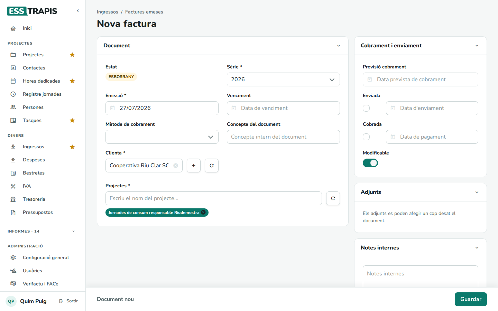

3. En triar un projecte, a sota apareix **DETALL DEL PROJECTE** amb les seves fases i línies d'ingrés. A la
   línia que aquesta factura paga, marcar **Fact.** i clicar l'etiqueta **Document**, que passa a
   **Assignat**. Si la factura no correspon a cap línia prevista, el **+** d'una fase hi afegeix una línia
   nova i ofereix associar-li la factura (*Vols crear una nova línia i associar-li el document
   automàticament?*).

   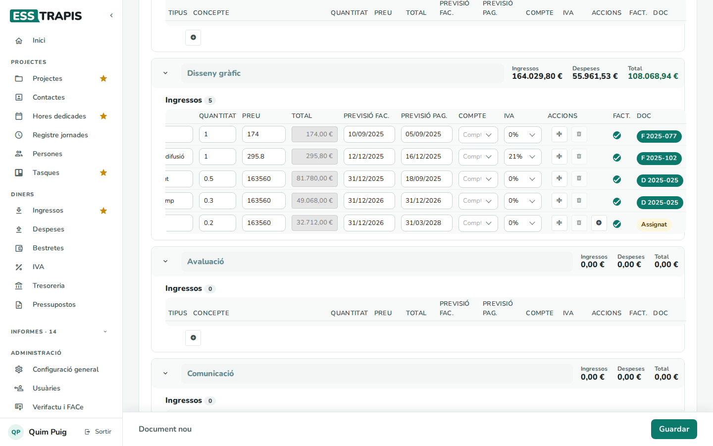

4. Bloc **Línies**: el **Concepte**, la **Quantitat**, el **Preu**, el **Descompte %**, l'**IVA %** i
   l'**IRPF %** de cada línia (com als pressupostos, vegeu [12](12-pressupostos.md#1-crear-un-pressupost)).
   A baix, la **Base imposable**, l'IVA, l'IRPF i el **Total**, i les **Notes** visibles a la factura.
5. **Guardar**. L'aplicació mostra un resum (*Aquesta factura s'emetrà com a ESBORRANY…*) i, amb **D'acord**,
   la desa.

> **La data d'emissió.** Les factures d'una sèrie han d'anar en ordre de data. Per això una factura nova no
> pot tenir una data anterior a l'última factura emesa de la sèrie, i si cal l'aplicació proposa aquesta data.

### 2. Revisar i emetre l'esborrany

Un esborrany desat té, a dalt, els botons **Editar dades de l'ESBORRANY**, **Eliminar esborrany** i
**Emetre factura (convertir a EMESA)**.

En emetre-la, l'aplicació avisa que *la factura passarà a EMESA i s'emetrà amb les dades següents, que no
podran ser modificades posteriorment*. Amb **D'acord**:

- la factura rep el **número** de la sèrie;
- es genera el **PDF** (*Factura emesa correctament*);
- si la clienta és una administració pública amb FACe, s'envia per FACe.

### 3. Una factura emesa

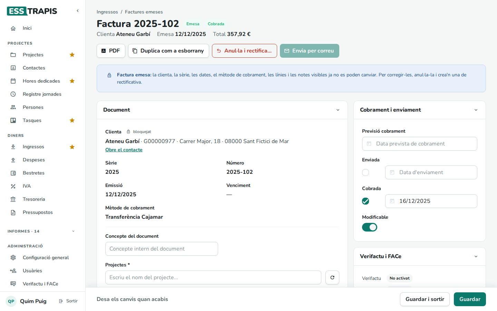

A dalt hi ha l'estat (**Emesa**, **Cobrada**, **Enviada**), la clienta, la data i el total, i els botons:

- **PDF**: obre el PDF de la factura.
- **Duplica com a esborrany**: una factura nova igual, en esborrany, per exemple per a una quota mensual.
- **Anul·la i rectifica…**: vegeu el pas 5.
- **Envia per correu**: desa la factura i l'envia a l'email de contacte de la clienta (*Correu enviat*).

L'avís blau recorda que la clienta, la sèrie, les dates, el mètode de cobrament, les línies i les notes
visibles ja no es poden canviar. El que sí que es pot canviar és el bloc **Cobrament i enviament**, els
adjunts, les notes internes i les línies del projecte assignades.

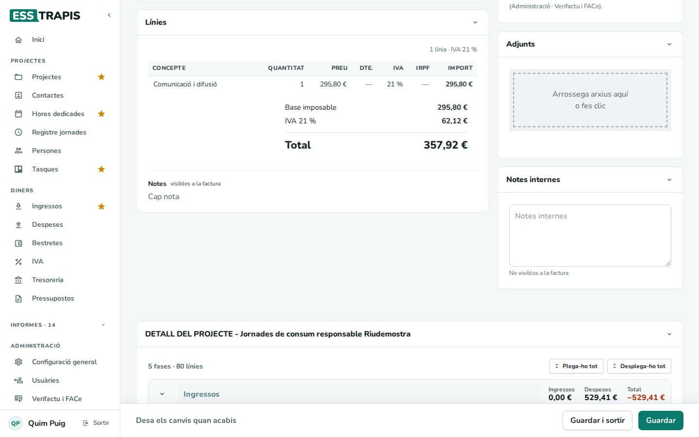

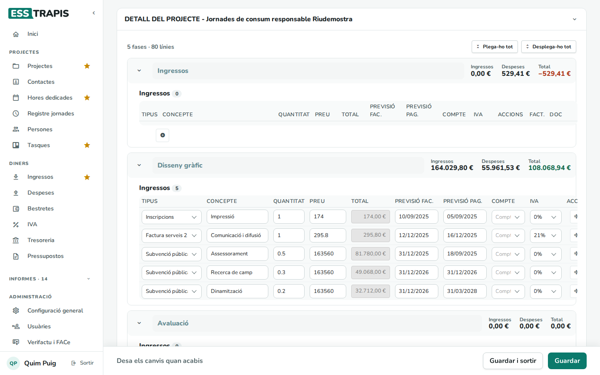

La vista prèvia mostra la factura tal com surt al PDF:

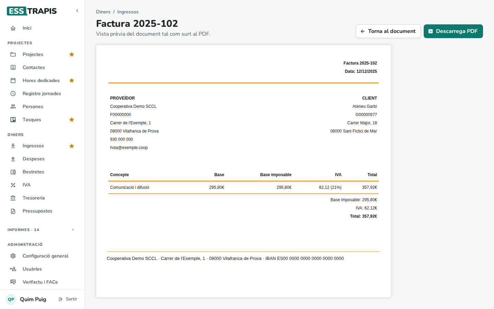

### 4. Marcar-la com a cobrada

Al bloc **Cobrament i enviament**:

| Camp | Què vol dir |
|---|---|
| **Previsió cobrament** | Quan es preveu cobrar-la. És la data que fa servir la tresoreria. |
| **Enviada** | Marcada (i la data) quan s'ha enviat a la clienta. |
| **Cobrada** | Marcada (i la data) quan s'ha cobrat. |
| **Modificable** | Si es desactiva, el document queda tancat: ja no es pot canviar ni esborrar, i la barra de baix diu *Document no modificable*. |

Després, **Guardar**.

### 5. Anul·lar i rectificar una factura

Una factura emesa amb un error no s'esborra: es fa una **factura rectificativa** que l'anul·la. **Anul·la i
rectifica…** converteix la pàgina en un esborrany nou amb:

- les mateixes línies amb la **quantitat en negatiu**, de manera que el total és el mateix en negatiu;
- la mateixa clienta i els mateixos projectes;
- la nota *Rectificativa de la factura …*;
- les sèries rectificatives per triar (si no n'hi ha cap, ho avisa).

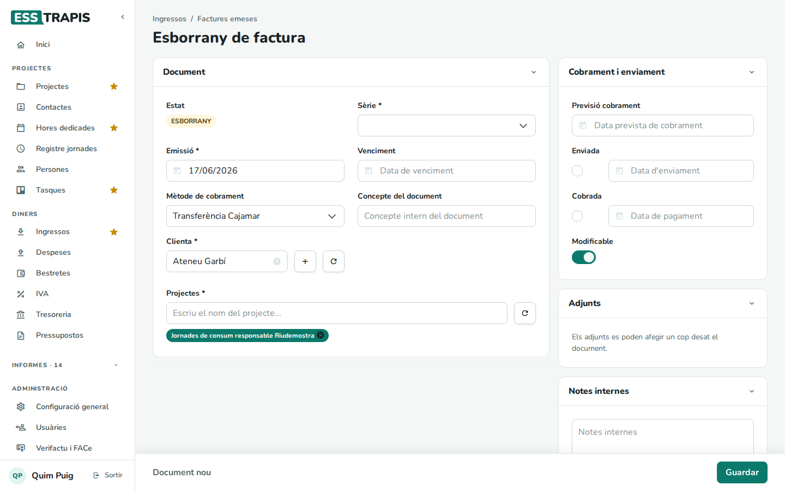

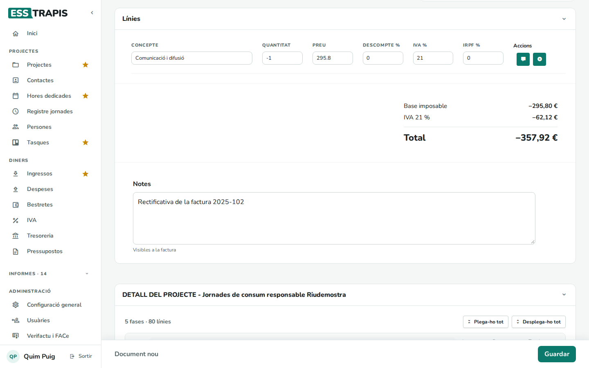

Es tria la **Sèrie**, es desa i s'emet com qualsevol factura. Després, si cal, es fa la factura correcta
(per exemple, amb **Duplica com a esborrany** des de l'original).

### 6. Altres ingressos

**Nou ingrés** registra un ingrés que no és una factura de la cooperativa (una subvenció cobrada, unes
inscripcions…). Té **Tipus**, **Sèrie**, **Emissió**, **Mètode de cobrament**, **Contacte**, **Projectes** i
línies, i s'assigna a les línies del projecte igual que una factura. A la llista i al projecte surt amb la
lletra **D**.

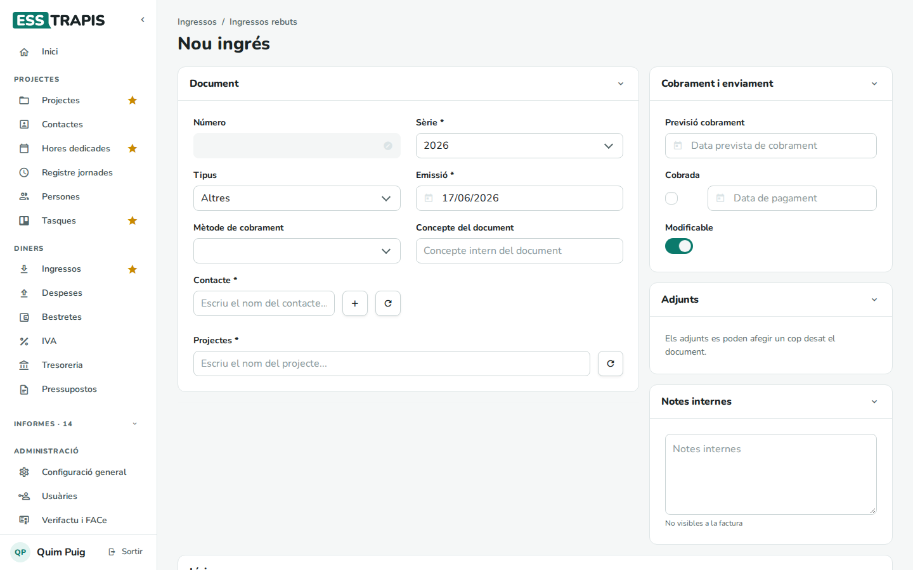

## Preguntes freqüents

**No puc posar la data que vull a la factura.** No pot ser anterior a l'última factura emesa de la mateixa
sèrie.

**El botó Envia per correu està desactivat.** La factura ha d'estar emesa i la clienta ha de tenir l'**Email
de contacte**.

**He emès una factura amb un error.** Feu-ne una rectificativa (pas 5).

**Una factura no surt al projecte.** Comproveu que està assignada a una línia del projecte (**DETALL DEL
PROJECTE**). Al projecte, la pestanya **Cobraments i pagaments** mostra si cada document està assignat.

## Vegeu també

- [05. Fases i pressupost del projecte](05-fases-pressupost.md#lligar-una-línia-amb-la-seva-factura)
- [12. Pressupostos](12-pressupostos.md)
- [18. Verifactu i FACe](18-verifactu-face.md)
- [21. IVA](21-iva.md) · [22. Tresoreria](22-tresoreria.md)
