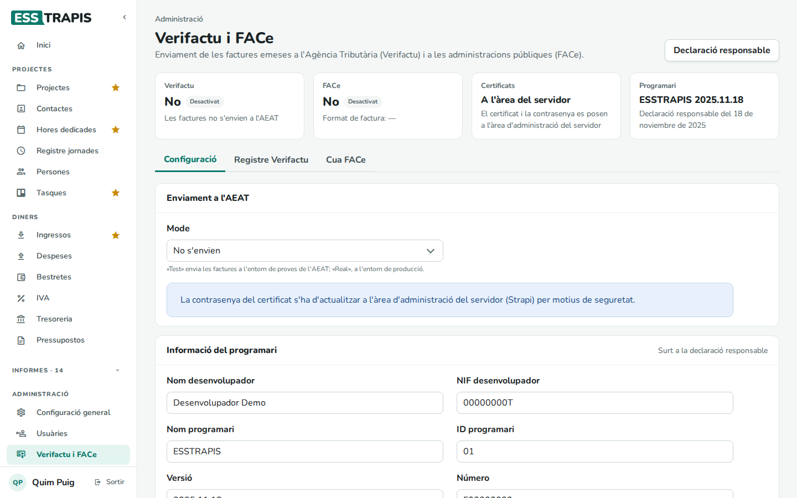
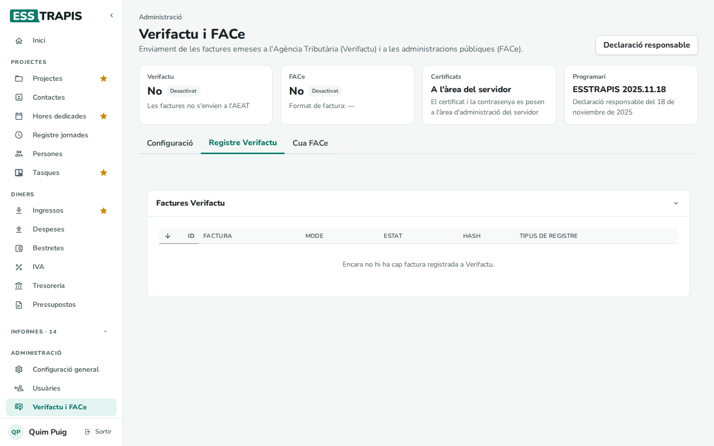
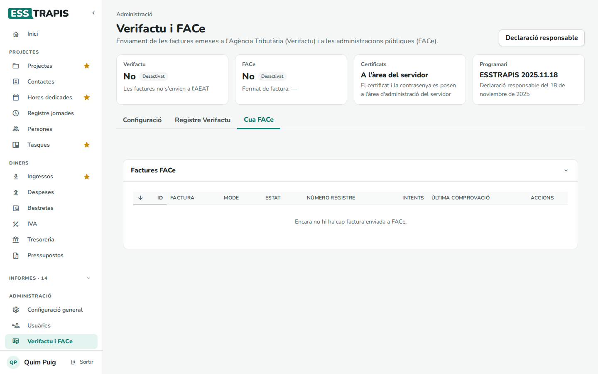
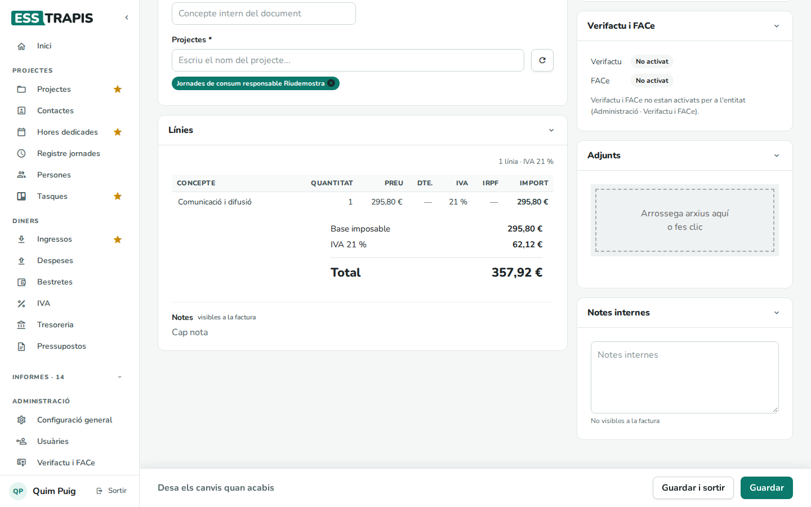
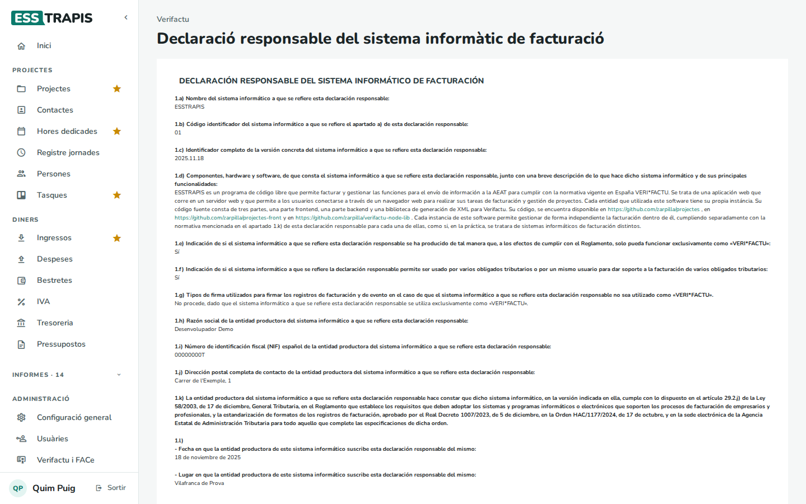

# 18. Facturació electrònica: Verifactu i FACe

> Permís necessari: `admin` per a la configuració; `projects` per a la declaració responsable

ESSTRAPIS pot enviar les factures emeses a dos sistemes:

- **Verifactu**: el sistema de l'Agència Tributària (AEAT) perquè les factures quedin registrades i no es
  puguin alterar. Cada factura emesa genera un **registre** encadenat amb l'anterior (cada registre porta
  l'empremta, o *hash*, del precedent) i s'envia a l'AEAT.
- **FACe**: el punt d'entrada de factures electròniques de les administracions públiques. Les factures a
  ajuntaments, consells, Generalitat… s'hi han d'enviar en format electrònic.

Tots dos funcionen sols: quan s'emet una factura, s'envia. Aquest capítol explica com es configuren i com es
consulta l'estat dels enviaments.

## Abans de començar

- Cal el **certificat digital** de l'entitat. El certificat i la seva contrasenya es posen a l'**àrea
  d'administració del servidor**, per seguretat; cal demanar-ho a qui manté el servidor.
- Per a FACe, cada administració pública ha de tenir el FACe activat i els codis **DIR3** a la seva fitxa de
  contacte (vegeu [11. Contactes](11-contactes.md#administracions-públiques-i-face)).

## La pàgina Verifactu i FACe

**Administració › Verifactu i FACe**.

A dalt, l'estat de cada sistema: **Verifactu** (si s'envien les factures a l'AEAT i en quin entorn), **FACe**
(amb el format de factura), **Certificats** i **Programari** (versió i data de la declaració responsable).
El botó **Declaració responsable** obre la declaració (vegeu més avall).

Té tres pestanyes:

### Configuració

- **Enviament a l'AEAT › Mode**: **No s'envien**, **Test** (l'entorn de proves de l'AEAT, per comprovar que tot
  funciona) o **Real** (l'entorn de producció).
- **Informació del programari**: les dades que surten a la declaració responsable (desenvolupador, nom i versió
  del programari, ubicació, data…). Normalment no cal tocar-les.
- **Guardar**.

El mode de **FACe** (**No**, **Test**, **Real**), el **Format de factura** (**UBL** o **FacturaE**) i les adreces
del servei es configuren a **Administració › Configuració general** (vegeu
[34. Configuració general](34-configuracio-general.md)).

### Registre Verifactu

Totes les factures registrades a Verifactu, amb la **Factura**, el **Mode**, l'**Estat**, el **Hash** i el
**Tipus de registre**. Clicant-ne una es veu el detall de l'enviament.

### Cua FACe

Les factures enviades per FACe amb el **Número registre**, l'**Estat** (**Pendent**, **Registrada**,
**Lliurada**, **Rebutjada**, **Error**), els **Intents** i l'**Última comprovació**. L'aplicació torna a provar
els enviaments pendents i consulta l'estat de tramitació periòdicament.

## A cada factura

Les factures emeses tenen un bloc **Verifactu i FACe** amb l'estat de cada enviament:

- Verifactu: **No enviada**, **Pendent**, **Correcta**, **Acceptada amb errors** o **Rebutjada**.
- FACe: **No enviada**, **Pendent**, **Registrada**, **Lliurada**, **Rebutjada** o **Error**.
- **Obre el registre** porta al detall.

Si no estan activats per a l'entitat, ho diu (*No activat*).

En emetre una factura a una administració amb FACe, l'avís de confirmació ho recorda (*FACTURA ELECTRÒNICA*) i
mostra els codis DIR3.

## La declaració responsable

La normativa obliga el programari de facturació a tenir una **declaració responsable** del fabricant. És a
**Altres › Verifactu** i al botó **Declaració responsable**: el text de la declaració, les versions anteriors en
PDF i el botó per descarregar-la.

## Preguntes freqüents

**Una factura surt «Rebutjada» a Verifactu.** Obriu el registre per veure'n el motiu. Si cal corregir la
factura, feu-ne una rectificativa (vegeu [17](17-factures-emeses.md#5-anullar-i-rectificar-una-factura)).

**Una factura a un ajuntament no s'ha enviat per FACe.** Comproveu que la fitxa del contacte té el FACe activat
i els tres codis DIR3, i que el mode FACe de l'entitat no és **No**.

## Vegeu també

- [17. Factures emeses](17-factures-emeses.md)
- [11. Contactes](11-contactes.md)
- [34. Configuració general](34-configuracio-general.md)
