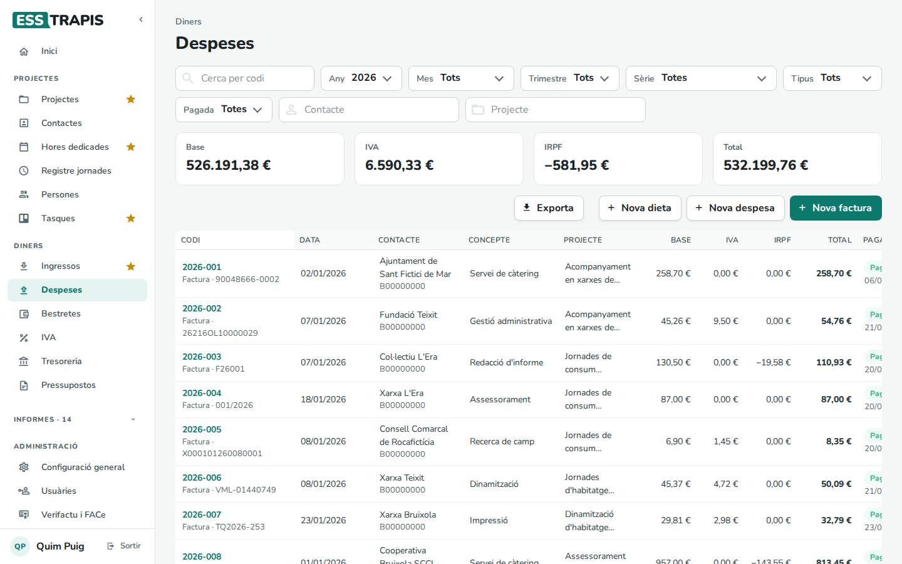
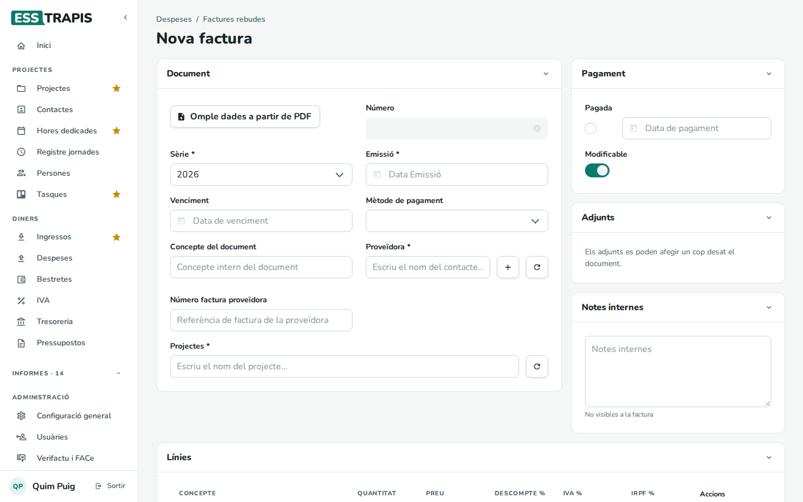
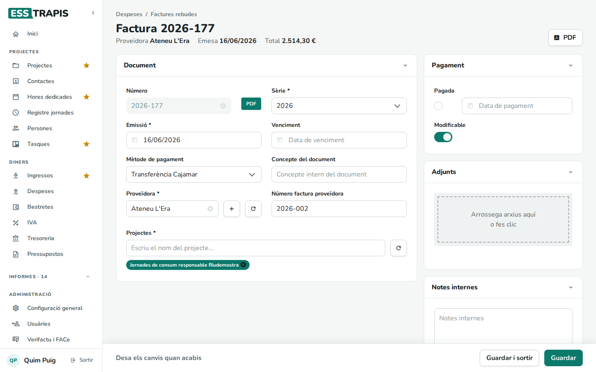
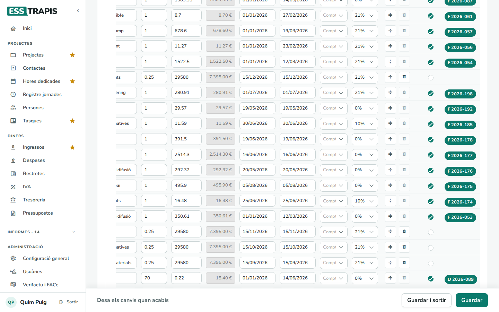
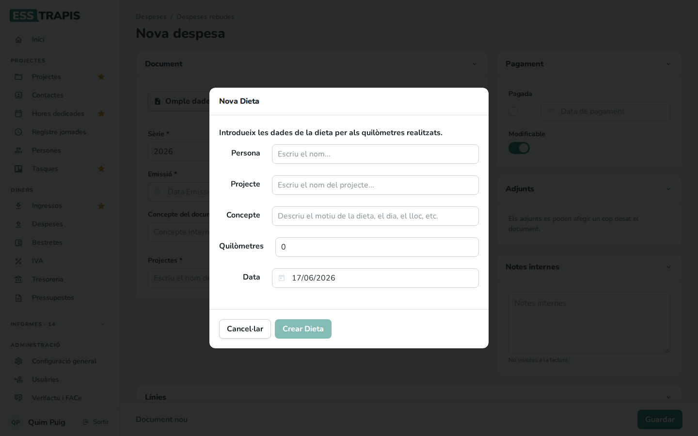

# 19. Despeses: factures rebudes

> Permís necessari: `projects`

A **Diners › Despeses** es registren les **factures** que arriben de les proveïdores i les **altres
despeses** (sense factura) i **dietes** de quilometratge. Com els ingressos, cada despesa es lliga a un o
més projectes i, dins del projecte, a la línia de despesa prevista que paga.

## Abans de començar

- La proveïdora ha de ser un contacte (vegeu [11. Contactes](11-contactes.md)); si no hi és, el **+** del
  formulari en crea un.
- Les **sèries**, els **mètodes de pagament** i els **tipus de despesa** es configuren a **Administració ›
  Taules auxiliars**. Les tarifes de les dietes per quilòmetre (amb i sense IRPF) són a **Administració › Configuració general › Persones
  i dietes** (vegeu [34](34-configuracio-general.md)).

## La llista de despeses

- Filtres: **Cerca per codi**, **Any**, **Mes**, **Trimestre**, **Sèrie**, **Tipus**, **Pagada**,
  **Contacte** i **Projecte**.
- Totals: **Base**, **IVA**, **IRPF** i **Total**.
- Columnes: **Codi** (amb el tipus i el número de factura de la proveïdora), **Data**, **Contacte**,
  **Concepte**, **Projecte**, **Base**, **IVA**, **IRPF**, **Total** i **Pagada**.
- **Exporta**, **Nova dieta**, **Nova despesa** i **Nova factura**.

## Pas a pas

### 1. Registrar una factura rebuda

**Nova factura** obre el formulari.

| Camp | Què vol dir |
|---|---|
| **Número** | El número intern, que s'assigna sol en desar segons la **Sèrie**. |
| **Sèrie** * | La numeració interna de les despeses. |
| **Emissió** * | La data de la factura. |
| **Venciment**, **Mètode de pagament** | Quan i com s'ha de pagar. |
| **Concepte del document** | Un concepte intern. |
| **Proveïdora** * | Qui factura. |
| **Número factura proveïdora** | El número que porta la factura de la proveïdora. |
| **Projectes** * | Els projectes a què correspon la despesa. |

A sota, les **Línies** (concepte, quantitat, preu, descompte, IVA i IRPF) amb els totals, i el **DETALL DEL
PROJECTE** per assignar la factura a la línia de despesa que paga: es marca **Fact.** a la línia i es clica
l'etiqueta **Document** perquè passi a **Assignat** (com a les factures emeses, vegeu
[17](17-factures-emeses.md#1-fer-una-factura)). Després, **Guardar**.

Les factures rebudes no tenen esborrany: es poden canviar mentre siguin **Modificables**.

### 2. Omplir les dades a partir del PDF

En una factura nova, si l'entitat té activada l'opció (**Configuració general › Opcions**, vegeu
[34](34-configuracio-general.md)), **Omple dades a partir de PDF** llegeix el PDF de la factura i proposa la proveïdora
(si el NIF coincideix amb un contacte), el número, les dates i les línies. Abans d'aplicar-les, es mostren en
una finestra per revisar-les. Cal revisar sempre el resultat abans de desar. El PDF s'envia a un servei extern
per llegir-lo.

### 3. Una factura rebuda

Al bloc **Pagament**, **Pagada** (i la data) quan s'ha pagat. El **PDF** és el document de la factura, si s'ha
adjuntat. Al detall del projecte, les línies pagades porten el número de la factura:

### 4. Altres despeses i dietes

- **Nova despesa**: una despesa sense factura (una quota, una comissió bancària…). Té **Tipus**, **Sèrie**,
  **Emissió**, **Contacte**, **Projectes** i línies, i s'assigna al projecte igual. Al projecte surt amb la
  lletra **D**.
- **Nova dieta**: un desplaçament pagat per quilòmetres. Demana la **Persona**, el **Projecte**, el
  **Concepte** (el motiu, el dia, el lloc), els **Quilòmetres** i la **Data**, i amb **Crear Dieta** prepara la
  despesa amb dues línies: la part sense IRPF i la part amb IRPF, segons les tarifes de l'entitat.

## Preguntes freqüents

**La factura no surt al projecte.** Comproveu que està assignada a una línia de despesa (**DETALL DEL
PROJECTE**).

**Les dades llegides del PDF no són correctes.** La lectura és una ajuda: corregiu-les a mà abans de desar.

## Vegeu també

- [05. Fases i pressupost del projecte](05-fases-pressupost.md)
- [17. Factures emeses](17-factures-emeses.md)
- [21. IVA](21-iva.md) · [22. Tresoreria](22-tresoreria.md)
