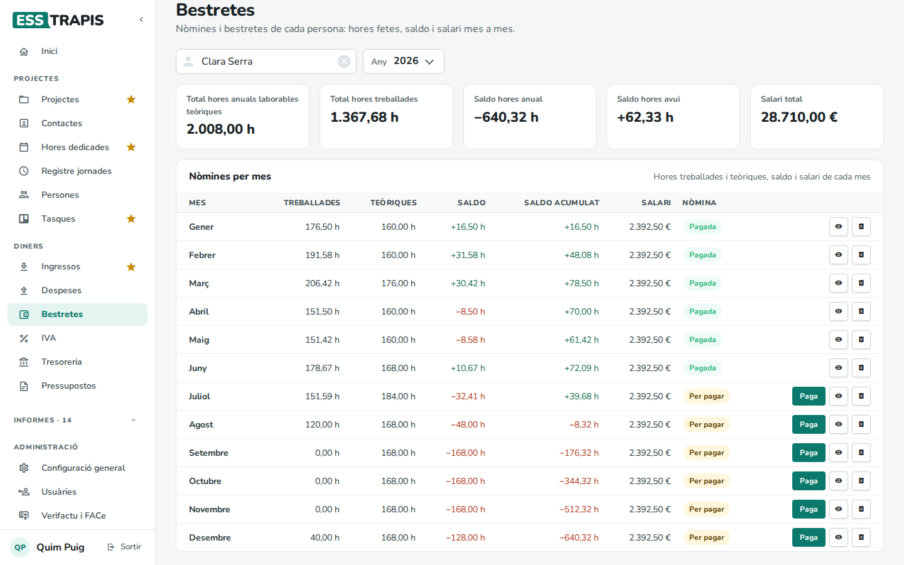
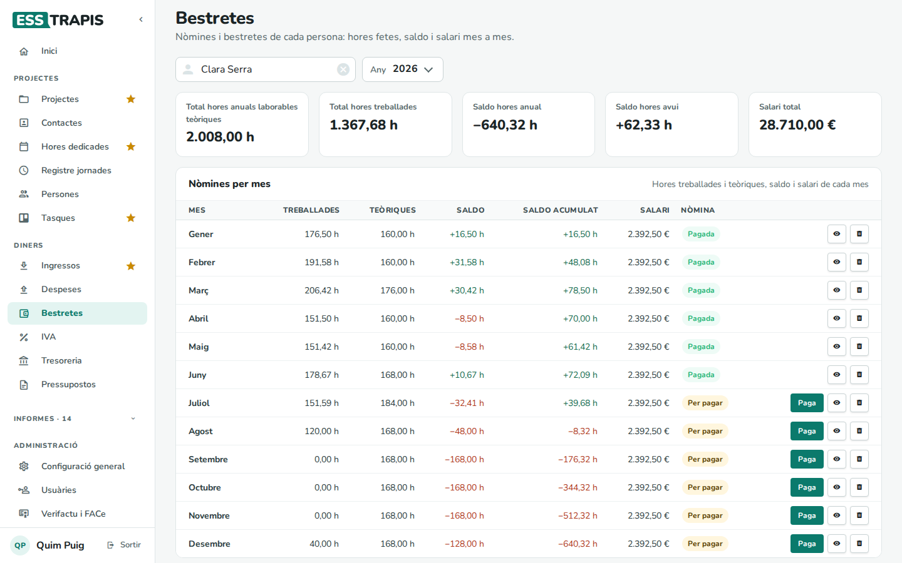
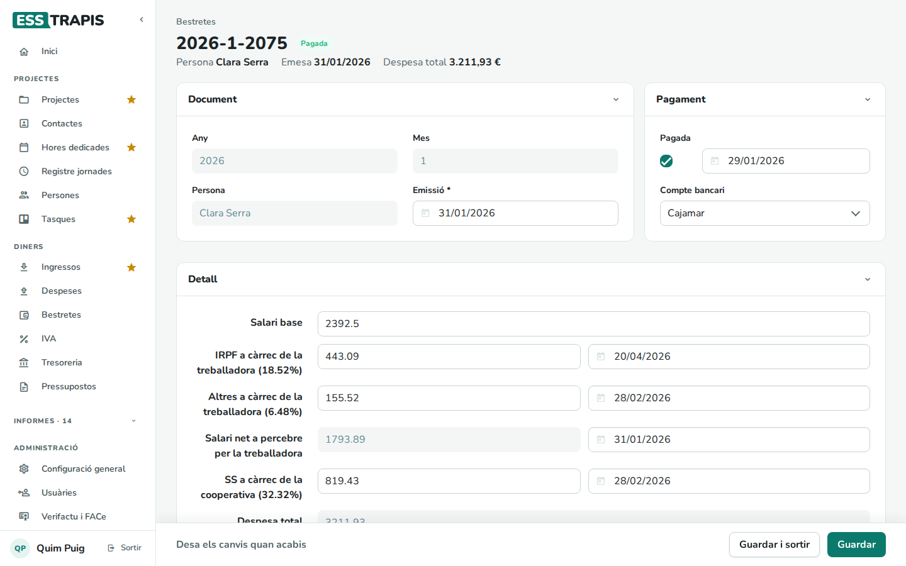

# 20. Bestretes (nòmines)

> Permís necessari: `projects`

Les **bestretes** són el que la cooperativa paga cada mes a les persones sòcies treballadores a compte del
resultat de l'exercici; per a les persones assalariades, són les **nòmines**. A ESSTRAPIS hi ha una bestreta
per persona i mes, amb el salari, l'IRPF, la Seguretat Social i el cost total per a la cooperativa. És a
**Diners › Bestretes**.

El cost de les bestretes entra als projectes a través de les hores: cada hora imputada val el **cost per
hora** de la persona (vegeu [15. Persones i jornades laborals](15-persones-jornades.md)).

## Abans de començar

- La persona ha de tenir **jornada** definida a **Persones**, amb el salari i la Seguretat Social: d'aquí
  surten els imports de cada bestreta.
- Les bestretes de tot l'any per a tothom es poden crear de cop des de **Persones › Crear Bestretes**.

## La pantalla

Triar la **Persona** i l'**Any** (sense persona, la pantalla demana *Tria una persona*).

Xifres de dalt: **Total hores anuals laborables teòriques**, **Total hores treballades**, **Saldo hores
anual** (treballades − teòriques de tot l'any), **Saldo hores avui** i **Salari total** de l'any.

**Nòmines per mes**:

| Columna | Què mostra |
|---|---|
| **Treballades**, **Teòriques** | Hores imputades i hores de jornada del mes. |
| **Saldo**, **Saldo acumulat** | La diferència del mes i la de l'any fins aquell mes. |
| **Salari** | El salari del mes segons la jornada. Si la bestreta desada té un altre import, surt el *teòric* i, en vermell, el que hi ha *a la nòmina*. |
| **Nòmina** | **Sense nòmina**, **Per pagar** o **Pagada**. |

Botons de cada mes:

- **Crea**: crea la bestreta del mes (si encara no n'hi ha).
- **Paga**: la marca com a pagada.
- L'ull (**Mostra la nòmina**) l'obre en una pestanya nova.
- La paperera l'esborra. Si s'havia canviat a mà, ho pregunta abans.

## Una bestreta

- **Document**: any, mes, persona i data d'**Emissió**.
- **Pagament**: **Pagada** (i la data) i el **Compte bancari** des d'on es paga.
- **Detall**: el **Salari base**, l'**IRPF a càrrec de la treballadora**, els **Altres a càrrec de la
  treballadora** (contingències, atur…), el **Salari net a percebre**, la **SS a càrrec de la cooperativa** i
  la **Despesa total**. Cada import (llevat del salari base) té la seva data de pagament, que és la que fa
  servir la tresoreria: el net, quan es paga la nòmina; l'IRPF, quan es liquida a Hisenda; la Seguretat
  Social, el mes següent…

Els imports es poden ajustar a mà; després, **Guardar**.

## Com es calcula

A partir del salari base del període de jornada:

- **IRPF** = salari base × % IRPF.
- **Altres** = salari base × % altres.
- **Salari net** = salari base − IRPF − altres.
- **SS a càrrec de la cooperativa** = quota fixa, o salari base × % quota.
- **Despesa total** = salari base + SS a càrrec de la cooperativa.

## Preguntes freqüents

**El salari surt en vermell amb «a la nòmina».** La bestreta desada no coincideix amb el salari que toca segons
la jornada (s'ha canviat la jornada després de crear-la, o s'ha retocat a mà). Reviseu-la o esborreu-la i
torneu-la a crear.

**Falten mesos «Sense nòmina».** Feu **Crea** a cada mes, o creeu-les totes des de **Persones**.

## Vegeu també

- [15. Persones i jornades laborals](15-persones-jornades.md)
- [07. Subvencions i justificacions](07-subvencions-justificacions.md) (justificar amb bestretes)
- [22. Tresoreria](22-tresoreria.md)
