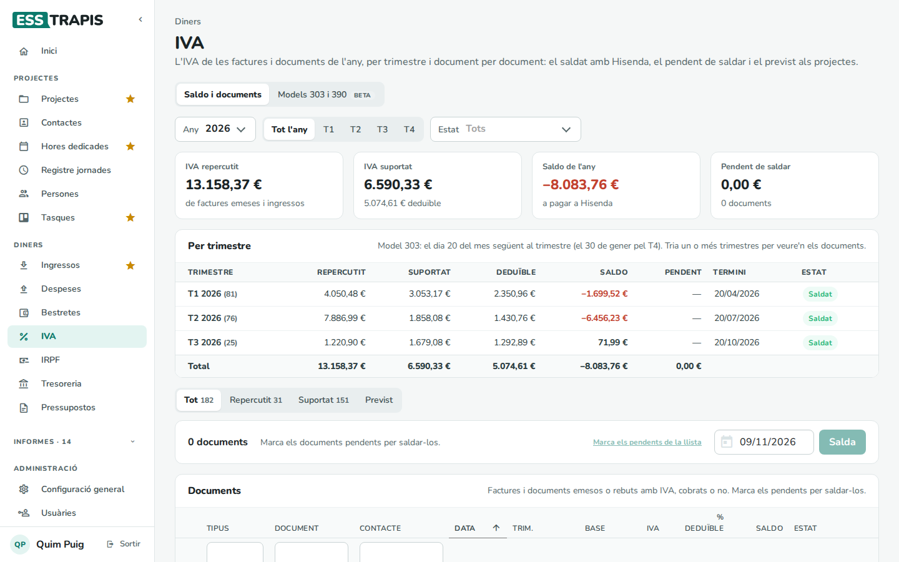
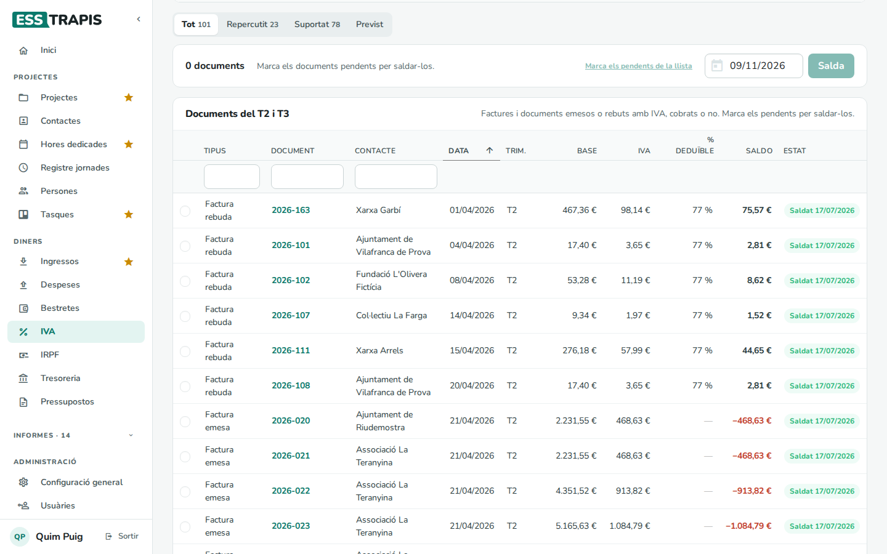
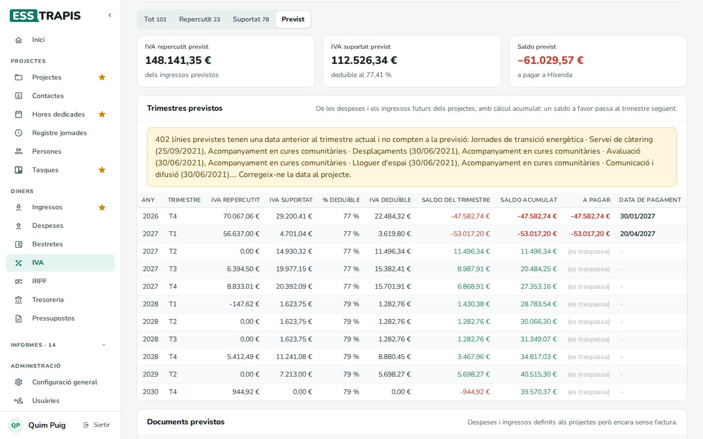
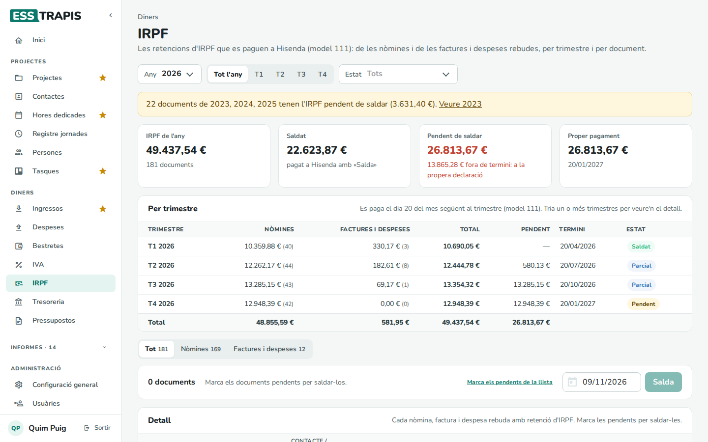
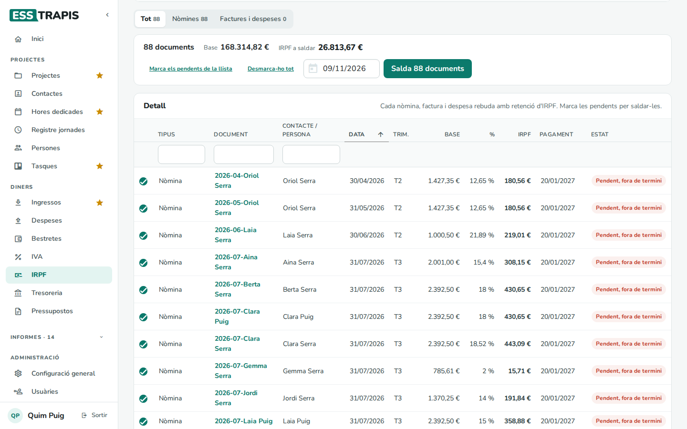

# 21. IVA i IRPF

> Permís necessari: `projects`

Les pantalles **Diners › IVA** i **Diners › IRPF** mostren el que es declara i es paga a Hisenda cada trimestre:
l'**IVA** (model 303) i les **retencions d'IRPF** (model 111). Totes dues funcionen igual: es tria l'any i un o
més trimestres, es veuen els documents un per un, saldats o pendents, i quan s'ha presentat i pagat una
declaració se'n **salden** els documents.

- **IVA repercutit**: el que la cooperativa cobra a les clientes a les factures emeses i els ingressos.
- **IVA suportat**: el que paga a les proveïdores a les factures i despeses rebudes. Només se'n pot descomptar
  la part **deduïble** (segons la prorrata de l'any, vegeu el glossari).
- **IRPF**: el que la cooperativa reté a les nòmines i a les factures i despeses rebudes (professionals,
  lloguers) i paga a Hisenda.

## La pantalla d'IVA

A dalt, els filtres:

- **Any**: l'any dels documents (per la data d'emissió).
- **Tot l'any / T1 … T4**: cada clic afegeix o treu un trimestre; se'n poden triar diversos alhora.
- **Estat**: tots, només els **pendents de saldar** o només els **saldats**.

Si algun document d'anys anteriors té l'IVA encara pendent, un avís ho diu i porta a aquell any.

Xifres de l'any: **IVA repercutit**, **IVA suportat** (i quant n'és deduïble), **Saldo de l'any** (negatiu: a
pagar a Hisenda) i **Pendent de saldar**.

La taula **Per trimestre** dona, de cada trimestre, el repercutit, el suportat, la part deduïble, el **saldo**,
el que queda **pendent**, el **termini** del model 303 (el dia 20 del mes següent; el 30 de gener pel T4) i
l'**estat**: *Saldat*, *Parcial* (n'hi ha de saldats i de pendents) o *Pendent*. Un clic en un trimestre el
tria o el treu del filtre.

## Els documents

Sota, les vistes **Tot**, **Repercutit** i **Suportat** llisten els documents del filtre: tipus, document,
contacte, data, trimestre, **base**, **IVA**, **% deduïble** (només a l'IVA suportat), **saldo** i **estat**
(*Saldat* amb la data, o *Pendent*). Cada columna es pot filtrar escrivint a la casella de sota del títol. A
baix, el total dels documents de la llista.

La vista **Previst** mostra l'IVA que es preveu a partir dels pressupostos dels projectes (factures encara no
emeses ni rebudes): per trimestre, amb càlcul acumulat, i línia per línia.

Si alguna línia prevista d'un projecte té una data anterior al trimestre actual, un avís la llista: no compta a
la previsió fins que se'n corregeix la data al projecte.

## La pantalla d'IRPF

Els mateixos filtres (any, trimestres, estat) i el mateix avís dels anys anteriors. Xifres de l'any: **IRPF de
l'any**, **Saldat**, **Pendent de saldar** (i quant n'és **fora de termini**) i **Proper pagament**.

La taula **Per trimestre** separa l'IRPF de les **nòmines** del de les **factures i despeses**, amb el pendent,
el termini del model 111 (el dia 20 del mes següent al trimestre) i l'estat. Les vistes **Tot**, **Nòmines** i
**Factures i despeses** llisten els documents amb la base, el percentatge, l'IRPF, la data de pagament i l'estat.

Un document pendent es paga al termini del seu trimestre. Si el termini ja ha passat (s'havia deixat fora d'una
declaració o s'ha entrat després), surt com a **Pendent, fora de termini** i es compta a la **declaració
següent**: a la pantalla i a **Tresoreria**.

## Saldar

Quan s'ha presentat i pagat la declaració d'un trimestre:

1. Triar el trimestre (o els trimestres, si s'hi afegeixen documents endarrerits) i, si es vol, l'estat
   **Pendents de saldar**.
2. Marcar els documents de la declaració, un per un o tots els de la llista amb **Marca els pendents de la
   llista**. Els ja saldats no es poden marcar.
3. Comprovar la suma al quadre de **Salda**: és la dels documents **marcats**, encara que el filtre en mostri
   d'altres (si n'hi ha de marcats fora del filtre, ho diu).
4. Triar la data del pagament i prémer **Salda N documents**.

Què passa en saldar:

- **IVA**: els documents queden saldats amb el % deduïble de l'any i el saldo es registra com un moviment
  **IVA Saldat** a **Tresoreria**. Només es pot saldar si hi ha un **% IVA deduïble** a la configuració.
- **IRPF**: cada document queda saldat amb aquella data, i la seva línia d'IRPF a **Tresoreria** passa a
  pagada en aquella data. No es crea cap moviment nou.

El que no es marca queda pendent i es pot saldar més endavant.

## Com es calcula

- **IVA deduïble** = IVA suportat × % deduïble de l'any.
- **Saldo** = IVA deduïble − IVA repercutit (negatiu vol dir que cal pagar).
- A **Previst**, el càlcul és **acumulat**: un saldo a favor d'un trimestre es descompta del següent, i només es
  preveu un pagament a **Tresoreria** quan el saldo acumulat és negatiu.

## Preguntes freqüents

**Una nòmina pagada surt amb l'IRPF pendent.** L'IRPF d'una nòmina es paga a Hisenda a banda: queda pendent
fins que se salda aquí.

**Un document surt «fora de termini».** No s'ha saldat i el seu termini ha passat: va a la propera declaració.
Si ja s'havia declarat, marqueu-lo i saldeu-lo amb la data en què es va pagar.

**L'IRPF d'abans.** En arribar aquesta funció (novembre de 2026), l'IRPF que ja constava com a pagat (factures
amb el termini passat i nòmines pagades) es va donar per saldat a la seva data.

## Vegeu també

- [17. Factures emeses](17-factures-emeses.md) · [19. Factures rebudes](19-factures-rebudes.md) ·
  [20. Bestretes](20-bestretes.md)
- [22. Tresoreria](22-tresoreria.md)
- [Glossari](00-glossari.md) (IVA no deduïble)
