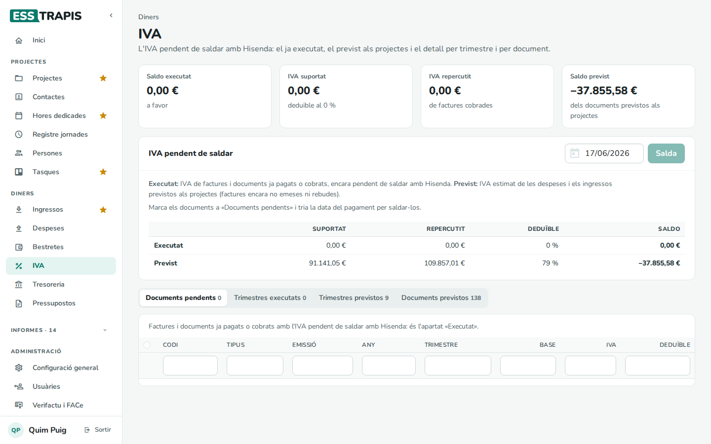
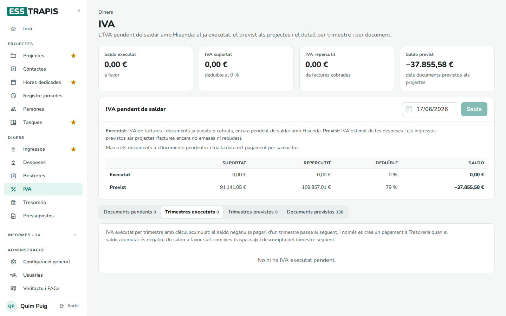
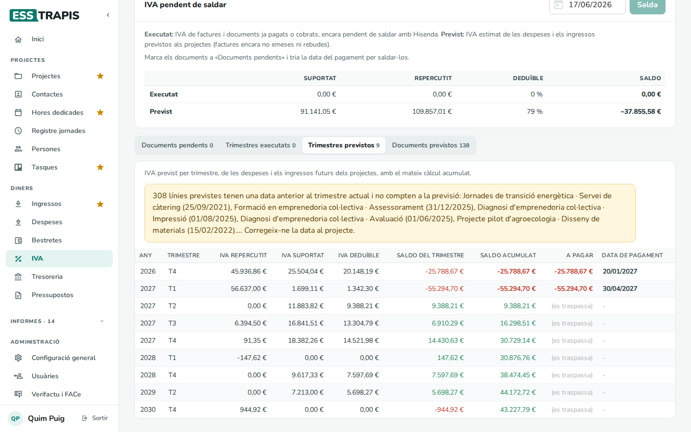
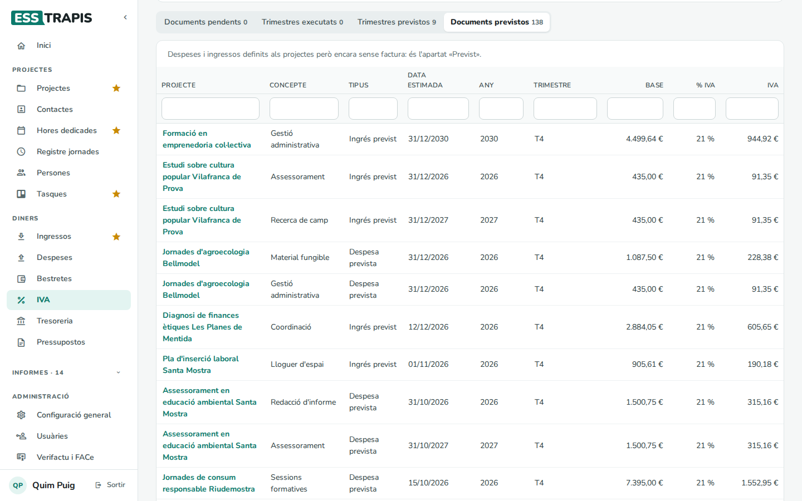

# 21. IVA

> Permís necessari: `projects`

La pantalla **Diners › IVA** mostra l'**IVA pendent de saldar amb Hisenda**: el de les factures ja cobrades i
pagades (*executat*) i el que es preveu a partir dels pressupostos dels projectes (*previst*), en total, per
trimestre i per document. Serveix per preparar les declaracions trimestrals i per preveure'n el pagament a la
tresoreria.

- **IVA repercutit**: el que la cooperativa cobra a les clientes a les factures emeses.
- **IVA suportat**: el que paga a les proveïdores a les factures rebudes. Només se'n pot descomptar la part
  **deduïble** (segons la prorrata de l'entitat, vegeu el glossari).

## La pantalla

Xifres de dalt:

- **Saldo executat**: l'IVA de les factures cobrades i pagades encara no saldat (*a pagar a Hisenda* o *a
  favor*).
- **IVA suportat** (amb el percentatge deduïble) i **IVA repercutit**.
- **Saldo previst**: el dels documents previstos als projectes (factures encara no emeses ni rebudes).

El bloc **IVA pendent de saldar** posa l'**Executat** i el **Previst** costat per costat: suportat, repercutit,
percentatge deduïble i saldo.

## Les quatre vistes

| Vista | Què mostra |
|---|---|
| **Documents pendents** | Les factures i documents ja cobrats o pagats amb l'IVA encara no saldat, amb el **Codi**, el **Tipus**, l'**Emissió**, l'**Any**, el **Trimestre**, la **Base**, l'**IVA** i el **Deduïble**. Cada columna es pot filtrar escrivint a la casella de sota del títol. A baix, les bases i l'IVA suportat i repercutit. |
| **Trimestres executats** | L'IVA executat per trimestre (vegeu *Com es calcula*), amb el que cal pagar i la data de pagament. |
| **Trimestres previstos** | El mateix amb l'IVA previst dels projectes. |
| **Documents previstos** | Les línies previstes dels projectes que en surten. |

Si alguna línia prevista d'un projecte té una data anterior al trimestre actual, un avís la llista: no compta a
la previsió fins que se'n corregeix la data al projecte.

## Saldar l'IVA

Quan s'ha presentat i pagat la declaració d'un trimestre:

1. A **Documents pendents**, marcar els documents de la declaració (la casella de dalt els marca tots).
2. Triar la data del pagament al costat del botó.
3. **Salda N documents**.

Els documents saldats deixen de sortir com a pendents.

## Com es calcula

Per a cada trimestre:

- **IVA deduïble** = IVA suportat × % deduïble.
- **Saldo del trimestre** = IVA deduïble − IVA repercutit (negatiu vol dir que cal pagar).
- El càlcul és **acumulat**: un saldo negatiu (a pagar) d'un trimestre passa al següent, i només es crea un
  pagament a **Tresoreria** quan el saldo acumulat és negatiu. Un saldo a favor surt com «(es traspassa)» i es
  descompta del trimestre següent.

## Preguntes freqüents

**L'IVA executat surt a zero.** Tots els documents cobrats i pagats ja estan saldats, o encara no hi ha factures
cobrades i pagades al període.

**Una factura no surt als documents pendents.** Només hi surten les factures **cobrades** o **pagades**.

## Vegeu també

- [17. Factures emeses](17-factures-emeses.md) · [19. Factures rebudes](19-factures-rebudes.md)
- [22. Tresoreria](22-tresoreria.md)
- [Glossari](00-glossari.md) (IVA no deduïble)
