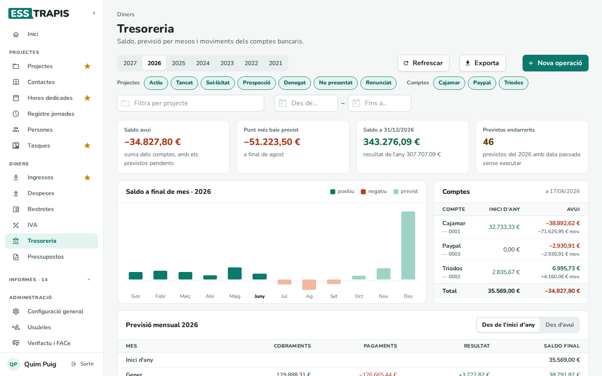
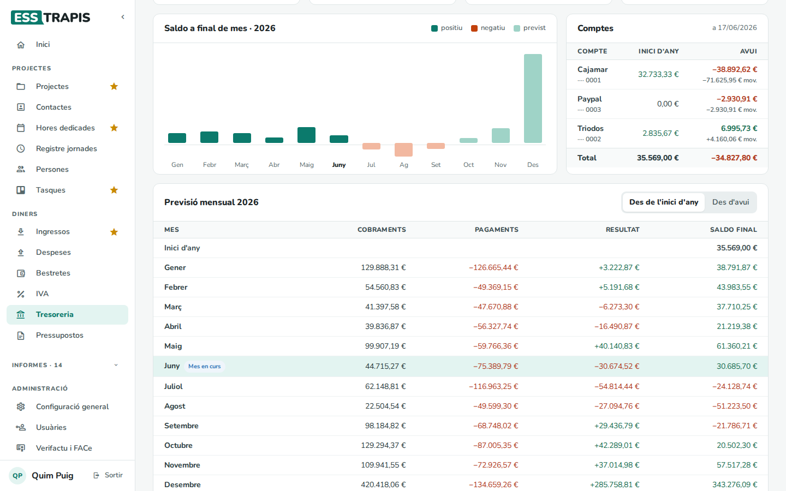
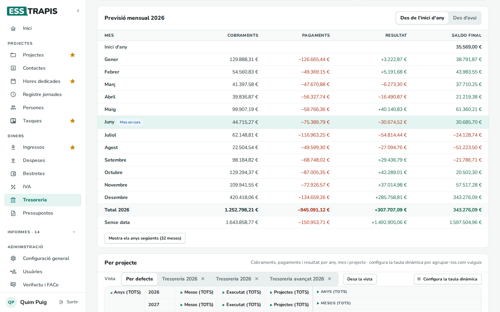
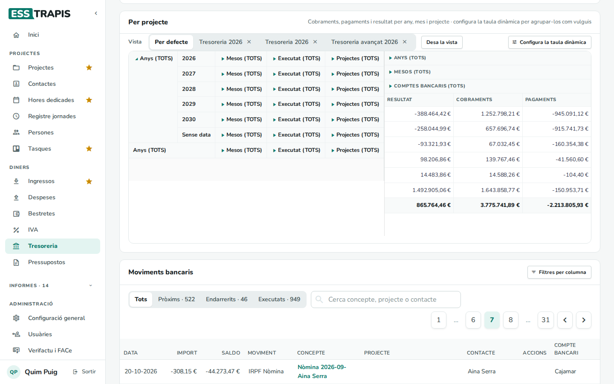
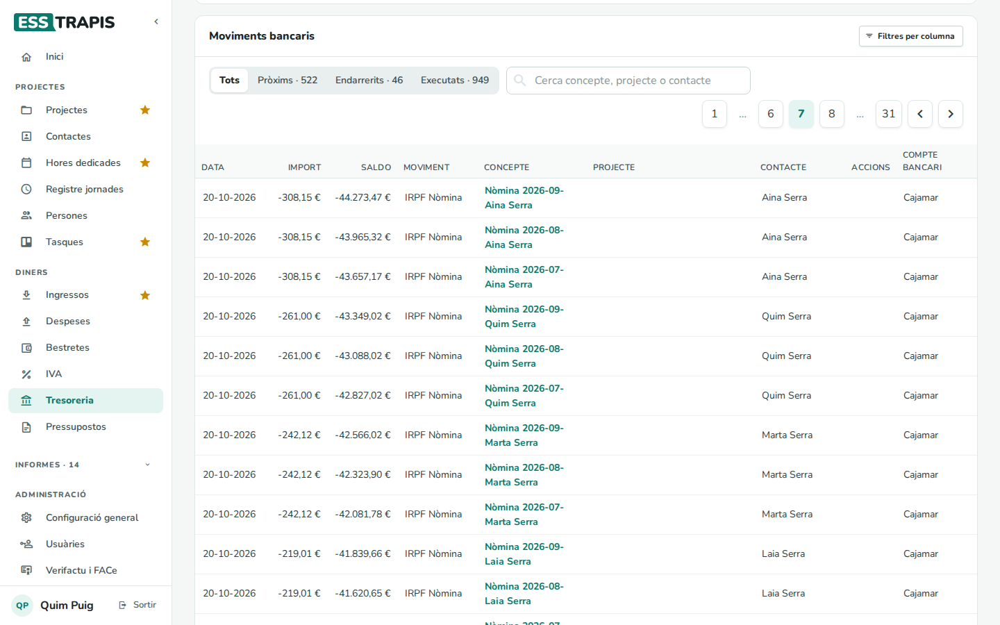
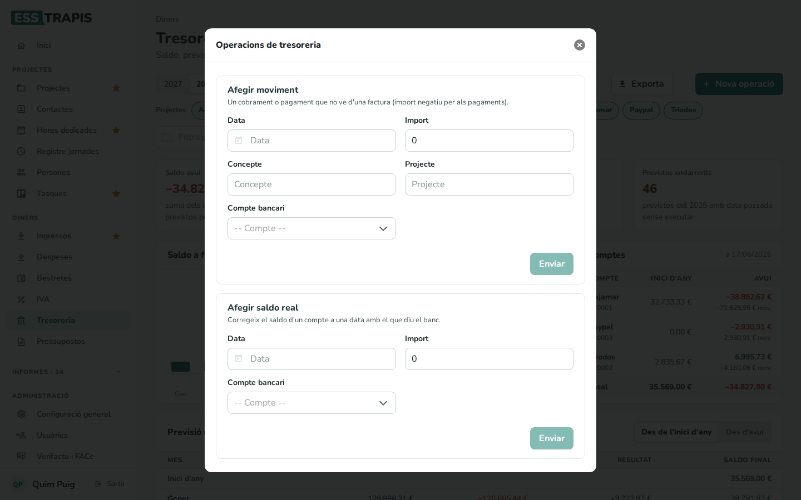

# 22. Tresoreria

> Permís necessari: `projects`

La **tresoreria** diu quants diners hi ha als comptes avui i quants n'hi haurà els pròxims mesos. Junta:

- els moviments ja **executats**: factures cobrades i pagades, bestretes pagades, IVA saldat, anotacions;
- els moviments **previstos**: factures pendents de cobrar o pagar, línies dels pressupostos dels projectes
  encara no facturades (amb la seva **previsió de pagament**), bestretes, Seguretat Social, IRPF i IVA per
  pagar.

És a **Diners › Tresoreria**.

## Abans de començar

- Els **comptes bancaris** i el seu saldo inicial es configuren a **Administració › Taules auxiliars**.
- La previsió és tan bona com les dates dels projectes: cada línia d'ingrés o de despesa ha de tenir la
  **Previsió pag.** (vegeu [05](05-fases-pressupost.md#les-línies)).

## La pantalla

**Filtres**:

- L'**any** (els botons de dalt) i **Refrescar** (torna a calcular).
- **Projectes**: els estats dels projectes que compten a la previsió (per exemple, treure *Sol·licitat* per no
  comptar el que encara no està aprovat).
- **Comptes**: els comptes bancaris que es sumen.
- **Filtra per projecte** i les dates **Des de… – Fins a…**; **Netejar filtres** els treu.
- **Exporta** descarrega els moviments; **Nova operació**, vegeu el pas 2.

**Xifres**:

- **Saldo avui**: la suma dels comptes, amb els previstos pendents.
- **Punt més baix previst**: el pitjor saldo a final de mes de l'any, i quin mes. És l'avís per preveure
  problemes de liquiditat.
- **Saldo a 31/12**: com acabarà l'any, i el resultat de l'any.
- **Previstos endarrerits**: moviments previstos de l'any amb la data ja passada i encara sense executar.
  Clicant-hi es mostren a **Moviments bancaris**.

Si hi ha moviments previstos **sense data**, un avís els llista: no compten a cap mes.

**Saldo a final de mes**: el gràfic de l'any, en verd els mesos en positiu, en vermell els negatius i més clars
els previstos. Passant el ratolí per una barra es veuen els cobraments, pagaments, resultat i saldo final.

## Els blocs

### Comptes

El saldo de cada compte a l'inici de l'any i avui, amb el moviment de l'any.

### Previsió mensual

Per a cada mes, els **Cobraments**, els **Pagaments**, el **Resultat** i el **Saldo final**. El mes en curs surt
marcat. **Des de l'inici d'any** comença pel saldo de l'1 de gener; **Des d'avui**, pel saldo d'avui (més útil per
mirar endavant). A baix, el **Total** de l'any, la fila **Sense data** i el botó per veure els anys següents.

### Per projecte

Una **taula dinàmica** amb els cobraments, pagaments i resultat per any, mes, executat o previst, projecte i
compte. Es pot reorganitzar i desar com a vista (vegeu [24. Taules dinàmiques](24-taules-dinamiques.md)).

### Moviments bancaris

Tots els moviments, un per fila, amb la **Data**, l'**Import**, el **Saldo** després del moviment, el tipus de
**Moviment**, el **Concepte** (amb l'enllaç al document), el **Projecte**, el **Contacte** i el **Compte
bancari**. La taula s'obre a la pàgina dels moviments d'avui.

- **Tots**, **Pròxims**, **Endarrerits** i **Executats** filtren per estat.
- **Cerca concepte, projecte o contacte**, i **Filtres per columna** per filtrar cada columna.
- A **Accions**, la casella marca un moviment com a **validat** (comprovat amb el banc).

## Pas a pas

### 1. Revisar la previsió

1. Mirar el **Punt més baix previst** i el gràfic: si algun mes queda en negatiu, cal avançar cobraments o
   endarrerir pagaments.
2. Revisar els **Previstos endarrerits**: cobraments que s'haurien d'haver fet (cal reclamar-los o canviar-ne la
   data al projecte) o pagaments pendents.
3. Validar els moviments executats amb l'extracte del banc.

### 2. Afegir una operació

**Nova operació** obre **Operacions de tresoreria**:

- **Afegir moviment**: un cobrament o pagament que no ve d'una factura (import negatiu per als pagaments), amb
  la **Data**, l'**Import**, el **Concepte**, el **Projecte** (opcional) i el **Compte bancari**. A la llista surt
  com a *Operació de tresoreria*.
- **Afegir saldo real**: corregeix el saldo d'un compte a una data amb el que diu el banc. Les previsions a partir
  d'aquella data parteixen d'aquest saldo.

Cada bloc té el seu botó **Enviar**.

## Preguntes freqüents

**El saldo d'avui no coincideix amb el del banc.** Afegiu un **saldo real** al compte amb la data i l'import de
l'extracte.

**Un cobrament previst surt en un mes que no toca.** La data surt de la **Previsió pag.** de la línia del projecte
(o de la **Previsió cobrament** de la factura). Canvieu-la allà.

## Vegeu també

- [05. Fases i pressupost del projecte](05-fases-pressupost.md)
- [17. Factures emeses](17-factures-emeses.md) · [19. Factures rebudes](19-factures-rebudes.md)
- [20. Bestretes](20-bestretes.md) · [21. IVA](21-iva.md)
