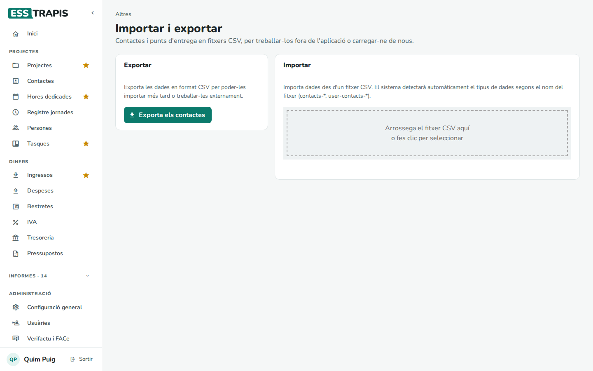
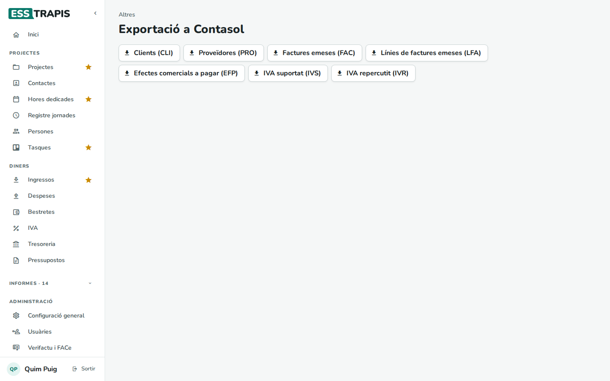

# 23. Importar, exportar i Contasol

> Permís necessari: `projects`

Dues pantalles del bloc **Altres** treuen dades de l'aplicació o n'hi carreguen:

- **Importar/Exportar**: els **contactes** (i, a les entitats amb logística, els punts d'entrega) en fitxers
  CSV, per treballar-los en un full de càlcul o carregar-ne molts de cop.
- **Contasol**: els fitxers per passar clients, proveïdores, factures i IVA al programa de comptabilitat
  **Contasol**.

A més, la majoria de llistats (projectes, ingressos, despeses, tresoreria, informes…) tenen el seu botó
**Exporta** per descarregar el que es veu en un full de càlcul.

## Importar i exportar contactes

**Altres › Importar/Exportar**.

### Exportar

**Exporta els contactes** descarrega tots els contactes en un fitxer CSV (*contacts-…*). Aquest fitxer és també
la plantilla per importar-ne.

### Importar

1. Preparar el fitxer CSV amb les mateixes columnes que l'exportació. El nom del fitxer ha de començar per
   **contacts-** (contactes) o **user-contacts-** (punts d'entrega): així l'aplicació sap què conté.
2. Arrossegar-lo a la zona puntejada (o clicar-hi).
3. Es mostra la **Previsualització de les dades**: cada fila amb el **Nom**, el **NIF**, el **Telèfon**, l'**Email**
   i l'**Estat** (si es crearà un contacte nou o se n'actualitzarà un d'existent). Els **Avisos** assenyalen dades a
   revisar.
4. **Confirma la importació** (l'aplicació ho torna a preguntar) o **Cancel·lar**.

Al final surt *Importació completada amb èxit!* i **Importa més dades** per tornar a començar.

## Contasol

**Altres › Contasol**: cada botó descarrega un fitxer (en format de full de càlcul) que Contasol pot importar.

| Botó | Què conté |
|---|---|
| **Clients (CLI)** | Els contactes de tipus clienta. |
| **Proveïdores (PRO)** | Els contactes de tipus proveïdora. |
| **Factures emeses (FAC)** | Les factures emeses (no els esborranys) i els altres ingressos. |
| **Línies de factures emeses (LFA)** | Les seves línies. |
| **Efectes comercials a pagar (EFP)** | Les factures rebudes i les altres despeses, pendents de pagar. |
| **IVA suportat (IVS)** | L'IVA de les factures rebudes. |
| **IVA repercutit (IVR)** | L'IVA de les factures emeses. |

Els fitxers inclouen **tots** els documents, de tots els anys. Si a Contasol només s'han d'importar els d'un
període, cal filtrar-los al full de càlcul abans d'importar-los.

## Preguntes freqüents

**La importació diu que no detecta el tipus de fitxer.** El nom del fitxer ha de començar per *contacts-* o
*user-contacts-*.

**He importat contactes repetits.** Si un contacte ja existeix (pel NIF), la importació l'actualitza en lloc de
crear-ne un de nou. Si n'heu creat de repetits amb un altre NIF, esborreu-los a **Contactes**.

## Vegeu també

- [11. Contactes](11-contactes.md)
- [17. Factures emeses](17-factures-emeses.md) · [19. Factures rebudes](19-factures-rebudes.md)
