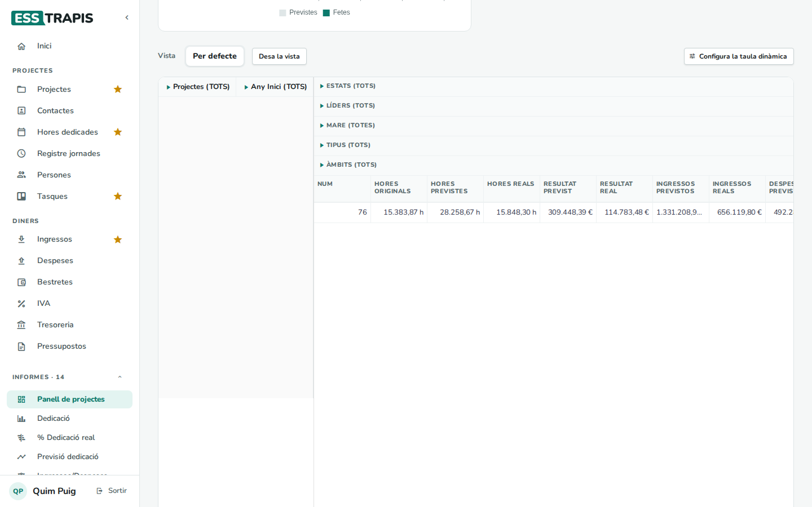
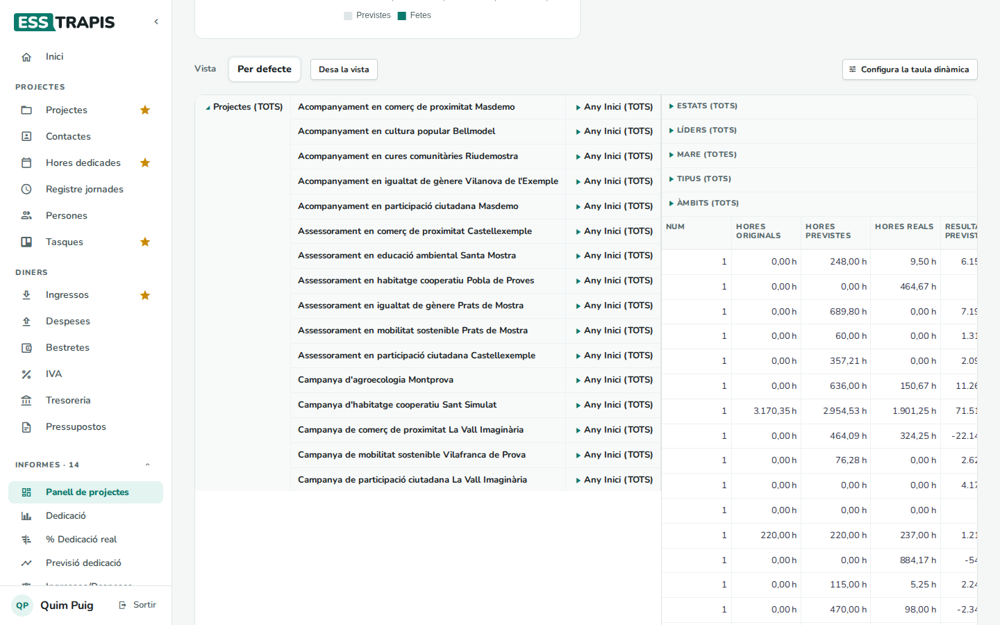
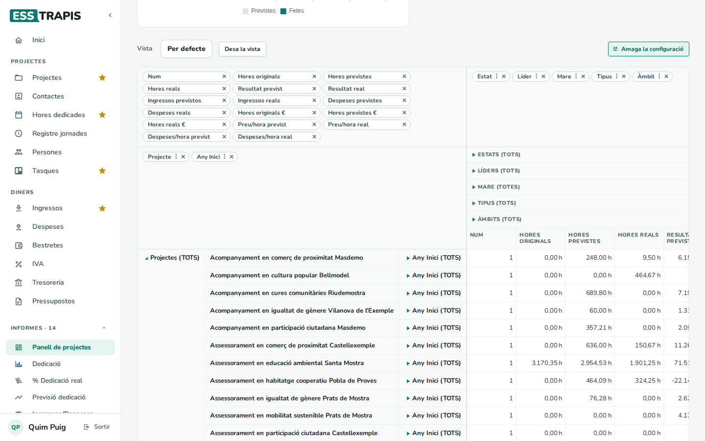
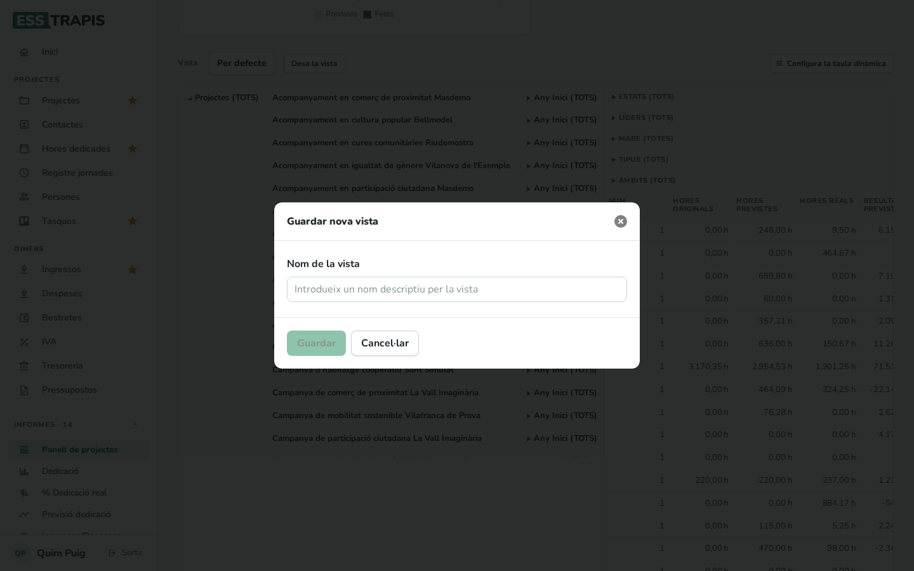

# 24. Com funcionen les taules dinàmiques

> Permís necessari: `projects`

Molts informes d'ESSTRAPIS (projectes, ingressos i despeses, estratègies, intercooperació, dedicació,
justificacions, tresoreria per projecte…) acaben amb una **taula dinàmica**: una taula que suma les xifres
(hores, ingressos, resultat…) agrupades com es vulgui (per any, estat, àmbit, persona, projecte…). Aquest capítol
explica com es fa servir; és igual a tots els informes. L'exemple és el **Panell de projectes**.

## Les parts de la taula

- **Files** (a l'esquerra): com s'agrupen les files, per exemple **Projectes** i **Any Inici**.
- **Columnes** (a dalt): com s'agrupen les columnes, per exemple **Estats**, **Líders**, **Mare**, **Tipus** i
  **Àmbits**.
- **Valors** (les xifres): **Num** (quants n'hi ha), **Hores originals**, **Hores previstes**, **Hores reals**,
  **Resultat previst**, **Resultat real**, **Ingressos**, **Despeses**…

Cada grup comença tancat i diu **(TOTS)**: suma tots els elements. El triangle del davant el desplega.

## Desplegar i plegar

Clicant el triangle d'un grup, s'obre en els seus elements. Per exemple, desplegant **Projectes (TOTS)** surt
una fila per projecte:

Es pot continuar desplegant dins de cada element (per exemple, cada projecte per anys), i fer el mateix amb les
columnes (cada estat, cada àmbit…). El triangle d'un grup obert el torna a plegar.

## Canviar què es mostra

**Configura la taula dinàmica** obre el panell de configuració (**Amaga la configuració** el tanca):

- A dalt a l'esquerra, els **valors** que es mostren; a dalt a la dreta, les **columnes**; a baix a l'esquerra, les
  **files**.
- La creu **×** d'una etiqueta la treu.
- Les etiquetes es poden **arrossegar** d'un lloc a l'altre: per exemple, portar **Àmbit** de les columnes a les
  files per veure els projectes agrupats per àmbit.

## Desar una vista

Quan la taula està com es vol, **Desa la vista**, s'hi posa un **Nom de la vista** i **Guardar**.

La vista surt al costat de **Per defecte**, a **Vista**. Clicant-la, la taula es torna a posar com estava
(files, columnes i valors); la creu del costat l'esborra. **Per defecte** torna a la
configuració inicial.

Les vistes són de l'entitat: totes les persones que veuen l'informe veuen les mateixes vistes desades.

## Exportar

**Exporta**, a sota de la taula, descarrega les dades de l'informe en un full de càlcul (una fila per element,
amb totes les columnes), per treballar-les a fora.

## Preguntes freqüents

**He desplegat massa i no em situo.** Feu clic a **Per defecte** per tornar a la taula inicial.

**Vull veure només uns quants estats o anys.** Feu servir els filtres de dalt de la pàgina de l'informe (estat,
any…): la taula dinàmica treballa amb les dades ja filtrades.

## Vegeu també

- [25. Informes de projectes i econòmics](25-informes-projectes-economics.md)
- [26. Informes de dedicació](26-informes-dedicacio.md)
