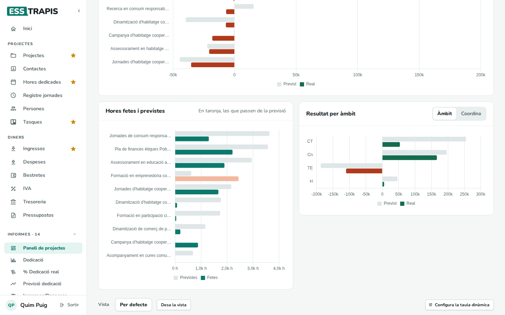
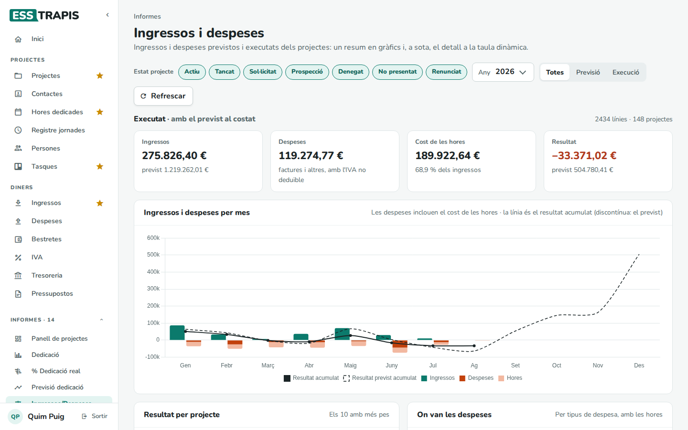
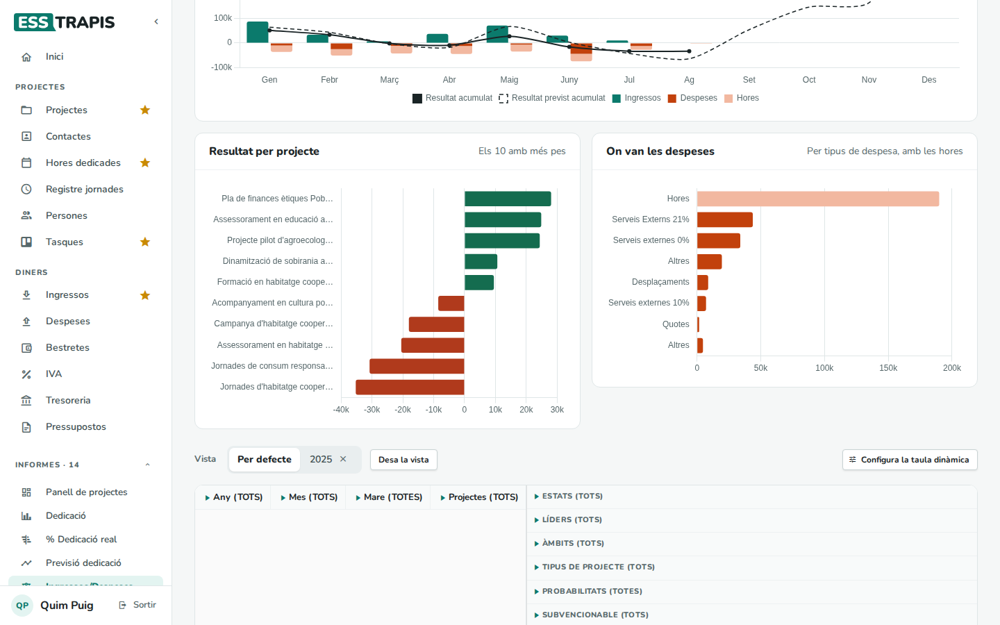
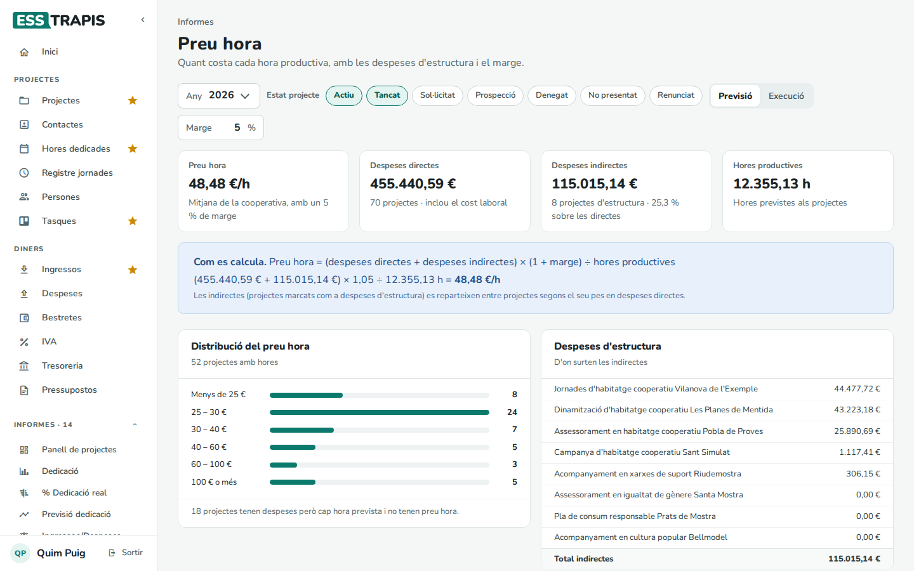
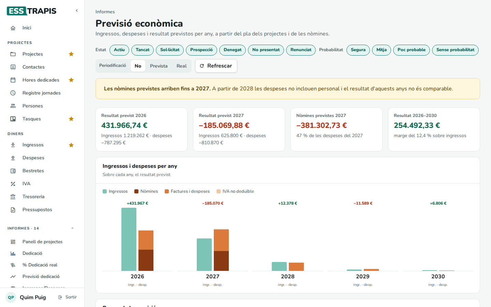
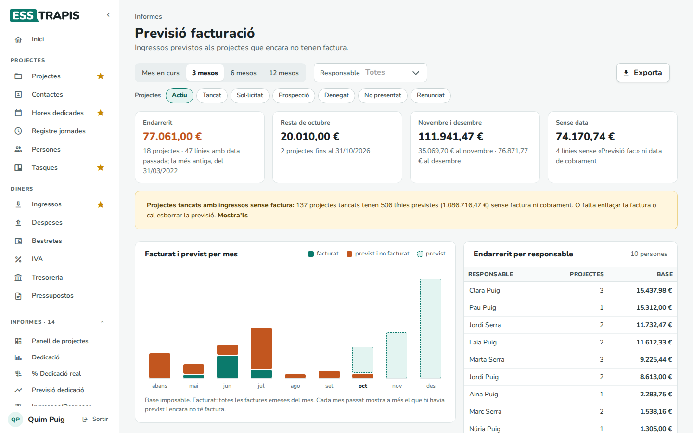
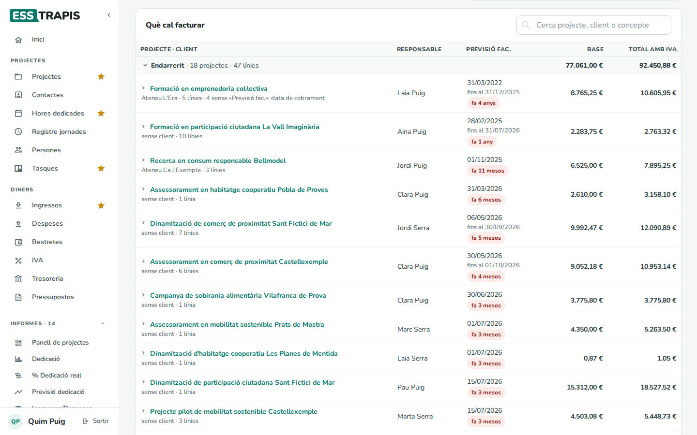
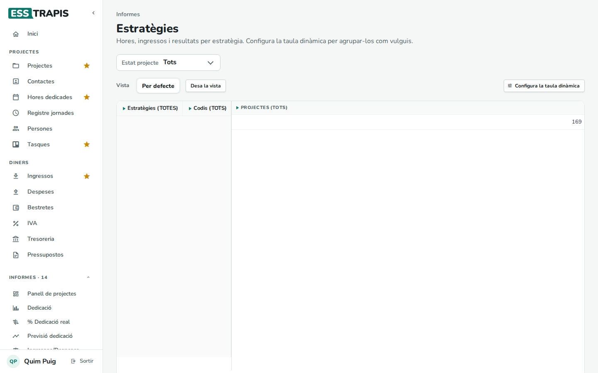

# 25. Informes de projectes i econòmics

> Permís necessari: `projects`

El bloc **Informes** del menú reuneix les pantalles per analitzar el conjunt de projectes. Aquest capítol
explica les econòmiques:

| Informe | Per a què serveix |
|---|---|
| **Panell de projectes** | Com van tots els projectes: hores, ingressos, resultat previst i real. |
| **Ingressos/Despeses** | Els ingressos i despeses previstos i executats per mes, per projecte i per tipus. |
| **Preu hora** | Quant costa cada hora productiva, amb les despeses d'estructura. |
| **Previsió econòmica** | El resultat previst dels pròxims anys. |
| **Previsió facturació** | Què cal facturar (i què s'hauria d'haver facturat). |
| **Estratègies** | Els projectes i les seves xifres per línia estratègica. |
| **Intercooperació** | Els projectes amb altres entitats. |

La majoria acaben amb una **taula dinàmica**: vegeu [24. Taules dinàmiques](24-taules-dinamiques.md). Els de
dedicació són al capítol [26](26-informes-dedicacio.md); **Previsió dedicació** al [09](09-planificacio-gantt.md#linforme-previsió-dedicació);
**Saldo hores** i **Hores anuals** al [16](16-saldo-hores.md); **Justificacions** i **Subvencions** al
[07](07-subvencions-justificacions.md).

## Panell de projectes

Filtre: **Estat projecte**.

- Xifres: **Projectes** (i quants tenen hores fetes), **Ingressos reals** (sobre els previstos), **Resultat real**
  (i el previst) i **Hores fetes** (sobre les previstes).
- **Resultat previst i real per projecte**: els 12 projectes amb més pes, amb el resultat previst (gris) i el real
  (verd si és positiu, vermell si és negatiu). Tots dos ja resten el cost de les hores.
- **Hores fetes i previstes** per projecte; en taronja, els que ja n'han fet més de les previstes.
- **Resultat per àmbit** o per **Coordina** (el botó de dalt canvia l'agrupació).
- A sota, la taula dinàmica amb tots els projectes.

## Ingressos/Despeses

Filtres: **Estat projecte** (els botons, se'n poden triar diversos), **Any**, i **Totes** / **Previsió** /
**Execució** (quines dades). **Refrescar** torna a calcular.

- Xifres de l'executat amb el previst al costat: **Ingressos**, **Despeses** (factures i altres, amb l'IVA no
  deduïble), **Cost de les hores** i **Resultat**.
- **Ingressos i despeses per mes**: barres d'ingressos, despeses i hores de cada mes, i el resultat acumulat (la
  línia contínua és l'executat; la discontínua, el previst).
- **Resultat per projecte** (els 10 amb més pes) i **On van les despeses** (per tipus de despesa, amb les hores).
- A sota, la taula dinàmica i tres exportacions: **Exporta detall** (una fila per línia), **Exporta totals per
  any** i **Exporta totals**.

## Preu hora

Filtres: **Any**, **Estat projecte**, **Previsió** / **Execució** i el **Marge** (%).

- **Preu hora**: el cost mitjà d'una hora de feina dels projectes, amb el marge.
- **Despeses directes**: les dels projectes (amb el cost de les hores).
- **Despeses indirectes**: les dels **projectes d'estructura** (gestió, local…), que es reparteixen entre els
  projectes segons el pes de les seves despeses directes.
- **Hores productives**: les hores dels projectes que no són d'estructura.
- **Distribució del preu hora**: quants projectes tenen cada preu hora; a baix, quants projectes tenen despeses però
  cap hora prevista.
- **Despeses d'estructura**: d'on surten les indirectes.

**Com es calcula** (també surt a la pantalla, amb les xifres):
Preu hora = (despeses directes + despeses indirectes) × (1 + marge) ÷ hores productives.

Serveix per decidir a quin preu cal pressupostar les hores perquè els projectes cobreixin també l'estructura.

## Previsió econòmica

Filtres: l'**Estat** i la **Probabilitat** dels projectes que compten, i la **Periodificació** (**No**, **Prevista**,
**Real**: si es fa servir la periodificació dels projectes, vegeu [05](05-fases-pressupost.md#la-pestanya-periodificació)).

- Xifres: el **Resultat previst** de l'any i del següent, les **Nòmines previstes** i el **Resultat** de tot el
  període.
- **Ingressos i despeses per any**: per a cada any, els ingressos i les despeses (nòmines, factures i despeses,
  IVA no deduïble), amb el resultat a dalt.
- **Resum de la previsió**: la taula amb les mateixes xifres.

Un avís diu fins a quin any hi ha nòmines previstes: a partir d'aquí les despeses no inclouen el personal i el
resultat no és comparable.

## Previsió facturació

Els ingressos previstos als projectes que encara no tenen factura. Filtres: l'horitzó (**Mes en curs**, **3
mesos**, **6 mesos**, **12 mesos**), el **Responsable** i l'estat dels **Projectes**. **Exporta** descarrega la llista.

- Xifres: **Endarrerit** (línies amb la previsió de factura ja passada), la **resta del mes**, els **mesos
  següents** i **Sense data** (línies sense **Previsió fac.** ni data de cobrament).
- Un avís compta els **projectes tancats amb ingressos sense factura**: o falta lligar-hi la factura o cal
  esborrar la previsió. **Mostra'ls** els afegeix a la llista.
- **Facturat i previst per mes** i **Endarrerit per responsable**.
- **Què cal facturar**: els projectes agrupats en **Endarrerit**, mes en curs, mesos següents i sense data, amb el
  responsable, la previsió de factura (i quant fa que ha passat), la base i el total amb IVA. La fletxa de cada
  projecte en mostra les línies.

Aquest informe fa servir sempre la data d'avui.

## Estratègies

Filtre: **Estat projecte**. La taula dinàmica compta els projectes, les hores, els ingressos i el resultat per
**estratègia** (les línies estratègiques de l'entitat que es marquen a cada projecte, a **Dades**).

Un projecte pot tenir diverses estratègies: surt a cadascuna.

## Intercooperació

Filtre: **Estat projecte**. La taula dinàmica mostra els projectes amb entitats d'**intercooperació** (el camp
**Intercooperació** de cada projecte) i els seus imports, per entitat. Si cap projecte en té, diu *No hi ha dades
per a aquests filtres*.

## Preguntes freqüents

**Les xifres no quadren amb les d'un projecte.** Comproveu els filtres d'estat i d'any. Els totals dels projectes
es recalculen en segon pla uns minuts després de cada canvi.

## Vegeu també

- [24. Taules dinàmiques](24-taules-dinamiques.md)
- [26. Informes de dedicació](26-informes-dedicacio.md)
- [05. Fases i pressupost del projecte](05-fases-pressupost.md)
