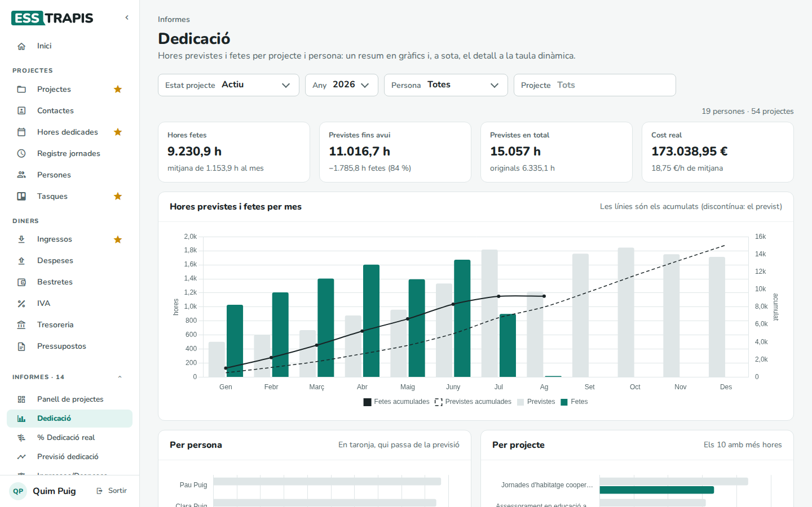
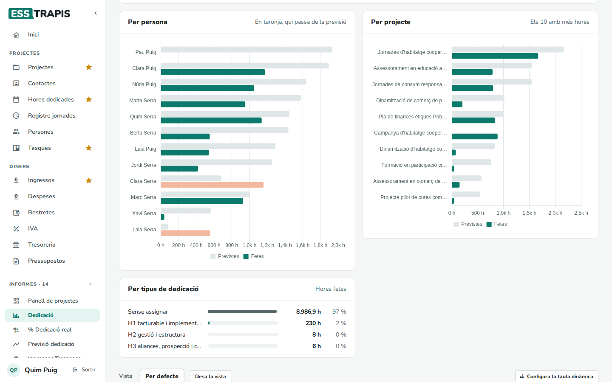
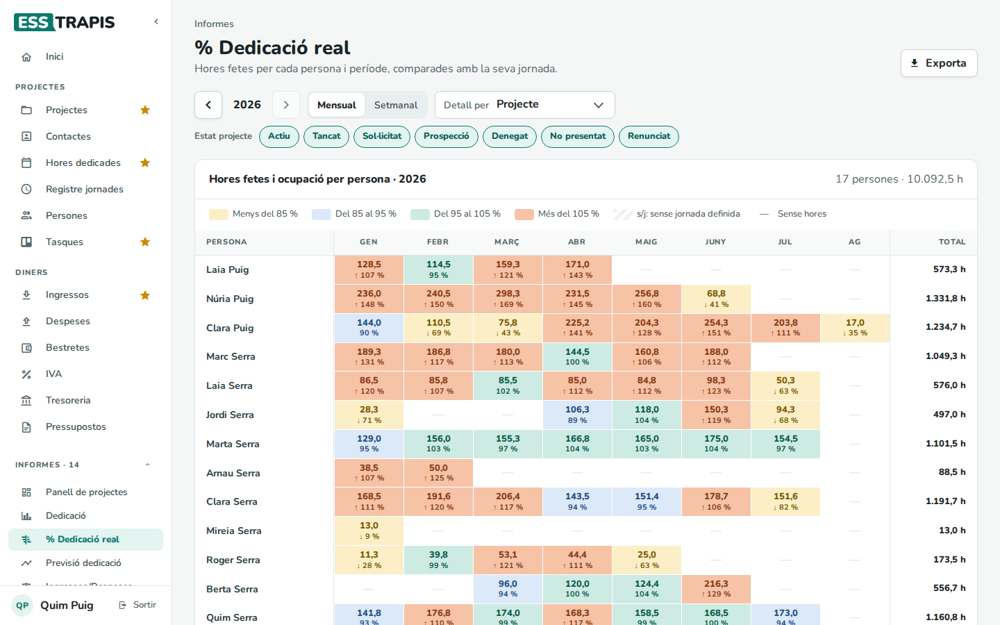
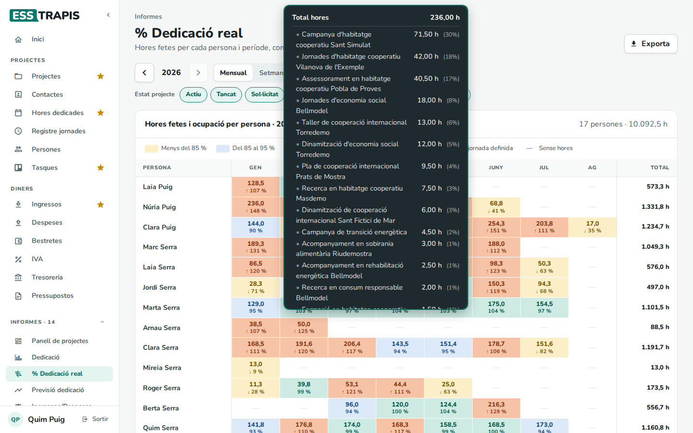

# 26. Informes de dedicació

> Permís necessari: `projects` (Dedicació també amb `hours`)

Dos informes analitzen les hores imputades:

- **Dedicació**: les hores previstes i fetes per mes, per persona i per projecte, i el seu cost.
- **% Dedicació real**: les hores fetes per cada persona i període comparades amb la seva jornada (l'ocupació
  real).

La previsió de les hores per persona (amb la planificació dels projectes) és l'informe **Previsió dedicació**:
vegeu [09](09-planificacio-gantt.md#linforme-previsió-dedicació).

## Dedicació

**Informes › Dedicació**. Filtres: **Estat projecte**, **Any**, **Persona** i **Projecte**.

- Xifres: **Hores fetes** (i la mitjana mensual), **Previstes fins avui** (i quantes se n'han fet de més o de
  menys), **Previstes en total** (i les originals) i **Cost real** (i el cost mitjà per hora).
- **Hores previstes i fetes per mes** (o per any si es tria **Tots**): les barres grises són les previstes; les
  verdes, les fetes. Les línies són els acumulats (la discontínua, el previst).
- **Per persona** i **Per projecte** (els 10 amb més hores): previstes i fetes; en taronja, qui passa de la previsió.
- **Per tipus de dedicació** i **Per funció**: com es reparteixen les hores fetes.
- A sota, la taula dinàmica (vegeu [24](24-taules-dinamiques.md)).

Les persones amb només el permís **Hores** també hi tenen accés, però sense el cost de les hores (que surt dels
salaris).

## % Dedicació real

**Informes › % Dedicació real**. És el mateix quadre que la **Previsió dedicació**, però amb les hores fetes en
lloc de les planificades.

- Les fletxes canvien d'any; **Mensual** / **Setmanal**; **Detall per** (**Projecte**, **Tipus de projecte**,
  **Probabilitat**); els estats dels projectes que compten; **Exporta**.
- Cada cel·la mostra les hores fetes i l'**ocupació** (hores fetes ÷ hores de jornada del període, sense caps de
  setmana, festius ni vacances), amb els mateixos colors: groc (menys del 85 %), blau (85–95 %), verd (95–105 %),
  taronja (més del 105 %), ratllat (sense jornada definida).
- Passant per sobre d'una cel·la es veu el detall per projecte; clicant-la, queda fix.

Comparant-lo amb la **Previsió dedicació** es veu si l'equip fa les hores que s'havien planificat.

## Preguntes freqüents

**Gairebé totes les hores surten com a «Sense assignar» al tipus de dedicació.** Les hores no tenen el **Tipus
dedicació** triat. Es pot posar un tipus per defecte a cada projecte (pestanya **Dades**, **Tipus de
dedicació**) perquè s'ompli sol en imputar-ne.

**Una persona surt amb una ocupació molt baixa.** Pot ser que no imputi totes les hores, o que tingui la jornada
mal definida a **Persones**.

## Vegeu també

- [09. Planificació (Gantt)](09-planificacio-gantt.md)
- [13. Imputar hores dedicades](13-imputar-hores.md)
- [16. Saldo d'hores i hores anuals](16-saldo-hores.md)
- [24. Taules dinàmiques](24-taules-dinamiques.md)
