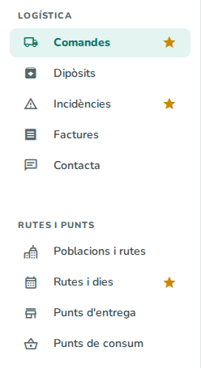
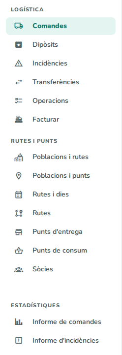
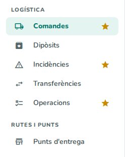

# 27. Visió general de la logística

> Permís necessari: `orders`, `orders_admin` o `orders_delivery`

El mòdul de **logística** organitza el transport de les comandes de les sòcies productores fins als
establiments que les reben: qui encarrega cada entrega, on deixa la mercaderia, quina ruta la porta, qui la
carrega i la lliura, què costa i com es factura. Aquest capítol explica les peces del mòdul, el camí d'una
comanda i què veu cada perfil. Els capítols següents expliquen cada pantalla.

## Abans de començar

Cada persona veu la logística segons el seu permís (vegeu [02. Usuaris, rols i permisos](02-usuaris-rols-permisos.md)):

| Permís | Qui és | Què fa |
|---|---|---|
| `orders` | La **sòcia** (productora o proveïdora) | Fa les seves comandes, les diposita al magatzem, en segueix el recorregut, obre incidències i consulta les seves factures. |
| `orders_admin` | L'**oficina** | Veu i edita totes les comandes, canvia els estats, configura rutes i punts, factura i treu els informes. |
| `orders_delivery` | La **repartidora** (conductora) | Veu les comandes, fa les operacions del dia (carregar, transferir) i obre incidències. |

En el text de l'aplicació, l'oficina i la repartidora es tracten sovint juntes: hi ha botons i opcions que
només veuen elles dues.

Algunes dades les prepara l'oficina abans que es puguin fer comandes: les **rutes** amb els dies que passen,
les **poblacions** per on passa cada ruta, les **tarifes** i els **punts d'entrega**
(vegeu [30. Poblacions, rutes i dies](30-poblacions-rutes-dies.md) i
[29. Punts d'entrega i de consum](29-punts-entrega-consum.md)).

## Les peces

- **Comanda**: un encàrrec de transport d'una sòcia: unes caixes, amb uns quilos, que van a un punt d'entrega
  un dia concret per una ruta. Té un número (per exemple, *#24874*) i un estat. Vegeu [28. Comandes](28-comandes.md).
- **Sòcia**: la productora que fa la comanda i que paga el transport.
- **Punt d'entrega**: l'establiment que rep la comanda (una botiga, un restaurant, una cooperativa de
  consum…), amb l'adreça, la població i l'horari en què s'hi pot anar.
- **Punt de consum**: un punt d'entrega especial on la comanda es reparteix entre diverses persones
  destinatàries, cadascuna amb les seves caixes, i on cada persona passa a recollir la seva part.
- **Ruta**: un recorregut del transport que passa uns dies concrets de la setmana per unes poblacions (per
  exemple, *DJ - BCN CIUTAT* passa els dijous). La ruta decideix el dia d'entrega i, amb els quilos, el preu.
- **Recollida**: on la sòcia deixa la comanda perquè la passin a buscar. Pot ser un **magatzem** (la sòcia hi
  **diposita** les caixes) o la **recollida en finca** (la repartidora va a buscar les caixes a la finca de la
  sòcia).
- **Comanda de recollida**: quan diverses comandes d'una sòcia es recullen el mateix dia a la mateixa finca,
  l'aplicació les agrupa en una comanda de recollida, amb el número acabat en **-R**.
- **Transferència**: quan la ruta que entrega no passa per on s'ha deixat la comanda, una altra ruta la porta
  primer d'un punt de recollida a un altre. Vegeu
  [31. Dipòsits, transferències i operacions](31-diposits-transferencies-operacions.md).
- **Incidència**: un problema amb una comanda (no s'ha dipositat, ha arribat malmesa…), que la sòcia i
  l'oficina segueixen fins que es tanca. Vegeu [32. Incidències i contacte](32-incidencies-contacte.md).
- **Albarà**: el full imprès que acompanya les caixes, amb un codi QR que obre la comanda.

## El camí d'una comanda

1. **La sòcia fa la comanda** a **Comandes**: tria el punt d'entrega, la ruta, què porta i on ho deixarà.
   L'aplicació proposa la data d'entrega segons els dies de la ruta i calcula el preu.
2. **Si cal, l'aplicació hi afegeix una transferència**: passa quan la ruta d'entrega no passa per on es deixa
   la comanda.
3. **Si és una recollida en finca**, la comanda s'afegeix a la comanda de recollida d'aquell dia.
4. **La sòcia diposita les caixes** al magatzem i ho marca (a **Dipòsits**, a la fitxa de la comanda o
   escanejant el QR de l'albarà). En una recollida en finca, és la repartidora qui marca **Recollir**.
5. **La transferència** (si n'hi ha) es marca quan comença i quan acaba.
6. **La repartidora carrega** la comanda a la furgoneta el dia de la ruta, des d'**Operacions**.
7. **L'oficina marca la comanda com a Lliurada** quan s'ha entregat.
8. **L'oficina factura** les comandes lliurades a **Facturar**: cada sòcia rep una factura del mes, que veu a
   **Factures**. Vegeu [33. Facturació de la logística](33-facturacio-logistica.md).
9. En qualsevol moment es pot obrir una **incidència**.

Els passos 4, 5 i 6 queden apuntats a la comanda amb la data, l'hora i la persona, però no en canvien l'estat.
L'**estat** el canvia l'oficina (vegeu [28. Comandes](28-comandes.md)).

## Què veu cada perfil

El menú lateral mostra blocs diferents segons el permís. Els accessos amb estrella són els que aquella persona
té fixats a l'inici (vegeu [37. La pàgina d'inici](37-pagina-inici.md)).

### La sòcia (`orders`)

- **Logística**: **Comandes** (les seves), **Dipòsits**, **Incidències**, **Factures** (les factures del
  transport que li ha fet la cooperativa) i **Contacta** (un formulari per escriure a l'oficina).
- **Rutes i punts**: **Poblacions i rutes** i **Rutes i dies** (per consultar per on i quins dies passa cada
  ruta), **Punts d'entrega** i **Punts de consum**.

En entrar s'obre la pàgina d'inici, o **Comandes** si s'ha triat així a **En entrar, obre** (vegeu
[37. La pàgina d'inici](37-pagina-inici.md)). Si la sòcia té factures pendents de pagar, en entrar li surt un
avís que les recorda; es tanca amb **D'acord**.

### L'oficina (`orders_admin`)

- **Logística**: a més de **Comandes**, **Dipòsits** i **Incidències**, té **Transferències**,
  **Operacions** i **Facturar**.
- **Rutes i punts**: **Poblacions i rutes**, **Poblacions i punts**, **Rutes i dies**, **Rutes**, **Punts
  d'entrega**, **Punts de consum** i **Sòcies**.
- **Estadístiques**: **Informe de comandes** i **Informe d'incidències**.
- A **Administració** hi ha les **Tarifes de ruta** (a **Taules auxiliars**) i la secció de logística de la
  **Configuració general** (vegeu [35. Taules auxiliars](35-taules-auxiliars.md) i
  [34. Configuració general](34-configuracio-general.md)).

### La repartidora (`orders_delivery`)

- **Logística**: **Comandes**, **Dipòsits**, **Incidències**, **Transferències** i **Operacions** (les
  recollides, entregues i transferències del dia de les seves rutes).
- **Rutes i punts**: només **Punts d'entrega**.

Una mateixa persona pot tenir permisos de projectes i de logística alhora; aleshores veu tots dos blocs al
menú.

## Preguntes freqüents / Errors habituals

**Una sòcia veu comandes d'una altra sòcia?** No. Només veu les seves comandes i les que van al seu propi
punt d'entrega (si també rep comandes d'altres).

**On es configuren els dies que passa cada ruta?** A **Rutes** (només l'oficina). Els tancaments puntuals, com
un festiu, es marquen a **Rutes i dies**. Vegeu [30. Poblacions, rutes i dies](30-poblacions-rutes-dies.md).

**Hi ha una pantalla per escanejar codis QR o imprimir etiquetes?** No com a entrada del menú: l'escàner és
als botons **Escaneja…** de **Dipòsits** i **Transferències**, i els albarans s'imprimeixen des de
**Comandes** i des de la fitxa de cada comanda.

## Vegeu també

- [28. Comandes](28-comandes.md)
- [29. Punts d'entrega i de consum](29-punts-entrega-consum.md)
- [30. Poblacions, rutes i dies](30-poblacions-rutes-dies.md)
- [31. Dipòsits, transferències i operacions](31-diposits-transferencies-operacions.md)
- [32. Incidències i contacte](32-incidencies-contacte.md)
- [33. Facturació de la logística](33-facturacio-logistica.md)
- [02. Usuaris, rols i permisos](02-usuaris-rols-permisos.md)
