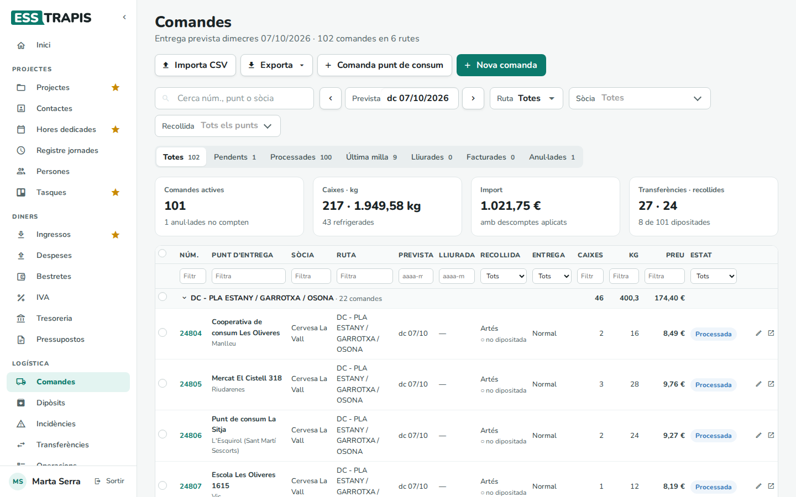
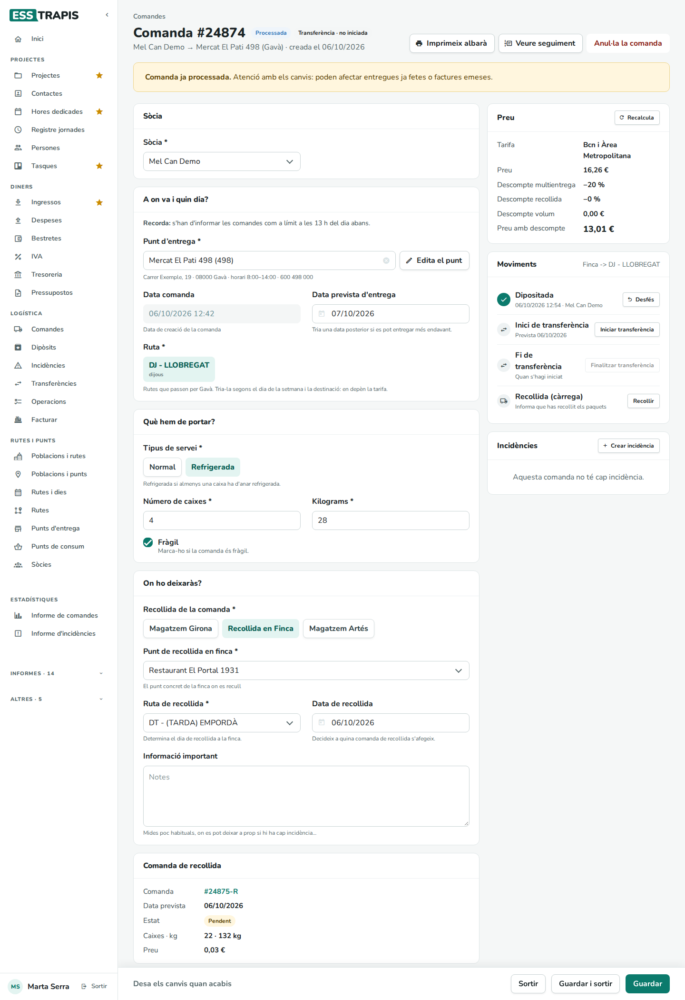
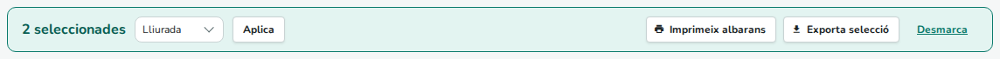
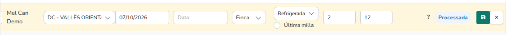
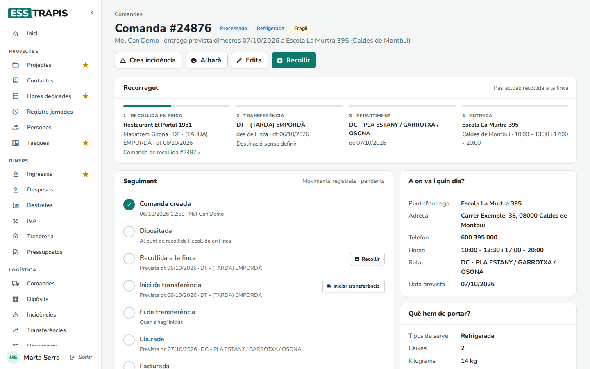
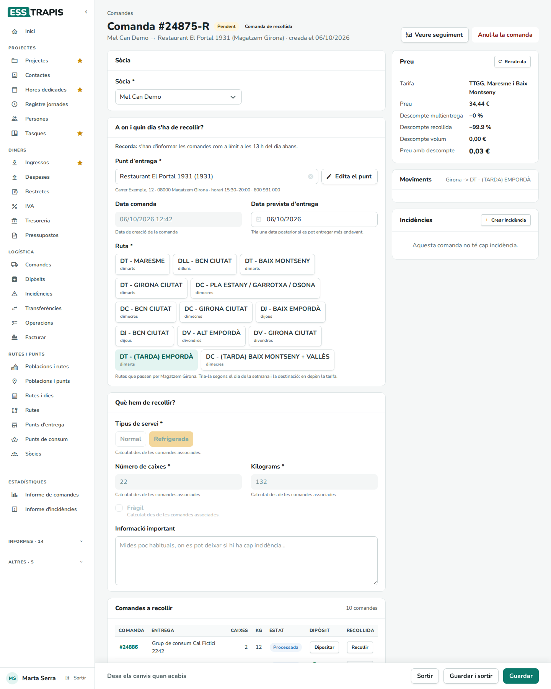
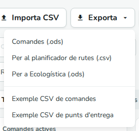

# 28. Comandes

> Permís necessari: `orders`, `orders_admin` o `orders_delivery`

A **Logística › Comandes** es fan i se segueixen les comandes de transport: la sòcia hi encarrega cada
entrega, i l'oficina i la repartidora hi veuen totes les comandes del dia, en canvien l'estat i n'imprimeixen
els albarans. Cada comanda té una **fitxa** per editar-la i una pàgina de **seguiment** que mostra per on va.

## Abans de començar

- Per fer una comanda cal que el **punt d'entrega** existeixi (o crear-lo des de la mateixa comanda) i que
  alguna **ruta** passi per la seva població. Vegeu [29. Punts d'entrega i de consum](29-punts-entrega-consum.md)
  i [30. Poblacions, rutes i dies](30-poblacions-rutes-dies.md).
- El preu surt de les **tarifes de ruta** que configura l'oficina (vegeu
  [35. Taules auxiliars](35-taules-auxiliars.md)).
- Per entendre les peces (sòcia, ruta, recollida, transferència) vegeu
  [27. Visió general de la logística](27-logistica-visio-general.md).

## La llista de comandes

A dalt, el subtítol diu de quin dia són les comandes i quantes n'hi ha (*Entrega prevista dimecres
07/10/2026 · 9 comandes en 4 rutes*), o *Totes les dates* si no hi ha cap dia triat.

**Filtres**

- **Cerca núm., punt o sòcia**: busca pel número de comanda, el nom del punt d'entrega o la sòcia.
- **Prevista**: el dia d'entrega previst. Les fletxes passen al dia anterior o al següent; al calendari,
  **Avui** i **Totes les dates** (treu el filtre de dia).
- **Recollida**: on es deixa la comanda (un magatzem o la finca). **Tots els punts** treu el filtre.
- L'oficina i la repartidora tenen també **Ruta** (una o més rutes; **Totes les rutes** les torna a mostrar
  totes) i **Sòcia**.
- Les pestanyes d'estat: **Totes**, **Pendents**, **Processades**, **Última milla**, **Lliurades**,
  **Facturades** i **Anul·lades**, cadascuna amb quantes comandes té. En obrir la pantalla per primer cop surt
  **Pendents**. Amb **Ctrl+clic** se'n poden triar diverses. **Última milla** no és un estat: mostra les
  comandes marcades com a última milla, siguin en l'estat que siguin.
- A la capçalera de la taula hi ha un filtre per columna (**Filtra**, **Tots**, **aaaa-mm-dd** per a les
  dates). La icona de l'embut ratllat, a l'esquerra, els treu tots.

L'aplicació recorda el dia, la sòcia, la recollida i l'agrupació triats en aquest navegador.

**Resum**

- **Comandes actives**: les comandes de la llista sense comptar les anul·lades.
- **Caixes · kg**: el total de caixes i quilos, i quantes comandes van refrigerades.
- **Import**: la suma dels preus, amb els descomptes aplicats.
- **Transferències · recollides**: quantes comandes tenen transferència i quantes es recullen a la finca, i
  quantes estan dipositades.

**La taula**

Les comandes surten agrupades (per defecte, per ruta), amb el total de caixes, quilos i preu de cada grup i el
nombre de pendents. **Agrupa per**, al peu, canvia l'agrupació: **Ruta**, **Data prevista**, **Sòcia** (oficina
i repartidora) o **Sense agrupar**. La fletxa de cada grup el plega o el desplega.

| Columna | Què hi surt |
|---|---|
| **Núm.** | El número de la comanda; clicant-lo s'obre el seguiment. |
| **Punt d'entrega** | L'establiment i la població, amb les etiquetes **Fràgil**, **Transferència**, **Última milla** o **Comanda de recollida**. |
| **Sòcia** | Qui fa la comanda (només oficina i repartidora). |
| **Ruta** | La ruta que l'entrega. |
| **Prevista** / **Lliurada** | El dia d'entrega previst i el dia que es va lliurar. |
| **Recollida** | On es deixa (magatzem o finca) i si ja està **● dipositada** o **○ no dipositada**. |
| **Entrega** | El tipus de servei: **Normal** o **Refrigerada**. |
| **Caixes**, **Kg** | El que es porta. |
| **Preu** | El preu final. Si té descompte, surt el percentatge rebaixat i uns punts de color: **Multientrega**, **Volum** i **Recollida** (la llegenda és al peu). |
| **Estat** | **Pendent**, **Processada**, **Lliurada**, **Facturada** o **Anul·lada**. |

Les comandes d'una setmana vinent surten més clares (**Setmanes vinents** a la llegenda). Al final de cada
fila hi ha dues icones: el llapis (**Edició ràpida**, vegeu el pas 6) i **Obre la fitxa**. Surten a la
sòcia només mentre la comanda és **Pendent**; a l'oficina i la repartidora, mentre no està anul·lada.

### Què veu cada perfil

- La **sòcia** veu només les seves comandes (i les que van al seu propi punt d'entrega). No té els filtres de
  **Ruta** ni de **Sòcia**, ni la columna **Sòcia**.
- L'**oficina** i la **repartidora** veuen totes les comandes, amb els filtres i la columna **Sòcia**:

La repartidora veu la mateixa llista que l'oficina. Per a la seva feina del dia té la pantalla
**Operacions** (vegeu [31. Dipòsits, transferències i operacions](31-diposits-transferencies-operacions.md)).

## Pas a pas

### 1. Fer una comanda nova

1. **Nova comanda**. Surt la fitxa buida, amb la **Sòcia** ja posada (una sòcia només es pot triar a ella
   mateixa; l'oficina tria la sòcia de la llista).
2. **Punt d'entrega**: s'escriu el nom i es tria de la llista. A sota surt l'adreça, l'horari i el telèfon del
   punt. **Edita el punt** obre les dades del punt per corregir-les; si el punt no hi és, **Nou punt** el crea
   (vegeu [29. Punts d'entrega i de consum](29-punts-entrega-consum.md)).
3. **Ruta**: surten les rutes que passen per la població del punt, cadascuna amb el dia de la setmana que fa.
   Cal triar-la segons el dia i la destinació, perquè en depèn la tarifa.

   

4. En triar la ruta, l'aplicació omple la **Data prevista d'entrega** amb el proper dia que passa la ruta
   (mai el mateix dia; els dies que la ruta està tancada se salten). Si la comanda es pot entregar més tard, es
   pot posar una data posterior.
5. **Tipus de servei**: **Normal** o **Refrigerada** (refrigerada si almenys una caixa ha d'anar en fred).
6. **Número de caixes** i **Kilograms**. **Fràgil** si cal anar-hi amb compte.
7. **Recollida de la comanda**: on es deixarà. Si és un magatzem, a sota surt el recordatori del magatzem (per
   exemple, l'hora límit per dipositar). Si és **Recollida en Finca**, cal triar també el **Punt de recollida
   en finca**, la **Ruta de recollida** (que decideix el dia que es passa a buscar) i, si cal, la **Data de
   recollida**.
8. **Informació important**: el que la repartidora ha de saber (mides poc habituals, on es pot deixar si hi
   ha cap problema…).
9. A la dreta, el quadre **Preu** mostra la **Tarifa** trobada, el **Preu**, els descomptes i el **Preu amb
   descompte**.
10. **Guardar** (o **Guardar i sortir**). La comanda es crea en estat **Pendent** i s'obre la seva fitxa.

En aquest exemple la sòcia ja té una altra comanda per al mateix punt i dia, i per això té un 20 % de
**Descompte multientrega**.

**Si la ruta passa avui.** Quan la ruta triada passa el mateix dia que es fa la comanda, surt l'avís «Ruta
tancada per avui. Se t'assignarà la mateixa ruta però de la setmana vinent ja. Recorda portar el paquet.» i la
data salta a la setmana següent:

**L'hora límit.** Les comandes per a l'endemà s'han de fer abans d'una hora límit, que fixa l'oficina a la
**Configuració general** (per defecte, les 14 h). Passada aquesta hora, en triar una ruta que passaria
l'endemà, surt «Ruta tancada per demà…» i la data salta al mateix dia de la setmana següent. L'oficina no té
aquest límit. El text de la fitxa diu «límit a les 13 h del dia abans», però l'hora que compta és la de la
configuració.

### 2. Si falta alguna dada

Si es clica **Guardar** amb camps obligatoris buits, els camps que falten es marquen en vermell i la comanda
no es desa:

Altres comprovacions surten com a missatge a baix de la pantalla (vegeu *Errors habituals*).

### 3. Una comanda per a un punt de consum

**Comanda punt de consum** obre una comanda per a un punt de consum: en comptes de caixes i quilos hi ha
**Línies**, una per cada persona destinatària, amb **Caixes**, **Kilograms**, **Nom** i **NIF** (**Afegeix
una línia** n'afegeix una; la creu la treu, però sempre n'ha de quedar una). Els totals es calculen de les línies.

> Atenció: ara mateix, en triar la **Recollida de la comanda**, les línies desapareixen i la fitxa torna a
> demanar caixes i quilos com una comanda normal. Si passa, aviseu l'oficina abans de guardar.

### 4. Editar o anul·lar una comanda

Des de la llista, **Obre la fitxa** (o el número de comanda i després **Edita**). La fitxa té les mateixes
parts que la comanda nova i, a més:

- A dalt, l'estat i, si en té, **Transferència · no iniciada / en transfer / finalitzada** o **Comanda de
  recollida**; i els botons **Imprimeix albarà**, **Veure seguiment** i **Anul·la la comanda** (demana
  confirmació: «Estàs segura que vols anul·lar la comanda?»).
- **Moviments**: el dipòsit, l'inici i la fi de la transferència i la recollida (càrrega), cadascun amb la
  data, l'hora i qui ho va fer. Cada moviment té el seu botó per marcar-lo (**Dipositar**, **Iniciar
  transferència**, **Finalitzar transferència**, **Recollir**) o **Desfés** per desmarcar-lo.
- **Incidències**: les de la comanda, amb **Crear incidència** (vegeu
  [32. Incidències i contacte](32-incidencies-contacte.md)).
- Si la comanda és d'una recollida en finca, a baix surt la seva **Comanda de recollida** (número **-R**, data,
  estat, caixes, quilos i preu).

**Qui pot canviar què**

- La **sòcia** pot canviar i anul·lar la comanda només mentre és **Pendent**. Quan l'oficina l'ha processada,
  la fitxa és de només lectura i surt l'avís «Comanda ja processada.», que demana contactar amb l'oficina per
  als canvis d'última hora.
- L'**oficina** i la **repartidora** poden canviar qualsevol comanda que no estigui anul·lada, també les ja
  lliurades o facturades. Per això surt «Comanda ja processada. Atenció amb els canvis: poden afectar entregues
  ja fetes o factures emeses.»
- Una comanda anul·lada ja no es pot editar.

A **Altres dades**, l'oficina i la repartidora tenen, a més de l'**Estat**:

- Si la comanda té transferència: **Ruta de transferència**, **Data de transferència** i **Edició manual de
  la transferència** (la transferència es calcula sola; si s'edita a mà, el càlcul automàtic es desactiva, i
  **Recalcula** el torna a fer), i l'**Origen** i la **Destinació** de la transferència.
- **Ruta completa**: el recorregut sencer, per exemple *Finca -> DJ - LLOBREGAT*.
- **Data de lliurament** i **Última milla** (es marca sola quan la comanda passa per última milla; també es pot
  marcar a mà).

Al quadre **Preu**, **Recalcula** torna a buscar la tarifa i el preu (oficina i repartidora).

### 5. Canviar l'estat

L'estat d'una comanda el porta l'oficina:

| Estat | Què vol dir | Qui el posa |
|---|---|---|
| **Pendent** | Acabada de fer. La sòcia encara la pot canviar. | En crear-la. |
| **Processada** | L'oficina l'ha revisat i planificat. | Oficina o repartidora. |
| **Lliurada** | Entregada al punt. Si no té data de lliurament, es posa la prevista (o la d'avui). | Oficina o repartidora. |
| **Facturada** | Ja és en una factura a la sòcia. | **Facturar** (vegeu [33. Facturació de la logística](33-facturacio-logistica.md)). |
| **Anul·lada** | No es repartirà ni es facturarà. | L'oficina o la repartidora; la sòcia, mentre és pendent. |

Es pot canviar a la fitxa (**Estat**, a **Altres dades**) o a la llista, per a diverses comandes alhora:
es marquen les caselles de les comandes (o la del grup, o la de la capçalera per a totes), es tria l'estat a
**Canvia l'estat a…** i **Aplica**. Mentre treballa surt «Processant comanda i/n...» i, al final, «Totes les
comandes processades correctament».

La sòcia només pot triar **Pendent** en aquesta barra. Dipositar, transferir i carregar no canvien l'estat:
queden apuntats als **Moviments** de la comanda.

### 6. Edició ràpida a la llista

El llapis d'una fila (**Edició ràpida**) permet canviar sense obrir la fitxa el punt d'entrega, la ruta, les
dates prevista i de lliurament, la recollida, el tipus de servei (amb la casella **Última milla**), les caixes i
els quilos. El preu es recalcula en canviar la ruta, els quilos o el tipus de servei. La icona de desar ho guarda
(«Comanda actualitzada correctament») i la creu ho cancel·la.

Si a la columna del preu surt **?**, l'aplicació no ha trobat cap tarifa per a aquella combinació. Convé
revisar el preu a la fitxa després de desar.

### 7. Seguir una comanda

**Veure seguiment** (a la fitxa) o el número de la comanda (a la llista) obren la pàgina de seguiment:

- **Recorregut**: les quatre etapes — **Dipòsit** (o **Recollida en finca**), **Transferència** (o *Sense
  transferència*), **Repartiment** i **Entrega** — amb l'etapa actual marcada (*Pas actual: …*).
- **Seguiment**: cada moviment, fet o pendent: **Comanda creada**, **Dipositada**, **Recollida a la finca**,
  **Inici de transferència**, **Fi de transferència**, **Lliurada** i **Facturada**, amb la data i qui ho va
  fer.
- **Incidències** de la comanda, i a la dreta les dades: on va i quin dia, què es porta, on es deixa, el preu i
  altres dades.
- A dalt: **Crea incidència**, **Albarà** (imprimeix l'albarà) i **Edita** (obre la fitxa; el veuen l'oficina i
  la sòcia de la comanda).

L'oficina i la repartidora hi tenen, a més, els botons per marcar els moviments (**Dipositar** mentre la comanda
és pendent, **Recollir**, **Iniciar transferència**, **Finalitzar transferència**, i els seus **Desfer…**). El
proper pas surt també com a botó principal a dalt:

La repartidora no hi té el botó **Edita**, però pot obrir la fitxa des de la llista.

### 8. Les comandes de recollida (-R)

Quan una comanda es recull a la finca, l'aplicació l'afegeix a la **comanda de recollida** de la sòcia per a
aquell punt, ruta i dia, i si no n'hi ha cap la crea. La comanda de recollida porta el número acabat en **-R**,
l'etiqueta **Comanda de recollida**, i les caixes, els quilos, el tipus de servei i **Fràgil** es calculen de les
comandes associades (no es poden canviar). A baix, **Comandes a recollir** les llista, amb **Dipositar** i
**Recollir** per a cadascuna (**Recollir**, només oficina i repartidora).

Una comanda de recollida que es queda sense cap comanda associada s'anul·la sola. No té albarà.

### 9. Imprimir albarans

**Imprimeix albarà** (a la fitxa), **Albarà** (al seguiment) o, a la llista, marcar comandes i **Imprimeix
albarans** obren un PDF en una pestanya nova. Cada caixa té la seva pàgina (*CAIXA: 1/2*), amb:

- **COMANDA** i el número, el logo de la cooperativa i un codi QR que obre el seguiment de la comanda.
- La data prevista, el punt d'entrega amb l'adreça, i *N caixes - N kg* (i *Refrigerada* si cal).
- **EMISSORA** (la cooperativa), **PROVEÏDORA** (la sòcia), **RUTA** (o **RUTA (TRANSFER)** amb el recorregut).
- **NOTES**: les notes del punt, *Fràgil*, l'horari i la informació important.
- En un punt de consum, el nom i el NIF de la persona de cada caixa.

Les comandes de recollida no s'imprimeixen. Si la sòcia no té cap fitxa de contacte associada, surt «ERROR.
L'usuària … no te cap contacte associat.» i cal avisar l'oficina.

### 10. Importar comandes d'un CSV

Per fer moltes comandes de cop:

1. **Exporta › Exemple CSV de comandes** descarrega un fitxer d'exemple amb les columnes.
2. S'omple amb un full de càlcul i es desa com a CSV separat per comes (també s'accepta punt i coma).
3. **Importa CSV** obre el quadre **Importa des d'un CSV**; s'hi deixa el fitxer a **Crea comandes pujant
   arxiu CSV separat per comes**.

4. Les comandes llegides surten a dalt de la llista, al grup **Importades, encara sense crear**, cadascuna amb
   un botó **Crea**. No es desen fins que es clica **Crea** (es creen en estat **Pendent**).
5. Si alguna línia té errors, surt el quadre **Errors al CSV** amb una línia per error (*Línia N: …*).

El fitxer porta una fila per comanda amb, entre d'altres: el nom de la ruta, la sòcia, la data d'entrega
(*AAAAMMDD*; buida vol dir el proper dia de la ruta), el nom comercial del punt d'entrega, les caixes, els
quilos, si és refrigerada o fràgil, la recollida i les notes. El **punt d'entrega ha d'existir** i es busca pel
nom comercial (sense tenir en compte els accents), i ha de tenir NIF, telèfon, adreça, codi postal, població,
horari i sector.

L'altre requadre, **Crea punts d'entrega pujant arxiu CSV separat per comes**, importa punts d'entrega (amb el
seu exemple a **Exporta › Exemple CSV de punts d'entrega**). Els punts importats així no tenen sector, i
l'importador de comandes els rebutja («…no te sector») fins que se'ls posa a la fitxa del punt.

### 11. Exportar

El menú **Exporta** descarrega la llista que es veu (o només les comandes marcades):

- **Comandes (.ods)**: les comandes, amb el preu de la ruta, els descomptes i el preu final.
- **Per al planificador de rutes (.csv)** i **Per a Ecologística (.ods)**: formats per a programes de
  planificació de rutes (només oficina i repartidora).
- **Exemple CSV de comandes** i **Exemple CSV de punts d'entrega**: els fitxers d'exemple per importar.

Amb comandes marcades, la barra de selecció té també **Exporta selecció**.

## Camps i opcions

| Camp | Què vol dir | Obligatori |
|---|---|---|
| **Sòcia** | Qui fa la comanda i la paga. | Sí |
| **Punt d'entrega** (o **Punt de consum**) | On es lliura. Ha de tenir nom comercial, NIF, telèfon, adreça, codi postal, població i horari. | Sí |
| **Data comanda** | Quan es va fer. Només l'oficina la pot canviar, i només en una comanda nova. | — |
| **Data prevista d'entrega** | El dia que s'entrega. Es proposa sola segons la ruta. | — |
| **Ruta** | La ruta que l'entrega; en depèn el dia i la tarifa. | Sí |
| **Tipus de servei** | **Normal** o **Refrigerada**. | Sí |
| **Número de caixes**, **Kilograms** | El que es porta (més grans que zero). En un punt de consum, les **Línies**. | Sí |
| **Fràgil** | Cal anar-hi amb compte. | No |
| **Recollida de la comanda** | El magatzem on es diposita o la recollida en finca. | Sí |
| **Punt de recollida en finca**, **Ruta de recollida**, **Data de recollida** | Només en la recollida en finca: on, amb quina ruta i quin dia es passa a buscar. | Sí (els dos primers) |
| **Informació important** | Notes per a la repartidora. | No |
| **Estat**, **Data de lliurament**, **Última milla**, dades de la transferència | Només oficina i repartidora (vegeu el pas 4). | — |

## Com es calcula

**El dia d'entrega.** El primer dia, a partir de l'endemà, que passa la ruta i que no està tancat a **Rutes i
dies**. Si ja ha passat l'hora límit i aquest dia seria l'endemà, es passa a la setmana següent (llevat de
l'oficina).

**La tarifa.** L'aplicació busca una tarifa que inclogui la ruta (o que valgui per a totes les rutes), la
recollida i el tipus de servei; si no en troba cap, surt **Tarifa no trobada** i el preu és zero.

**El preu** depèn dels quilos:

- Menys de 10 kg: un preu fix.
- De 10 a 60 kg: el preu de la tarifa als 10, 20, 30, 40, 50 i 60 kg, i entremig la part proporcional.
- Més de 60 kg: el preu dels 60 kg més un tant per cada quilo de més.
- En un punt de consum, s'hi suma un tant per cada línia.

El preu es calcula mentre la comanda és **Pendent**; després queda fixat (l'oficina el pot tornar a calcular
amb **Recalcula**).

**Els descomptes**

- **Multientrega** (%): quan la sòcia té més d'una comanda per al mateix punt d'entrega i el mateix dia. El
  percentatge es fixa a la **Configuració general**, i l'oficina el pot desactivar per a una sòcia.
- **Volum** (€): quan la sòcia porta prou comandes en una mateixa ruta i dia; cada comanda té uns euros menys.
  Es configura a cada ruta.
- **Recollida** (%): el que tingui el punt d'entrega a «% de descompte per recollida en finca».

El preu amb descomptes es calcula igual a tot arreu (la fitxa, la llista, el seguiment, Facturar i la
factura): primer es resta el descompte de volum i després s'aplica la suma dels dos percentatges, i el
resultat s'arrodoneix a cèntims:

**preu amb descomptes = (preu − descompte per volum €) × (1 − (descompte multientrega % + descompte
recollida %) / 100)**

Per exemple, 10,00 € amb 1,00 € de volum, un 10 % de multientrega i un 5 % de recollida: (10,00 − 1,00) ×
(1 − 0,15) = **7,65 €**.

## Preguntes freqüents / Errors habituals

**«Error. Falten alguns camps obligatòris».** Falta la sòcia, la ruta, el punt d'entrega, les caixes, els
quilos o la recollida.

**«Error. No hi ha NIF al punt d'entrega»** (o telèfon, adreça, codi postal, població, nom comercial). El punt
d'entrega està incomplet: **Edita el punt** i completeu-lo.

**«Error. No hi ha tots els trams horaris definits al punt d'entrega»**, **«Error. El tram horari ha de ser
mínim de 3 hores»** i semblants. L'horari del punt d'entrega no és correcte: com a mínim un tram de 3 hores.

**«Error. Els valors de caixes i kilos han de ser positius».** Les caixes i els quilos han de ser més grans que
zero.

**«Error. Has de seleccionar un punt de recollida en finca» / «…una ruta de recollida».** En la recollida en
finca cal triar el punt i la ruta.

**«La ruta seleccionada no es fa dimarts»** (o el dia que sigui). La data prevista no és un dia de la ruta. A
la sòcia no la deixa guardar; a l'oficina només l'avisa. També pot sortir «Atenció! La data de lliurament no és
vàlida per la ruta seleccionada» si el dia triat està tancat.

**«La ruta "…" no té cap dia de la setmana configurat».** Cal que l'oficina hi posi els dies (vegeu
[30. Poblacions, rutes i dies](30-poblacions-rutes-dies.md)).

**En guardar surt només «Error».** El servidor ha rebutjat la comanda. Un motiu habitual és haver passat
l'hora límit per a una entrega de l'endemà: canvieu la data o la ruta, o parleu amb l'oficina.

**No surt la ruta que vull.** Només surten les rutes que passen per la població del punt d'entrega. Si la
població no té cap ruta, cal parlar amb l'oficina.

**No puc canviar una comanda.** La sòcia només pot canviar les comandes pendents. Per a les altres, cal
contactar amb l'oficina (o obrir una incidència).

**He dipositat les caixes però l'estat continua Pendent.** És normal: el dipòsit queda apuntat als
**Moviments** i a la columna **Recollida** (● dipositada), però l'estat el canvia l'oficina.

## Vegeu també

- [27. Visió general de la logística](27-logistica-visio-general.md)
- [29. Punts d'entrega i de consum](29-punts-entrega-consum.md)
- [30. Poblacions, rutes i dies](30-poblacions-rutes-dies.md)
- [31. Dipòsits, transferències i operacions](31-diposits-transferencies-operacions.md)
- [32. Incidències i contacte](32-incidencies-contacte.md)
- [33. Facturació de la logística](33-facturacio-logistica.md)
