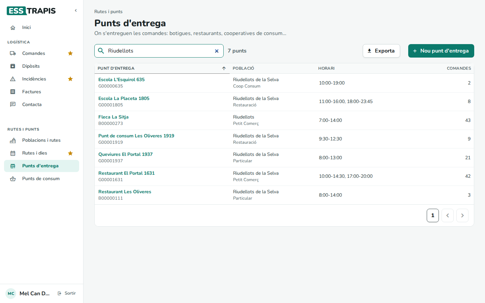
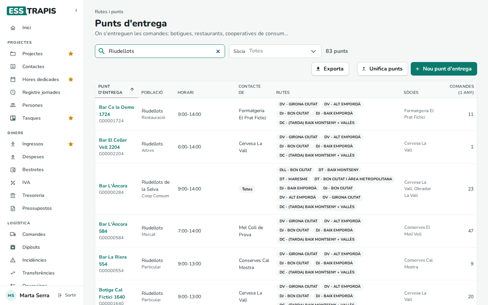
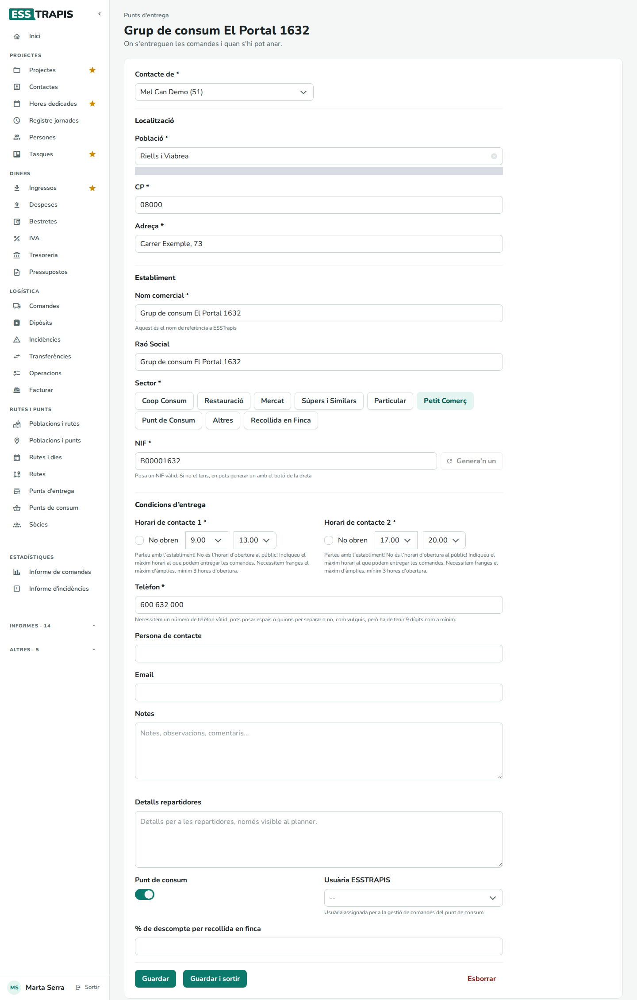
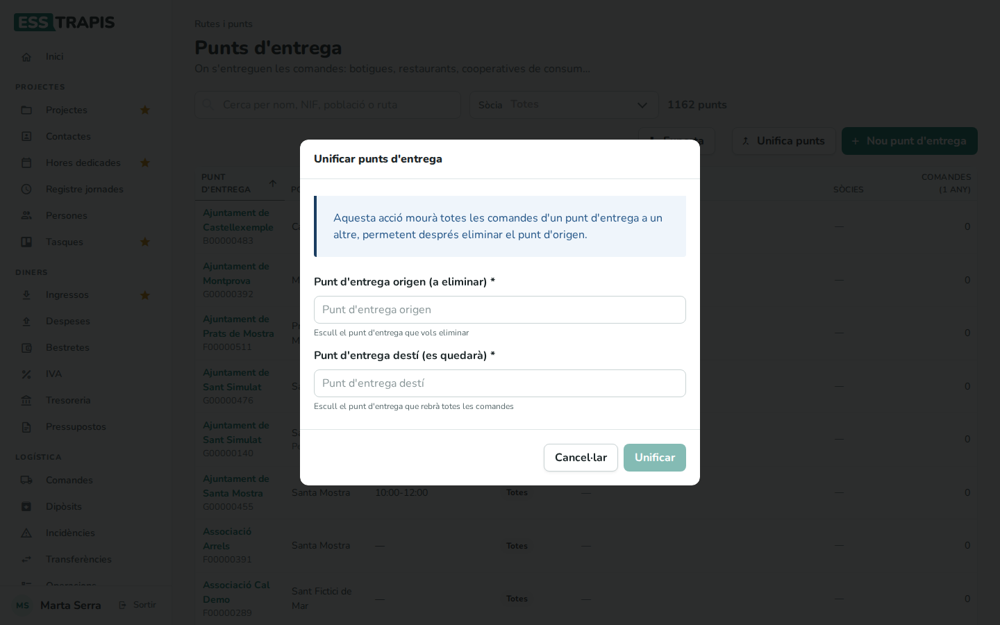
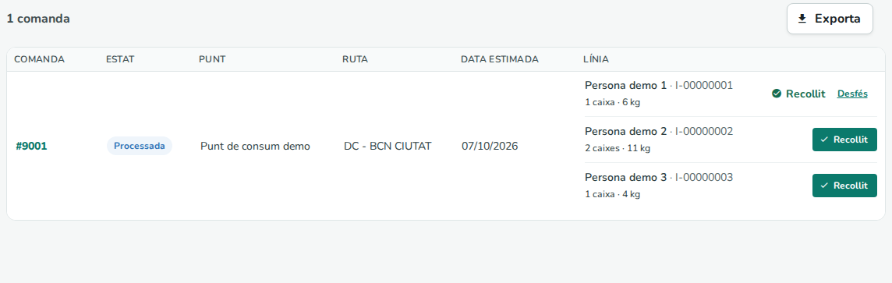

# 29. Punts d'entrega i de consum

> Permís necessari: `orders` (sòcia), `orders_admin` (oficina) o `orders_delivery` (repartidora)

Un **punt d'entrega** és el lloc on es porta una comanda: una botiga, un restaurant, una cooperativa de
consum, una escola… Cada comanda va a un punt d'entrega, i la ruta, l'horari i el telèfon que fa servir la
repartidora surten del punt. Un **punt de consum** és un punt d'entrega especial on la comanda porta caixes per
a diverses persones, que hi passen a recollir la seva; a la pantalla **Punts de consum** es marca qui ja l'ha
recollida.

## Abans de començar

- La **població** del punt ha de ser a la llista de poblacions. Si no hi és, cal demanar a l'oficina que
  l'afegeixi i li doni rutes (vegeu [30. Poblacions, rutes i dies](30-poblacions-rutes-dies.md)). Sense
  població de la llista, el punt no es pot guardar.
- Les comandes troben la ruta a partir de la població del punt: si la població no té cap ruta, la comanda no
  en podrà triar cap.
- Els **sectors** (Coop Consum, Restauració, Petit Comerç…) són una taula de l'entitat que es manté a
  **Administració › Taules auxiliars** (vegeu [35. Taules auxiliars](35-taules-auxiliars.md)).

Menú **Rutes i punts › Punts d'entrega** (tots tres perfils) i **Rutes i punts › Punts de consum** (sòcia i
oficina).

## Pas a pas

### 1. La llista de punts d'entrega

La sòcia veu els seus punts, els punts compartits per totes les sòcies i els punts on van les seves comandes.

- Columnes: **Punt d'entrega** (el nom comercial, i a sota la raó social si és diferent i el NIF),
  **Població** (i a sota el sector), **Horari** (els dos horaris de contacte) i **Comandes** (quantes n'hi ha
  fet).
- **Cerca per nom, NIF, població o ruta**: filtra mentre s'escriu. El comptador diu quants punts queden.
- **Exporta** descarrega la llista (amb adreça, telèfon, horaris, rutes…).
- **Nou punt d'entrega** obre una fitxa buida.

Clicant el nom s'obre la fitxa del punt.

### 2. La fitxa d'un punt d'entrega

La fitxa té tres blocs:

- **Localització**: **Població** (s'escriu i es tria de la llista), **CP** i **Adreça**. Sota la població hi ha
  un missatge amb la persona de l'oficina amb qui cal parlar si la població no és a la llista (a la captura
  està tapat).
- **Establiment**: **Nom comercial** (el nom amb què el punt surt a tot arreu), **Raó Social**, **Sector** (es
  tria clicant-ne un) i **NIF**. Si l'establiment no té NIF, **Genera'n un** en posa un d'inventat que comença
  per `I-`.
- **Condicions d'entrega**: els dos **Horaris de contacte**, el **Telèfon**, la **Persona de contacte**,
  l'**Email** i les **Notes**.

Després, **Guardar** (es queda a la fitxa) o **Guardar i sortir** (torna a la llista). Surt *Guardat*.

**Els horaris de contacte.** No són l'horari d'obertura al públic, sinó les hores en què s'hi pot portar la
comanda; com més amplis, millor. Cada horari té una hora d'inici i una de final, en quarts d'hora. Si
l'establiment només obre en una franja, es marca **No obren** a l'altra. Les regles:

- almenys un dels dos horaris ha d'estar complet i durar 3 hores o més;
- un horari omplert ha de durar com a mínim 3 hores i començar abans d'acabar;
- no es pot deixar només l'hora d'inici o només la de final.

### 3. Crear un punt d'entrega

1. **Nou punt d'entrega** a la llista (o **Nou punt** des d'una comanda, vegeu
   [28. Comandes](28-comandes.md#1-fer-una-comanda-nova)).
2. Omplir la població, el CP, l'adreça, el nom comercial, el sector, el NIF, almenys un horari de 3 hores i
   el telèfon (com a mínim 9 xifres; es poden posar espais o guions).
3. **Guardar**. El punt queda com a punt de la sòcia que l'ha creat.

Si falta alguna dada, els camps es marquen en vermell i surt *Error. Hi ha camps incorrectes*; el punt no es
desa fins que es corregeixen:

Si la raó social es deixa buida, es desa amb el nom comercial.

### 4. Què veuen l'oficina i la repartidora

L'oficina i la repartidora veuen tots els punts d'entrega de totes les sòcies, amb més columnes i un filtre
**Sòcia**:

- **Contacte de**: de qui és el punt (el nom de la sòcia), **Totes** si és un punt compartit per totes les
  sòcies, o **Multientrega**.
- **Rutes**: les rutes de les comandes que hi han anat.
- **Sòcies**: les sòcies que hi han enviat comandes.
- **Comandes (1 any)**: les comandes de l'últim any.
- **Unifica punts** (vegeu el pas 5).

A la fitxa, l'oficina i la repartidora tenen més camps:

- **Contacte de**: la sòcia de qui és el punt. L'opció **TOTES** el fa compartit: el veuen totes les sòcies.
- **Detalls repartidores**: indicacions per a la repartidora; només surten a l'exportació per al planificador
  de rutes.
- **Punt de consum**: el converteix en punt de consum (vegeu el pas 6), i aleshores apareix **Usuària
  ESSTRAPIS**, la persona usuària que gestiona les recollides d'aquell punt.
- **% de descompte per recollida en finca**: el descompte que tindran les comandes cap a aquest punt (vegeu
  [28. Comandes](28-comandes.md#com-es-calcula)).
- **Esborrar**: esborra el punt (*Vols esborrar aquest contacte?*). Si el punt ja té comandes, no es pot
  esborrar: *Error. El contacte no s'ha pogut esborrar perquè té dades associades*. La sòcia no té aquest
  botó.

### 5. Unificar dos punts repetits

Quan el mateix establiment s'ha creat dues vegades, l'oficina pot passar totes les comandes d'un punt a l'altre
amb **Unifica punts**:

1. **Punt d'entrega origen (a eliminar)**: el punt que sobra. Si té comandes, la finestra diu quantes es
   mouran.
2. **Punt d'entrega destí (es quedarà)**: el punt bo. No pot ser el mateix que l'origen (*El punt d'origen i el
   destí no poden ser el mateix!*).
3. **Unificar** i confirmar amb **Sí, unificar**. Surt *S'han mogut N comandes correctament*.

L'aplicació només mou les comandes: el punt d'origen continua existint i cal esborrar-lo després des de la seva
fitxa. Les comandes mogudes conserven les dades del punt antic que s'hi van copiar en crear-les (nom, adreça,
telèfon), i és el que surt a l'albarà.

### 6. Els punts de consum

Una comanda per a un punt de consum porta una **línia** per a cada persona destinatària, amb el seu nom, NIF,
caixes i quilos (com es fa la comanda: [28. Comandes](28-comandes.md#3-una-comanda-per-a-un-punt-de-consum)).
Quan arriben les caixes, les persones hi passen a buscar la seva i al menú **Punts de consum** es marca qui ja
l'ha recollida.

- Hi surten les comandes per a punts de consum que no estan ni facturades ni anul·lades, per data d'entrega.
- Columnes: **Comanda** (enllaç al seguiment), **Estat**, **Punt**, **Ruta**, **Data estimada** i **Línia**:
  cada persona amb el seu NIF, les caixes i els quilos.
- **Recollit**, al costat de cada línia, la marca com a recollida (*Línia marcada com recollida
  correctament*). **Desfés** ho torna enrere. Quan totes les línies d'una comanda estan recollides, la comanda
  queda marcada com a recollida, però continua a la llista.
- **Exporta** descarrega una fila per línia, amb la columna **Recollida** (Sí / No).

Qui ho veu:

- **La sòcia**: les seves comandes per a punts de consum i, si és l'**Usuària ESSTRAPIS** d'un punt de consum,
  les comandes que hi van, encara que siguin d'altres sòcies.
- **L'oficina**: totes.

## Camps i opcions

| Camp | Què vol dir | Obligatori |
|---|---|---|
| **Contacte de** | La sòcia de qui és el punt; **TOTES**, compartit per totes. Només oficina i repartidora. | Sí |
| **Població** | De la llista de poblacions; en depenen les rutes que pot triar la comanda. | Sí |
| **CP**, **Adreça** | On és el punt. | Sí |
| **Nom comercial** | El nom amb què el punt surt a les llistes, a les comandes i a l'albarà. | Sí |
| **Raó Social** | El nom fiscal. Buit: el nom comercial. | No |
| **Sector** | El tipus d'establiment. Els punts del sector **Recollida en Finca** no surten per triar com a punt d'entrega d'una comanda. | Sí |
| **NIF** | El NIF de l'establiment, o un d'inventat amb **Genera'n un**. | Sí |
| **Horari de contacte 1 / 2** | Quan s'hi pot portar la comanda; almenys un de 3 hores. **No obren** buida la franja. | Almenys un |
| **Telèfon** | Com a mínim 9 xifres. | Sí |
| **Persona de contacte**, **Email**, **Notes** | Per a la repartidora i l'oficina; les notes surten a l'albarà. | No |
| **Detalls repartidores** | Indicacions per al planificador de rutes. Només oficina i repartidora. | No |
| **Punt de consum** | El punt rep comandes amb línies per persona. Només oficina i repartidora. | No |
| **Usuària ESSTRAPIS** | Qui gestiona les recollides del punt de consum. | No |
| **% de descompte per recollida en finca** | Descompte de les comandes cap a aquest punt. Només oficina i repartidora. | No |

## Preguntes freqüents / Errors habituals

- **No trobo la població a la llista.** Només es poden triar poblacions que ja existeixen. L'oficina les afegeix
  a **Poblacions i rutes** (vegeu [30](30-poblacions-rutes-dies.md#2-poblacions-i-rutes)).
- **«Error. Hi ha camps incorrectes».** Hi ha algun camp en vermell: sovint és l'horari (menys de 3 hores, o
  l'hora d'inici després de la de final) o el telèfon (menys de 9 xifres). El missatge no diu quin horari falla;
  cal mirar els camps marcats.
- **He canviat l'adreça d'un punt i l'albarà d'una comanda ja feta encara diu l'antiga.** Cada comanda guarda
  una còpia de les dades del punt del moment en què es va crear; els canvis al punt valen per a les comandes
  noves.
- **Puc veure un punt que no és meu?** Sí, si és compartit (**Totes** / **Multientrega**) o si hi has enviat
  alguna comanda. També el pots corregir.
- **Vull esborrar un punt.** Ho ha de fer l'oficina, i només si no té comandes. Si està repetit, primer
  **Unifica punts** i després esborrar el que sobra.

## Vegeu també

- [27. Visió general de la logística](27-logistica-visio-general.md)
- [28. Comandes](28-comandes.md): triar el punt d'entrega i fer comandes per a punts de consum.
- [30. Poblacions, rutes i dies](30-poblacions-rutes-dies.md): les poblacions i les rutes que hi passen.
- [31. Dipòsits, transferències i operacions](31-diposits-transferencies-operacions.md)
