# 30. Poblacions, rutes i dies

> Permís necessari: `orders` (sòcia, només consulta) o `orders_admin` (oficina)

Una **ruta** és un recorregut de repartiment que es fa uns dies concrets de la setmana (per exemple, *DC - BCN
CIUTAT* passa els dimecres) i que passa per unes **poblacions**. Quan es fa una comanda, la població del punt
d'entrega decideix quines rutes es poden triar, i el dia de la ruta decideix la data d'entrega. Aquí s'explica
com es consulten i es mantenen les rutes, les poblacions per on passen, els dies que una ruta no surt i les
**tarifes** que fixen el preu del transport.

## Abans de començar

- La sòcia pot consultar **Rutes i dies** i **Poblacions i rutes**, sense canviar res.
- L'oficina (`orders_admin`) a més obre i tanca dies, afegeix i treu poblacions de les rutes, crea poblacions i
  crea, edita i desactiva rutes (pestanyes **Poblacions i punts** i **Rutes**).
- La repartidora (`orders_delivery`) no té aquestes pantalles: veu les seves rutes a **Operacions** (vegeu
  [31](31-diposits-transferencies-operacions.md)).
- Les **tarifes de ruta** es mantenen a **Administració › Taules auxiliars**, que demana el permís `admin`
  (vegeu [Les tarifes de ruta](#les-tarifes-de-ruta)).
- Els festius de l'entitat que surten a **Rutes i dies** són els del calendari general (vegeu
  [36. Inici d'any i manteniment](36-inici-any-manteniment.md)).

Menú **Rutes i punts**: **Rutes i dies**, **Poblacions i rutes**, i per a l'oficina **Poblacions i punts** i
**Rutes**. Les quatre pantalles comparteixen unes pestanyes a dalt per passar d'una a l'altra.

## Pas a pas

### 1. Rutes i dies

Mostra quatre setmanes de totes les rutes actives, agrupades pel dia de la setmana, i per a cada dia que passa
la ruta diu si està **Oberta** o **Tancada** i quantes comandes hi ha previstes (*N com.*).

- A dalt, el resum (*18 rutes actives · setmanes del … al …*) i els botons per anar a les **setmanes
  anteriors**, a les **setmanes següents** i a **Avui**.
- Cada ruta porta, sota el nom, quantes poblacions té, el descompte per volum si en té (*−1,74 € a partir de 10
  comandes*) i si **fa transferències**.
- Llegenda: **Oberta**, **Tancada** (vora puntejada) i **Oberta en dia festiu** (groc). Els dies passats surten
  més clars.
- Si en les setmanes que es veuen hi ha un festiu de l'entitat amb rutes obertes, surt un avís groc: *Dilluns
  12/10/2026 és festiu i les 2 rutes d'aquell dia hi són obertes, amb 2 comandes previstes.*
- A la dreta, **Quina ruta passa per…?**: s'escriu una població i surten les rutes que hi passen. **Totes les
  poblacions** porta a **Poblacions i rutes**. A sota, quantes poblacions no tenen cap ruta.

Els comptes de comandes inclouen les comandes de totes les sòcies (les anul·lades no compten), també quan ho
mira una sòcia.

**L'oficina** veu el mateix, amb el text *clica un dia per obrir o tancar la ruta* i, a l'avís de festiu, el botó
**Tanca les rutes del …**, que tanca d'un cop totes les rutes obertes d'aquell dia:

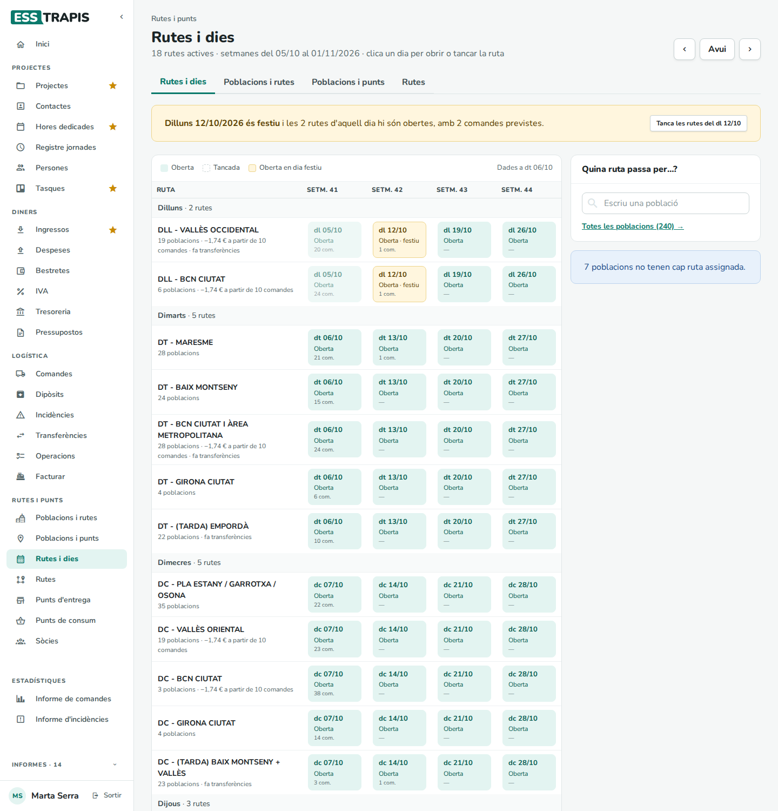

**Tancar o obrir un dia.** L'oficina clica la casella d'un dia: si estava oberta, la ruta queda tancada aquell
dia; si estava tancada, es torna a obrir.

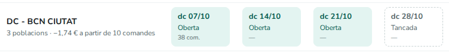

Un dia tancat se salta en posar la data a les comandes noves: l'aplicació proposa el dia següent que passa la
ruta (vegeu [28. Comandes](28-comandes.md#com-es-calcula)). Les comandes que ja tenien aquella data **no es
mouen**: la casella continua dient quantes n'hi ha, i cal canviar-les a mà (per exemple amb l'edició ràpida de
la llista de comandes).

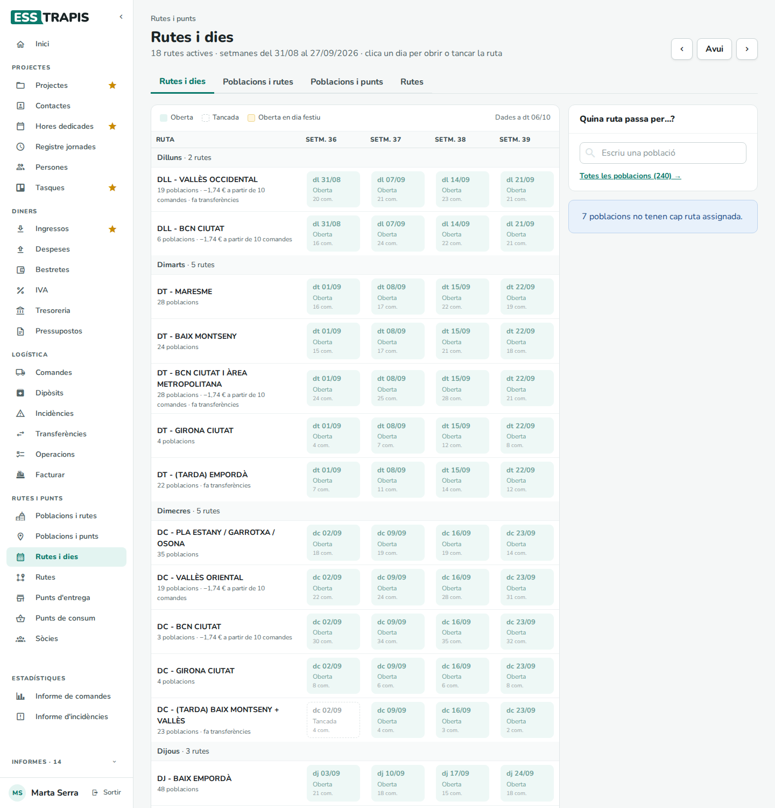

Un festiu de l'entitat no tanca cap ruta per si sol: només en fa sortir l'avís. Si la ruta no ha de sortir, cal
tancar-la.

### 2. Poblacions i rutes

Les rutes, agrupades pel primer dia de la setmana que fan, amb les poblacions per on passen. La sòcia la fa
servir per saber quina ruta li va bé:

- A dalt, el resum: quantes poblacions hi ha, quantes rutes actives i quantes poblacions no tenen ruta.
- **Filtra per ruta o població** deixa només les rutes que tenen aquest nom o hi passen per aquesta població.
- Cada ruta mostra els seus dies i les primeres poblacions; **+N més** o la fletxa la despleguen.
  **Desplega-les totes** / **Plega-les totes**.
- Clicant una població, surt a **Quina ruta passa per…?**, a la dreta.

**L'oficina** hi veu també una creu a cada població i tres quadres més:

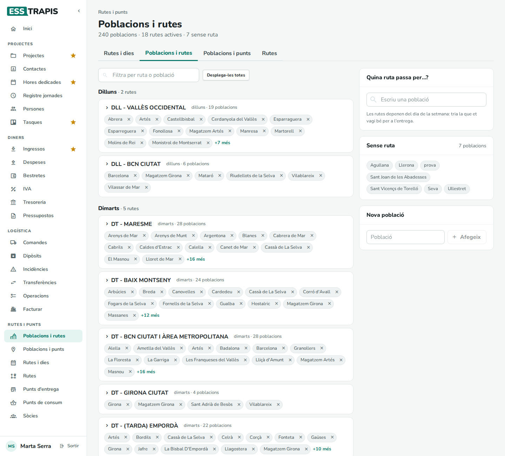

- **Treure una població d'una ruta**: la creu del costat del nom. Surt *… treta de …* amb **Desfés**, per si ha
  estat un error.
- **Afegir una població a una ruta**: es desplega la ruta i s'escriu la població a **Afegeix una població a la
  ruta**. Surt *… afegida a …*.

  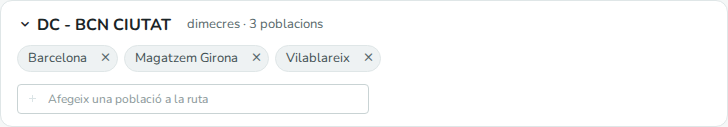

- **Quina ruta passa per…?**: per a cada població trobada, les seves rutes amb una creu per treure-les i
  **Afegeix una ruta…** per afegir-n'hi una altra. És la manera més ràpida de canviar les rutes d'una població.

  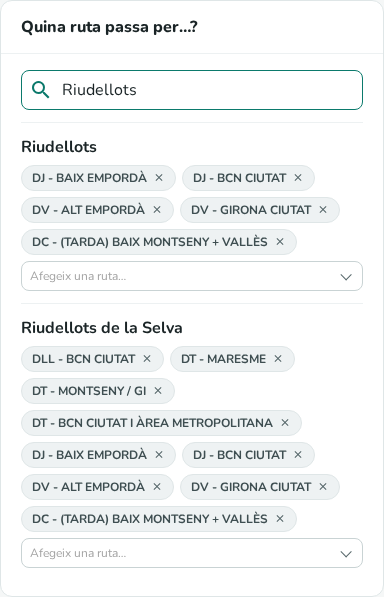

- **Sense ruta**: les poblacions que no tenen cap ruta. Les comandes cap a punts d'aquestes poblacions no poden
  triar ruta.
- **Poblacions repetides**: poblacions amb el mateix nom (sense comptar accents ni majúscules). Les comandes
  poden anar a una o a l'altra; convé deixar-ne una de sola.
- **Nova població**: s'escriu el nom i **Afegeix** (*Vols afegir la població?*). Si ja existeix, l'aplicació ho
  diu (*Ja existeix: …*) i la busca. La població nova surt a **Quina ruta passa per…?** per donar-li rutes de
  seguida.

No hi ha cap botó per esborrar o canviar el nom d'una població.

### 3. Poblacions i punts (oficina)

Les poblacions escrites als punts d'entrega que no són a la llista de poblacions. Les comandes cap a aquests
punts no troben cap ruta.

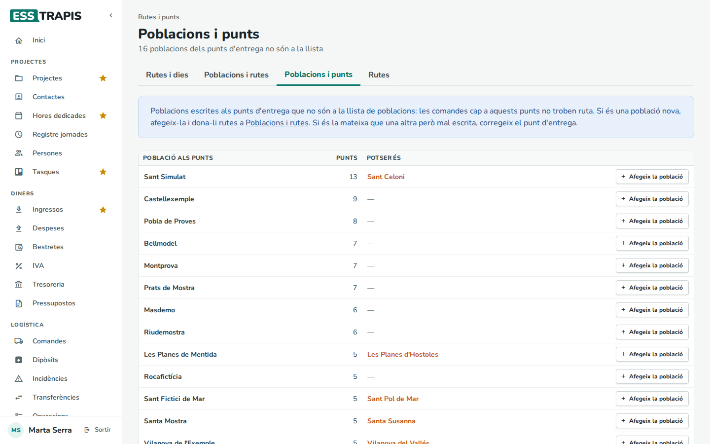

- **Població als punts**: el nom tal com està escrit als punts.
- **Punts**: quants punts tenen aquest nom de població.
- **Potser és**: una població de la llista amb un nom semblant, si n'hi ha.
- **Afegeix la població**: la crea a la llista (*Població afegida correctament*). Després cal donar-li rutes a
  **Poblacions i rutes**.

Si és la mateixa població mal escrita, el que cal és corregir la població als punts d'entrega (vegeu
[29](29-punts-entrega-consum.md#2-la-fitxa-dun-punt-dentrega)), no afegir-la.

### 4. Rutes (oficina)

La llista de totes les rutes, les actives primer, per ordre:

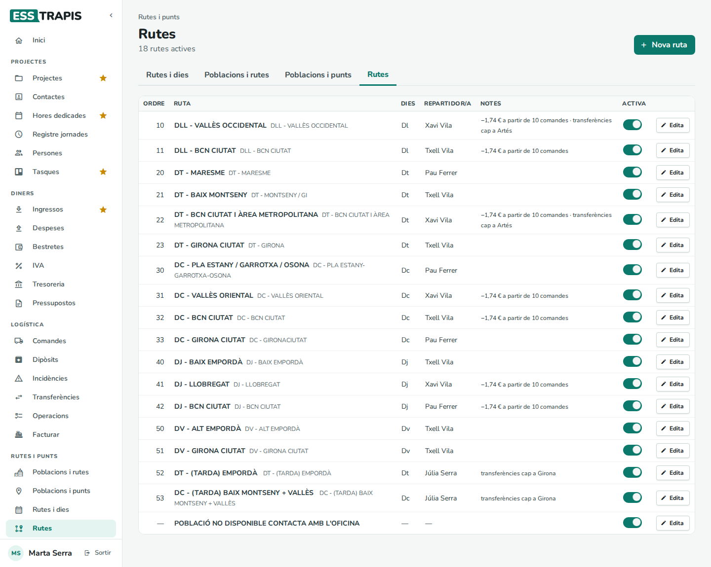

Columnes: **Ordre**, **Ruta** (i el nom curt), **Dies** (Dl, Dt, Dc…), **Repartidor/a**, **Notes** (descompte
per volum i cap a on van les transferències) i **Activa**. **Edita** obre la fitxa de la ruta.

Una ruta no s'esborra mai: les comandes antigues la conserven. Si ja no es fa, es **desactiva**.

**Editar una ruta.** **Edita**, canviar el que calgui i **Desa** (*Ruta desada*). **Cancel·la** tanca sense
desar.

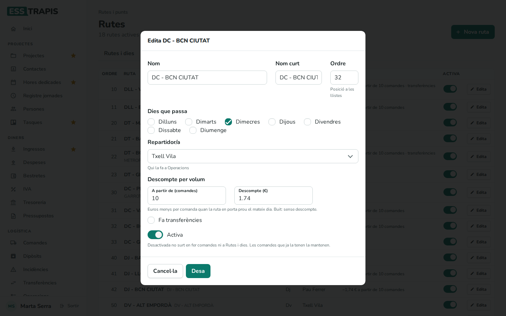

> **Atenció abans de desar una ruta que no fa transferències.** Quan una comanda es deixa en un magatzem per on
> no passa la ruta, la ruta té guardat a quin magatzem van les seves transferències, encara que la fitxa no
> el mostri (només el mostra si **Fa transferències** està marcat). En desar una ruta sense **Fa
> transferències**, aquest magatzem s'esborra, i les comandes noves d'aquesta ruta que necessitin una
> transferència es quedaran sense destinació. Abans de desar una ruta així, consulteu-ho amb qui porta les
> transferències (vegeu [31](31-diposits-transferencies-operacions.md#transferències)).

**Crear una ruta.** **Nova ruta** obre la fitxa buida, amb l'**Ordre** següent al de l'última ruta i
**Activa**. Cal omplir com a mínim el **Nom** i un dia a **Dies que passa**. Si alguna cosa no quadra, en clicar
**Desa** surt en vermell sota el camp i no es desa:

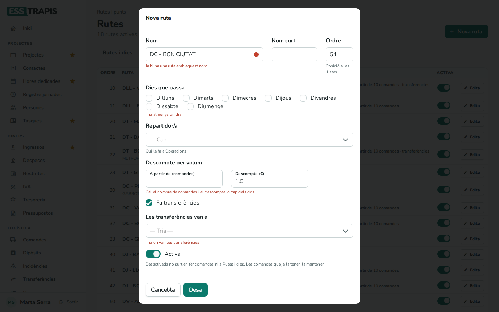

Una ruta nova encara no passa per cap població: després cal afegir-n'hi a **Poblacions i rutes**. Tampoc no té
cap tarifa fins que no s'inclou en una (vegeu [Les tarifes de ruta](#les-tarifes-de-ruta)).

**Desactivar una ruta.** L'interruptor **Activa** de la llista (o el de la fitxa). En desactivar-la des de la
llista, l'aplicació demana confirmació:

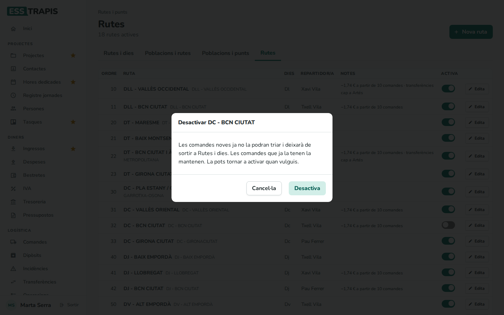

Amb **Desactiva**, la ruta deixa de sortir en fer comandes, a **Rutes i dies**, a **Poblacions i rutes** i a
**Operacions**. Les comandes que ja la tenen la conserven. Per tornar-la a activar, es torna a clicar
l'interruptor (no demana confirmació).

Si es clica **Cancel·la** a la confirmació, la ruta continua activa i l'interruptor torna a quedar encès.

## Les tarifes de ruta

La **tarifa** diu quant costa el transport d'una comanda segons els quilos. Cada tarifa s'aplica a unes rutes,
a un tipus de servei (Normal o Refrigerada) i, si cal, a una recollida. Es mantenen a **Administració › Taules
auxiliars › Logística › Tarifes de ruta**, que només pot canviar una persona amb el permís `admin`; els camps
són a [35. Taules auxiliars](35-taules-auxiliars.md#les-llistes).

A les dades d'exemple hi ha tres grups de rutes, cadascun amb una tarifa Normal i una de Refrigerada: *Girona*,
*TTGG, Maresme i Baix Montseny* i *Bcn i Àrea Metropolitana*.

**Quina tarifa té una comanda.** L'aplicació busca les tarifes que inclouen la ruta de la comanda (o que no
tenen cap ruta, i valen per a totes) i el seu tipus de servei. Les tarifes amb la recollida **Recollida en
Finca** només s'apliquen a la primera comanda pendent de la sòcia amb recollida en finca en aquella ruta. Si
n'hi ha més d'una, guanya la que té rutes; si no en troba cap, la comanda diu **Tarifa no trobada** i el preu és
zero.

> Dues limitacions actuals: de les recollides en magatzem, l'aplicació només reconeix el primer magatzem (a les
> dades d'exemple, *Magatzem Girona*), de manera que una tarifa lligada a un altre magatzem no s'aplica mai; i si
> una comanda encaixa amb diverses tarifes que valen per a totes les rutes i cap de concreta, també surt
> **Tarifa no trobada**. Per evitar-ho, cada tarifa ha de tenir les seves rutes.

**Com es calcula el preu.** Per exemple, amb la tarifa Normal *Bcn i Àrea Metropolitana*:

| Pes | Preu |
|---|---|
| Menys de 10 kg | 9,83 € (preu fix) |
| 10 / 20 / 30 / 40 / 50 / 60 kg | 9,83 / 10,94 / 12,51 / 15,19 / 17,87 / 20,55 € |
| Cada kg de més de 60 | 0,33 € |

- Una comanda de 25 kg és a mig camí entre 20 i 30 kg: 10,94 + (12,51 − 10,94) × 0,5 = **11,73 €**.
- Una de 70 kg: 20,55 + 10 × 0,33 = **23,85 €**.
- A les comandes per a punts de consum s'hi suma l'import **Per línia de punt de recollida** per cada línia.

Els descomptes (multientrega, volum i recollida) es resten després: vegeu
[28. Comandes](28-comandes.md#com-es-calcula). El **descompte per volum** es posa a cada ruta (**A partir de
(comandes)** i **Descompte (€)**).

**Canviar una tarifa.** El preu nou s'aplica a les comandes que es fan o es modifiquen mentre són **Pendents**;
les comandes ja processades, lliurades o facturades conserven el preu que tenien (l'oficina el pot tornar a
calcular amb **Recalcula** a la fitxa de la comanda).

## Camps i opcions

**Fitxa de la ruta**

| Camp | Què vol dir | Obligatori |
|---|---|---|
| **Nom** | El nom de la ruta. No pot repetir el d'una altra ruta. | Sí |
| **Nom curt** | El nom que surt a les etiquetes de **Quina ruta passa per…?**. Buit: el nom. | No |
| **Ordre** | La posició de la ruta a les llistes. | No |
| **Dies que passa** | Els dies de la setmana que es fa. | Almenys un |
| **Repartidor/a** | Qui la fa: les seves comandes li surten a **Operacions**. Es tria entre les persones amb el permís `orders_delivery`. | No |
| **Descompte per volum** | **A partir de (comandes)** i **Descompte (€)**: euros menys per comanda quan una sòcia en porta prou a la ruta el mateix dia. Tots dos o cap. | No |
| **Fa transferències** | La ruta porta comandes d'un magatzem a un altre abans del repartiment. | No |
| **Les transferències van a** | El magatzem on deixa les transferències. | Si fa transferències |
| **Activa** / **Desactivada** | Desactivada no surt en fer comandes ni a **Rutes i dies**. | — |

## Preguntes freqüents / Errors habituals

- **Una comanda no troba cap ruta.** La població del punt d'entrega no té rutes (quadre **Sense ruta**) o no és
  a la llista de poblacions (**Poblacions i punts**).
- **He tancat un dia i les comandes encara hi són.** Tancar un dia només afecta les comandes noves. Les que ja hi
  eren s'han de canviar de data a mà.
- **La ruta surt amb el text «sense dia».** No té cap dia marcat: les comandes no en poden calcular la data
  (*La ruta "…" no té cap dia de la setmana configurat*). Cal editar-la i marcar-ne algun.
- **«Ja hi ha una ruta amb aquest nom».** Els noms no es poden repetir, encara que la ruta antiga estigui
  desactivada.
- **«Cal el nombre de comandes i el descompte, o cap dels dos».** El descompte per volum necessita els dos
  valors.
- **«Tria on van les transferències».** Si la ruta fa transferències, cal dir a quin magatzem.
- **Les transferències d'una ruta han deixat d'anar on tocava.** Pot ser que s'hagi desat la ruta sense **Fa
  transferències** (vegeu l'avís de l'apartat 4).
- **La sòcia no pot canviar res aquí.** És correcte: per a una població nova, cal escriure a l'oficina
  (**Logística › Contacta**, vegeu [32](32-incidencies-contacte.md)).

## Vegeu també

- [27. Visió general de la logística](27-logistica-visio-general.md)
- [28. Comandes](28-comandes.md): com la ruta i el dia decideixen la data i el preu.
- [29. Punts d'entrega i de consum](29-punts-entrega-consum.md): la població de cada punt.
- [31. Dipòsits, transferències i operacions](31-diposits-transferencies-operacions.md): les transferències i
  el dia de la repartidora.
- [33. Facturació de la logística](33-facturacio-logistica.md)
- [35. Taules auxiliars](35-taules-auxiliars.md): els camps de les tarifes de ruta.
