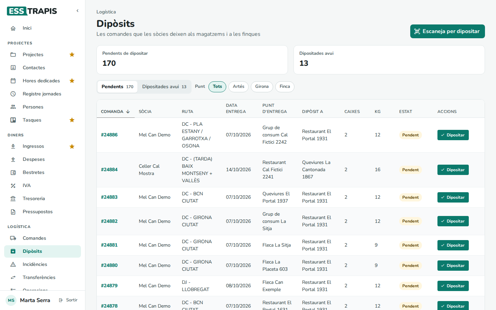
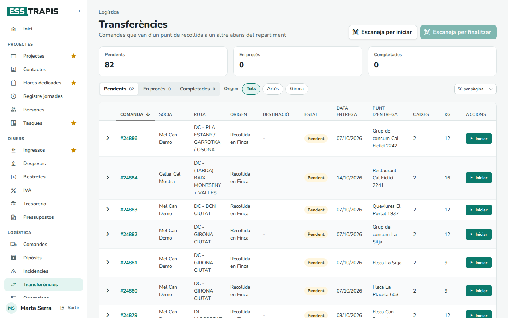
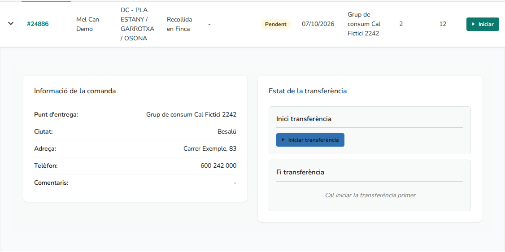
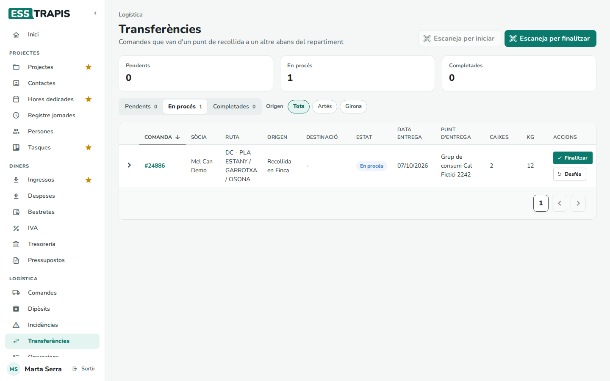
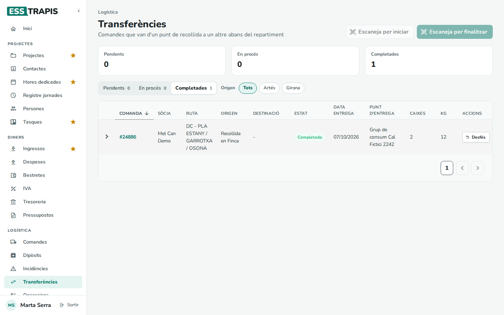
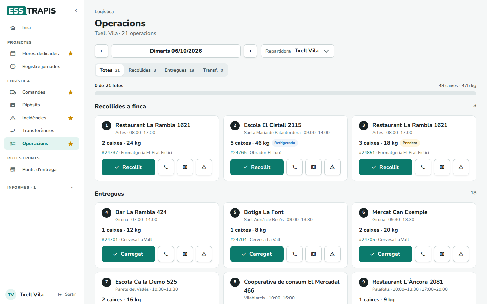
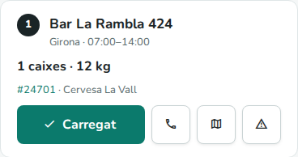
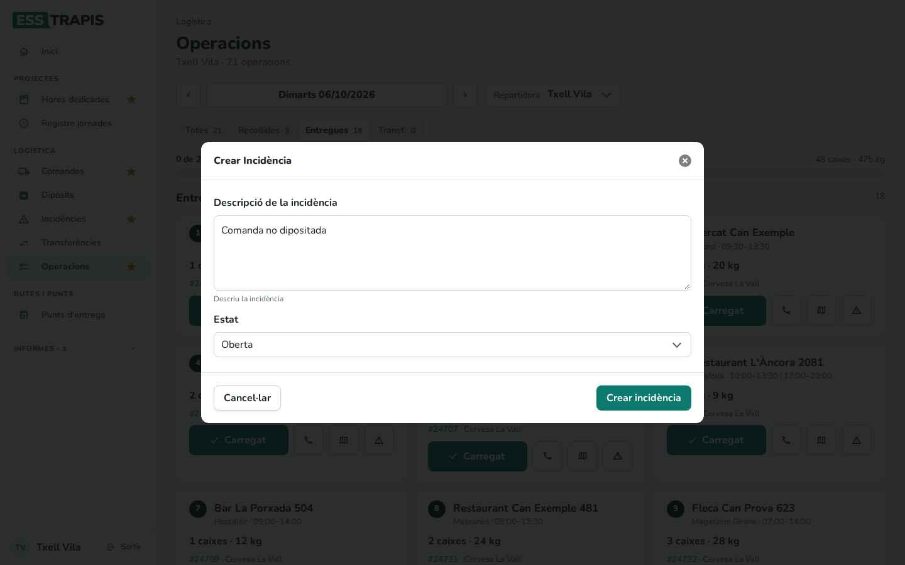
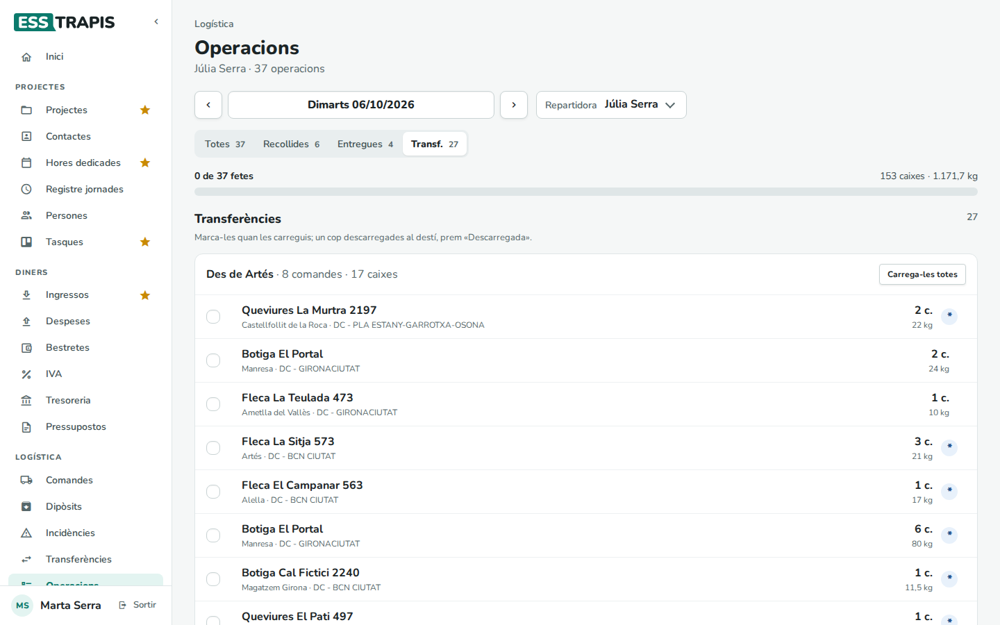

# 31. Dipòsits, transferències i operacions

> Permís necessari: `orders` (Dipòsits), `orders_admin` o `orders_delivery` (Dipòsits, Transferències i Operacions)

Aquestes tres pantalles serveixen per apuntar per on passen les caixes d'una comanda abans d'arribar al punt
d'entrega: quan la sòcia les **diposita** al magatzem, quan una altra ruta les **transfereix** d'un magatzem
a un altre i quan la repartidora les **carrega** a la furgoneta. També s'explica com llegir el codi QR de
l'albarà per fer-ho més de pressa.

## Abans de començar

- **Dipòsits** és per a tothom de la logística. La sòcia hi veu només les seves comandes; l'oficina i la
  repartidora hi veuen les de totes les sòcies.
- **Transferències** i **Operacions** només les veuen l'oficina i la repartidora.
- **Operacions** mostra la feina d'una repartidora segons les rutes que té assignades: a **Rutes**, el camp
  **Repartidor/a** de cada ruta (vegeu [30. Poblacions, rutes i dies](30-poblacions-rutes-dies.md)).
- Per escanejar codis QR cal un dispositiu amb càmera (un mòbil, una tauleta o un ordinador amb càmera) i
  donar permís al navegador per fer-la servir.

Cada moviment (dipòsit, inici i fi de transferència, càrrega) queda apuntat a la comanda amb la data, l'hora i
la persona que l'ha fet, però **no canvia l'estat de la comanda**: una comanda dipositada o carregada continua
*Pendent* o *Processada* fins que l'oficina la marca com a *Lliurada* (vegeu [28. Comandes](28-comandes.md)).
Tot el que es fa en aquestes pantalles també es pot fer, una comanda a la vegada, des de la fitxa de la
comanda (caixa **Moviments**) o des de la seva pàgina de seguiment.

Aquestes pantalles només mostren comandes **Pendents** o **Processades**: quan l'oficina marca una comanda com
a lliurada, facturada o anul·lada, en desapareix.

## Dipòsits

**Logística › Dipòsits** llista les comandes que s'han de deixar en un magatzem o a la finca, amb l'estat del
dipòsit de cadascuna. Una comanda **dipositada** és una comanda que la sòcia ja ha deixat al punt de
recollida.

### 1. Les comandes pendents de dipositar

- A dalt, dos comptadors: **Pendents de dipositar** i **Dipositades avui**.
- Les pestanyes **Pendents** (les que encara no s'han dipositat) i **Dipositades avui** (les que s'han
  dipositat avui; les d'altres dies ja no hi surten).
- **Punt**: filtra per on es deixa la comanda: **Tots**, un botó per cada magatzem (per exemple, **Artés** i
  **Girona**) i **Finca** (les recollides en finca).
- La taula: **Comanda** (el número; clicant-lo s'obre la pàgina de seguiment), **Sòcia**, **Ruta**, **Data
  entrega**, **Punt d'entrega**, **Dipòsit a** (el magatzem o el punt de la finca on es deixa), **Caixes**,
  **Kg**, **Estat** (*Pendent* o *Dipositada*) i **Accions**.

Les comandes de recollida (les que acaben en **-R**) no hi surten: les caixes de la finca no es dipositen,
les passa a buscar la repartidora (vegeu *Operacions*, més avall).

### 2. Marcar una comanda com a dipositada

**Dipositar**, a la fila de la comanda, demana confirmació:

Amb **D'acord** la comanda queda dipositada amb la data i l'hora d'ara i el nom de qui ho ha marcat, i surt el
missatge **Comanda marcada com a dipositada**. La comanda passa de **Pendents** a **Dipositades avui**.

### 3. Desfer un dipòsit

A la pestanya **Dipositades avui**, **Desfés** treu la marca de dipòsit (demana confirmació: *Estàs segur que
vols desfer el dipòsit d'aquesta comanda?*). La comanda torna a **Pendents**.

### 4. Què veu l'oficina i la repartidora

L'oficina i la repartidora veuen les comandes de totes les sòcies, i poden dipositar o desfer qualsevol
dipòsit.

## Llegir el codi QR de l'albarà

Cada albarà imprès porta un codi QR que obre la comanda (vegeu [28. Comandes](28-comandes.md)). Llegint-lo
amb la càmera es poden dipositar o transferir moltes comandes seguides sense buscar-les a la llista.

El botó d'escanejar fa una cosa o una altra segons la pestanya que hi ha triada:

| Pantalla i pestanya | Botó | Què fa cada lectura |
|---|---|---|
| **Dipòsits**, **Pendents** | **Escaneja per dipositar** | Marca la comanda com a dipositada. |
| **Dipòsits**, **Dipositades avui** | **Escaneja per desfer** | Treu la marca de dipòsit. |
| **Transferències**, **Pendents** | **Escaneja per iniciar** | Marca l'inici de la transferència. |
| **Transferències**, **En procés** | **Escaneja per finalitzar** | Marca la fi de la transferència. |

A **Transferències**, cada botó només s'activa quan hi ha triada la seva pestanya.

En prémer el botó s'obre la finestra de l'escàner, sense cap confirmació per comanda: cada codi llegit es
desa en aquell moment.

- A l'esquerra, la imatge de la càmera. Cal apuntar-la al codi QR. Quan el llegeix, la imatge fa un flaix i
  sona un xiulet. Si el dispositiu té més d'una càmera, el botó de les fletxes canvia de càmera, i el
  navegador recorda l'última triada.
- A la dreta, l'**Historial d'escaneig**: una línia per cada lectura, la més nova a dalt, amb el número de
  comanda, el resultat (**OK**, **AVÍS** o **ERROR**), un missatge i l'hora. Guarda les 20 últimes.
- Al títol, un comptador diu quantes s'han processat bé.
- **Netejar historial** buida la llista. **Tancar** tanca l'escàner i actualitza la llista de la pantalla.

Si es llegeix el mateix codi dues vegades seguides en menys de tres segons, la segona lectura no compta.

Els missatges de l'historial:

| Missatge | Vol dir |
|---|---|
| *Dipositada correctament* / *Dipòsit desfet* | Fet. |
| *Transferència iniciada* / *Transferència finalitzada* | Fet. |
| *Ja estava dipositada* / *No està dipositada* | No calia fer res. |
| *Transferència ja iniciada* / *Transferència ja finalitzada* | No calia fer res. |
| *Transferència no iniciada* | Per finalitzar-la, primer s'ha d'iniciar. |
| *No és una comanda de dipòsit* | És una comanda de recollida (-R), que no es diposita. |
| *No és una comanda de transferència* | Aquesta comanda no té transferència. |
| *No tens permís per modificar aquesta comanda* | Una sòcia ha llegit la comanda d'una altra sòcia. |
| *Comanda no trobada* | El número no correspon a cap comanda. |
| *Format de codi QR invàlid* | El codi no és el d'un albarà d'ESSTRAPIS. |

Si la càmera no s'engega, surt **No s'ha pogut iniciar la càmera** i *Assegura't que has donat permís per
utilitzar la càmera.* Cal permetre la càmera al navegador i prémer **Tornar a intentar**.

## Transferències

Una **transferència** és un tram previ al repartiment: quan la ruta que entrega la comanda no passa per on la
sòcia l'ha deixada, una altra ruta la porta abans d'un punt de recollida a un altre (per exemple, del
magatzem d'Artés al de Girona). L'aplicació decideix sola quines comandes en necessiten (vegeu
[28. Comandes](28-comandes.md)). **Logística › Transferències** les llista per seguir-les.

### 1. La llista

- Tres comptadors i pestanyes: **Pendents** (encara no han sortit), **En procés** (carregades, encara no
  arribades) i **Completades** (ja descarregades al destí). Amb Ctrl+clic se'n poden triar diverses alhora.
- **Origen**: filtra pel magatzem d'on surten (**Tots**, **Artés**, **Girona**…). Les que surten d'una
  recollida en finca només es veuen amb **Tots**.
- La taula: **Comanda** (clicant-la s'obre la fitxa de la comanda), **Sòcia**, **Ruta**, **Origen**,
  **Destinació**, **Estat**, **Data entrega**, **Punt d'entrega**, **Caixes**, **Kg** i **Accions**.

Els comptadors només compten les pestanyes triades: amb **Pendents** triada, **En procés** i **Completades**
surten a 0 encara que n'hi hagi. Per veure'n el nombre, cal triar-les (o totes tres amb Ctrl+clic).

### 2. El detall d'una transferència

La fletxa del començament de la fila obre el detall:

- **Informació de la comanda**: el punt d'entrega, la ciutat, l'adreça, el telèfon i els comentaris.
- **Estat de la transferència**: **Inici transferència** i **Fi transferència**, cadascun amb la data i
  la usuària que l'ha marcat, i un botó **Eliminar** per treure la marca. Si encara no s'ha fet, hi ha el botó
  **Iniciar transferència** o **Finalitzar transferència** (la fi no es pot marcar abans de l'inici: *Cal
  iniciar la transferència primer*).

### 3. Iniciar, finalitzar i desfer

- **Iniciar** (demana *Vols iniciar aquesta transferència?*): la comanda passa a **En procés**.

  

- **Finalitzar** (demana *Vols finalitzar aquesta transferència?*): la comanda passa a **Completades**.

  

- **Desfés** treu l'últim pas: en una transferència en procés, treu l'inici (torna a **Pendents**); en una
  completada, treu la fi (torna a **En procés**).

També es poden marcar llegint el QR de l'albarà (vegeu més amunt) o des d'**Operacions**.

## Operacions

**Logística › Operacions** és la feina d'un dia d'una repartidora, pensada per al mòbil: les caixes que ha
d'anar a buscar a les finques, les comandes que ha de carregar per entregar i les transferències que ha de
portar.

### 1. El dia d'una repartidora

- Sota el títol, la ruta o el nom de la repartidora i el nombre d'operacions.
- La **data**: s'obre en el dia d'avui. Les fletxes passen al dia anterior o al següent, i el calendari té
  **Avui** i **Tots els dies** (totes les operacions pendents, amb la data a cada targeta).
- **Repartidora**: quan hi ha més d'una repartidora amb rutes, aquí es tria de qui és el dia. La repartidora
  hi té triada ella mateixa; l'oficina, la primera per ordre alfabètic.
- Les pestanyes **Totes**, **Recollides**, **Entregues** i **Transf.**, amb quantes n'hi ha de cada tipus.
- La barra de progrés: **N de M fetes** i el total de caixes i quilos del dia.

Les operacions que hi surten:

| Bloc | Quines comandes | Data que compta |
|---|---|---|
| **Recollides a finca** | Les comandes de recollida (-R) de les rutes de la repartidora. | La data prevista d'entrega. |
| **Entregues** | Les comandes de les rutes de la repartidora. | La data prevista d'entrega. |
| **Transferències** | Les comandes amb transferència que fa una ruta de la repartidora. | La data de la transferència. |

### 2. Les targetes de recollida i d'entrega

Cada parada és una targeta, numerada en l'ordre de la llista:

- El nom del punt (o de la finca, en una recollida), la població i l'horari en què s'hi pot anar.
- Les caixes i els quilos, i les etiquetes **Refrigerada**, **Fràgil**, **Pendent** (la comanda encara no
  està processada), **Dipositada** i **Incidència** (si en té alguna).
- El número de comanda (obre la pàgina de seguiment) i la sòcia.
- **Carregat** (a les entregues) o **Recollit** (a les recollides a finca): demana *Vols marcar aquesta comanda
  com a recollida?* i hi apunta l'hora. La targeta queda marcada com a feta, amb l'hora i un enllaç
  **Desfés** per treure-ho.
- **Truca** (el telèfon del punt), **Obre el mapa** (l'adreça al mapa, en una pestanya nova) i **Crea una
  incidència**.

**Carregat** només vol dir que les caixes són a la furgoneta. L'entrega no es marca aquí: la comanda continua
a la llista fins que l'oficina la marca com a *Lliurada* a **Comandes**.

### 3. Obrir una incidència des d'una targeta

El botó del triangle obre el formulari d'incidència amb el text *Comanda no dipositada* ja escrit (es pot
canviar). Vegeu [32. Incidències i contacte](32-incidencies-contacte.md).

### 4. Les transferències del dia

Les transferències es mostren com una llista per marcar, agrupades per origen (**Des de Artés · 8 comandes ·
17 caixes**):

- La casella de cada comanda la marca com a **carregada** (és l'inici de la transferència). Es desa en
  marcar-la, sense confirmació; desmarcant-la es treu.
- **Carrega-les totes** marca totes les del grup (demana confirmació).
- Un cop carregada, surt el botó **Descarregada**: es prem quan les caixes ja són al magatzem de destí (és la
  fi de la transferència). Després surt l'etiqueta **Descarregada** i un **Desfés**.
- L'asterisc (*) indica que la comanda va refrigerada.

Una transferència compta com a feta a la barra de progrés quan està descarregada; una recollida o una entrega,
quan està carregada.

## Camps i opcions

| Element | On | Què fa |
|---|---|---|
| **Dipositar** / **Desfés** | Dipòsits | Marca o treu el dipòsit de la comanda. |
| **Escaneja per dipositar** / **Escaneja per desfer** | Dipòsits | Obre l'escàner de QR en el mode de la pestanya triada. |
| **Punt** | Dipòsits | Filtra per magatzem o **Finca**. |
| **Iniciar** / **Finalitzar** / **Desfés** | Transferències | Marca o treu l'inici i la fi de la transferència. |
| **Escaneja per iniciar** / **Escaneja per finalitzar** | Transferències | Obre l'escàner de QR. |
| **Origen** | Transferències | Filtra pel magatzem d'on surt la transferència. |
| **Repartidora** | Operacions | Tria de quina repartidora es mostra el dia. |
| **Carregat** / **Recollit** | Operacions | Apunta que les caixes s'han carregat o s'han recollit a la finca. |
| Casella / **Carrega-les totes** / **Descarregada** | Operacions | Inici i fi de les transferències. |

## Preguntes freqüents / Errors habituals

**He dipositat la comanda però continua «Pendent» a Comandes.** És normal: el dipòsit no canvia l'estat de la
comanda. L'estat el canvia l'oficina (vegeu [28. Comandes](28-comandes.md)).

**A Dipòsits l'oficina no troba una comanda.** La llista mostra les 50 comandes amb el número més alt (o les 50
primeres segons la columna per la qual s'hagi ordenat) i no deixa passar a la pàgina següent, tot i que el
comptador **Pendents de dipositar** les compta totes. El filtre **Punt** també mira només aquestes 50. Per
trobar-ne una altra, es pot ordenar per una altra columna, buscar-la a **Comandes** o llegir-ne el QR.

**Ahir vaig dipositar una comanda i avui no la veig enlloc.** **Dipositades avui** només mostra les del dia.
El dipòsit es veu a la fitxa de la comanda (caixa **Moviments**) i a la seva pàgina de seguiment.

**A Transferències, En procés i Completades surten a 0.** Els comptadors només compten les pestanyes triades.
Cal clicar la pestanya (o triar-les totes amb Ctrl+clic).

**La Destinació d'una transferència surt buida (-).** La comanda no té el magatzem de destí apuntat. L'oficina
el pot revisar a la fitxa de la comanda, a **Altres dades** (vegeu [28. Comandes](28-comandes.md)).

**A Operacions surt «No tens cap ruta assignada».** La repartidora triada no té cap ruta activa assignada a
**Rutes**. Si surt *No hi ha operacions per a aquest dia.*, sí que en té, però aquell dia no hi ha res
pendent.

**Una comanda que ja hem entregat ha desaparegut d'Operacions.** Quan l'oficina la marca com a lliurada, deixa
de sortir a Operacions, a Dipòsits i a Transferències.

**L'escàner no llegeix el codi.** Cal que el QR estigui sencer, ben il·luminat i dins el quadre. Si dona
*Format de codi QR invàlid*, el codi no és el d'un albarà d'ESSTRAPIS.

## Vegeu també

- [27. Visió general de la logística](27-logistica-visio-general.md): el camí d'una comanda.
- [28. Comandes](28-comandes.md): la fitxa de la comanda, l'albarà i la pàgina de seguiment.
- [30. Poblacions, rutes i dies](30-poblacions-rutes-dies.md): les rutes i qui les fa.
- [32. Incidències i contacte](32-incidencies-contacte.md)
