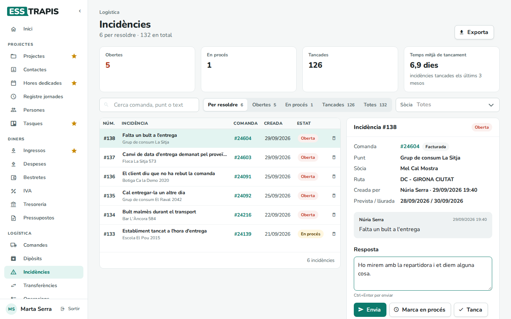
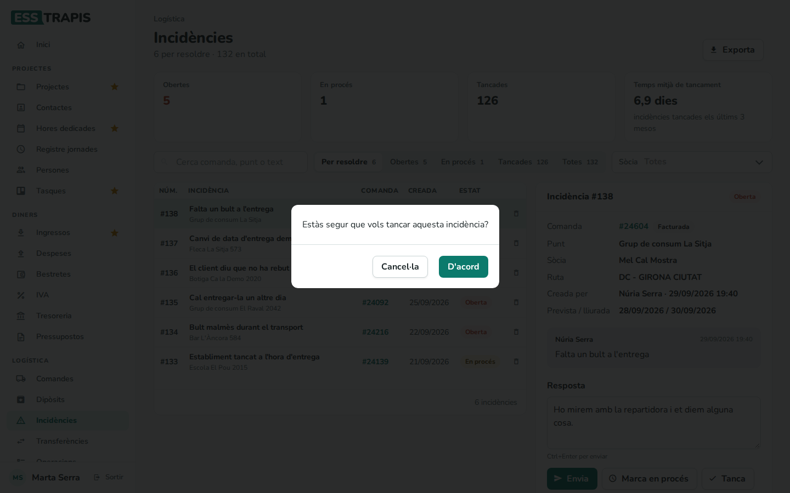
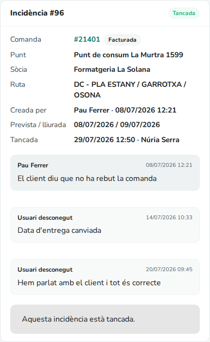
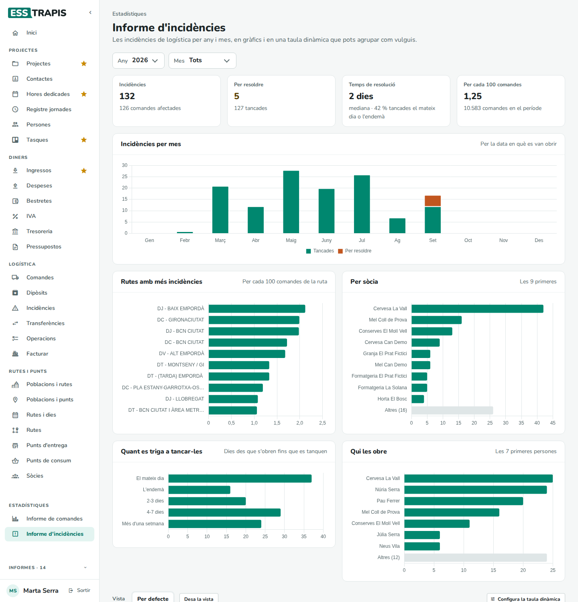

# 32. Incidències i contacte

> Permís necessari: `orders`, `orders_admin` o `orders_delivery` (Incidències); `orders` (Contacta);
> `orders_admin` (Informe d'incidències)

Una **incidència** és un problema amb una comanda (no s'ha dipositat, ha arribat malmesa, l'establiment era
tancat…) que la sòcia, l'oficina i la repartidora segueixen fins que es tanca. Aquest capítol explica com
s'obren, com es responen i es tanquen, el formulari **Contacta** perquè les sòcies escriguin a l'oficina, i
l'**Informe d'incidències** de l'oficina.

## Abans de començar

- **Incidències** és al menú de tots tres perfils. La sòcia hi veu les incidències de les seves comandes;
  l'oficina i la repartidora, les de totes.
- **Contacta** és només per a les sòcies.
- **Informe d'incidències** (a **Estadístiques**) és només per a l'oficina.
- Les incidències i el formulari de contacte **envien correus**. L'adreça de l'oficina que els rep es
  configura a **Configuració general** › **Formulari de contacte** › **Correu que rep els missatges** (vegeu
  [34. Configuració general](34-configuracio-general.md)).

Cada incidència té un d'aquests estats:

| Estat | Vol dir |
|---|---|
| **Oberta** | Acabada d'obrir; ningú no s'hi ha posat encara. |
| **En procés** | Algú se n'ocupa. |
| **Tancada** | Resolta. Ja no s'hi pot respondre. |

## Pas a pas

### 1. Obrir una incidència

Les incidències sempre van lligades a una comanda, i s'obren des de la comanda, no des de la pantalla
**Incidències**:

- a la fitxa de la comanda, caixa **Incidències**, botó **Crear incidència** (la comanda ha d'estar desada);
- a la pàgina de seguiment de la comanda, botó **Crea incidència** (vegeu [28. Comandes](28-comandes.md));
- a **Operacions**, el botó del triangle de cada targeta (la repartidora; vegeu
  [31. Dipòsits, transferències i operacions](31-diposits-transferencies-operacions.md)).

S'obre el formulari **Crear Incidència**:

| Camp | Què vol dir | Obligatori |
|---|---|---|
| **Descripció de la incidència** | Què passa, en poques paraules (fins a 500 caràcters). Des d'**Operacions** ja ve escrit *Comanda no dipositada*. | Sí |
| **Estat** | **Oberta** (de partida), **En procés** o **Tancada**. | Sí |

**Crear incidència** la desa al moment (no cal desar la comanda) i surt *Incidència creada correctament*. Si
falta la descripció, surt *Si us plau, descriu la incidència*. **Cancel·lar** tanca el formulari sense crear
res.

En crear-se, s'envia un correu a l'oficina i a la sòcia de la comanda. La caixa **Incidències** de la fitxa
de la comanda mostra després cada incidència amb el seu estat, la data i un enllaç **Obre** que porta a la
pantalla **Incidències**; al títol de la caixa, una etiqueta diu quantes n'hi ha d'obertes.

### 2. La pantalla Incidències

**Logística › Incidències** té la llista a l'esquerra i, a la dreta, la incidència triada.

- Sota el títol: quantes n'hi ha **per resoldre** (obertes i en procés) i quantes **en total**.
- Els comptadors **Obertes**, **En procés**, **Tancades** i **Temps mitjà de tancament** (els dies que han
  trigat, de mitjana, les incidències tancades els últims tres mesos). Els comptadors i les pestanyes tenen en
  compte la cerca i el filtre **Sòcia**.
- **Cerca comanda, punt o text**: busca per número de comanda o d'incidència, pel nom del punt d'entrega o
  per un tros de la descripció.
- Les pestanyes **Per resoldre** (la que s'obre de partida), **Obertes**, **En procés**, **Tancades** i
  **Totes**, amb quantes n'hi ha a cadascuna.
- **Sòcia** (oficina i repartidora): només les incidències de les comandes d'una sòcia.
- La llista: **Núm.**, **Incidència** (la descripció, amb el punt d'entrega i la sòcia a sota),
  **Comanda** (obre la pàgina de seguiment), **Creada** i **Estat**. La paperera elimina la incidència.
- **Exporta** descarrega en un full de càlcul les incidències de la pestanya i els filtres triats (totes, no
  només la pàgina que es veu).

Clicant una fila, a la dreta surt la incidència: la comanda i el seu estat, el **Punt**, la **Sòcia**, la
**Ruta**, qui l'ha creada i quan, les dates **Prevista / lliurada** de la comanda i, si està tancada, quan i
qui l'ha tancada. A sota hi ha la conversa: la descripció inicial i les respostes, cadascuna amb l'autor i
l'hora.

### 3. Respondre, posar en procés i tancar

Mentre la incidència no està tancada, a sota de la conversa hi ha:

- **Resposta**: s'escriu el missatge i s'envia amb **Envia** (o Ctrl+Enter). Surt *Resposta afegida
  correctament*.
- **Marca en procés** (només si està oberta): demana confirmació i la passa a **En procés**.
- **Tanca**: demana confirmació i la tanca, apuntant la data i qui l'ha tancada.

Cada resposta nova envia un correu a l'oficina (el **Correu que rep els missatges** de **Configuració
general** i totes les persones actives amb el permís `orders_admin`) i a la sòcia de la comanda, menys a qui
l'ha escrita. El correu porta tota la conversa, amb l'autor de cada resposta. Una adreça no rep mai el mateix
correu dues vegades.

Un canvi d'estat sense resposta (**Marca en procés**, **Tanca**) envia un correu només a l'oficina (el
**Correu que rep els missatges**) si el fa la sòcia de la comanda, i a la sòcia si el fa una altra persona.

Una incidència tancada es pot llegir però ja no s'hi pot respondre (*Aquesta incidència està tancada.*):

### 4. Què veu la sòcia

La sòcia hi veu només les incidències de les seves comandes, sense el filtre **Sòcia**. Pot respondre-les,
posar-les en procés i tancar-les, igual que l'oficina.

Amb **Totes** veu també les tancades:

La sòcia només pot eliminar una incidència de les seves comandes que no estigui tancada i que tingui menys de
24 hores. L'oficina i la repartidora poden eliminar-ne qualsevol.

### 5. Escriure a l'oficina: Contacta

**Logística › Contacta** és un formulari perquè la sòcia escrigui a l'oficina per qualsevol cosa que no sigui
una incidència d'una comanda: una població que no és a la llista, un problema amb una recollida…

| Camp | Què vol dir | Obligatori |
|---|---|---|
| **Sòcia** | La sòcia que escriu. Ja ve posada i no es pot canviar. | — |
| **Correu electrònic** | On vol rebre la resposta. Ve posat el correu de la sòcia. | Sí |
| **Nom** | Qui escriu. | Sí |
| **Missatge** | El text. | Sí |

A la dreta hi ha el text que l'oficina ha escrit a **Configuració general** (**Text del formulari**).

**Envia** envia el missatge a l'oficina i una còpia a la sòcia, i la pantalla mostra el missatge d'agraïment
(també configurable; de partida, *Gràcies! Hem rebut el teu missatge.*). Si falta algun camp, surt *Falten
camps per omplir*; si no s'ha pogut enviar, *Error en l'enviament, si us plau, contacta a través d'un altra
forma.*

## L'informe d'incidències

**Estadístiques › Informe d'incidències** (només l'oficina) resumeix les incidències d'un període en
xifres i gràfics, i a sota hi ha una taula dinàmica per agrupar-les com es vulgui.

### Els filtres

**Any** i **Mes** trien el període, segons la data en què es va obrir cada incidència. L'informe s'obre amb
l'any més recent i el mes d'avui; amb **Tots** es veu tot l'any (o tots els anys).

### Les xifres

| Xifra | Què compta |
|---|---|
| **Incidències** | Quantes se n'han obert en el període, i a sota quantes comandes diferents afecten. |
| **Per resoldre** | Quantes estan **obertes** o **en procés**. A sota, *N tancades*. |
| **Temps de resolució** | La mediana de dies entre l'obertura i el tancament de les tancades (la meitat s'han tancat en menys temps), i quin percentatge s'han tancat el mateix dia o l'endemà. |
| **Per cada 100 comandes** | Incidències per cada 100 comandes del període (a sota, quantes comandes hi ha hagut). |

A la taula dinàmica, cada incidència té el seu estat: **Oberta**, **En procés** o **Tancada**. Les que estan en
procés encara no tenen data de tancament, i per això no compten al **Temps de resolució**.

### Els gràfics

- **Incidències per mes** (o **per dia**, si s'ha triat un mes; o **per any**): barres apilades de
  **Tancades** i **Per resoldre**.
- **Rutes amb més incidències**: les deu rutes amb més incidències per cada 100 comandes de la ruta. Les rutes
  sense comandes en el període no hi surten.
- **Per sòcia**: les sòcies amb més incidències a les seves comandes; la resta s'ajunta a **Altres**.
- **Quant es triga a tancar-les**: quantes incidències tancades s'han resolt **El mateix dia**, **L'endemà**,
  en **2-3 dies**, en **4-7 dies** o en **Més d'una setmana**.
- **Qui les obre**: les persones que n'obren més; la resta, a **Altres**.

Passant el ratolí per sobre d'una barra se'n veu el detall.

### La taula dinàmica

A sota dels gràfics hi ha la taula dinàmica, amb les incidències agrupades per **Estat** i **Nom Ruta** (a les
columnes) i per **Any**, **Mes**, **Nom Sòcia** i **Usuari** (qui la va obrir, a les files). Com es despleguen
els grups, com es canvien els camps, com es desen les vistes i com s'exporta s'explica a
[24. Com funcionen les taules dinàmiques](24-taules-dinamiques.md).

## Preguntes freqüents / Errors habituals

**No veig cap botó per crear una incidència a la pantalla Incidències.** No n'hi ha: les incidències es creen
des de la comanda (la fitxa, la pàgina de seguiment o una targeta d'**Operacions**).

**A l'informe, Per resoldre no coincideix amb la pantalla Incidències.** L'informe només compta les incidències
que es van obrir en el període triat; la pantalla **Incidències** les compta totes.

**El Temps mitjà de tancament surt «—».** No s'ha tancat cap incidència en els últims tres mesos.

**Una sòcia no rep els correus de les incidències.** Els correus van a l'adreça de l'usuari de la sòcia. Si
l'oficina no rep els seus, cal revisar el **Correu que rep els missatges** a **Configuració general** (vegeu
[34. Configuració general](34-configuracio-general.md)) i l'adreça de cada usuari amb el permís
`orders_admin`.

**No rebo el correu de la resposta que he escrit jo.** És normal: qui escriu una resposta no en rep el
correu.

**He enviat el formulari Contacta, on veig la resposta?** La resposta arriba per correu a l'adreça que s'ha
posat al formulari; l'aplicació no guarda cap conversa.

## Vegeu també

- [28. Comandes](28-comandes.md): la fitxa i la pàgina de seguiment de la comanda.
- [31. Dipòsits, transferències i operacions](31-diposits-transferencies-operacions.md): les incidències des
  d'Operacions.
- [24. Com funcionen les taules dinàmiques](24-taules-dinamiques.md)
- [34. Configuració general](34-configuracio-general.md): el correu i els textos del formulari de contacte.
- [27. Visió general de la logística](27-logistica-visio-general.md)
