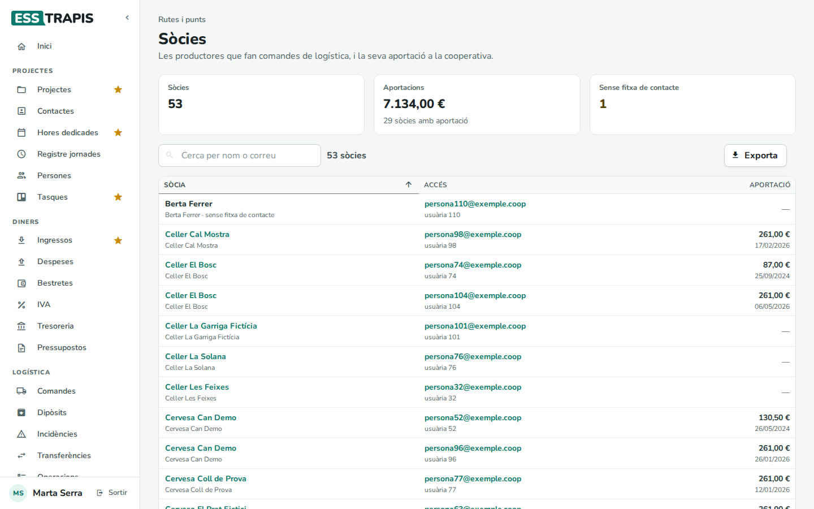
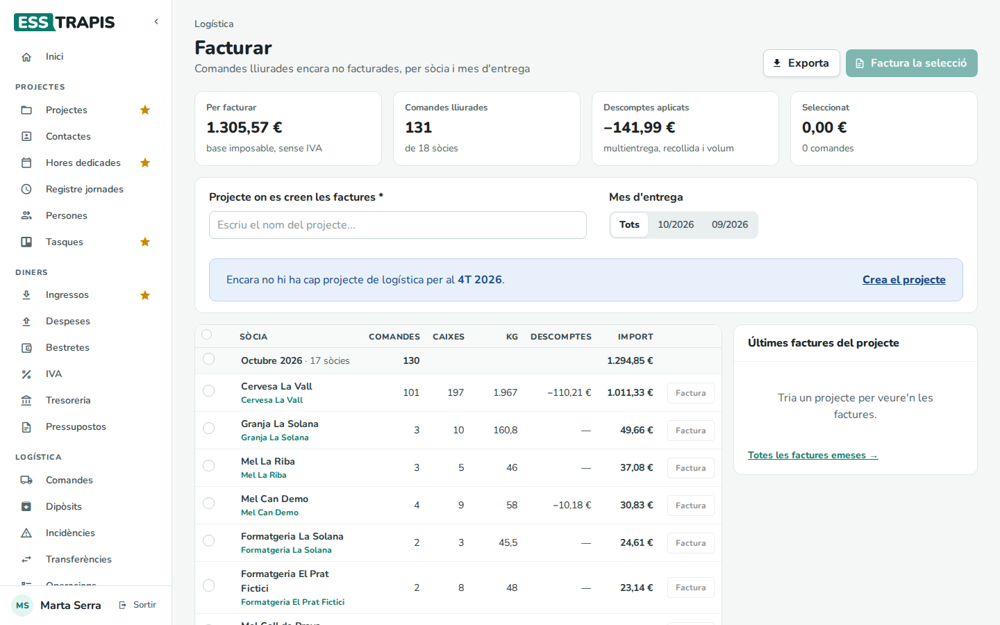
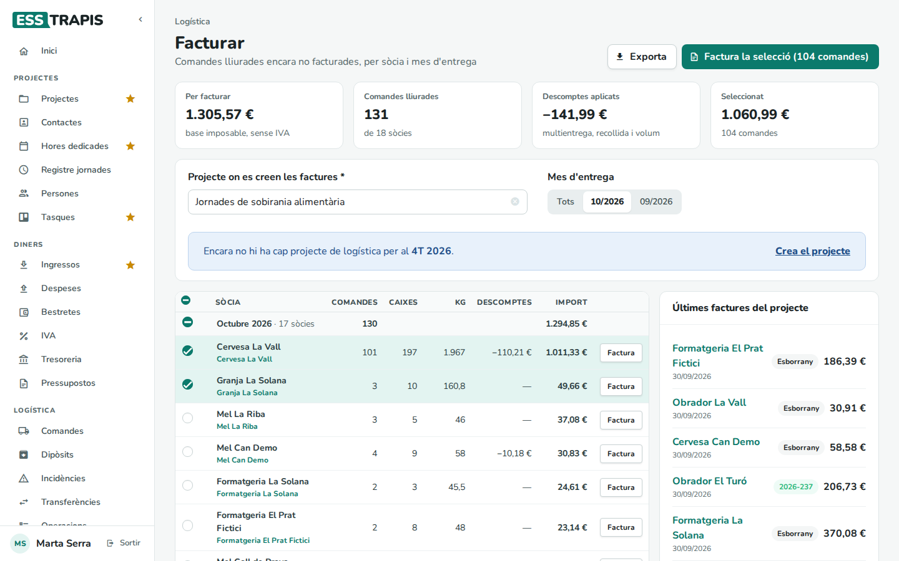
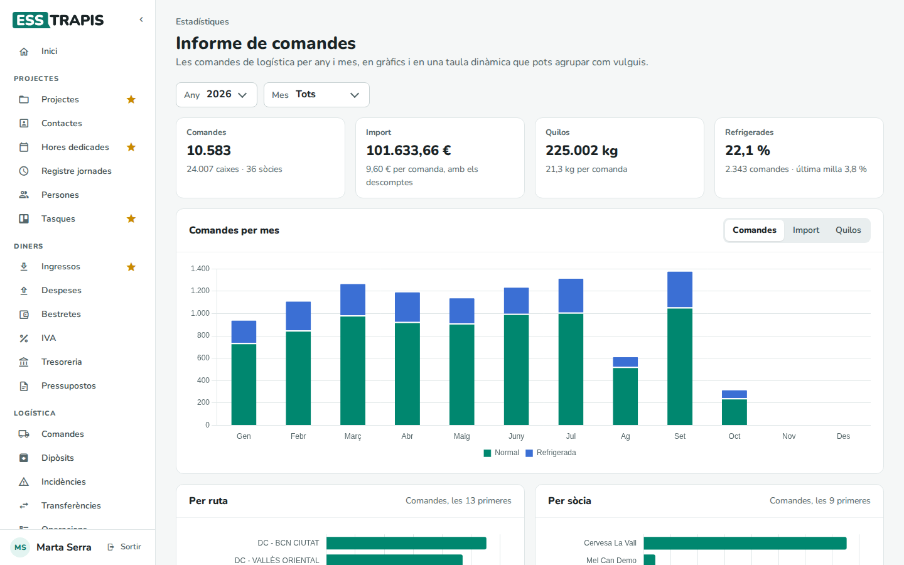
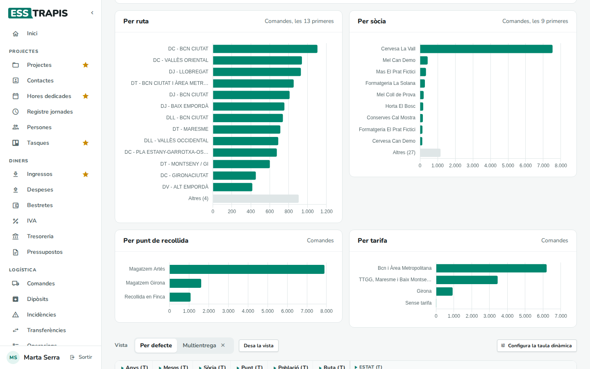

# 33. Facturació de la logística

> Permís necessari: `orders_admin` (Sòcies, Facturar, Informe de comandes) · `orders` (Factures de la sòcia)

Cada mes, l'oficina factura a cada sòcia el servei de transport de les comandes que ja s'han lliurat. Aquest
capítol explica les quatre pantalles d'aquesta feina: **Sòcies** (qui són i què han aportat), **Facturar**
(crear les factures a partir de les comandes lliurades), **Factures** (el que veu la sòcia) i l'**Informe de
comandes** (les xifres del servei).

## Abans de començar

- Les comandes que es facturen són les que estan en estat **Lliurada** (vegeu [28. Comandes](28-comandes.md)).
  Facturar no fa servir cap altre estat.
- Cada sòcia ha de tenir una **fitxa de contacte** vinculada al seu usuari: la factura es fa a nom d'aquest
  contacte. Es vincula a **Contactes**, a la fitxa del contacte, amb el camp **Persona** (vegeu
  [11. Contactes](11-contactes.md)). La pantalla **Sòcies** avisa de les que no en tenen.
- Hi ha d'haver un **projecte** on anar a parar les factures (per costum, un per trimestre, amb un nom com
  *Logística 2026 4T*) amb almenys una fase (vegeu [04. Crear i editar un projecte](04-crear-editar-projecte.md)).
- Hi ha d'haver una **sèrie** de factures amb el nom de l'any en curs (per exemple, *2026*) (vegeu
  [36. Inici d'any i manteniment](36-inici-any-manteniment.md)).
- Els preus i descomptes de cada comanda surten de les tarifes de ruta, de les rutes i de la configuració
  general (vegeu [30. Poblacions, rutes i dies](30-poblacions-rutes-dies.md) i
  [27. Visió general de la logística](27-logistica-visio-general.md)).

## Pas a pas

### 1. Revisar les sòcies

**Rutes i punts › Sòcies** llista les productores que fan comandes de logística: les usuàries actives (no
bloquejades i confirmades) que només tenen el permís de sòcia (`orders`). Les persones de l'oficina o del
repartiment no hi surten.

A dalt hi ha tres xifres:

- **Sòcies**: quantes n'hi ha.
- **Aportacions**: la suma de les aportacions a la cooperativa, i quantes sòcies n'han fet.
- **Sense fitxa de contacte**: les usuàries que no tenen cap contacte vinculat. A aquestes sòcies no se'ls pot
  fer factura ni imprimir albarans fins que no se'ls vinculi un contacte.

La llista té tres columnes:

| Columna | Què mostra |
|---|---|
| **Sòcia** | El nom del contacte vinculat (clicant-lo s'obre la fitxa del contacte) i, a sota, el nom de l'usuària. Si no en té, *sense fitxa de contacte*. |
| **Accés** | El correu amb què entra a ESSTRAPIS i el número d'usuària (*usuària 98*). |
| **Aportació** | L'import aportat i la data, tal com són a la fitxa del contacte. |

**Cerca per nom o correu** filtra la llista. **Exporta** baixa un full de càlcul amb totes les sòcies.

L'aportació no s'escriu aquí: es canvia a la fitxa del contacte, als camps **Import aportació sòcia** i
**Data aportació sòcia** (vegeu [11. Contactes](11-contactes.md)).

### 2. Obrir Facturar

**Logística › Facturar** mostra les comandes **lliurades** que encara no s'han facturat, agrupades per mes
d'entrega i, dins de cada mes, per sòcia.

Les xifres de dalt:

- **Per facturar**: l'import de totes les comandes pendents, amb els descomptes aplicats i sense IVA.
- **Comandes lliurades**: quantes són i de quantes sòcies.
- **Descomptes aplicats**: quant es resta, en total, per descomptes de multientrega, de recollida i de volum
  (per això surt en negatiu).
- **Seleccionat**: l'import i les comandes de les files marcades.

Cada fila diu, per a una sòcia i un mes, quantes **Comandes**, **Caixes** i **Kg** hi ha, els **Descomptes** i
l'**Import** a facturar. El mes és el de la **data prevista d'entrega** de les comandes. Sota del nom de la
sòcia hi ha el seu contacte, que s'obre clicant-lo.

**Exporta** baixa la taula (el mes triat, o tots) en un full de càlcul.

### 3. Triar el projecte

A **Projecte on es creen les factures** s'escriu una part del nom i es tria el projecte de la llista. Sense
projecte no es pot facturar: el botó avisa *Cal triar un projecte abans de facturar.*

A sota, una nota ajuda a triar-lo. L'aplicació busca els projectes que tenen al nom *logística*, l'any i el
trimestre (*Logística 2026 4T*, *4T 2026 - Logística*…) i mira el trimestre del mes més recent de la taula:

- Si en troba un, diu *Les comandes de 4T 2026 van al projecte …* i **Fes-lo servir** el tria.
- Si no, diu *Encara no hi ha cap projecte de logística per al 4T 2026*, amb el nom de l'últim que hi ha, i
  **Crea el projecte** obre un projecte nou (cal el permís `projects`).

Un cop triat el projecte, la columna de la dreta, **Últimes factures del projecte**, en mostra les sis
últimes factures: a qui, quan, si és un **Esborrany** o ja té número, i la base. **Totes les factures
emeses →** obre la llista d'ingressos.

### 4. Triar què es factura

- **Mes d'entrega**: **Tots** o un mes concret (*10/2026*) per veure només les comandes d'aquell mes.
- La casella de cada fila marca una sòcia i un mes; la de la fila del mes les marca totes d'aquell mes, i la
  de la capçalera, totes les que es veuen.
- Les files marcades continuen marcades encara que després es triï un altre mes: **Seleccionat** i el botó
  **Factura la selecció** compten totes les marcades, es vegin o no.

### 5. Facturar

Hi ha dues maneres:

- **Factura**, a la fila d'una sòcia: fa la factura d'aquella sòcia i aquell mes.
- **Factura la selecció (N comandes)**, a dalt: fa una factura per cada fila marcada, és a dir, una per sòcia i
  mes. En acabar, diu quantes s'han creat (*3 de 3 factures creades*).

Compte: no hi ha confirmació. En clicar el botó, les factures es creen de seguida.

Per a cada factura, l'aplicació:

1. Crea una factura en **esborrany** a nom del contacte de la sòcia, amb data d'avui, a la sèrie de l'any en
   curs i lligada al projecte triat. El concepte és *Serveis logístics* seguit del mes i l'any.
2. Hi posa una línia per comanda: *Comanda 03/10/2026 | 24874 | nom de la ruta* (data prevista, número de
   comanda i ruta), amb un 21 % d'IVA. Vegeu [Com es calcula](#com-es-calcula) per al preu i el descompte de
   cada línia.
3. Passa les comandes a l'estat **Facturada** i les lliga a la factura. Ja no tornen a sortir a Facturar.
4. Afegeix un ingrés a l'**última fase** del projecte, amb la base de la factura.

Les factures es creen en esborrany: encara no tenen número ni s'han enviat a ningú. Després cal revisar-les,
emetre-les i enviar-les a les sòcies des d'**Ingressos**, com qualsevol altra factura (cal el permís
`projects`; vegeu
[17. Ingressos: factures emeses](17-factures-emeses.md); si Verifactu és actiu, es registren en emetre-les,
vegeu [18. Facturació electrònica: Verifactu i FACe](18-verifactu-face.md)).

### 6. La sòcia consulta les seves factures

Cada sòcia té, al seu menú, **Logística › Factures**: les factures de logística que la cooperativa li ha fet.

- Filtres: **Any**, **Mes**, **Trimestre** (quan se'n tria un, el mes queda desactivat) i **Pagada** (**Totes**,
  **Sí**, **No**).
- A dalt, la suma de **Base**, **IVA** i **Total** de les factures que es veuen.
- A la llista: **Codi** (si la factura té PDF, el codi l'obre), **Data** i venciment (*venç.*), el
  **Projecte** on es va crear la factura, **Base**, **IVA**,
  **Total** i **Pagada**: *Pagada* amb la data, *Pendent de pagar*, *Vençuda* (ha passat el venciment),
  *Esborrany* o *Abonament* (una factura en negatiu).
- **Exporta** baixa la llista en un full de càlcul.

La sòcia també veu les factures en esborrany tan bon punt l'oficina les crea a Facturar, amb l'etiqueta
*Esborrany*.

Quan una sòcia té factures enviades i encara no pagades, en entrar a ESSTRAPIS li surt un missatge que li
recorda l'import pendent i li indica aquesta pantalla. Es tanca amb **D'acord** i torna a sortir cada vegada
que entra, fins que l'oficina marca les factures com a pagades.

### 7. L'informe de comandes

**Estadístiques › Informe de comandes** resumeix les comandes de logística d'un període: xifres, gràfics i,
a sota, una taula dinàmica.

Es filtra per **Any** i **Mes** (cadascun pot ser **Tots**). En obrir-lo, mostra l'any més recent i el mes
actual. Hi entren totes les comandes que no estan anul·lades, en qualsevol altre estat (també les pendents),
segons la seva data prevista d'entrega (o, si no en tenen, la d'entrega o la de la comanda).

Les xifres de dalt:

| Xifra | Què és |
|---|---|
| **Comandes** | Quantes comandes, i a sota quantes caixes i de quantes sòcies. |
| **Import** | La suma dels preus amb tots els descomptes, i l'import mitjà per comanda. Sense IVA. |
| **Quilos** | Els quilos totals i la mitjana per comanda. |
| **Refrigerades** | El percentatge de comandes de tipus refrigerat, quantes són i el percentatge que han passat per última milla. |

El primer gràfic, **Comandes per mes**, separa les comandes normals de les refrigerades. Els botons
**Comandes**, **Import** i **Quilos** canvien què es compta (també als altres gràfics). El període de cada barra
depèn dels filtres:

| Filtres | Cada barra és |
|---|---|
| Un any i un mes | un dia d'aquell mes |
| Un any i **Tots** els mesos | un mes |
| **Tots** els anys i un mes | aquell mes de cada any |
| **Tots** i **Tots** | cada mes de tots els anys |

A sota, quatre gràfics reparteixen les mateixes comandes **Per ruta**, **Per sòcia**, **Per punt de recollida**
i **Per tarifa**. Només surten els primers de cada llista; la resta s'agrupa en una barra gris, *Altres (N)*.
A la dreta del títol s'indica quants se'n mostren (*Comandes, les 13 primeres*).

Més avall hi ha la taula dinàmica de les comandes, amb vistes desades i **Exporta**. Es fa servir com totes
les taules dinàmiques de l'aplicació (vegeu [24. Com funcionen les taules dinàmiques](24-taules-dinamiques.md)).
Hi ha aquests camps: Estat, Recollida, Entrega, Tarifa, Úl. Milla, Data, Multientrega, Descompte Recollida,
Any, Mes, Sòcia, Punt, Població i Ruta; i aquests valors: Comandes, Preu, Caixes i Kg. El **Preu** és el mateix
import amb descomptes de la xifra **Import**.

## Camps i opcions

### Facturar

| Element | Què fa |
|---|---|
| **Projecte on es creen les factures \*** | El projecte on es lliguen les factures i on s'afegeix l'ingrés. Obligatori. |
| **Mes d'entrega** | Mostra totes les comandes o només les d'un mes (de data prevista d'entrega). |
| Caselles | Marquen sòcies i mesos per a **Factura la selecció**. |
| **Factura** (a la fila) | Factura aquella sòcia i aquell mes. |
| **Factura la selecció (N comandes)** | Una factura per cada fila marcada. |
| **Exporta** | Baixa la taula en un full de càlcul. |
| **Fes-lo servir** / **Crea el projecte** | Tria el projecte del trimestre, o n'obre un de nou si no n'hi ha. |

### Factures (sòcia)

| Element | Què fa |
|---|---|
| **Any**, **Mes**, **Trimestre** | El període, per data de la factura. |
| **Pagada** | Totes, només les pagades o només les pendents. |
| **Exporta** | Baixa la llista en un full de càlcul. |

## Com es calcula

Cada comanda té un **preu de tarifa** (segons la ruta, els quilos i el tipus de servei; vegeu
[28. Comandes](28-comandes.md)) i fins a tres descomptes:

- **Descompte multientrega** (%): quan la mateixa sòcia porta més d'una comanda al mateix punt d'entrega el
  mateix dia. El percentatge es fixa a **Configuració general** › Logística, i es pot desactivar per a una sòcia
  a la seva fitxa d'usuària.
- **Descompte recollida** (%): el percentatge de descompte per recollida en finca que té el punt d'entrega.
- **Descompte volum** (€): un import fix que es resta a cada comanda quan la sòcia porta prou comandes per la
  mateixa ruta el mateix dia. Es configura a cada ruta.

Les diferents pantalles no combinen aquests tres descomptes de la mateixa manera, i per això el preu final
d'una comanda pot variar uns cèntims d'una pantalla a l'altra:

| On | Com es calcula |
|---|---|
| **Facturar** (Per facturar, Import, Descomptes), **Informe de comandes** (Import i Preu de la taula dinàmica) i la fitxa de la comanda (**Preu amb descompte**) | Al preu se li resta el descompte de volum; al resultat se li aplica el percentatge de multientrega i, després, el de recollida. |
| Llista de **Comandes** (columna **Preu**, xifra **Import**) i la pàgina **Veure comanda** (**Amb descompte**) | Al preu se li apliquen els dos percentatges, un darrere l'altre, i al final es resta el descompte de volum. |
| **La factura** | Cada línia porta com a preu el preu de la comanda menys el descompte de volum, i com a descompte **la suma** dels dos percentatges. Cada línia s'arrodoneix a cèntims. |

Per exemple, una comanda de 10,00 € amb 1,00 € de descompte de volum, un 10 % de multientrega i un 5 % de
recollida:

- A Facturar i a l'informe: (10,00 − 1,00) × 0,90 × 0,95 = **7,70 €**.
- A la llista de comandes: 10,00 × 0,90 × 0,95 − 1,00 = **7,55 €**.
- A la factura: (10,00 − 1,00) × (1 − 0,15) = **7,65 €**.

Si una comanda només té un dels descomptes, les tres maneres donen el mateix. Les diferències apareixen quan
en té dos o més. **El que paga la sòcia és sempre el que diu la factura**: l'import de **Per facturar** i de la
fila de cada sòcia és una previsió, i pot diferir uns cèntims de la base de la factura que es crea.

La columna **Descomptes** de Facturar és la diferència entre l'**Import** i el preu de tarifa, en negatiu.

L'ingrés que s'afegeix a la fase del projecte és la base de la factura tal com ha quedat, no la previsió.

## Preguntes freqüents / Errors habituals

**Surt «ERROR. No hi ha sèrie per a l'any 2026».** No hi ha cap sèrie amb el nom de l'any en curs. Cal
crear-la (vegeu [36. Inici d'any i manteniment](36-inici-any-manteniment.md)). Atenció: es fa servir l'any del
dia en què es factura, no el de les comandes. Les comandes de desembre facturades al gener van a la sèrie
del gener.

**Surt «ERROR. No hi ha contactes per a l'usuari N».** Aquella sòcia (usuària N) no té cap contacte vinculat.
A **Sòcies** surt com a *sense fitxa de contacte*. Vinculeu-li un contacte i torneu a facturar.

**Surt «ERROR. No hi ha fases per al projecte …».** El projecte triat no té cap fase. Afegiu-n'hi una o
trieu-ne un altre.

**Surt «Ja hi ha una facturació en curs…».** Algú altre (o una altra pestanya) està facturant. Espereu que
acabi i torneu-ho a provar.

**Surt «N comandes ja estaven facturades i s'han saltat» o «Les comandes seleccionades ja estan
facturades».** Mentrestant, algú altre ja les havia facturat. No es duplica cap factura. Torneu a carregar la
pantalla.

**El botó Factura no fa res, o demana el projecte.** S'ha d'escriure i, sobretot, **triar** el projecte de la
llista que s'obre: només escriure'n el nom no n'hi ha prou.

**M'he equivocat de projecte o de comandes. Com ho desfaig?** Mentre la factura és un esborrany, es pot
esborrar des d'**Ingressos** (vegeu [17. Ingressos: factures emeses](17-factures-emeses.md)). En esborrar-la,
les seves comandes tornen a l'estat **Lliurada** i tornen a sortir a Facturar. L'ingrés que s'havia afegit a
la fase del projecte no s'esborra sol: cal treure'l a mà. Una factura ja emesa no es pot esborrar: s'ha de
rectificar.

**Per què el mes del concepte no coincideix amb el de la taula?** La taula agrupa per data prevista
d'entrega, i el mes del concepte *Serveis logístics …* surt de la data en què es va fer la primera comanda de
la factura. Una comanda feta a final de setembre i lliurada a l'octubre surt a l'octubre a Facturar, però el
concepte pot dir *setembre*. Si cal, es canvia el concepte a l'esborrany abans d'emetre'l.

**Les comandes de recollida en finca (número acabat en -R) també surten?** Sí: si estan en estat **Lliurada**,
surten a Facturar amb el seu propi preu, com qualsevol altra comanda.

**Puc canviar una comanda ja facturada?** L'oficina sí que pot obrir-la i editar-la, però la factura no es
torna a calcular. Si el canvi afecta l'import, s'ha de rectificar la factura.

**La sòcia veu l'esborrany abans que l'emetem?** Sí: a **Factures** hi surt amb l'etiqueta *Esborrany* des que
es crea. El missatge de pagaments pendents en entrar no hi compta, perquè només té en compte les factures
enviades.

**Per què una sòcia surt a Facturar i no a Sòcies?** Sòcies només llista les usuàries que tenen només el
permís de sòcia. Si una usuària té, a més, algun altre permís, no hi surt, però les seves comandes sí que es
facturen.

## Vegeu també

- [27. Visió general de la logística](27-logistica-visio-general.md): el recorregut d'una comanda fins a la factura.
- [28. Comandes](28-comandes.md): l'estat **Lliurada** i el preu de cada comanda.
- [30. Poblacions, rutes i dies](30-poblacions-rutes-dies.md): les tarifes i el descompte per volum de les rutes.
- [29. Punts d'entrega i de consum](29-punts-entrega-consum.md): el descompte per recollida en finca del punt.
- [17. Ingressos: factures emeses](17-factures-emeses.md): revisar, emetre, enviar i cobrar les factures.
- [18. Facturació electrònica: Verifactu i FACe](18-verifactu-face.md).
- [24. Com funcionen les taules dinàmiques](24-taules-dinamiques.md): la taula de l'informe de comandes.
- [11. Contactes](11-contactes.md): vincular una sòcia al seu contacte i l'aportació.
