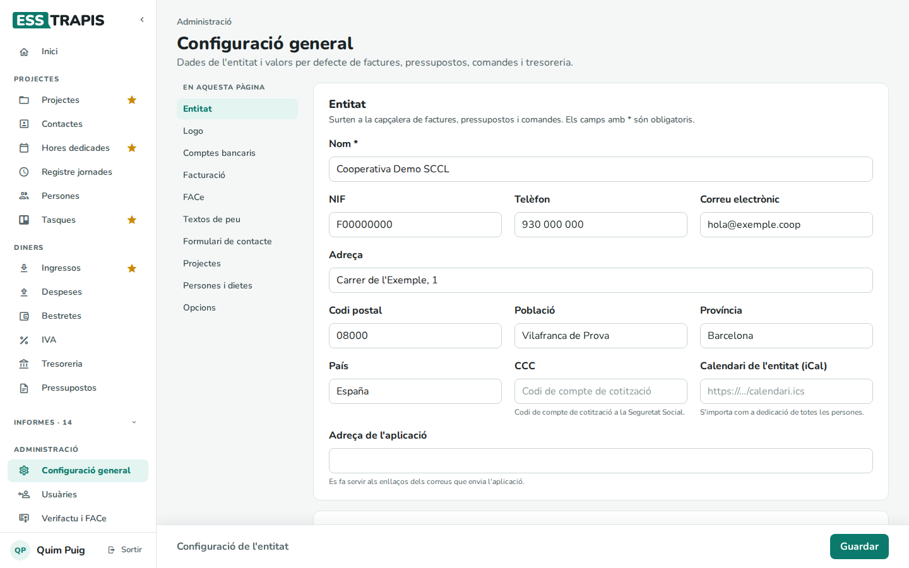
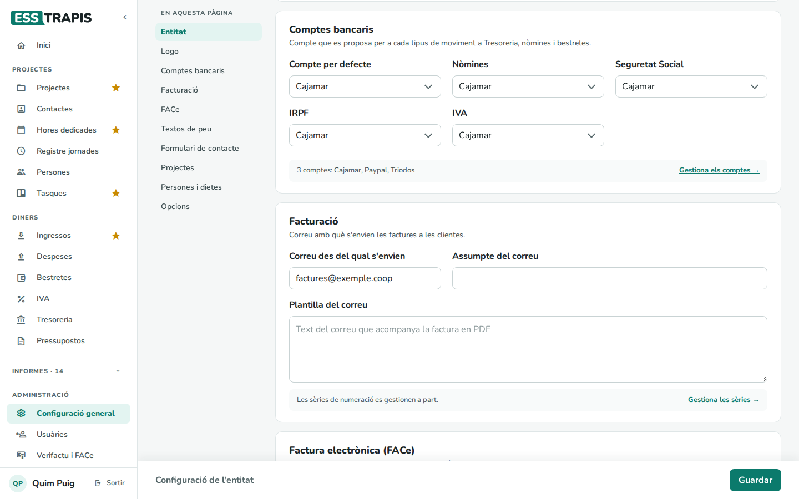
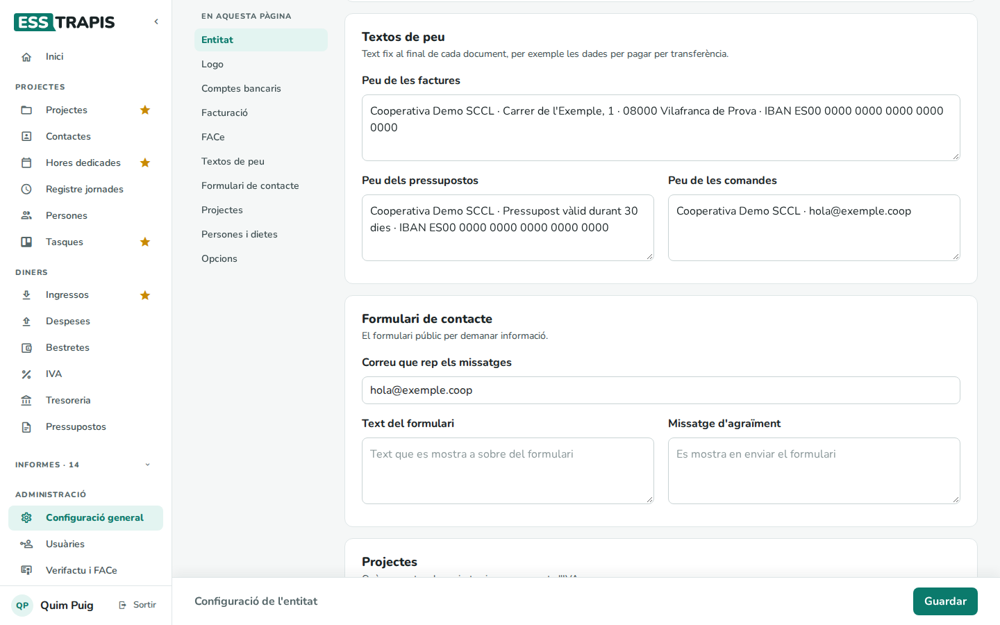
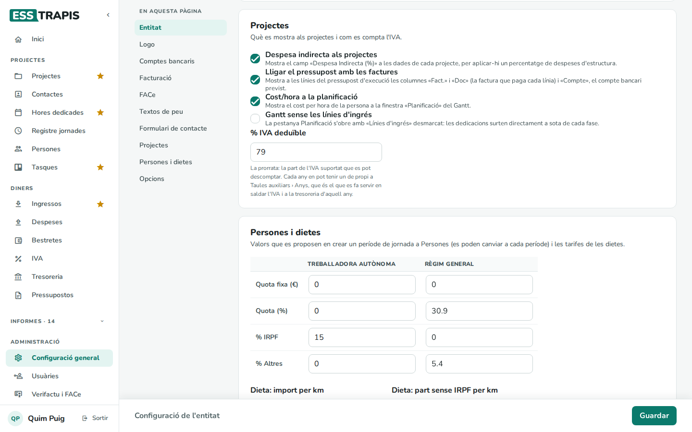
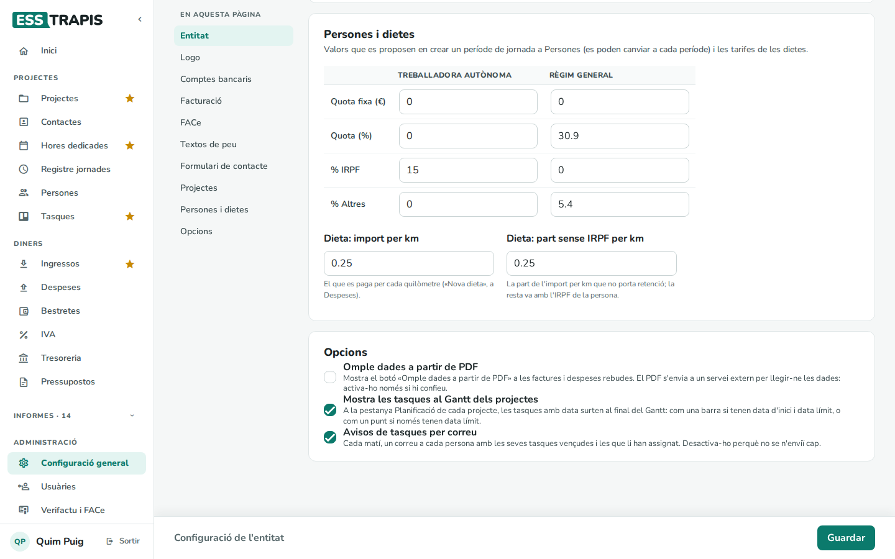

# 34. Configuració general de l'entitat

> Permís necessari: `admin`

**Administració › Configuració general** guarda les dades de l'entitat i els valors per defecte de factures,
pressupostos, comandes i tresoreria. L'índex de l'esquerra (**En aquesta pàgina**) porta a cada bloc. Al final,
**Guardar** a la barra de baix.

## Els blocs

**Entitat** — surten a la capçalera de factures, pressupostos i comandes: **Nom** *, **NIF**, **Telèfon**,
**Correu electrònic**, l'adreça, el **CCC** (codi de compte de cotització a la Seguretat Social), el **Calendari de
l'entitat (iCal)** (s'importa com a dedicació de totes les persones) i l'**Adreça de l'aplicació** (la que surt als
enllaços dels correus que envia l'aplicació).

**Logo** — surt a les factures, pressupostos i comandes impreses. Millor en PNG o JPG, amb fons transparent o
blanc. S'arrossega a la zona o es tria; **Treu el logo** el treu. Si el fitxer s'ha perdut, la pàgina ho avisa.

**Comptes bancaris** — el compte que es proposa per a cada tipus de moviment: **Compte per defecte**, **Nòmines**,
**Seguretat Social**, **IRPF** i **IVA**. Els comptes es creen a **Taules auxiliars › Comptes bancaris**
(**Gestiona els comptes**).

**Facturació** — el correu amb què s'envien les factures a les clientes: **Correu des del qual s'envien**,
**Assumpte del correu** i **Plantilla del correu** (el text que acompanya el PDF). Les sèries es gestionen a part
(**Gestiona les sèries**).

**Factura electrònica (FACe)** — el mode (**No**, **Test**, **Real**), el **Format de factura** (**UBL** o
**FacturaE**) i les adreces del servei de test i real. Vegeu [18. Verifactu i FACe](18-verifactu-face.md).

**Textos de peu** — el text del peu de les factures, dels pressupostos i de les comandes (per exemple, el compte
bancari o la validesa d'un pressupost). El de les comandes s'imprimeix al peu de cada albarà.

**Formulari de contacte** — per a les entitats amb logística: el correu que rep els missatges, el text del
formulari i el missatge d'agraïment.

**Projectes** — què es mostra als projectes i com es compta l'IVA:

- **Despesa indirecta als projectes**: el camp **Despesa Indirecta (%)** a les dades de cada projecte (vegeu
  [04](04-crear-editar-projecte.md)).
- **Lligar el pressupost amb les factures**: a les línies del pressupost d'execució, les columnes **Fact.**,
  **Doc** (la factura que paga cada línia) i **Compte** (el compte bancari previst).
- **Cost/hora a la planificació**: el cost per hora de la persona a la finestra **Planificació** del Gantt.
- **Gantt sense les línies d'ingrés**: la pestanya **Planificació** s'obre amb **Línies d'ingrés** desmarcat.
- **% IVA deduïble**: la prorrata general. Cada any en pot tenir una de pròpia a **Taules auxiliars › Anys**, i
  és la que es fa servir per saldar l'IVA i a la tresoreria d'aquell any (vegeu [21. IVA](21-iva.md)).

**Persones i dietes** — els valors que es proposen en crear un període de jornada a **Persones** (a cada període
es poden canviar), per a **Treballadora autònoma** i per a **Règim general**: **Quota fixa (€)**, **Quota (%)**, **%
IRPF** i **% Altres** (vegeu [20. Bestretes](20-bestretes.md#com-es-calcula)). A sota, les tarifes de les dietes per
quilòmetre: **Dieta: import per km** i **Dieta: part sense IRPF per km**.

**Logística** — només per a les entitats amb el mòdul de comandes: el **Descompte multientrega (%)** (quan una sòcia
té més d'una comanda per al mateix punt d'entrega i dia) i l'**Hora límit per a l'endemà**. Les tarifes de les rutes
són a **Taules auxiliars › Tarifes de ruta** (vegeu [35](35-taules-auxiliars.md)).

**Opcions**:

- **Omple dades a partir de PDF**: mostra aquest botó a les factures i despeses rebudes. El PDF s'envia a un
  servei extern per llegir-ne les dades: cal activar-ho només si s'hi confia.
- **Mostra les tasques al Gantt dels projectes**: a la pestanya **Planificació**, les tasques amb data surten al
  final del Gantt.
- **Avisos de tasques per correu**: cada matí, un correu a cada persona amb les seves tasques vençudes i les
  noves.

## Què no és aquí

Els certificats de Verifactu i FACe els configura qui manté el servidor (vegeu
[18. Verifactu i FACe](18-verifactu-face.md)).

## Vegeu també

- [35. Taules auxiliars](35-taules-auxiliars.md)
- [17. Factures emeses](17-factures-emeses.md)
- [18. Verifactu i FACe](18-verifactu-face.md)
- [10. Tasques](10-tasques.md)
