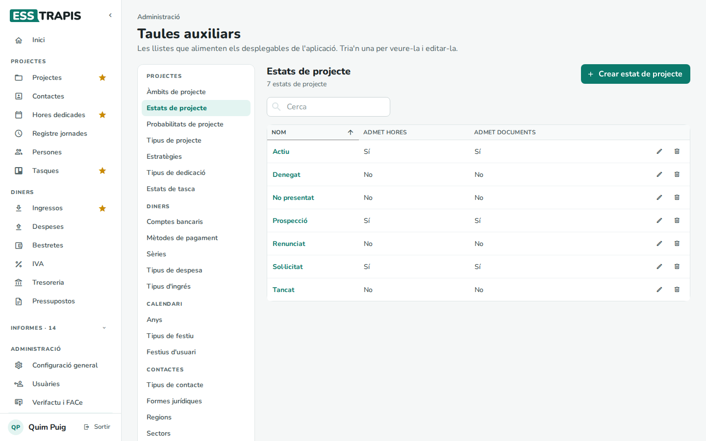
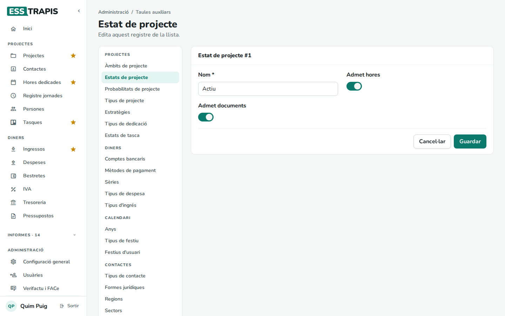
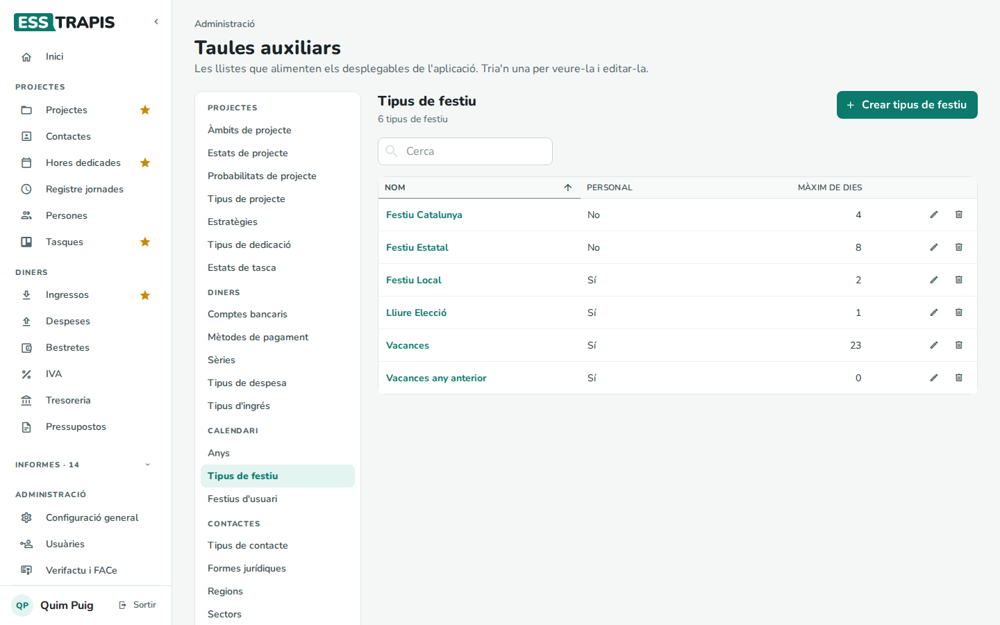
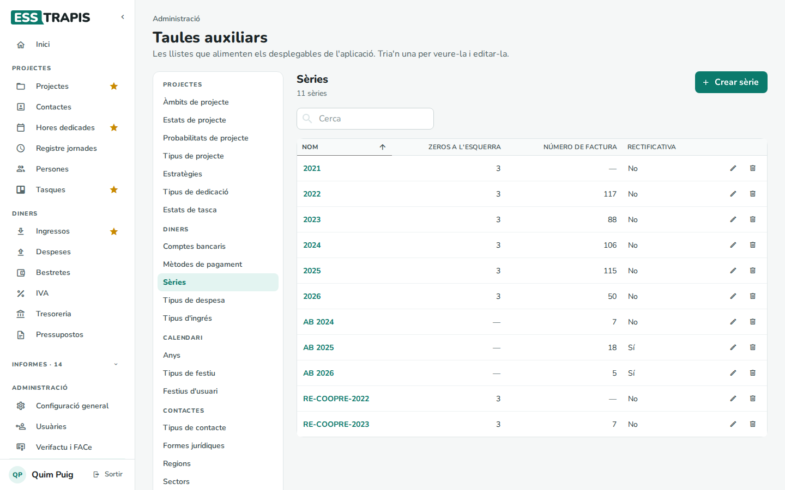
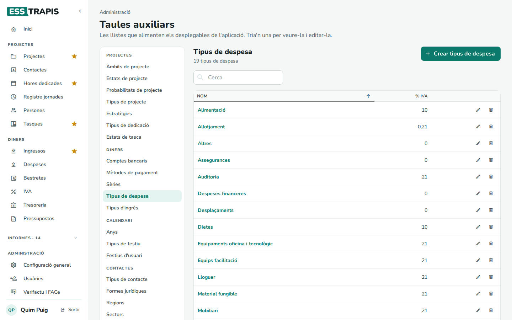
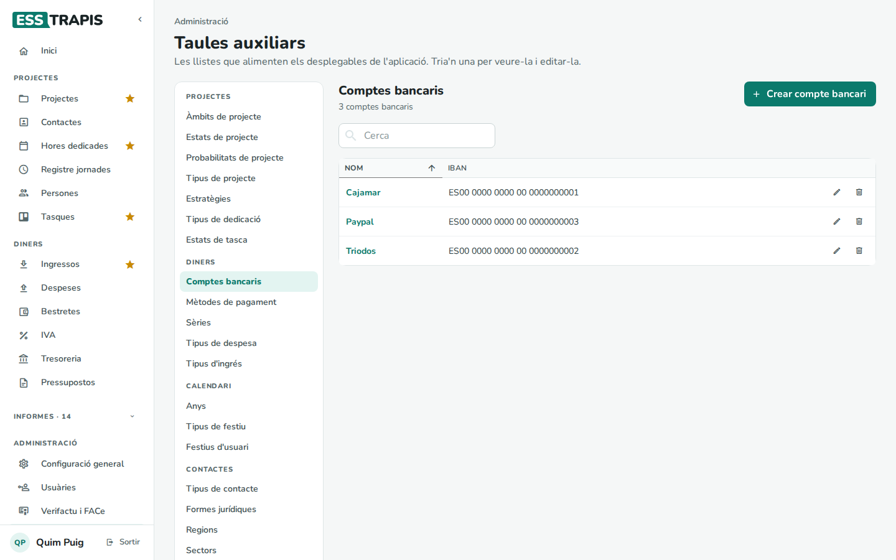

# 35. Taules auxiliars

> Permís necessari: `admin`

Les **taules auxiliars** són les llistes que omplen els desplegables de l'aplicació: estats de projecte, tipus de
despesa, sèries, comptes bancaris… Cada entitat les adapta a la seva manera de treballar. Són a **Administració ›
Taules auxiliars**.

## Com funcionen

A l'esquerra, les llistes agrupades (amb logística, també la de **Tarifes de ruta**); a la dreta, la llista triada amb un buscador (**Cerca**). A cada fila, el
llapis l'edita i la paperera l'esborra. **Crear …** (per exemple, **Crear estat de projecte**) n'afegeix una.

Cada registre s'edita en una fitxa amb **Guardar** i **Cancel·lar**:

No es pot esborrar un registre que ja es fa servir (un estat que tenen projectes, una sèrie amb factures…). Si ja no
cal, es pot canviar de nom o deixar de fer-lo servir.

## Les llistes

**Projectes**

| Llista | Què és |
|---|---|
| **Àmbits de projecte** | Les àrees de l'entitat (filtre de la llista de projectes i informes). |
| **Estats de projecte** | Actiu, Tancat, Sol·licitat… Cada estat diu si **Admet hores** (s'hi poden imputar hores) i si **Admet documents** (s'hi poden assignar factures). |
| **Probabilitats de projecte** | Per als projectes no aprovats (s'usen a la previsió econòmica i de dedicació). |
| **Tipus de projecte** | Classificació lliure dels projectes. |
| **Estratègies** | Les línies estratègiques de l'entitat (informe d'estratègies). |
| **Tipus de dedicació** | La classificació de les hores (H1 facturable, H2 gestió…). |
| **Estats de tasca** | Les columnes del tauler de tasques; l'última és la d'acabades. Vegeu [10. Tasques](10-tasques.md). |

**Diners**

| Llista | Què és |
|---|---|
| **Comptes bancaris** | Nom i IBAN de cada compte (tresoreria, factures). |
| **Mètodes de pagament** | Transferència, rebut… (factures emeses i rebudes). |
| **Sèries** | Les numeracions de factures, despeses i pressupostos (vegeu més avall). |
| **Tipus de despesa** | Amb el seu IVA per defecte (línies de despesa dels projectes, factures rebudes). |
| **Tipus d'ingrés** | Amb el seu IVA per defecte (línies d'ingrés dels projectes, altres ingressos). |

**Calendari**: **Anys** (vegeu [36](36-inici-any-manteniment.md)), **Festius d'usuari** (el màxim de dies de
vacances i de lliure elecció d'una persona en un any, quan és diferent del general) i **Tipus de festiu**: Festiu
Estatal, Vacances, Lliure Elecció… Cada tipus diu si és **Personal** (s'apunta a una persona; si no, és un festiu de
tothom, que només afegeix una persona administradora) i el **Màxim de dies** a l'any (buit: sense màxim).

**Logística** (només amb el mòdul de comandes): **Tarifes de ruta**, el preu del transport d'una comanda segons el
pes:

- **Rutes**, **Recollida** i **Tipus d'entrega**: a quines comandes s'aplica la tarifa (buit: a totes).
- **Menys de 10 kg**: un preu fix.
- **A 10 kg**, **A 20 kg** … **A 60 kg**: el preu a cada pes; entre dos trams, el preu es calcula proporcionalment.
- **Cada kg de més de 60**: per sobre de 60 kg, el preu de 60 kg més aquest import per cada kg.
- **Per línia de punt de recollida**: es suma per cada línia que va a un punt de recollida.

**Contactes**: **Tipus de contacte** (clienta, proveïdora, intercooperació…), **Formes jurídiques**, **Regions**
(l'àmbit territorial dels projectes), **Sectors** i **Entitats socials**.

## Les sèries

Cada sèrie té un **Nom** (que fa de prefix: *2026* dona *2026-001*), els **Zeros a l'esquerra** del número, el
**Número de factura** (l'últim número fet) i si és **Rectificativa** (les factures rectificatives han de tenir la
seva pròpia sèrie). Normalment es fa una sèrie nova cada any (vegeu [36](36-inici-any-manteniment.md)).

## Tipus de despesa i comptes bancaris

## Vegeu també

- [34. Configuració general](34-configuracio-general.md)
- [36. Inici d'any i manteniment](36-inici-any-manteniment.md)
