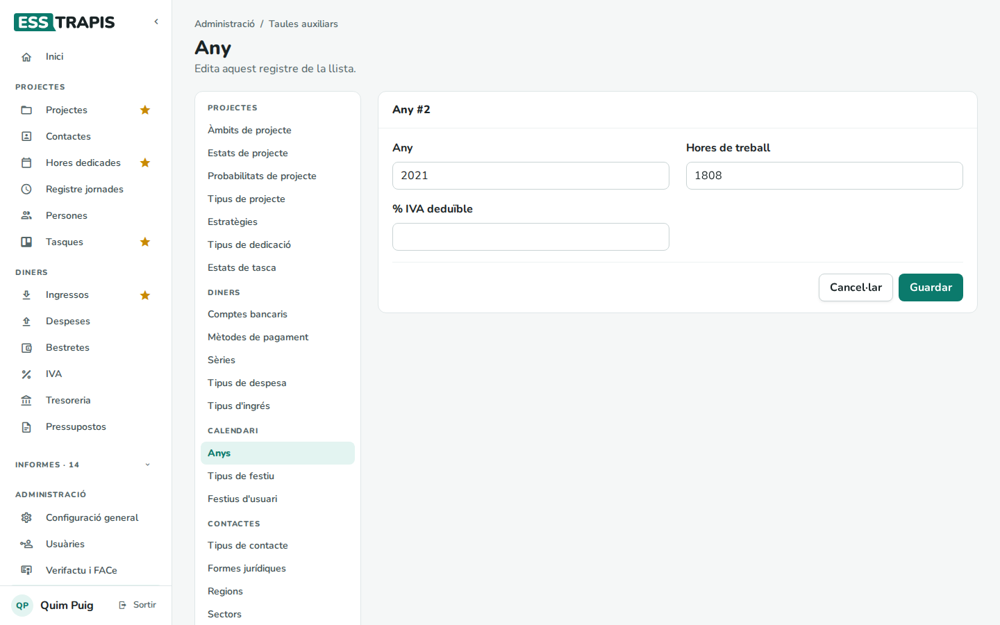
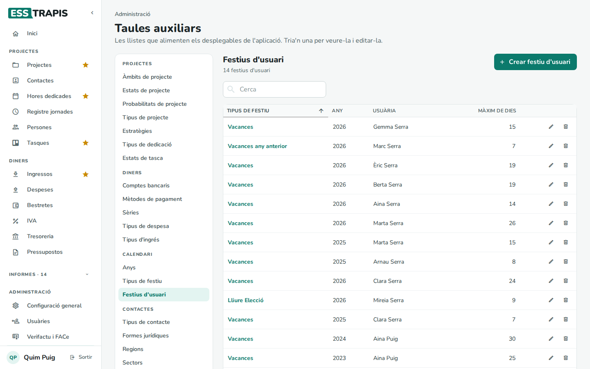
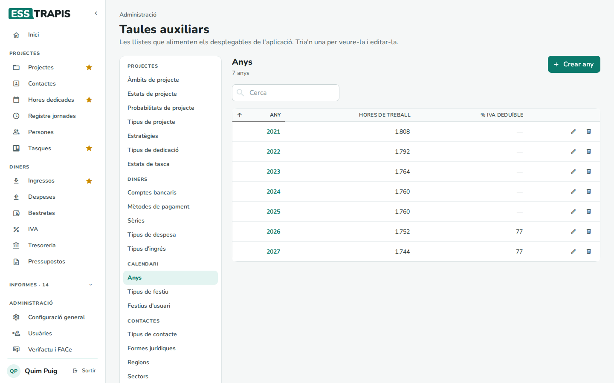
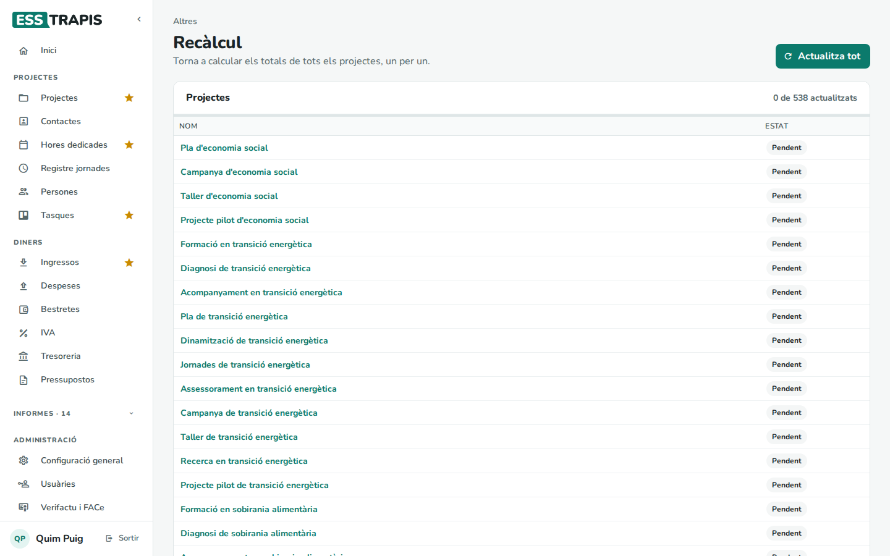

# 36. Inici d'any i manteniment

> Permís necessari: `admin` (anys i festius); `projects` (recàlcul)

Cada any cal preparar unes quantes coses perquè les hores, les nòmines i les factures del nou any funcionin bé. I,
de tant en tant, pot caldre tornar a calcular els totals dels projectes.

## Preparar un any nou

Abans de començar l'any (o el primer dia):

1. **L'any**: a **Administració › Taules auxiliars › Anys**, **Crear any** amb:
   - **Any**.
   - **Hores de treball**: les hores anuals de jornada completa del conveni. Serveixen per calcular el cost per hora
     de cada persona i el saldo d'hores anual.
   - **% IVA deduïble**: la prorrata d'IVA de l'any (la part de l'IVA suportat que es pot descomptar).

   
2. **Les sèries**: a **Taules auxiliars › Sèries**, una sèrie nova per a les factures emeses (per exemple, *2027*)
   i, si cal, per a les rectificatives i les despeses. Vegeu [35](35-taules-auxiliars.md#les-sèries).
3. **Els festius**: els oficials (estatals i autonòmics) són comuns a tothom. Una persona administradora els afegeix
   a **Hores dedicades › Festiu** amb el tipus **Festiu Estatal** o **Festiu Catalunya** (surten amb *TOTES*); cal
   comprovar al calendari que hi són tots. Els **festius locals** s'apunten a
   cada persona amb **Hores dedicades › Festiu**. Vegeu [13](13-imputar-hores.md#6-festius-i-vacances).
4. **Les vacances**: si alguna persona té un màxim de dies diferent del general, a **Taules auxiliars › Festius
   d'usuari** (tipus, any, persona i **Màxim de dies**).

   
5. **Les jornades**: a **Persones**, revisar que cada persona té un període de jornada per al nou any, amb el salari
   actualitzat. Vegeu [15](15-persones-jornades.md).
6. **Les bestretes**: a **Persones › Crear Bestretes**, crear les de tot l'any.

## Recàlcul

Els totals de cada projecte (ingressos, despeses, hores, resultat original, previst i executat) es guarden calculats
i s'actualitzen sols en segon pla després de cada canvi. Si després d'un canvi gran (per exemple, retocar les
jornades d'anys anteriors) les xifres no quadren, es poden tornar a calcular tots.

La pantalla **Recàlcul** no és al menú: s'hi arriba afegint `#/recalculate` a l'adreça de l'aplicació. Llista tots els projectes amb el seu estat (**Pendent** o
**Actualitzat**). **Actualitza tot** els recalcula un per un; la barra de progrés diu quants en porta.

Amb molts projectes pot trigar una estona: cal deixar la pàgina oberta fins que acabi.

## Vegeu també

- [15. Persones i jornades laborals](15-persones-jornades.md)
- [16. Saldo d'hores i hores anuals](16-saldo-hores.md)
- [21. IVA](21-iva.md)
- [35. Taules auxiliars](35-taules-auxiliars.md)
