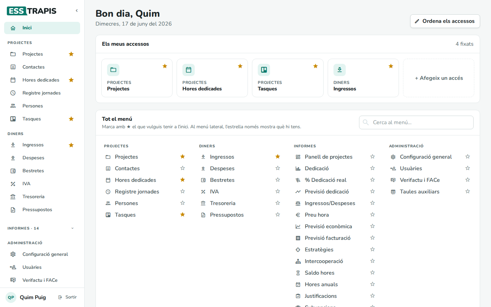
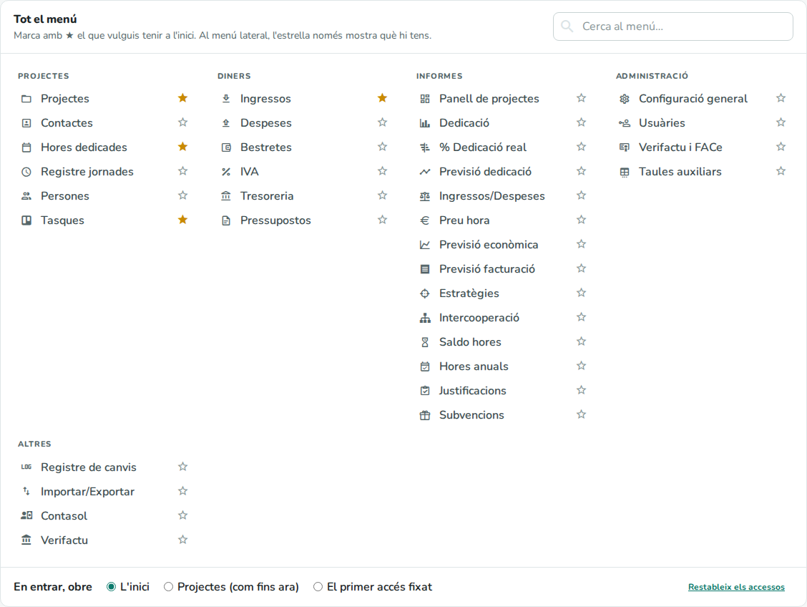
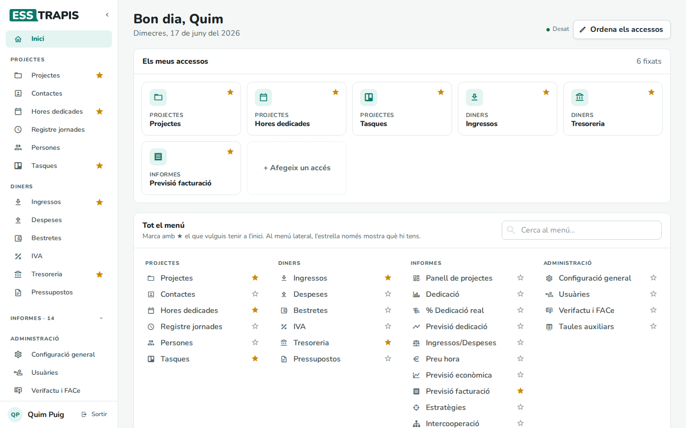
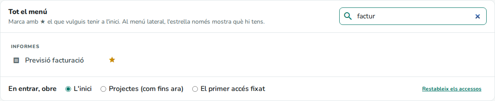
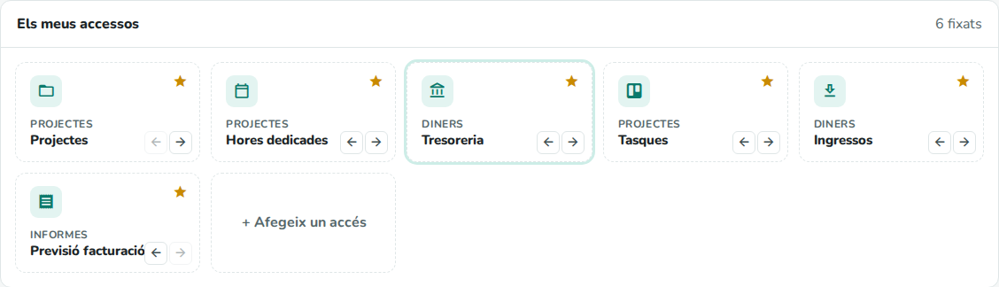
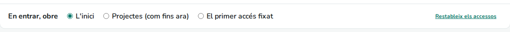
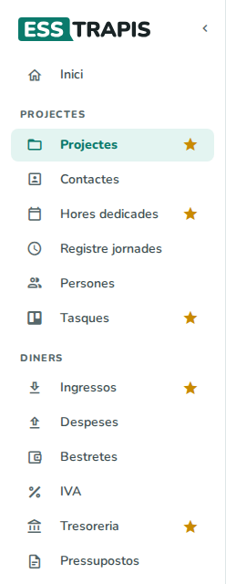

# 37. La pàgina d'inici

> Permís necessari: cap

**Inici** és la primera pantalla després d'entrar. Hi ha els **accessos** que cada persona ha triat: les
pantalles que fa servir més, a un clic. També s'hi tria quina pantalla s'obre en entrar.

## Abans de començar

No cal cap permís ni cap configuració. Cada persona té el seu Inici: el que una persona fixa no canvia el de
les altres. Només es poden fixar pantalles que la persona pot obrir (vegeu
[02. Usuaris, rols i permisos](02-usuaris-rols-permisos.md)).

## La pantalla

- A dalt, una salutació amb el nom de la persona i la data del dia.
- **Els meus accessos**: una fitxa per cada pantalla fixada, amb el bloc del menú on és (*Projectes*,
  *Diners*…) i el seu nom. Clicant la fitxa s'obre la pantalla. A la dreta es veu quants n'hi ha (*4 fixats*).
- La fitxa de **Tasques** mostra també quantes tasques hi ha **vençudes** i quantes **novetats** (com el punt
  del menú; vegeu [10. Tasques](10-tasques.md)).
- **Tot el menú**: totes les pantalles del menú lateral que la persona pot obrir, per blocs, cadascuna amb
  la seva estrella.

Inici és sempre la primera entrada del menú lateral, per tornar-hi des de qualsevol pantalla.

La primera vegada, Inici ja té fins a quatre accessos de mostra, segons els permisos: **Projectes**, **Hores
dedicades**, **Tasques** i **Ingressos**; o, a la logística, **Comandes**, **Incidències**, **Operacions** i
**Rutes i dies**.

## Pas a pas

### 1. Fixar una pantalla a l'inici

A **Tot el menú**, l'estrella buida (☆) del costat d'una pantalla la fixa a l'inici, i queda plena (★). La
pantalla s'afegeix al final de **Els meus accessos**. Clicant l'estrella plena es treu.

Cada canvi es desa sol: al costat del títol apareix un moment **Desat**.

També es pot treure un accés amb l'estrella de la seva fitxa, a **Els meus accessos**.

### 2. Cercar una pantalla

**Cerca al menú…** filtra **Tot el menú** mentre s'escriu: per nom de pantalla o per nom de bloc (*informes*
mostra tot el bloc). **+ Afegeix un accés** porta directament a aquest cercador.

### 3. Ordenar els accessos

**Ordena els accessos** (amb dos accessos o més) posa les fitxes en mode d'ordenar: tenen la vora de punts i
dues fletxes: **←** la mou un lloc abans i **→** un lloc després. Amb el ratolí també es poden arrossegar i deixar
anar davant d'una altra fitxa. Mentre s'ordena, clicar una fitxa no l'obre. **Fet** surt d'aquest mode.

### 4. Triar què s'obre en entrar

Al peu de **Tot el menú**, **En entrar, obre** diu quina pantalla s'obre després d'iniciar la sessió:

| Opció | Què obre |
|---|---|
| **L'inici** | Aquesta pàgina. És l'opció de partida. |
| ***Pantalla* (com fins ara)** | La pantalla que obria l'aplicació abans que hi hagués Inici, segons els permisos: **Projectes**, **Hores dedicades** per a qui només imputa hores, o **Comandes** a la logística. |
| **El primer accés fixat** | La primera fitxa de **Els meus accessos**. Si no n'hi ha cap, Inici. |

Si s'entra des d'un enllaç a una pantalla concreta (per exemple, d'un correu d'avís d'una tasca), després
d'iniciar la sessió s'obre aquella pantalla, sigui quina sigui l'opció triada.

### 5. L'estrella al menú lateral

Al menú lateral, les pantalles fixades a l'inici porten una estrella a la dreta. Aquesta estrella només ho
indica: les pantalles es fixen i es treuen a Inici, perquè un clic per error al menú no les canviï. Amb el
menú plegat no es mostra.

## Camps i opcions

| Element | Què fa |
|---|---|
| **Ordena els accessos** / **Fet** | Entra i surt del mode d'ordenar les fitxes. |
| Estrella d'una fitxa | Treu la pantalla de l'inici. |
| **+ Afegeix un accés** | Porta al cercador de **Tot el menú**. |
| **Cerca al menú…** | Filtra les pantalles de **Tot el menú** per nom o per bloc. |
| ☆ / ★ a **Tot el menú** | Fixa o treu la pantalla de l'inici. |
| **En entrar, obre** | La pantalla que s'obre després d'iniciar la sessió (vegeu el pas 4). |
| **Restableix els accessos** | Torna als accessos de mostra de la primera vegada. No canvia l'opció d'**En entrar, obre**. |

## Preguntes freqüents / Errors habituals

**Si canvio d'ordinador, hi tindré els mateixos accessos?** Sí. Els accessos i l'opció d'**En entrar, obre**
es desen al compte de la persona, no al navegador.

**Surt «No s'ha pogut desar: queda només en aquest navegador».** L'aplicació no ha pogut parlar amb el
servidor. El canvi només val en aquest navegador i es pot perdre: quan torni la connexió, torneu a obrir
Inici i repetiu-lo. Si torna a passar, aviseu qui administra ESSTRAPIS.

**Ha desaparegut una fitxa.** Si a la persona li han tret el permís d'una pantalla, la fitxa deixa de
mostrar-se. No s'esborra: si torna a tenir el permís, la fitxa torna a sortir al seu lloc.

**No trobo una pantalla a Tot el menú.** Només hi surten les pantalles del menú lateral que la persona pot
obrir. Les fitxes concretes (un projecte, una factura) no es poden fixar.

**No veig el botó Ordena els accessos.** Surt quan hi ha almenys dos accessos fixats.

## Vegeu també

- [01. Primers passos](01-primers-passos.md): entrar a l'aplicació i el menú lateral.
- [02. Usuaris, rols i permisos](02-usuaris-rols-permisos.md): per què cada persona veu pantalles diferents.
- [10. Tasques](10-tasques.md): les tasques vençudes i les novetats.
