# 38. Guia per a sòcies (logística)

> Permís necessari: `orders` (sòcia)

Aquesta guia és per a tu, sòcia productora que fa servir ESSTRAPIS per encarregar el transport de les teves
comandes. Explica, pas a pas, només el que veus i el que fas: preparar els punts d'entrega, fer les comandes,
imprimir els albarans, deixar les caixes, seguir-les, avisar d'un problema i consultar les factures. Si vols
més detalls d'alguna pantalla, al final hi ha els enllaços als capítols complets.

## Què és i què hi pots fer

La cooperativa porta les teves caixes fins als establiments que te les compren. A ESSTRAPIS:

- **Fas cada comanda**: on va (el **punt d'entrega**), quin dia (la **ruta**), què portes (caixes i quilos) i
  on ho deixes (el magatzem o la teva finca).
- **Imprimeixes l'albarà** i l'enganxes a les caixes.
- **Deixes les caixes** al magatzem i ho marques com a **dipositat** (o la repartidora les passa a buscar a la
  finca).
- **Segueixes** per on va cada comanda.
- **Obres una incidència** si hi ha algun problema amb una comanda.
- **Consultes les teves factures**: cada mes la cooperativa et factura el transport de les comandes
  lliurades.

Algunes paraules que surten sovint:

| Paraula | Què vol dir |
|---|---|
| **Punt d'entrega** | L'establiment que rep la comanda (una botiga, un restaurant, una cooperativa de consum…), amb l'adreça i l'horari en què s'hi pot portar. |
| **Punt de consum** | Un punt d'entrega on la comanda es reparteix entre diverses persones, cadascuna amb les seves caixes. |
| **Ruta** | Un recorregut del transport que passa uns dies concrets de la setmana per unes poblacions (per exemple, *DJ - BCN CIUTAT*, els dijous). Decideix el dia d'entrega i, amb els quilos, el preu. |
| **Recollida** | On deixes la comanda perquè la passin a buscar: un **magatzem** o la **recollida en finca**. |
| **Dipòsit** | Deixar les caixes al magatzem, i marcar-ho a l'aplicació. |
| **Transferència** | Quan la ruta que entrega no passa pel magatzem on has deixat les caixes, una altra ruta les hi porta abans. Ho decideix l'aplicació; tu no has de fer res. |
| **Albarà** | El full que acompanya cada caixa, amb un codi QR que obre la comanda. |
| **Hora límit** | L'hora fins a la qual pots fer una comanda per a l'endemà. |
| **Incidència** | Un problema amb una comanda, que tu i l'oficina seguiu fins que es tanca. |

## Entrar i el teu menú

Entres a ESSTRAPIS amb el teu correu i la teva contrasenya (com s'entra:
[01. Primers passos](01-primers-passos.md)).

**Si tens factures pendents de pagar**, en entrar et surt un missatge que et saluda pel nom i et recorda
l'import total pendent. També et recorda que les factures t'arriben per correu a final de mes, que les tens a
**Factures**, i que convé pagar-les amb una transferència per factura, amb l'import exacte i, al concepte, el
teu nom comercial, el mes i el número de factura. Es tanca amb **D'acord**. Torna a sortir cada vegada que
entres, fins que l'oficina marca les factures com a pagades; si ja has pagat, no cal que facis res més.

Després s'obre la teva pàgina d'**Inici**:

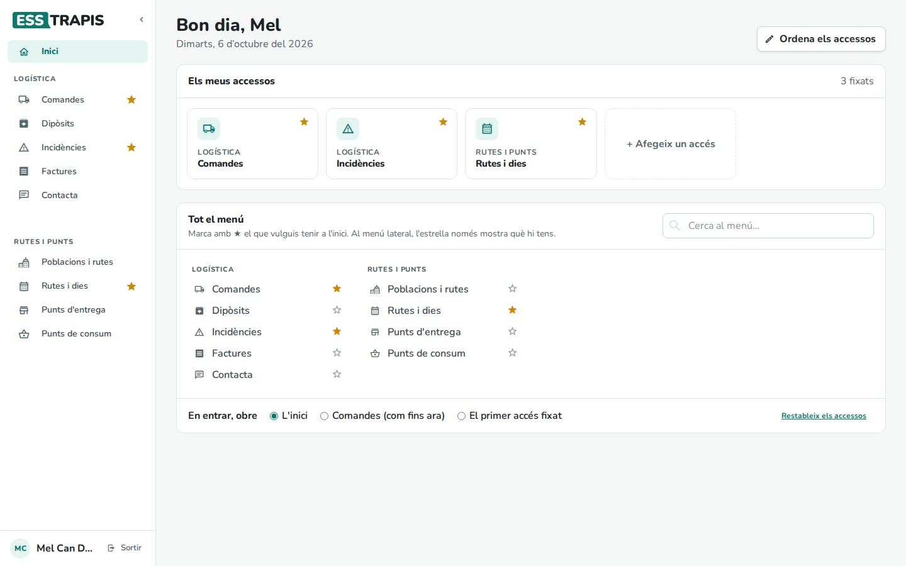

- **Els meus accessos**: les pantalles que fas servir més, a un clic. De partida hi ha **Comandes**,
  **Incidències** i **Rutes i dies**.
- **Tot el menú**: totes les teves pantalles. L'estrella buida (☆) fixa una pantalla a l'inici; la plena (★) la
  treu.
- **En entrar, obre**: si prefereixes que en entrar s'obri directament la llista de comandes, tria
  **Comandes (com fins ara)**.

Com ordenar els accessos i altres opcions: [37. La pàgina d'inici](37-pagina-inici.md).

El menú lateral, a l'esquerra, té dos blocs:

- **Logística**: **Comandes** (les teves comandes), **Dipòsits** (marcar que has deixat les caixes),
  **Incidències**, **Factures** (les factures del transport) i **Contacta** (escriure a l'oficina).
- **Rutes i punts**: **Poblacions i rutes** i **Rutes i dies** (per consultar per on i quins dies passa cada
  ruta), **Punts d'entrega** (les teves clientes) i **Punts de consum**.

Les estrelles del menú lateral només indiquen quines pantalles tens a l'inici.

## Abans de la primera comanda

### Quina ruta passa per on vas?

A **Rutes i punts › Poblacions i rutes**, escriu la població a **Quina ruta passa per…?** i et surten les
rutes que hi passen i quins dies:

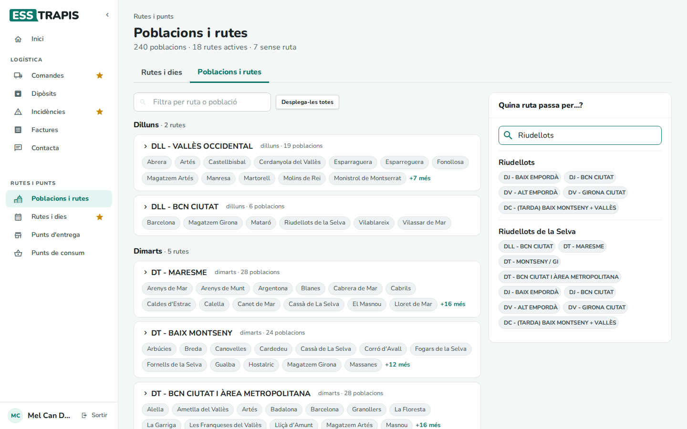

A **Rutes i dies** veus les properes quatre setmanes de cada ruta: els dies que surt (**Oberta**) i els que no
(**Tancada**, per exemple per un festiu).

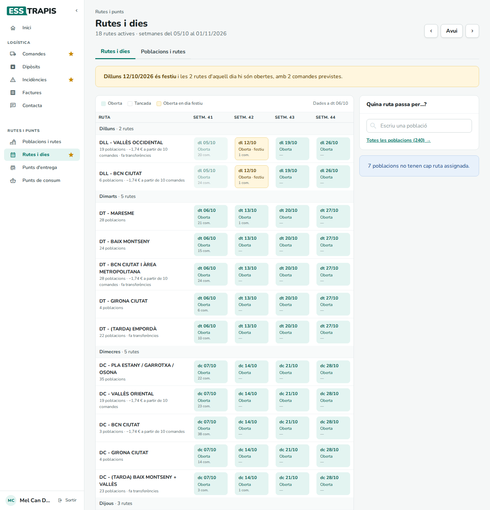

Aquestes pantalles són només de consulta. Si la població on vols entregar no té cap ruta, o no és a la llista,
escriu a l'oficina des de **Contacta**.

### Els teus punts d'entrega

Cada comanda va a un punt d'entrega. A **Rutes i punts › Punts d'entrega** hi ha els teus punts, els que són
compartits per totes les sòcies i els punts on ja has enviat comandes. **Cerca per nom, NIF, població o
ruta** et troba un punt de seguida.

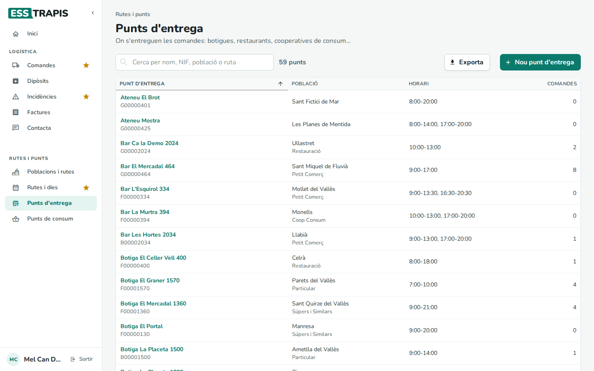

Abans de crear-ne un, busca'l: potser ja hi és. Si hi és amb alguna dada malament (l'adreça, el telèfon,
l'horari), clica'n el nom, corregeix-la i **Guardar**.

### Crear un punt d'entrega

1. **Nou punt d'entrega** (o, des d'una comanda, **Nou punt**).
2. **Localització**: la **Població** (escriu-la i tria-la de la llista), el **CP** i l'**Adreça**.
3. **Establiment**: el **Nom comercial** (el nom amb què el punt sortirà a tot arreu), la **Raó Social** si és
   diferent, el **Sector** i el **NIF**. Si l'establiment no té NIF, **Genera'n un** n'hi posa un d'inventat.
4. **Condicions d'entrega**: els **Horaris de contacte** i el **Telèfon** (almenys 9 xifres). La **Persona de
   contacte**, l'**Email** i les **Notes** són opcionals; les notes surten a l'albarà.
5. **Guardar** o **Guardar i sortir**.

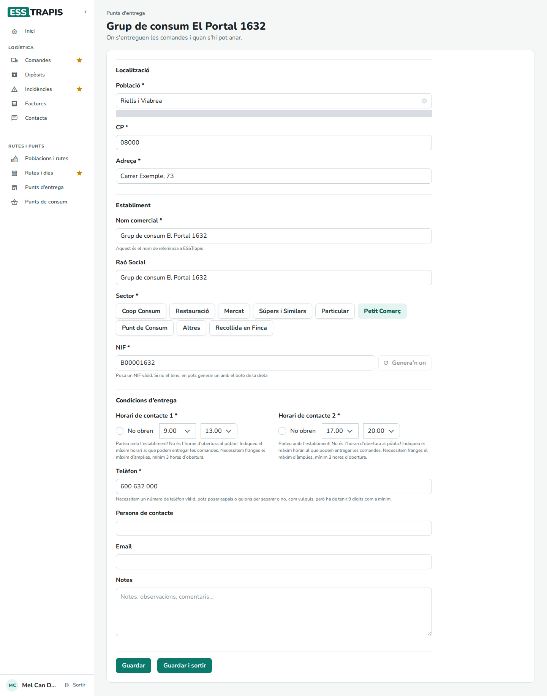

**Els horaris de contacte** no són l'horari d'obertura al públic, sinó les hores en què s'hi pot portar la
comanda: parla-ho amb l'establiment i posa'ls tan amplis com puguis. Almenys un dels dos horaris ha de durar
3 hores o més. Si només obren en una franja, marca **No obren** a l'altra.

Si falta alguna dada o n'hi ha alguna malament, els camps es marquen en vermell, surt *Error. Hi ha camps
incorrectes* i el punt no es desa. Sovint és l'horari (menys de 3 hores) o el telèfon.

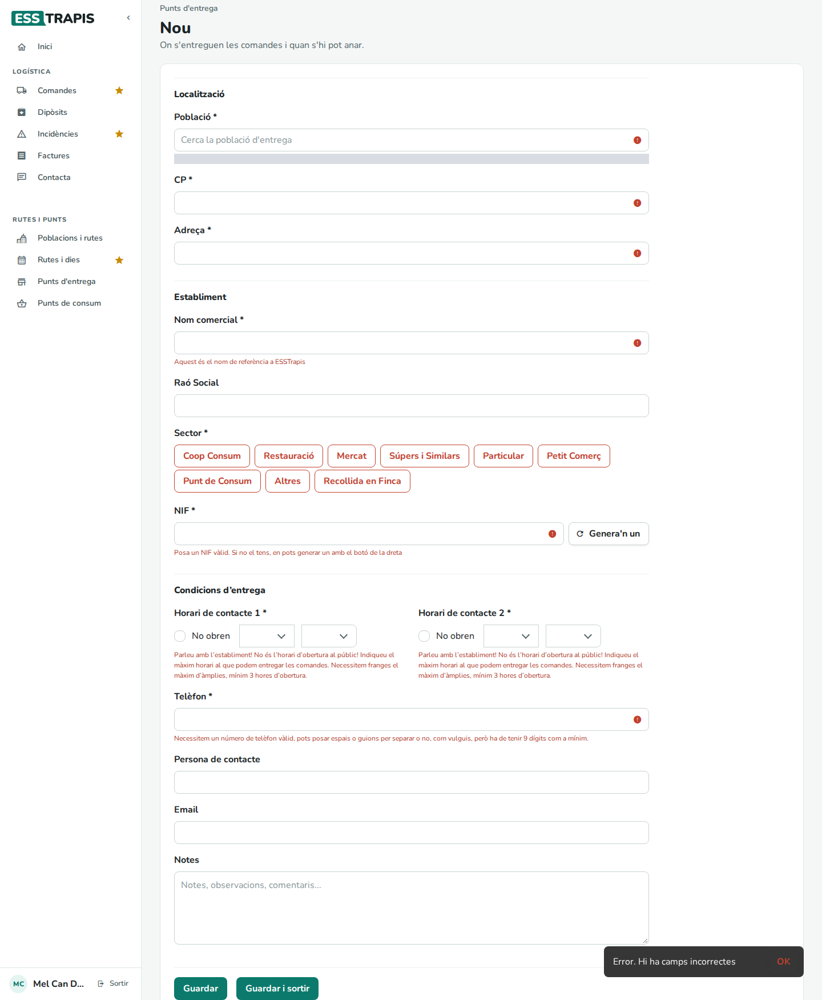

Si la població no és a la llista, no pots guardar el punt: sota el camp **Població** hi ha a qui de l'oficina
has d'escriure perquè l'afegeixi. Els punts no els pots esborrar; si n'hi ha un de repetit, digues-ho a
l'oficina.

Quan canvies les dades d'un punt, el canvi val per a les comandes noves: les comandes ja fetes guarden l'adreça
i el telèfon que tenia el punt quan les vas fer.

### Els punts de consum

Un **punt de consum** és un punt d'entrega on la comanda porta caixes per a diverses persones (per exemple, un
grup de consum), que hi passen a buscar la seva part. Els crea l'oficina. Si n'envies a algun, mira
[Una comanda per a un punt de consum](#una-comanda-per-a-un-punt-de-consum).

## Fer una comanda pas a pas

A **Logística › Comandes** hi ha la llista de les teves comandes:

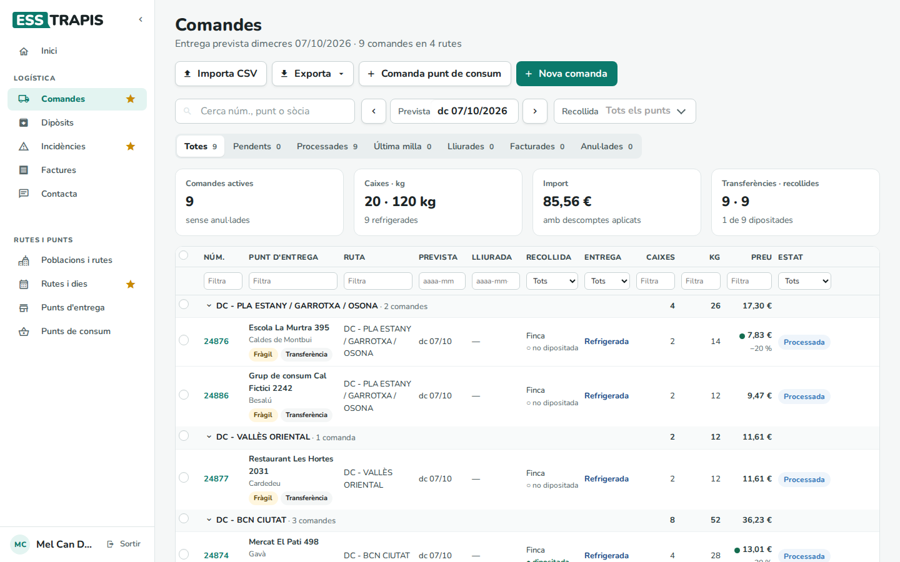

Per fer-ne una, **Nova comanda**:

1. **Sòcia**: ja hi surt el teu nom.
2. **Punt d'entrega**: escriu el nom i tria'l de la llista. A sota surt l'adreça, l'horari i el telèfon del
   punt; **Edita el punt** obre les seves dades per corregir-les i, si el punt no hi és, **Nou punt** el crea.
3. **Ruta**: surten les rutes que passen per la població del punt, amb el dia de la setmana que fan. Tria-la
   segons el dia i la destinació: en depèn el preu.

   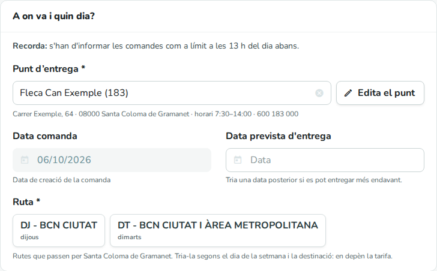

4. **Data prevista d'entrega**: en triar la ruta, s'omple amb el proper dia que passa (mai el mateix dia, i
   saltant els dies que la ruta està tancada). Si la comanda pot arribar més tard, hi pots posar una data
   posterior, sempre un dia que passi la ruta.
5. **Tipus de servei**: **Normal** o **Refrigerada** (refrigerada si almenys una caixa ha d'anar en fred).
6. **Número de caixes** i **Kilograms**. Marca **Fràgil** si cal anar-hi amb compte.
7. **Recollida de la comanda**: on la deixaràs.
   - Un **magatzem**: a sota surt el recordatori de fins quan hi pots deixar les caixes.
   - **Recollida en Finca**: la repartidora passa a buscar les caixes a la teva finca. Tria també el **Punt de
     recollida en finca**, la **Ruta de recollida** (decideix quin dia hi passen) i, si cal, la **Data de
     recollida**. Si no et surt l'opció **Recollida en Finca**, és que l'oficina encara no t'ha donat d'alta
     cap punt de recollida a la finca: demana-l'hi.
8. **Informació important**: el que la repartidora ha de saber (mides poc habituals, on es pot deixar si hi
   ha cap problema…).
9. Mira el quadre **Preu**, a la dreta (més detalls a [El preu i els descomptes](#el-preu-i-els-descomptes)).
10. **Guardar** (o **Guardar i sortir**). La comanda queda en estat **Pendent**.

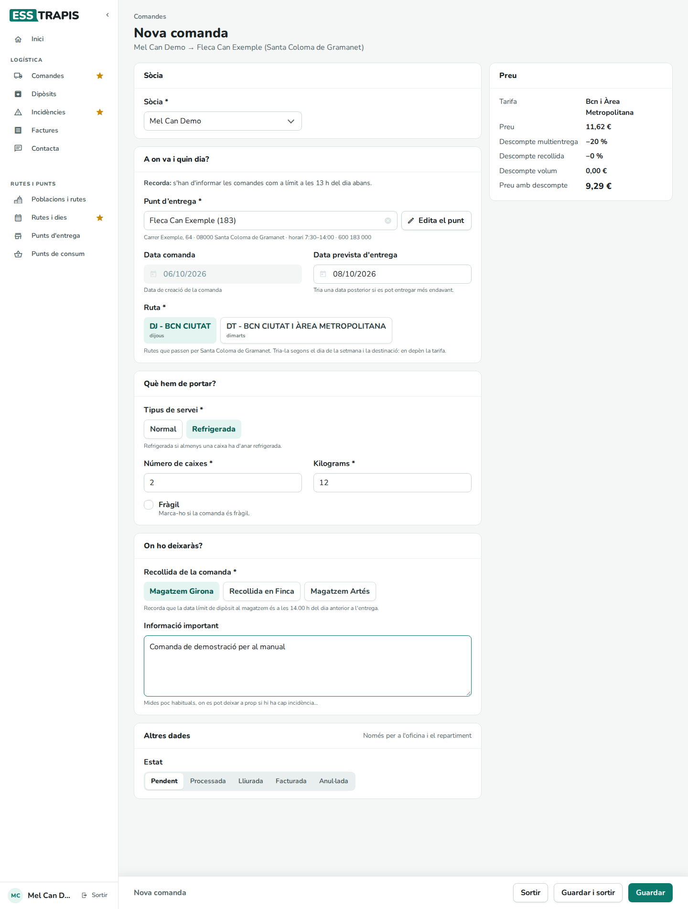

La part **Altres dades** és només per a l'oficina i el repartiment: no cal que hi toquis res.

Si falta alguna dada obligatòria, els camps es marquen en vermell i la comanda no es desa:

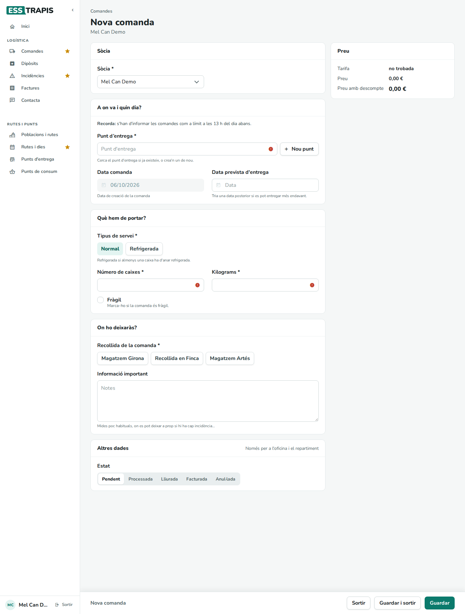

### L'hora límit

Les comandes per a l'endemà s'han de fer abans d'una hora límit, que fixa l'oficina (normalment, les 14 h).
Passada aquesta hora, en triar una ruta que passaria l'endemà, surt «Ruta tancada per demà…» i la data salta
al mateix dia de la setmana següent. Si la ruta passa avui mateix, surt «Ruta tancada per avui…» i també salta
a la setmana vinent:

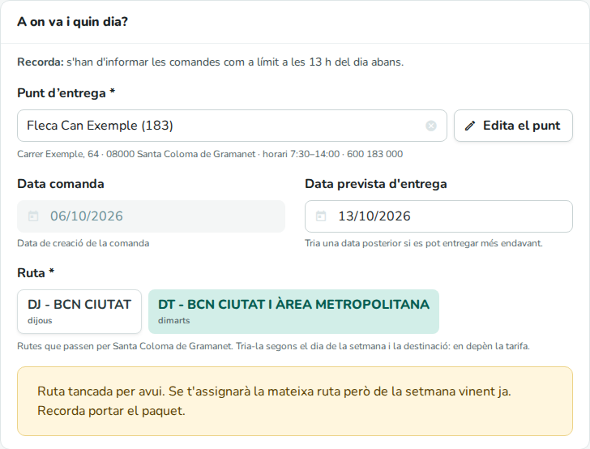

> Compte: el text de la fitxa diu «límit a les 13 h del dia abans», però l'hora que compta és la que ha fixat
> l'oficina. Si tens dubtes, pregunta-ho. Si, passada l'hora, poses a mà la data de l'endemà, en guardar
> sortirà un error.

### El preu i els descomptes

El quadre **Preu** de la fitxa mostra:

- **Tarifa**: la tarifa de la ruta que s'aplica. Si diu que no n'ha trobat cap, el preu surt a zero: avisa
  l'oficina.
- **Preu**: depèn de la ruta, el tipus de servei i els quilos. Fins a 10 kg és un preu fix; a partir d'aquí puja
  amb els quilos.
- Els descomptes, si en tens:
  - **Descompte multientrega**: quan portes més d'una comanda al mateix punt d'entrega el mateix dia.
  - **Descompte volum**: uns euros menys per comanda quan portes prou comandes per la mateixa ruta el mateix
    dia (a **Rutes i dies**, sota el nom de cada ruta, surt a partir de quantes).
  - **Descompte recollida**: el que l'oficina hagi posat al punt d'entrega.
- **Preu amb descompte**: el que costarà la comanda.

A la llista de comandes, la columna **Preu** mostra el preu final, el percentatge rebaixat i uns punts de
color segons el descompte (la llegenda és al peu de la llista).

Primer es resta el descompte de volum i després s'aplica la suma dels dos percentatges: **(preu − descompte
volum) × (1 − (multientrega % + recollida %) / 100)**, arrodonit a cèntims. El preu és el mateix a la fitxa, a la
llista i a la factura. El preu queda fixat quan l'oficina processa la comanda.

### Una comanda per a un punt de consum

Per enviar caixes a un punt de consum, fes servir **Comanda punt de consum** (al costat de **Nova comanda**).
En comptes de caixes i quilos hi ha **Línies**, una per a cada persona destinatària, amb les seves **Caixes**,
**Kilograms**, **Nom** i **NIF**. **Afegeix una línia** n'afegeix una altra.

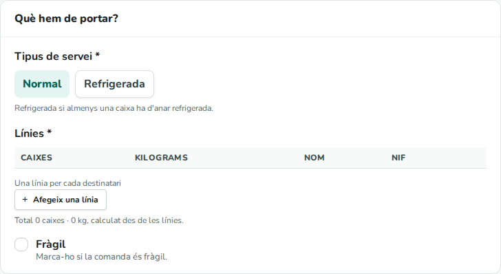

> Atenció: ara mateix, en triar la **Recollida de la comanda**, les línies desapareixen i la fitxa torna a
> demanar caixes i quilos com una comanda normal. Si et passa, avisa l'oficina abans de guardar.

A **Rutes i punts › Punts de consum** surten aquestes comandes amb una fila per persona. Si ets tu qui gestiona
un punt de consum, hi marques amb **Recollit** cada persona que ha passat a buscar la seva part (**Desfés** ho
torna enrere):

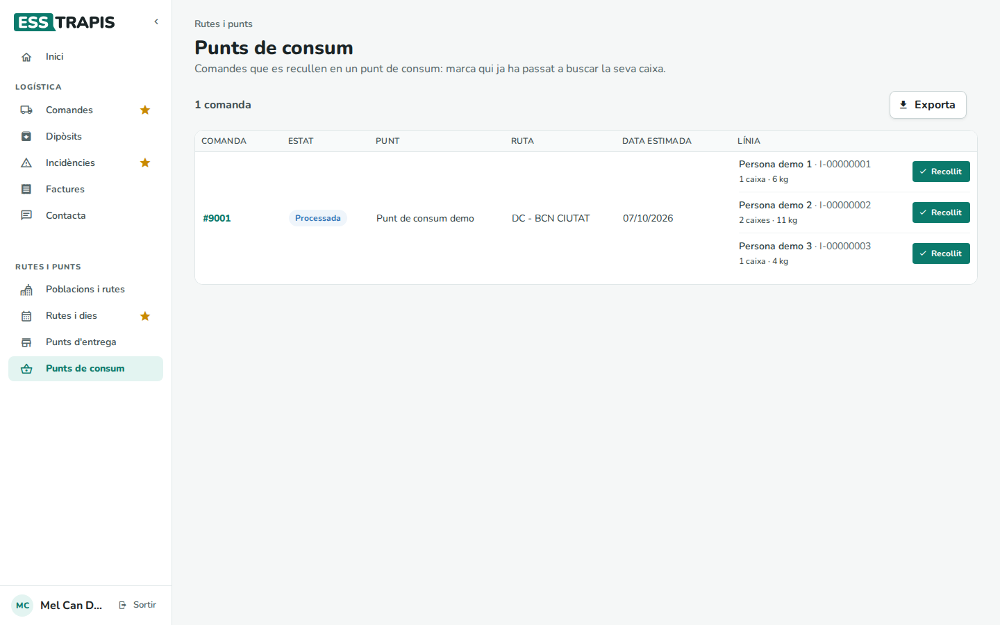

### Canviar o anul·lar una comanda

Mentre la comanda és **Pendent**, la pots canviar:

- a la llista, amb el llapis (**Edició ràpida**) per canviar el punt, la ruta, les dates, la recollida, el
  tipus de servei, les caixes o els quilos; o
- amb **Obre la fitxa**, on també hi ha **Anul·la la comanda** (et demana confirmació).

Quan l'oficina la **processa** (la revisa i la planifica), ja no la pots canviar: la fitxa queda de només
lectura, amb l'avís «Comanda ja processada.». Per a un canvi d'última hora, parla amb l'oficina
(**Contacta**, o una incidència si és sobre aquella comanda).

Els estats d'una comanda els canvia l'oficina:

| Estat | Vol dir |
|---|---|
| **Pendent** | Acabada de fer. Encara la pots canviar o anul·lar. |
| **Processada** | L'oficina l'ha revisat i planificat. |
| **Lliurada** | Entregada al punt. |
| **Facturada** | Ja és en una factura teva. |
| **Anul·lada** | No es repartirà ni es facturarà. |

> Compte: si marques comandes a la llista, la barra que surt a dalt permet triar **Pendent** a **Canvia l'estat
> a…**. No la facis servir amb comandes que ja estan processades: si cal tornar enrere una comanda, demana-ho a
> l'oficina.

## Importar comandes amb CSV

Si fas moltes comandes de cop, les pots preparar en un full de càlcul:

1. **Exporta › Exemple CSV de comandes** descarrega un fitxer d'exemple, ja amb el teu número de sòcia.

   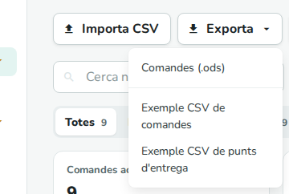

2. Omple'l amb una fila per comanda i desa'l com a CSV separat per comes (també s'accepta punt i coma).
3. **Importa CSV** i deixa el fitxer al requadre **Crea comandes pujant arxiu CSV separat per comes**.

   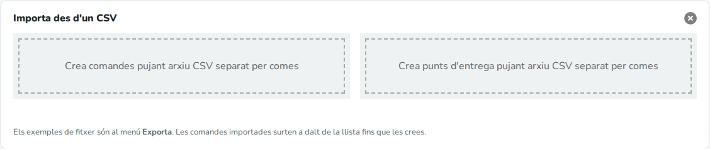

4. Les comandes llegides surten a dalt de la llista, al grup **Importades, encara sense crear**. Revisa-les i
   clica **Crea** a cadascuna: fins aleshores no es desen. Es creen en estat **Pendent**.
5. Si alguna fila té errors, surt **Errors al CSV** amb una línia per error (*Línia N: …*).

Al fitxer, cada fila porta, entre d'altres: el nom de la ruta (tal com surt a l'aplicació), la data d'entrega
(*AAAAMMDD*; buida vol dir el proper dia de la ruta), el nom comercial del punt d'entrega, les caixes, els
quilos, si és refrigerada o fràgil (1 o 0), on la deixes i les notes. Deixa la columna de la sòcia tal com ve a
l'exemple. Abans d'importar:

- El **punt d'entrega ha d'existir**: es busca pel nom comercial (sense tenir en compte els accents) i ha de
  tenir NIF, telèfon, adreça, codi postal, població, horari i sector.
- On deixes la comanda s'indica amb un número de punt de recollida: pregunta a l'oficina quin número té cada
  magatzem.

El segon requadre, **Crea punts d'entrega pujant arxiu CSV separat per comes**, crea punts d'entrega de cop (el
seu exemple és a **Exporta › Exemple CSV de punts d'entrega**). Els punts creats així no tenen sector: abans
d'importar-hi comandes, obre cada punt i posa-l'hi.

**Exporta › Comandes (.ods)** descarrega la llista que estàs veient en un full de càlcul.

## Imprimir els albarans

Cada caixa porta el seu albarà. Es pot imprimir:

- d'una comanda: **Imprimeix albarà** a la fitxa, o **Albarà** a la pàgina de seguiment;
- de diverses alhora: marca-les a la llista i **Imprimeix albarans**.

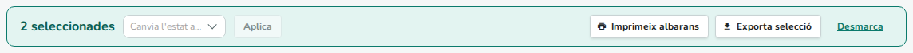

S'obre un PDF en una pestanya nova, amb una pàgina per caixa (*CAIXA: 1/2*). Cada pàgina porta el número de
comanda, un codi QR, la data prevista, el punt d'entrega i l'adreça, les caixes i els quilos, la ruta i les
notes (fràgil, horari, informació important). En un punt de consum, cada caixa porta el nom i el NIF de la
persona.

Si surt «ERROR. L'usuària … no te cap contacte associat.», la teva usuària encara no està lligada a la teva fitxa
de sòcia: avisa l'oficina. Les comandes de recollida (número acabat en **-R**, mira més avall) no tenen albarà.

## Dipositar les caixes

Quan deixes les caixes al magatzem, marca-ho a **Logística › Dipòsits**:

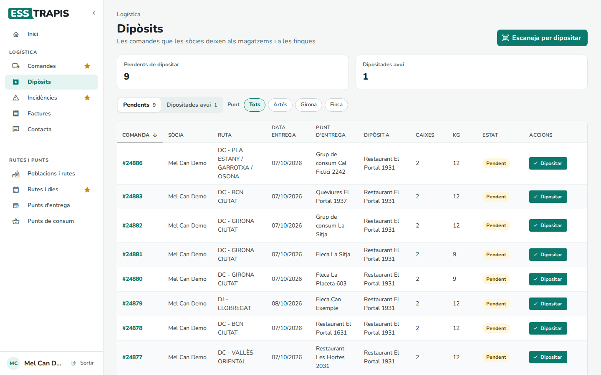

1. A la pestanya **Pendents**, busca la comanda (el filtre **Punt** mostra només un magatzem o la finca).
2. **Dipositar**, i confirma amb **D'acord**.

   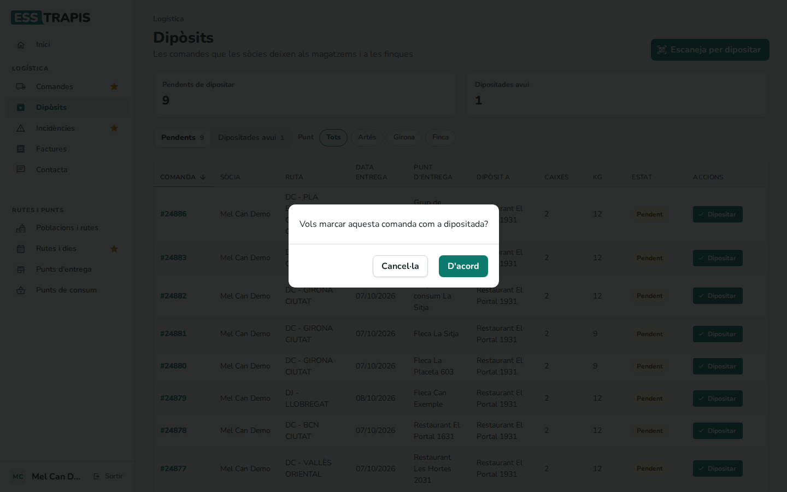

3. Surt **Comanda marcada com a dipositada** i la comanda passa a **Dipositades avui**.

T'has equivocat? A **Dipositades avui**, **Desfés** treu la marca.

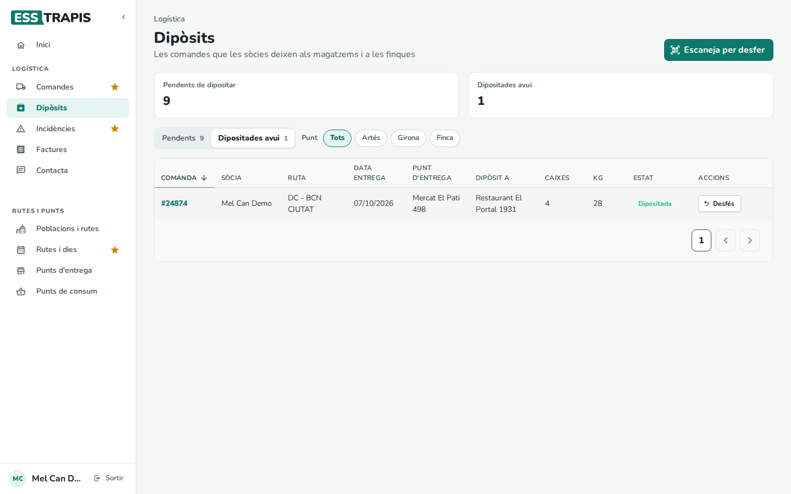

També pots marcar el dipòsit a la fitxa de la comanda (caixa **Moviments**, **Dipositar**), però només mentre
és **Pendent**; si ja està processada, fes-ho des de **Dipòsits**.

### Amb el codi QR

Amb el mòbil o la tauleta és més ràpid: a **Dipòsits**, pestanya **Pendents**, **Escaneja per dipositar**
obre la càmera. Apunta-la al QR de cada albarà: cada lectura marca la comanda com a dipositada al moment
(sense confirmació), fa un xiulet i s'apunta a l'**Historial d'escaneig**, a la dreta.

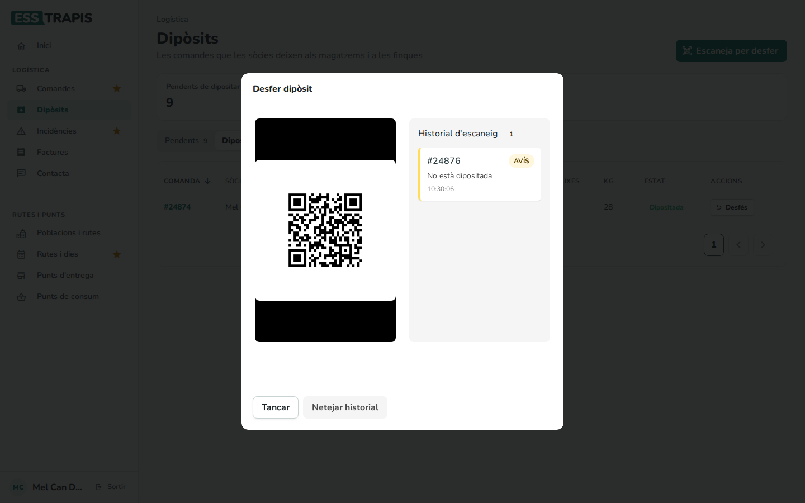

- *Dipositada correctament*: fet. *Ja estava dipositada*: no calia.
- *No és una comanda de dipòsit*: és una comanda de recollida en finca, que no es diposita.
- *No tens permís per modificar aquesta comanda*: l'albarà és d'una altra sòcia.
- Si la càmera no s'engega, dona permís al navegador per fer-la servir i prem **Tornar a intentar**.

A la pestanya **Dipositades avui**, el botó es diu **Escaneja per desfer** i treu la marca.

### Recollida en finca

Si la comanda es recull a la finca, no l'has de dipositar: la repartidora hi passa i ho marca ella. L'aplicació
ajunta totes les comandes que recull el mateix dia a la teva finca en una **comanda de recollida**, amb el
número acabat en **-R**, que també veuràs a la llista.

### Dipositada no vol dir lliurada

El dipòsit queda apuntat a la comanda (columna **Recollida**: ● dipositada), però **no canvia l'estat**: la
comanda continua *Pendent* o *Processada* fins que l'oficina la marca com a *Lliurada*.

## Seguir una comanda

Clicant el número d'una comanda a la llista (o llegint el QR de l'albarà) s'obre la pàgina de seguiment:

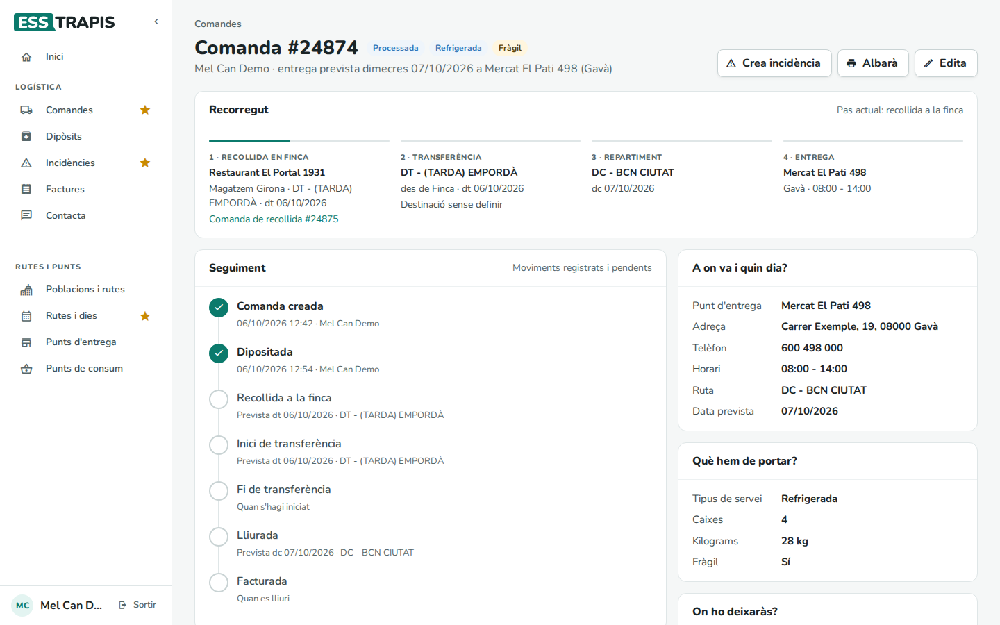

- **Recorregut**: les etapes **Dipòsit** (o **Recollida en finca**), **Transferència**, **Repartiment** i
  **Entrega**, amb el pas on és ara (*Pas actual: …*).
- **Seguiment**: cada moviment fet o pendent (**Comanda creada**, **Dipositada**, **Recollida a la finca**,
  **Inici de transferència**, **Fi de transferència**, **Lliurada**, **Facturada**), amb la data i qui ho ha
  fet.
- A la dreta, on va i quin dia, què es porta, on es deixa i el preu.
- A dalt, **Crea incidència**, **Albarà** i **Edita** (obre la fitxa; si la comanda ja està processada, només
  per consultar-la).

## Quan hi ha un problema: incidències

Una **incidència** és un problema amb una comanda concreta: no s'ha pogut dipositar, ha arribat malmesa,
l'establiment era tancat… Es crea des de la comanda:

- a la pàgina de seguiment, **Crea incidència**; o
- a la fitxa de la comanda, caixa **Incidències**, **Crear incidència**.

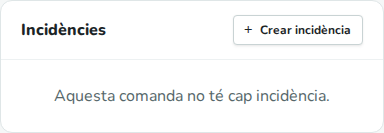

Escriu què passa a **Descripció de la incidència** (fins a 500 caràcters), deixa l'**Estat** a **Oberta** i
**Crear incidència**.

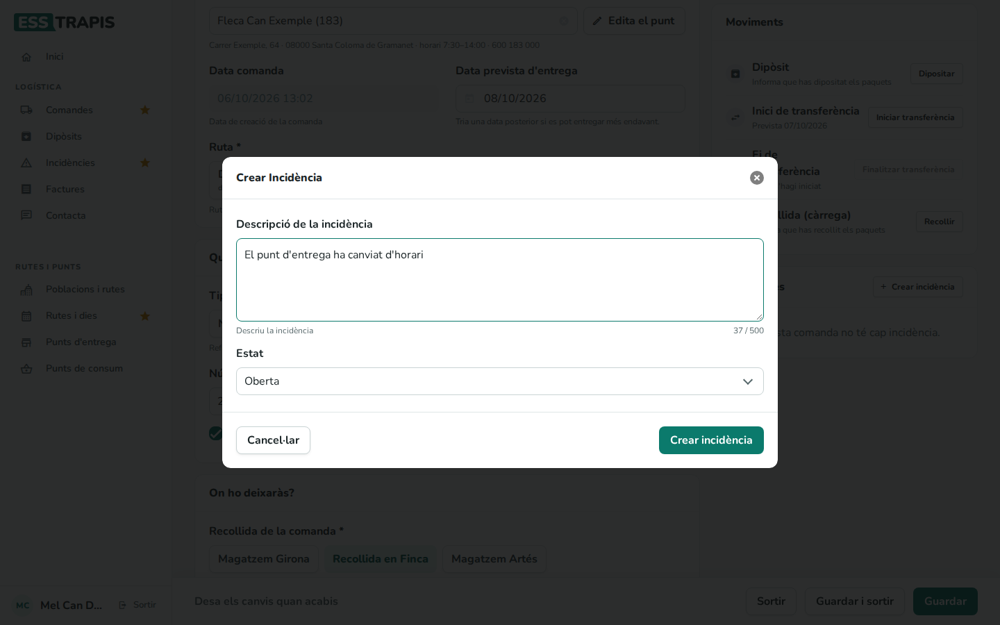

L'oficina rep un correu, i tu una còpia. A partir d'aquí, les segueixes a **Logística › Incidències**:

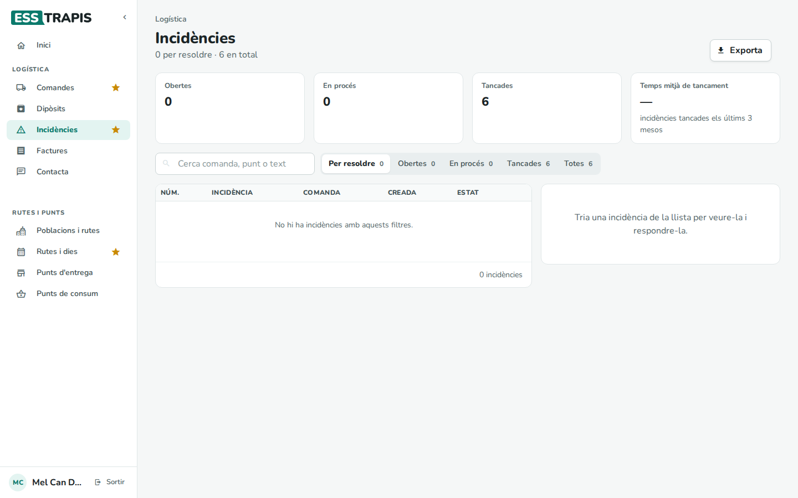

- La pestanya **Per resoldre** (la que s'obre) mostra les obertes i les que estan **En procés**; **Totes**
  mostra també les tancades.
- Clicant una incidència, a la dreta surten les dades i la conversa. A **Resposta** escrius un missatge i
  **Envia**. Cada resposta envia un correu a l'oficina i a tu, menys a qui l'ha escrita: les teves arriben a
  l'oficina; les de l'oficina o de la repartidora, a tu.
- Quan està resolta, **Tanca**. Una incidència tancada es pot llegir, però ja no s'hi pot respondre.

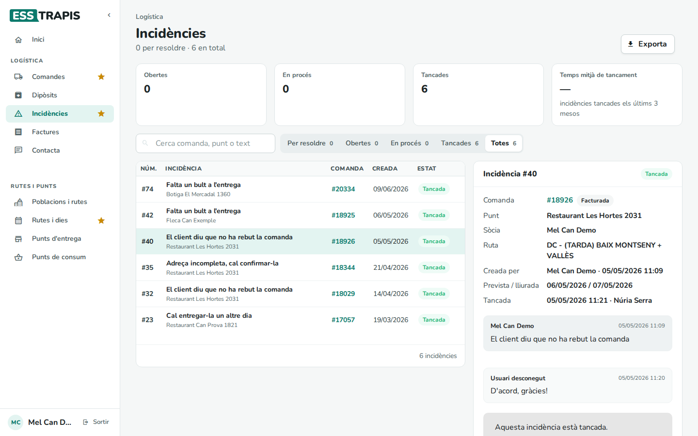

Si n'has creat una per error, la pots eliminar amb la paperera durant les primeres 24 hores, mentre no estigui
tancada.

> A la conversa, les respostes surten com a «Usuari desconegut»: és una limitació de l'aplicació, no vol dir
> que hagi escrit algú altre.

## Les teves factures

A **Logística › Factures** hi ha les factures del transport que t'ha fet la cooperativa. Cada mes, l'oficina
factura les comandes lliurades: una factura per mes.

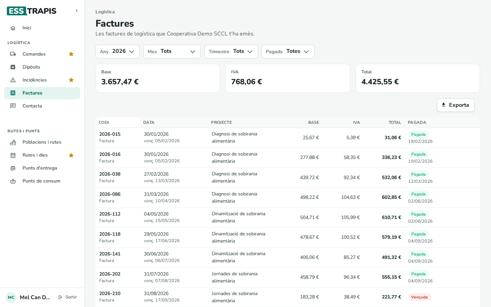

- Filtres: **Any**, **Mes**, **Trimestre** i **Pagada** (**Totes**, **Sí**, **No**). A dalt, la suma de
  **Base**, **IVA** i **Total** del que es veu.
- El **Codi** obre el PDF de la factura, si en té.
- La columna **Projecte** és el projecte on l'oficina ha creat la factura.
- **Pagada**: *Pagada* amb la data, *Pendent de pagar*, *Vençuda* (ha passat el venciment) o *Abonament* (una
  factura en negatiu). Les factures que l'oficina encara revisa (esborranys) no hi surten fins que les emet.
- **Exporta** baixa la llista en un full de càlcul.

Cada línia de la factura és una comanda (data, número i ruta), amb els seus descomptes i el 21 % d'IVA.

## Contactar amb l'oficina

Per a tot el que no és un problema d'una comanda concreta (una població nova, una ruta, un canvi d'última
hora, un dubte), **Logística › Contacta**:

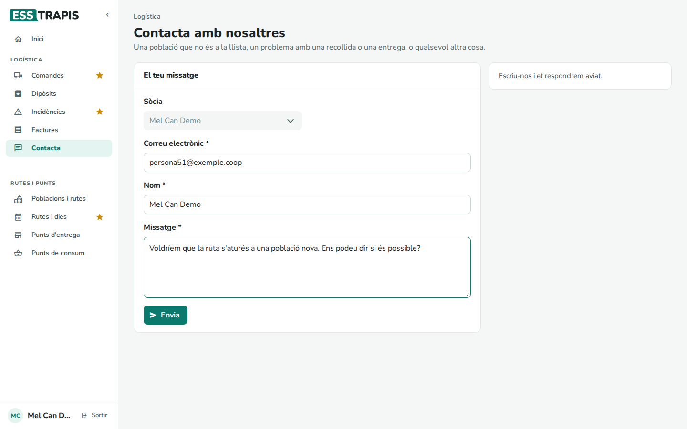

El **Correu electrònic** i el **Nom** ja hi surten (els pots canviar); escriu el **Missatge** i **Envia**.
L'oficina rep el missatge i tu una còpia. La resposta t'arriba per correu: l'aplicació no guarda la conversa.

## Preguntes freqüents

**No surt la ruta que vull.** Només surten les rutes que passen per la població del punt d'entrega. Comprova
la població del punt i, a **Poblacions i rutes**, quines rutes hi passen. Si no n'hi ha cap, escriu a
l'oficina.

**«Error. No hi ha NIF al punt d'entrega»** (o telèfon, adreça, codi postal, població). El punt està
incomplet: **Edita el punt**, completa'l i torna a guardar la comanda.

**«Error. El tram horari ha de ser mínim de 3 hores»** o semblants. L'horari del punt d'entrega no és
correcte: com a mínim un dels dos horaris ha de durar 3 hores.

**«La ruta seleccionada no es fa dimarts»** (o el dia que sigui). La data prevista no és un dia que passi la
ruta: canvia la data o la ruta.

**En guardar surt només «Error».** Sovint és perquè ha passat l'hora límit i la comanda és per a l'endemà.
Canvia la data o la ruta, o parla amb l'oficina.

**No puc canviar una comanda.** Només pots canviar les comandes **Pendents**. Si ja està processada, parla amb
l'oficina.

**He dipositat les caixes però la comanda continua Pendent.** És normal: el dipòsit no canvia l'estat. L'estat
el canvia l'oficina.

**Ahir vaig dipositar una comanda i avui no la trobo a Dipòsits.** **Dipositades avui** només mostra les
d'avui. El dipòsit es veu al seguiment de la comanda.

**Una comanda ha desaparegut de Dipòsits.** Quan l'oficina la marca com a lliurada (o s'anul·la), ja no hi
surt. La trobaràs a **Comandes**.

**L'escàner no llegeix el codi.** El QR ha d'estar sencer, ben il·luminat i dins el quadre. *Format de codi QR
invàlid* vol dir que no és un albarà d'ESSTRAPIS.

**He canviat l'adreça d'un punt i l'albarà diu l'antiga.** Les comandes ja fetes guarden les dades del punt
del moment en què es van fer. Si cal, digues-ho a l'oficina.

**Veig comandes d'altres sòcies?** No. Només veus les teves i, si també reps comandes en un punt teu, les que
hi van.

**Ja he pagat i em continua sortint el missatge de factures pendents.** Surt fins que l'oficina apunta el
pagament. Si fa dies que vas pagar, escriu-los des de **Contacta**.

**On veig la resposta al formulari Contacta?** Al teu correu.

## Vegeu també

Els capítols complets, per si vols més detalls:

- [27. Visió general de la logística](27-logistica-visio-general.md): les peces i el camí d'una comanda.
- [28. Comandes](28-comandes.md): la llista, la fitxa, el preu, l'albarà i la importació.
- [29. Punts d'entrega i de consum](29-punts-entrega-consum.md)
- [30. Poblacions, rutes i dies](30-poblacions-rutes-dies.md)
- [31. Dipòsits, transferències i operacions](31-diposits-transferencies-operacions.md): els dipòsits i el codi
  QR.
- [32. Incidències i contacte](32-incidencies-contacte.md)
- [33. Facturació de la logística](33-facturacio-logistica.md): com es calculen les factures.
- [37. La pàgina d'inici](37-pagina-inici.md)
- [01. Primers passos](01-primers-passos.md): entrar a l'aplicació, recuperar la clau oblidada i el teu compte.
