# 39. Conciliació bancària

> Permís necessari: `projects` (qualsevol persona que vegi la Tresoreria)

**Conciliar** és comprovar que cada moviment del banc correspon a un cobrament o un pagament de l'ESSTRAPIS.
En aquesta pantalla es puja l'extracte del banc i es lliga cada moviment amb una o més línies de la
[22. Tresoreria](22-tresoreria.md):

- les que estan clares es concilien soles;
- per a la resta, la pantalla proposa les línies més probables, i també es poden triar a mà;
- les factures i despeses que encara eren pendents queden **cobrades o pagades amb la data del banc**;
- el saldo final de l'extracte passa a ser el **saldo real** del compte.

És a **Diners › Tresoreria**, a la pestanya **Conciliació**.

## Abans de començar

- Cada compte del banc ha d'estar a **Administració › Taules auxiliars › Comptes bancaris** amb el seu
  **IBAN**. La pantalla reconeix el compte de l'extracte per l'IBAN; si no el troba, no puja res.
- L'extracte es descarrega de la banca en línia en format **Norma 43**. Segons el banc, aquest format es diu
  «Cuaderno 43», «CSB43», «AEB43» o «Norma 43». Normalment és a l'apartat de moviments del compte, a
  l'opció d'exportar o descarregar. No serveixen ni el PDF ni l'Excel.
- Un mateix fitxer pot portar diversos comptes, i es pot pujar un extracte que se solapi amb un d'anterior:
  els moviments que ja hi eren no es dupliquen.

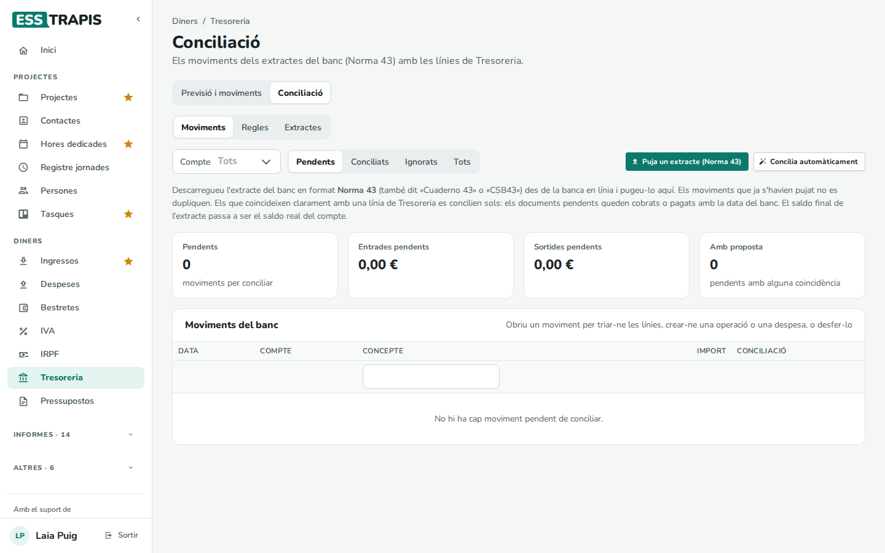

La pestanya té tres apartats: **Moviments** (la feina de cada dia), **Regles** i **Extractes**.

## Pas a pas

### 1. Pujar l'extracte

**Puja un extracte (Norma 43)** i triar el fitxer. En acabar, un avís resumeix què ha passat:

- quants moviments són nous;
- quants s'han conciliat sols, i com: amb línies de Tresoreria, com a traspassos entre comptes o per regles;
- el saldo final de cada compte, que queda anotat com a saldo real.

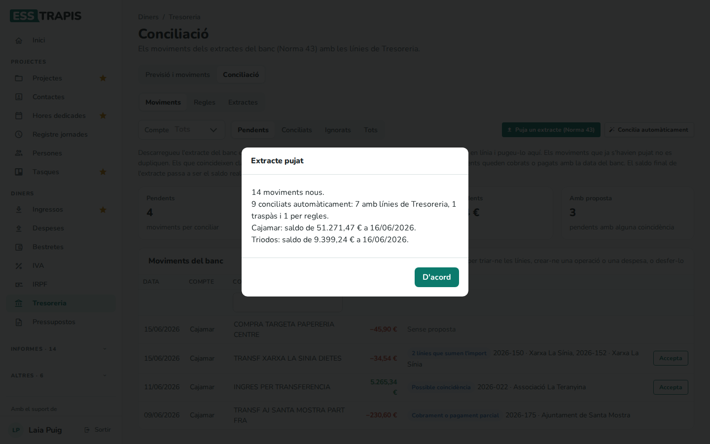

La llista mostra llavors els moviments **Pendents** de conciliar. Les xifres de dalt en diuen quants n'hi ha,
quant sumen les entrades i les sortides pendents, i quants tenen alguna proposta.

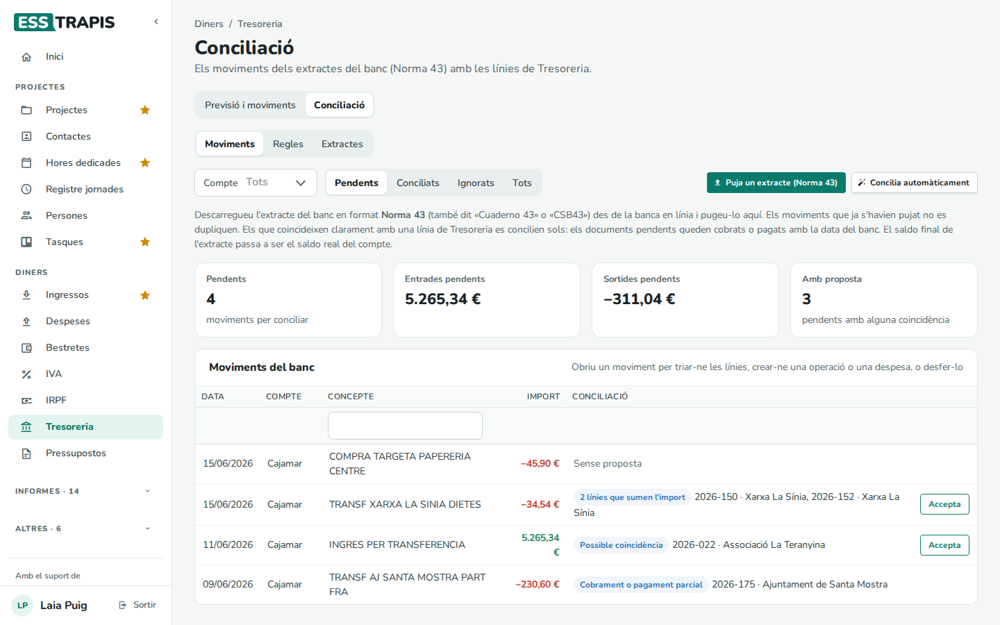

A la columna **Conciliació** de cada moviment pendent hi ha la millor proposta, o «Sense proposta». Si la
proposta és bona, n'hi ha prou de clicar **Accepta**. **Tots** mostra també els conciliats: l'etiqueta en diu
com, i «automàtic» si s'han conciliat sols.

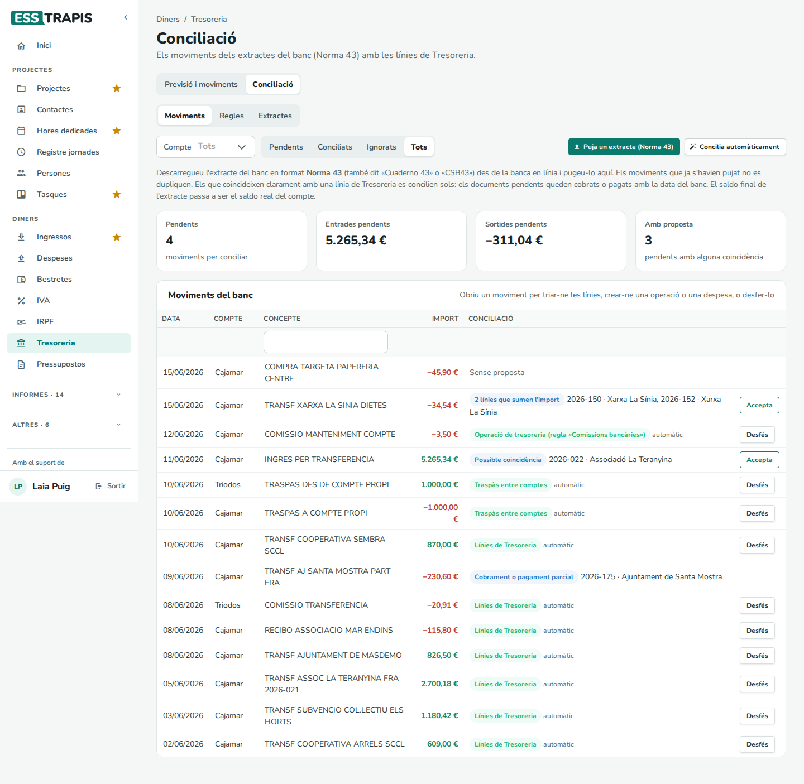

### 2. Resoldre els pendents

Clicar un moviment n'obre el detall, amb tres parts: **Propostes**, **Tria les línies** i **Sense document**.

**Una proposta.** És una línia de Tresoreria amb el mateix import en dates properes. Quan diu «pendent: es
marcarà com a cobrat» (o pagat), el document encara no estava cobrat: en acceptar-la, queda cobrat amb la
data del moviment.

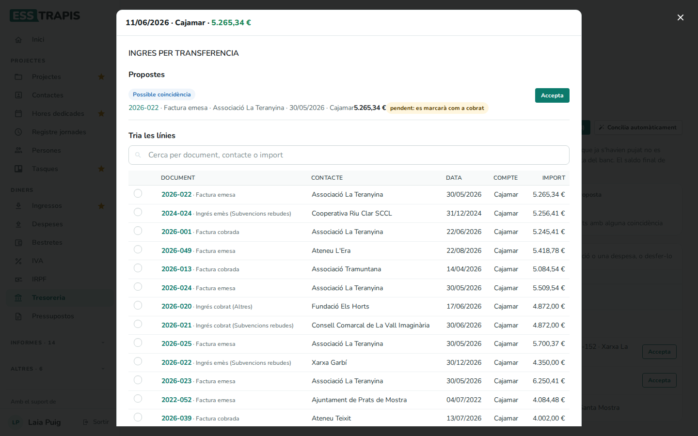

**Un cobrament o pagament parcial.** Si el concepte del banc diu de qui és el moviment (nom, NIF o número
de factura) i l'import és més petit que el que queda pendent d'un document, es proposa com a
**cobrament o pagament parcial**. El document queda pendent de la resta.

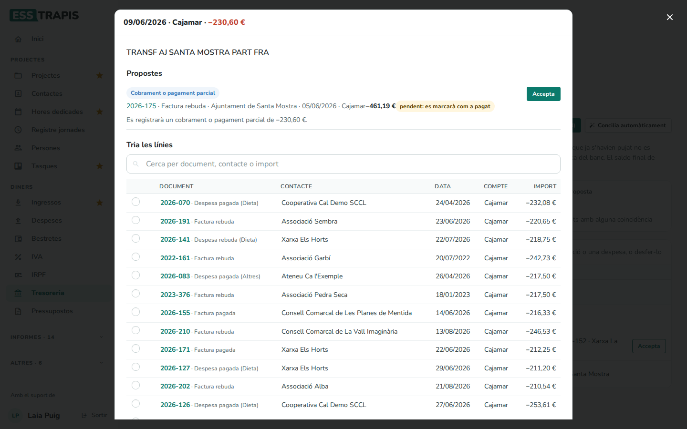

**Diverses línies.** Quan un sol moviment paga o cobra diversos documents, la proposta pot ser «2 línies
que sumen l'import». També es poden triar a mà a **Tria les línies**:

1. Cercar per número de document, contacte o import. Sense cercar, la llista mostra els documents
   pendents i els moviments executats de fins a dos mesos abans o després, començant pels d'import més
   proper.
2. Marcar les línies. En una línia pendent, es pot escriure a la dreta quina part s'ha cobrat o pagat ara.
3. A sota es veu quant sumen les triades i quant falta. Quan quadra, **Concilia amb les línies triades**.

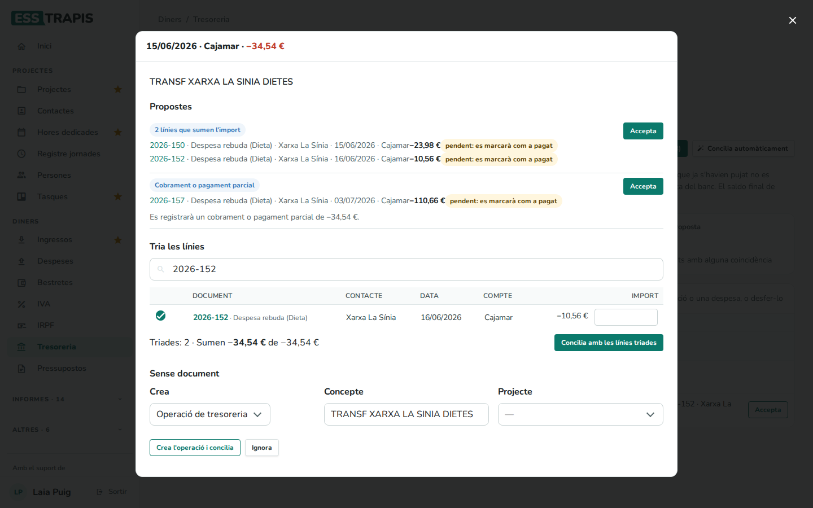

**Sense document.** Per a un moviment que no correspon a cap línia (una comissió, una compra amb targeta…):

- **Operació de tresoreria**: crea un moviment a la Tresoreria amb el concepte i, si es tria, el projecte.
- **Despesa pagada** (només en les sortides): crea una despesa ja pagada, amb la **Proveïdora**, el
  **Projecte** i el **Tipus de despesa**. Es numera amb la sèrie que es diu com l'any del moviment (cal
  que existeixi) i no porta IVA: si cal, després es completa a [19. Factures rebudes](19-factures-rebudes.md).
- **És un traspàs entre comptes**: quan surt el mateix import d'un compte propi i entra a un altre.
- **Ignora**: el moviment no s'ha de conciliar.

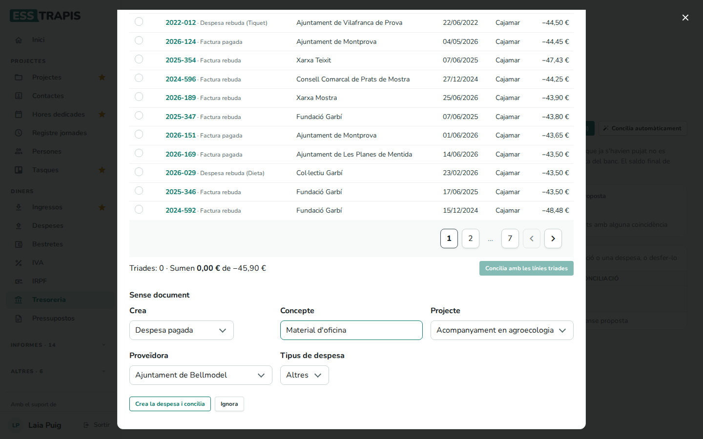

### 3. Comprovar o desfer una conciliació

Obrint un moviment conciliat es veuen les línies amb què s'ha lligat, amb l'enllaç a cada document.
**Desfés la conciliació** ho torna tot enrere:

- treu les validacions;
- els documents que s'havien marcat com a cobrats o pagats tornen a pendents;
- s'esborren les operacions i les despeses que s'havien creat;
- el moviment torna a **Pendents**.

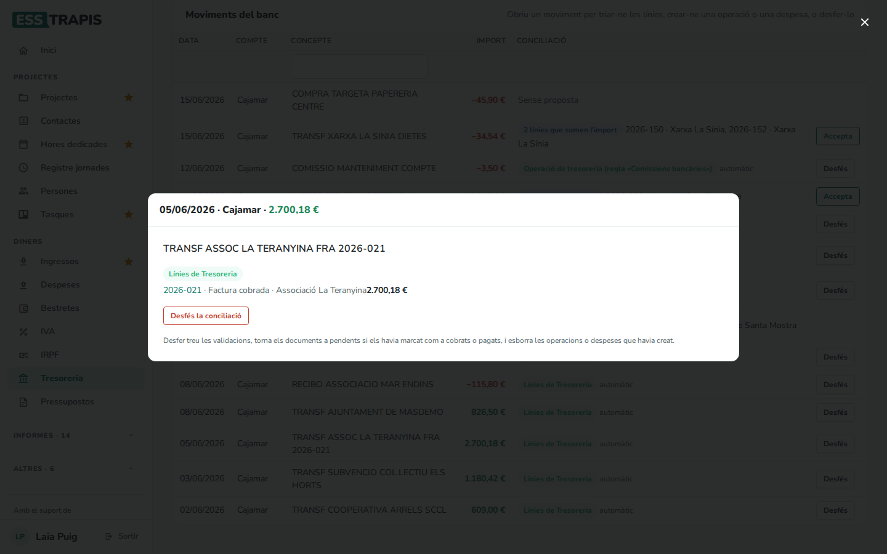

Treure el check d'una línia a la [22. Tresoreria](22-tresoreria.md) també torna el moviment del banc a
pendents.

### 4. Les regles

Les **regles** diuen què fer amb els moviments que es repeteixen i no tenen document: comissions, quotes,
rebuts de la targeta… S'apliquen en pujar un extracte i amb **Concilia automàticament**, però només quan el
moviment no coincideix amb cap línia de Tresoreria.

A l'apartat **Regles**, **Afegeix una regla**:

| Camp | Què vol dir |
|---|---|
| **Nom** | Com es diu la regla. Surt a l'etiqueta dels moviments que concilia. |
| **Si el concepte conté** | Un tros del concepte del banc, sense distingir majúscules ni accents (`comissió` també troba «COMISSIO MANTENIMENT»). |
| **Moviments** | **Entrades i sortides**, **Només entrades** o **Només sortides**. |
| **Compte** | Un compte bancari, o **Tots**. |
| **Acció** | **Operació de tresoreria**, **Despesa pagada** o **Ignorar**. |
| **Projecte** | El projecte de l'operació o la despesa. Obligatori per a una despesa. |
| **Proveïdora**, **Tipus de despesa** | Només per a **Despesa pagada**. La proveïdora és obligatòria. |
| **Activa** | Una regla desactivada no s'aplica. |

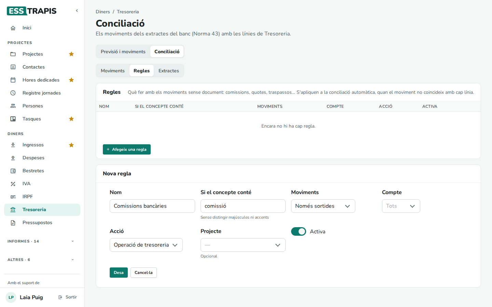

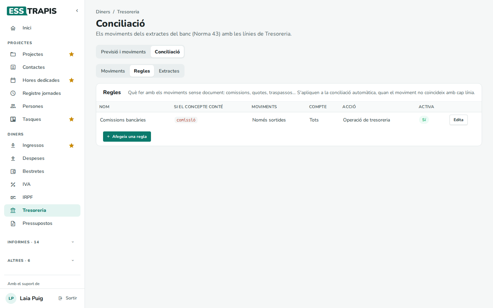

### 5. Els extractes pujats

L'apartat **Extractes** llista els últims 20 fitxers pujats, un per compte. Per a cadascun mostra quan es
va pujar, el període, quants moviments eren nous, quants ja s'havien pujat i el saldo final.

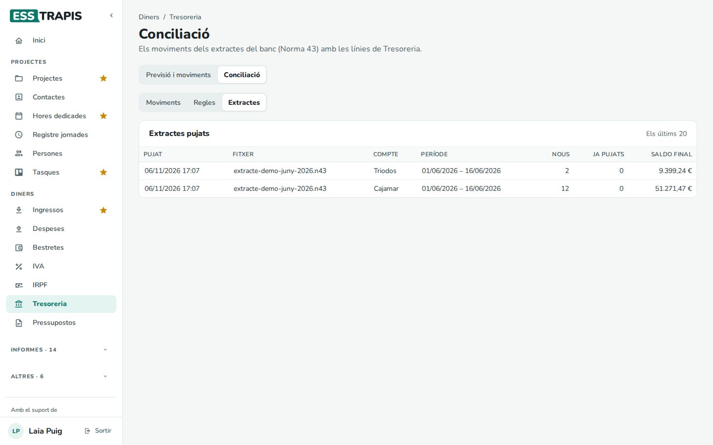

## Com es concilia sol

Un moviment es concilia sol amb una línia de Tresoreria quan:

1. és **l'única** línia amb **el mateix import**, al mateix compte bancari;
2. **i**, a més, les dates són a 3 dies o menys, o el concepte del banc diu el número del document, el NIF o el
   nom del contacte;
3. **i** cap altre moviment del mateix extracte no vol la mateixa línia.

Si no es compleix alguna de les tres condicions, el moviment queda pendent amb una proposta.

**Les dates.** Les propostes busquen dates properes:

- per als moviments ja executats a Tresoreria, uns 10 dies abans o després;
- per als documents pendents, un marge més ampli, perquè un cobrament sovint arriba més tard del previst.

**Els traspassos.** Dos moviments de comptes propis diferents, un de sortida i un d'entrada, amb el mateix
import i a 3 dies o menys, es concilien sols com a **traspàs entre comptes**.

**El saldo real.** La Tresoreria compta un saldo real anotat com el saldo a l'inici del dia. Per això el saldo
final d'un extracte que acaba el 16 de juny s'anota el 17 de juny.

## Preguntes freqüents

**Diu que el compte de l'extracte no és de l'entitat.** Falta l'IBAN del compte, o no és correcte, a
**Administració › Taules auxiliars › Comptes bancaris**.

**He pujat dues vegades el mateix extracte.** No passa res: els moviments que ja hi eren surten a «Ja pujats»
i no es tornen a crear.

**Una proposta no és correcta.** No l'accepteu: obriu el moviment, cerqueu la línia bona a **Tria les
línies** i concilieu-la. Si s'havia conciliat sola malament, **Desfés la conciliació** i torneu-la a fer.

**Una nòmina pendent no surt com a candidata.** Les nòmines, l'IRPF i la Seguretat Social que encara no
estan marcats com a pagats no tenen cap document per marcar. Primer cal marcar-los com a pagats a
[20. Bestretes](20-bestretes.md); llavors ja es poden conciliar.

**Puc fer el mateix sense extracte?** Sí: a la [22. Tresoreria](22-tresoreria.md), el check d'una línia
pendent marca el document com a cobrat o pagat.

## Vegeu també

- [22. Tresoreria](22-tresoreria.md)
- [17. Factures emeses](17-factures-emeses.md) · [19. Factures rebudes](19-factures-rebudes.md)
- [35. Taules auxiliars](35-taules-auxiliars.md) (comptes bancaris)
