# 41. Posar en marxa FACe pas a pas

> Permís necessari: `admin`

Aquest capítol explica, de cap a peus, com es prepara una entitat per enviar factures a les administracions
públiques per **FACe** des d'ESSTRAPIS: des de l'alta a FACe fins a la primera factura real. El funcionament del
dia a dia (la cua, els estats de cada factura) és a [18. Verifactu i FACe](18-verifactu-face.md).

ESSTRAPIS envia les factures a FACe pel seu servei web, signades amb el **certificat digital de l'entitat**. Perquè
FACe les accepti, l'entitat s'ha de donar d'alta a FACe com a **integradora**: és el nom que FACe dona a qui li
envia factures des d'un programa, en lloc de pujar-les a mà al portal web.

FACe té dos entorns, i tot es fa primer en el de proves:

| | Entorn de proves | Entorn real |
|---|---|---|
| Portal d'integradors | `se-integradores-face.redsara.es` | `integradores.face.gob.es` |
| Portal de proveïdors (consultar factures) | `se-proveedores-face.redsara.es` | `proveedores.face.gob.es` |
| A ESSTRAPIS, mode FACe | **Test** | **Real** |

## Abans de començar

- El **certificat digital de l'entitat** (fitxer `.p12` o `.pfx`) i la seva contrasenya. És el mateix que es fa servir
  per a Verifactu, i serveix el de representant d'entitat de la FNMT.
- Una **persona autoritzada** amb **certificat de persona física** (o Cl@ve), que signarà la declaració de conformitat i
  entrarà al portal d'integradors.
- Accés d'administració a ESSTRAPIS.

Els passos:

1. Pujar el certificat a ESSTRAPIS i baixar-ne la part pública.
2. Demanar a FACe l'alta com a integradora.
3. Entrar al portal d'integradors.
4. Donar d'alta el certificat i una plataforma, a cada entorn.
5. Posar ESSTRAPIS en mode **Test**.
6. Preparar les administracions (codis DIR3).
7. Enviar una factura de prova.
8. Passar a real.

## 1. Pujar el certificat a ESSTRAPIS i baixar-ne la part pública

**Administració › Configuració general**, apartat **Factura electrònica (FACe)**. A la targeta **Certificat de FACe**,
**Puja el certificat**: trieu el fitxer `.p12` o `.pfx`, escriviu-ne la contrasenya i **Desa el certificat**.
ESSTRAPIS comprova que la contrasenya l'obre i en mostra el **Titular**, el **NIF**, qui l'ha emès i fins quan és vàlid.

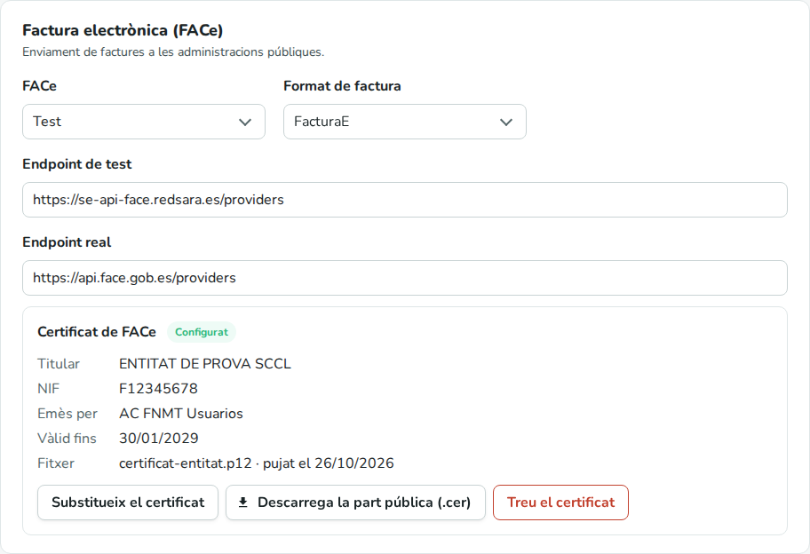

Un cop pujat, **Descarrega la part pública (.cer)** baixa un fitxer `certificat-face-<NIF>.cer`. És la **part pública**
del certificat (no conté la clau privada ni cap contrasenya), i és el que demana FACe per saber qui li envia les
factures. Guardeu-lo: el fareu servir als passos 2 i 4.

> Sense ESSTRAPIS també es pot obtenir. A Windows: obrir el certificat › **Detalls** › **Copia en un fitxer** ›
> «X.509 codificat en base 64 (.CER)». Amb OpenSSL:
> `openssl pkcs12 -in certificat.p12 -clcerts -nokeys -out certificat.cer` (amb els `.p12` antics de la FNMT cal
> afegir `-legacy`).

De moment deixeu el mode **FACe** a **No**.

## 2. Demanar l'alta com a integradora

L'alta es demana una sola vegada, amb un tiquet al **Portal de Soporte** de l'Administració Digital, i serveix per
als dos entorns.

1. Entreu a `https://servicios.administraciondigital.gob.es` i trieu **Acceso sin Autenticar**. *No* us registreu a
   Autentica: és per al personal de les administracions.

   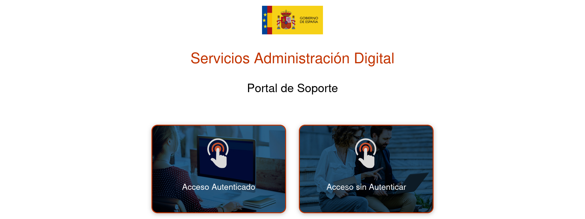

2. **Nuevo Ticket**.

   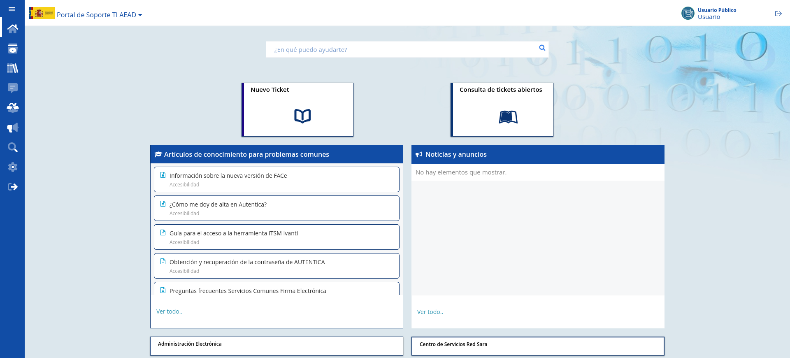

3. Cerqueu **FACe** i trieu **Altas como integrador en FACe**. *No* «Altas como proveedor en FACe»: per enviar factures
   des d'ESSTRAPIS només cal l'alta d'integradora.

   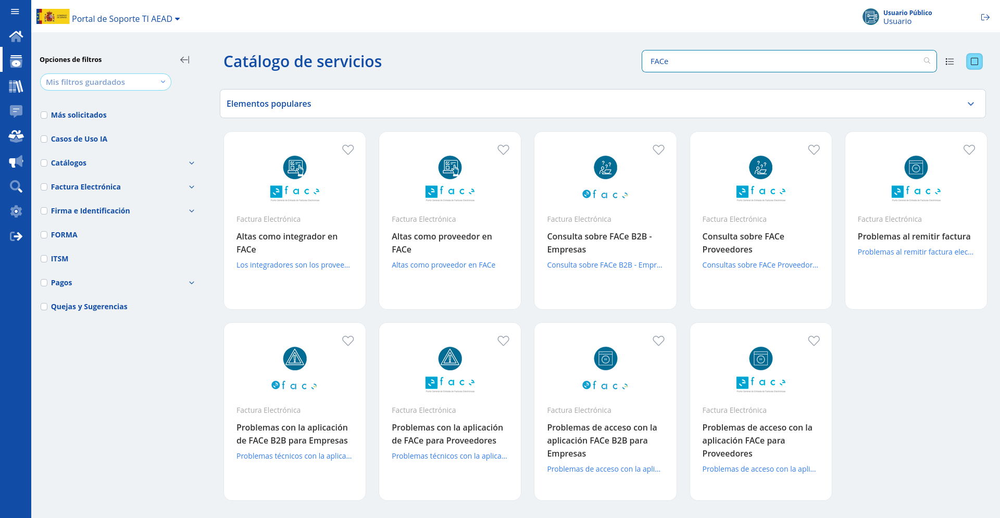

4. Ompliu el formulari:

   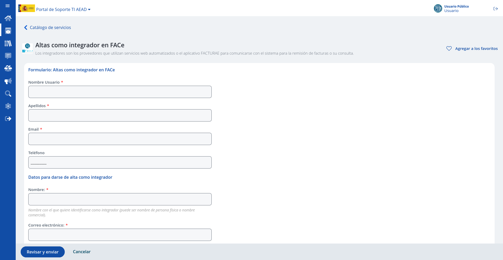

   | Camp | Què hi va |
   |---|---|
   | Nombre Usuario, Apellidos, Email, Teléfono | Qui fa la petició |
   | Datos para darse de alta como integrador › Nombre | El nom de l'entitat (és el nom amb què FACe us identificarà) |
   | Correo electrónico | El correu de l'entitat on voleu rebre els avisos de FACe |
   | PEM del certificado | El fitxer `.cer` del pas 1 (el formulari només admet `.cer`) |
   | Datos de persona autorizada | Nom, NIF i correu de la persona autoritzada. Han de coincidir amb la signatura de la declaració |
   | Declaración de conformidad | La declaració signada electrònicament per la persona autoritzada (vegeu més avall) |
   | Comentario | Per exemple: «Alta como integrador para enviar a FACe las facturas de la entidad desde el programa de facturación ESSTRAPIS.» |

   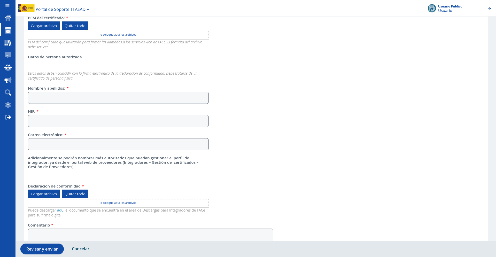

   La **declaració de conformitat** es descarrega de l'enllaç *aquí* del mateix formulari. Cal omplir-la i signar-la
   electrònicament (per exemple amb AutoFirma) amb el certificat de persona física de la persona autoritzada.

   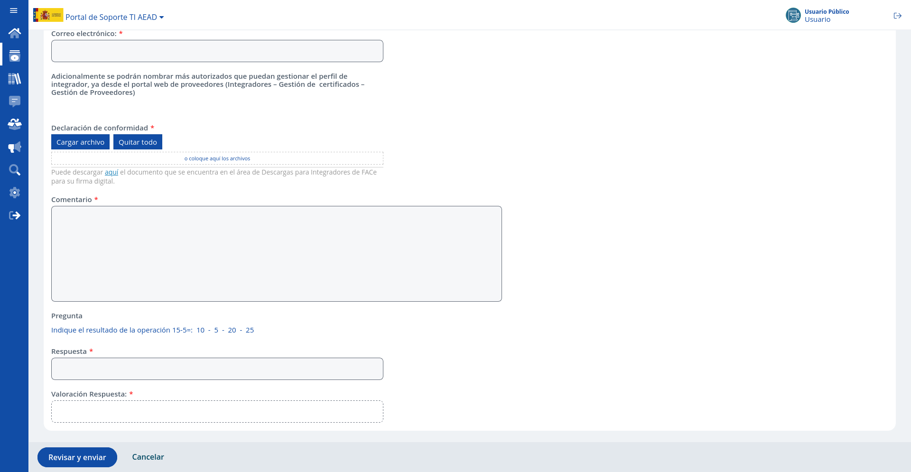

5. Responeu la pregunta de seguretat i **Revisar y enviar**.

FACe respon per correu quan l'alta està feta.

## 3. Entrar al portal d'integradors

Hi ha un portal per entorn. Al de proves, una pestanya vermella al marge esquerre ho recorda: **Entorno de Pruebas: SE**.

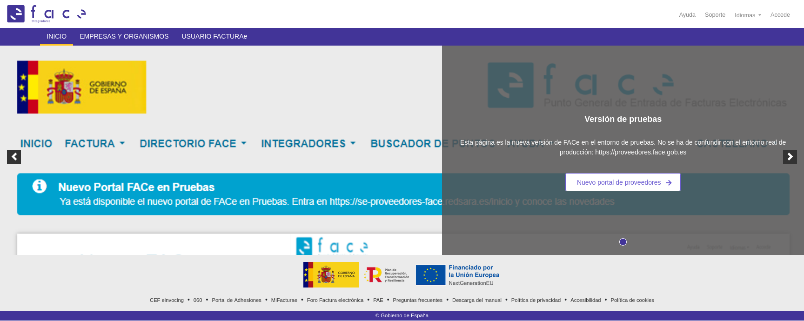

**Accede** i després **Cl@ve**:

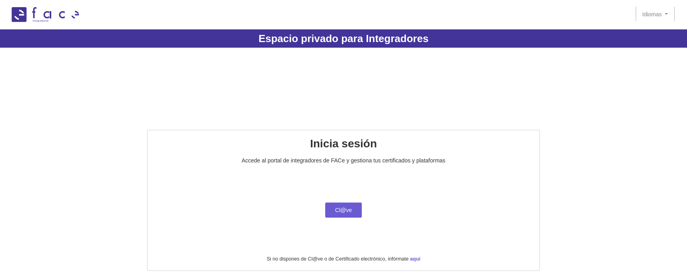

A Cl@ve, **eIdentifier** per entrar amb el certificat de la persona autoritzada (o Cl@ve Mòbil).

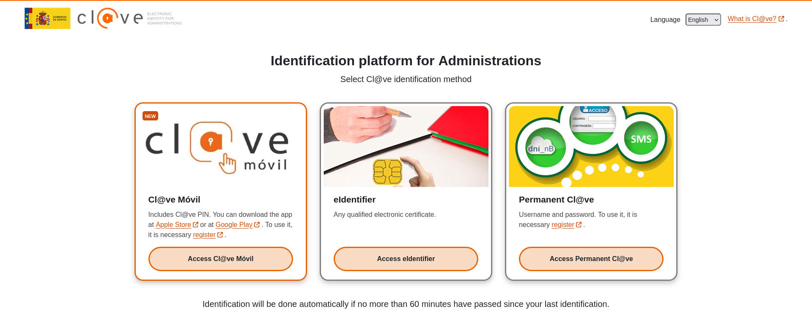

A dins, el menú de l'esquerra té **Certificados**, **Plataforma** i **Autorizados**.

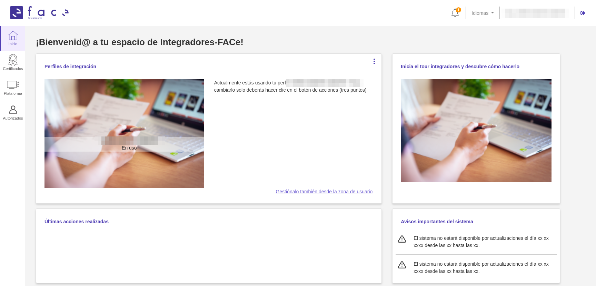

## 4. Donar d'alta el certificat i la plataforma

Cal fer-ho **a cada portal**: primer al de proves i, quan tot funcioni, al real (pas 8). L'ordre importa: primer el
certificat, després la plataforma.

### El certificat

**Certificados › Nuevo certificado**: un **Alias del certificado** (per exemple «ESSTRAPIS»), **Adjuntar fichero** amb
el `.cer` del pas 1 i **Siguiente**.

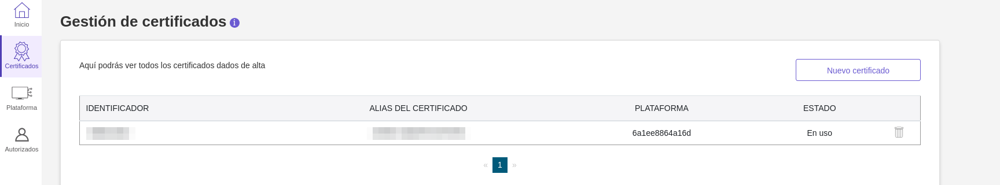

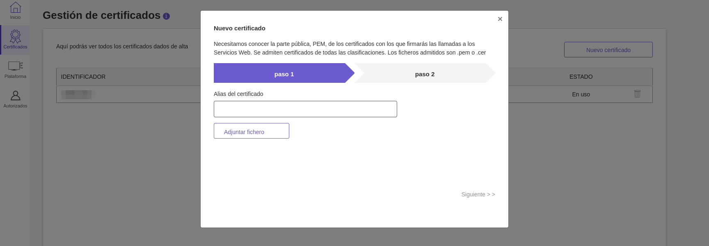

El pas 2 mostra l'emissor, el número de sèrie i les dates del certificat. **Guardar**.

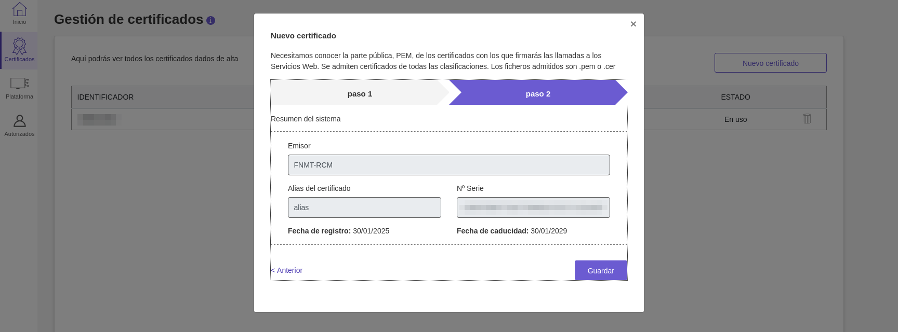

> **A l'entorn de proves** el botó **Siguiente** de vegades no respon, o surt «Certificado erróneo», amb un certificat
> que al portal real funciona: és un error del portal de proves. Obriu un altre tiquet al mateix servei del pas 2
> (**Altas como integrador en FACe**), expliqueu-ho i adjunteu-hi el `.cer`. FACe us dona d'alta el certificat i
> després només cal crear la plataforma.

### La plataforma

**Plataforma › Nueva plataforma**.

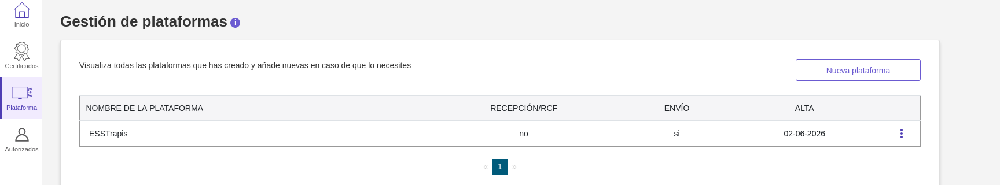

Un **Nombre plataforma** (per exemple «ESSTRAPIS»), marqueu **només Servicio de envío** (el de recepció és per als
organismes públics) i **Siguiente**.

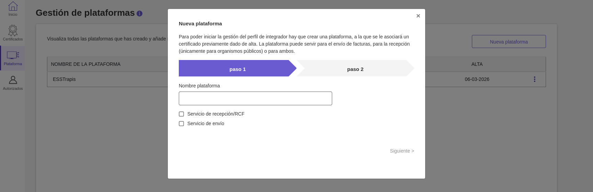

Trieu el certificat que acabeu de donar d'alta i **Agregar**.

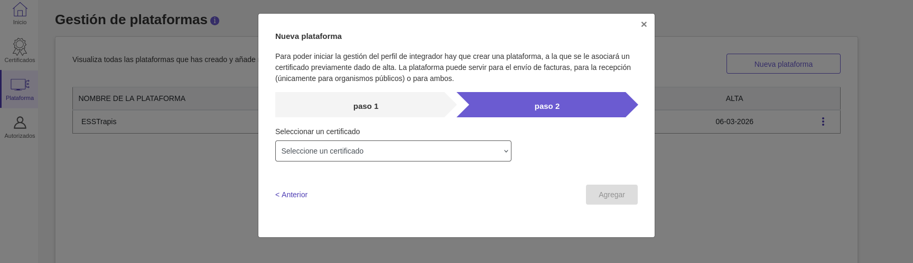

Al detall de la plataforma (els tres punts de la fila) es veu el certificat associat, en estat **Activo**. L'apartat
**Administraciones** es pot deixar buit.

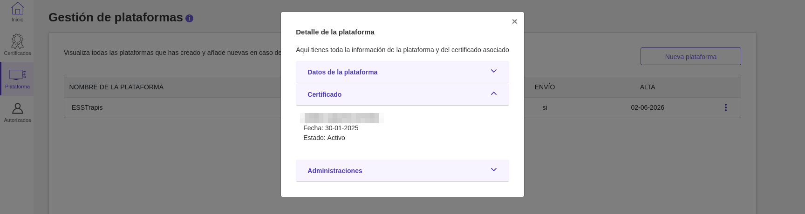

### Altres persones autoritzades (opcional)

**Autorizados › Asociar usuario autorizado**, amb el **NIF** d'una altra persona que hagi de poder gestionar el perfil
(per exemple, per renovar el certificat). Ha d'estar registrada a FACe.

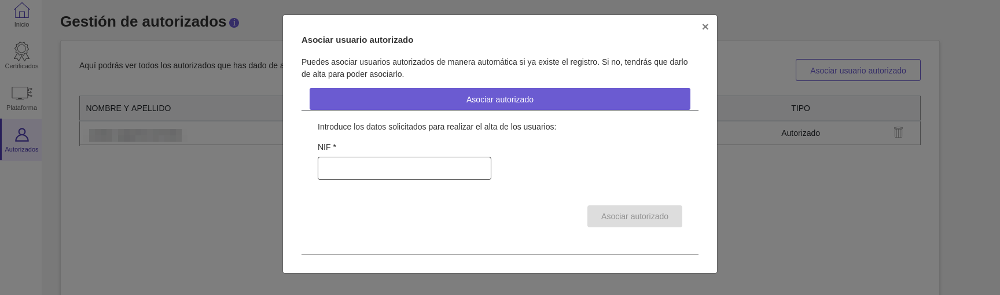

## 5. Posar ESSTRAPIS en mode Test

**Administració › Configuració general › Factura electrònica (FACe)** (la pantalla del pas 1):

- **FACe**: **Test**.
- **Format de factura**: **FacturaE** (el format propi de FACe), tret que una administració demani UBL.
- **Endpoint de test** i **Endpoint real**: les adreces del servei de FACe. Ja vénen posades; no cal tocar-les.
- **Guardar**.

## 6. Preparar les administracions

A cada administració a qui facturareu, a la seva fitxa de **Contactes**, bloc **Facturació electrònica**: **Activar
FACe** i omplir els tres codis **DIR3** (oficina comptable, òrgan gestor i unitat tramitadora). Vegeu
[11. Contactes](11-contactes.md#administracions-públiques-i-face).

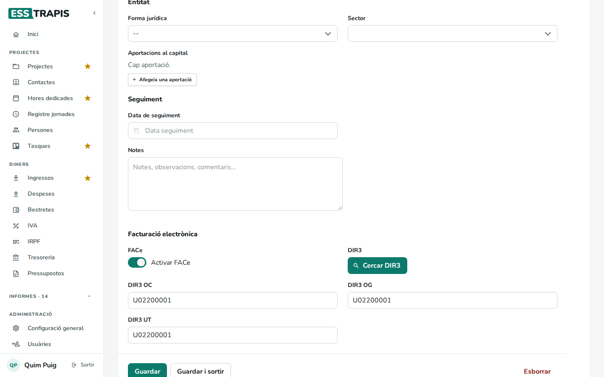

**Cercar DIR3** busca els codis a partir del NIF de l'administració; en triar-ne un s'omplen els tres camps.

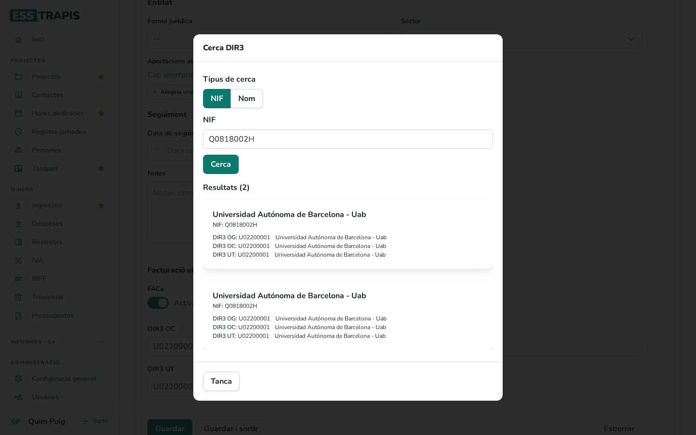

Els codis també es poden comprovar al **Buscador de relaciones** del portal de proveïdors de FACe, que cerca per codi
DIR3. Molt sovint l'administració mateixa us els donarà amb la comanda o el contracte.

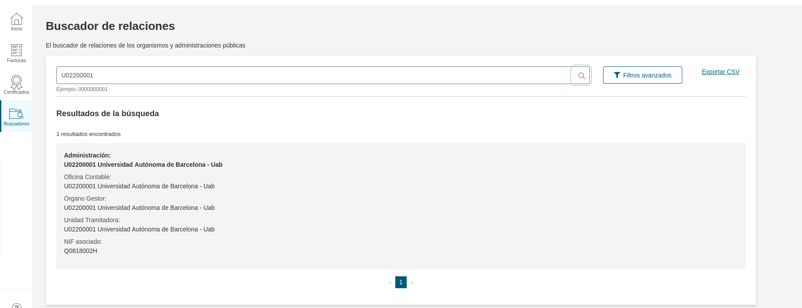

## 7. Enviar una factura de prova

> **Feu la prova en una còpia de l'entitat.** A ESSTRAPIS, una factura de prova és una factura de veritat: gasta un
> número de la sèrie i, si Verifactu està activat, s'envia a l'AEAT. Per això, si l'entitat ja factura amb ESSTRAPIS,
> demaneu a qui manté ESSTRAPIS una **còpia de proves** de l'entitat (amb el certificat i els contactes) i feu-hi els
> passos 5, 6 i 7. A l'entitat de veritat no canvieu res fins al pas 8. Una entitat que encara no ha emès cap factura
> pot fer la prova directament.

Emeteu una factura a una administració preparada al pas 6. En emetre-la, l'avís de confirmació recorda que anirà per
FACe i mostra els codis DIR3. ESSTRAPIS l'envia sola a l'entorn de proves de FACe.

A **Administració › Verifactu i FACe › Cua FACe** surt la factura amb el **Número registre** que li ha donat FACe i
l'estat **Registrada**.

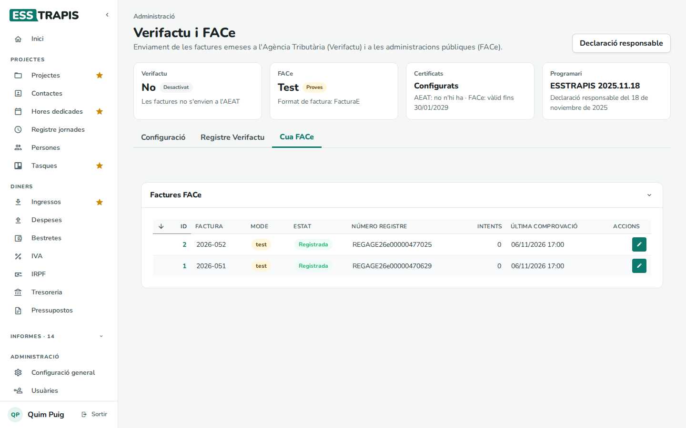

I a la mateixa factura, al bloc **Verifactu i FACe**:

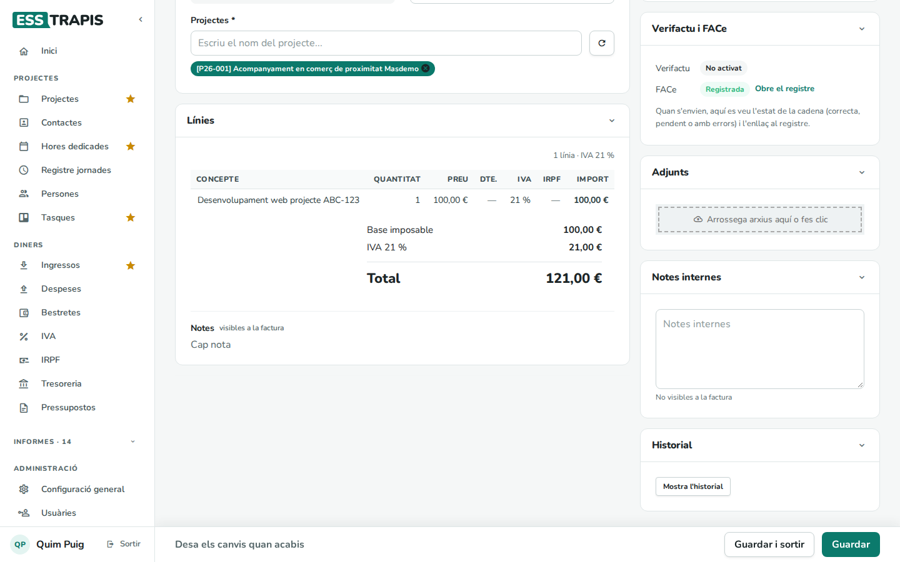

Es pot comprovar també al portal de proveïdors de proves (`se-proveedores-face.redsara.es`, **Facturas**), entrant amb
Cl@ve:

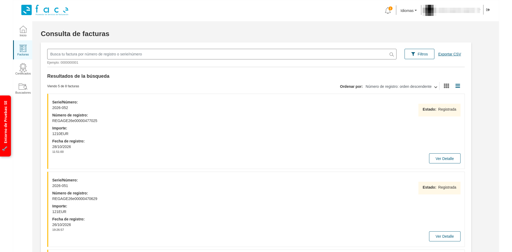

## 8. Passar a real

1. Al **portal d'integradors real** (`integradores.face.gob.es`), repetiu el pas 4: el certificat i la plataforma.
2. A l'entitat de veritat d'ESSTRAPIS (no a la còpia de proves): prepareu les administracions com al pas 6 i, a
   **Configuració general**, **FACe**: **Real** i **Guardar**.
3. Les factures que s'emetin a partir d'ara a administracions amb FACe van a l'entorn real. Comproveu la primera a la
   **Cua FACe** i a `proveedores.face.gob.es`.

## Preguntes freqüents

**Al portal de proves surt «Certificado erróneo» o el botó «Siguiente» no fa res.** És un error del portal de proves:
vegeu l'avís del pas 4.

**FACe rebutja una factura perquè el número ja existeix.** FACe no admet dues factures de la mateixa entitat amb el
mateix número, tampoc a l'entorn de proves.

**El certificat caduca.** ESSTRAPIS ho avisa 30 dies abans a la targeta del certificat. Amb el certificat nou, cal fer
**les dues coses**: pujar-lo a ESSTRAPIS (pas 1) i donar-lo d'alta al portal d'integradors i associar-lo a la
plataforma (pas 4). Si només es fa a ESSTRAPIS, FACe no el reconeixerà.

**Una factura a una administració no s'ha enviat per FACe.** Comproveu que el mode FACe no és **No**, que la fitxa del
contacte té **Activar FACe** i els tres codis DIR3, i que la targeta del certificat no té errors.

**Cal donar-se d'alta també com a proveïdor a FACe?** No per enviar factures des d'ESSTRAPIS. Només cal l'alta
d'integradora.

## Vegeu també

- [18. Verifactu i FACe](18-verifactu-face.md)
- [11. Contactes](11-contactes.md)
- [17. Factures emeses](17-factures-emeses.md)
- [34. Configuració general](34-configuracio-general.md)
